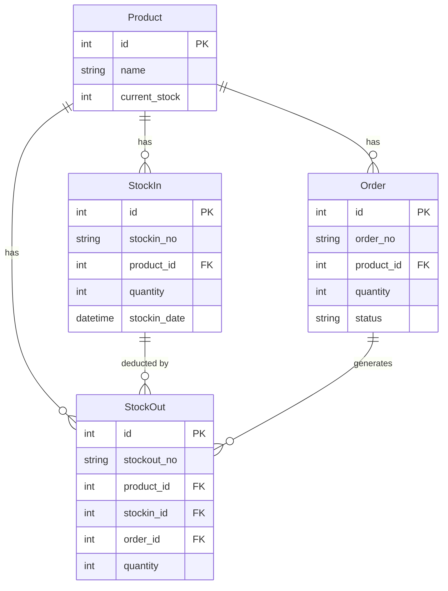

# 备货抵扣实时同步修复 - 技术设计文档

## 概述
- **设计目标**: 修复订单批量提交API缺少抵扣备货逻辑的问题，确保订单创建并抵扣备货后，备货管理模块能够实时显示正确的剩余数量。
- **技术栈**: Flask + SQLAlchemy + Bootstrap + Jinja2 + JavaScript
- **相关文档**: [需求规格文档](./spec.md)

## 问题根因分析

### 发现的核心问题

经过代码分析和测试验证，发现问题的根本原因：

**问题位置**: `/api/batch-submit-orders` API (app.py 第749-845行)

**问题描述**: 
- 批量提交订单API (`batch_submit_orders`) 只创建了Order记录和InventoryLog记录
- **缺少抵扣备货的处理逻辑**
- 未检查 `deductStock` 标志
- 未创建 StockOut 记录
- 未更新订单状态

**对比分析**:
| 功能 | 单个订单提交 (`/orders` POST) | 批量订单提交 (`/api/batch-submit-orders`) |
|------|-------------------------------|-------------------------------------------|
| 创建Order记录 | ✓ | ✓ |
| 更新Product库存 | ✓ | ✓ |
| 创建InventoryLog | ✓ | ✓ |
| **检查抵扣标志** | ✓ | ✗ **缺失** |
| **创建StockOut记录** | ✓ | ✗ **缺失** |
| **执行抵扣逻辑** | ✓ | ✗ **缺失** |
| **更新订单状态** | ✓ | ✗ **缺失** |

### 数据流分析

```mermaid
graph TD
    A[用户创建订单] --> B{选择抵扣备货?}
    B -->|是| C[设置deductStock=on]
    B -->|否| D[仅创建订单]
    C --> E[提交表单]
    E --> F{提交方式}
    F -->|单个提交| G[/orders POST]
    F -->|批量提交| H[/api/batch-submit-orders]
    G --> I[执行抵扣逻辑]
    H --> J[❌ 缺少抵扣逻辑]
    I --> K[创建StockOut记录]
    K --> L[更新订单状态]
    L --> M[备货管理显示正确]
    J --> N[❌ 备货数量未更新]
```

## 架构设计

### 修复方案

**方案选择**: 在 `batch_submit_orders` API中添加完整的抵扣备货处理逻辑

**理由**:
1. 保持与单个订单提交逻辑的一致性
2. 复用现有的抵扣逻辑代码
3. 最小化修改范围，降低风险
4. 不需要修改数据库结构

### 模块设计

#### 1. 抵扣逻辑提取

将订单创建中的抵扣逻辑提取为独立函数，便于复用：

```python
def process_order_deduction(order, product_id, quantity, deduct_stock, deduct_stockins_data=None):
    """
    处理订单抵扣备货逻辑
    
    参数:
        order: Order对象
        product_id: 产品ID
        quantity: 订单数量
        deduct_stock: 是否抵扣备货 (bool)
        deduct_stockins_data: 自定义抵扣数据 (可选)
    
    返回:
        total_deducted: 实际抵扣数量
    """
    # 抵扣处理逻辑
    pass
```

#### 2. API修改

修改 `batch_submit_orders` API，添加抵扣处理：

```python
@app.route('/api/batch-submit-orders', methods=['POST'])
def batch_submit_orders():
    for order_data in orders_data:
        # ... 创建订单 ...
        
        # 添加抵扣处理
        deduct_stock = order_data.get('deductStock') == 'on'
        deductible_quantity = order_data.get('deductibleQuantity', 0)
        
        if deduct_stock and deductible_quantity > 0:
            # 执行抵扣逻辑
            process_order_deduction(order, product_id, quantity, 
                                   deduct_stock, deductible_quantity)
```

## 详细设计

### 1. 抵扣处理函数设计

```python
def process_order_deduction(order, product_id, order_quantity, 
                           deduct_stock, custom_deduct_quantity=None):
    """
    处理订单抵扣备货的核心逻辑
    
    Args:
        order: Order实例
        product_id: int, 产品ID
        order_quantity: int, 订单数量
        deduct_stock: bool, 是否执行抵扣
        custom_deduct_quantity: int, 自定义抵扣数量(可选)
    
    Returns:
        int: 实际抵扣的总数量
    
    Raises:
        ValueError: 当参数无效时
    """
    if not deduct_stock:
        return 0
    
    # 查询可用备货(按时间升序，FIFO原则)
    stockins = StockIn.query.filter_by(product_id=product_id)\
        .order_by(StockIn.stockin_date.asc(), StockIn.id.asc()).all()
    
    # 计算总可用数量
    total_available = sum(s.quantity - sum(so.quantity for so in s.stockouts) 
                         for s in stockins)
    
    # 确定实际抵扣数量
    if custom_deduct_quantity and custom_deduct_quantity > 0:
        remaining_to_deduct = min(custom_deduct_quantity, 
                                 order_quantity, 
                                 total_available)
    else:
        remaining_to_deduct = min(order_quantity, total_available)
    
    total_deducted = 0
    
    # 按FIFO原则执行抵扣
    for stockin in stockins:
        if remaining_to_deduct <= 0:
            break
        
        # 计算该备货记录的可用数量
        stockin_used = sum(so.quantity for so in stockin.stockouts)
        stockin_available = stockin.quantity - stockin_used
        
        if stockin_available <= 0:
            continue
        
        # 计算本次抵扣数量
        deduct_amount = min(remaining_to_deduct, stockin_available)
        
        # 创建StockOut记录
        stockout = StockOut(
            stockout_no=generate_stockout_number(),
            stockout_date=datetime.now(),
            product_id=stockin.product_id,
            quantity=deduct_amount,
            order_id=order.id,
            stockin_id=stockin.id,
            note=f'订单自动抵扣：{order.order_no}'
        )
        db.session.add(stockout)
        
        # 更新产品库存
        stockin.product.current_stock -= deduct_amount
        
        # 记录库存日志
        log = InventoryLog(
            product_id=stockin.product_id,
            change_type='订单抵扣',
            change_quantity=-deduct_amount,
            related_id=stockout.stockout_no,
            note=f'订单自动抵扣：{stockin.stockin_no}'
        )
        db.session.add(log)
        
        total_deducted += deduct_amount
        remaining_to_deduct -= deduct_amount
    
    # 更新订单状态
    if total_deducted >= order_quantity:
        order.status = '已备货'
    elif total_deducted > 0:
        order.status = '部分备货'
    else:
        order.status = '待备货'
    
    return total_deducted
```

### 2. 批量提交API修改

```python
@app.route('/api/batch-submit-orders', methods=['POST'])
@permission_required('order_manage')
def batch_submit_orders():
    """批量提交订单API"""
    try:
        data = request.get_json()
        orders_data = data.get('orders', [])
        
        success_count = 0
        failed_orders = []
        
        for order_data in orders_data:
            try:
                # ... 现有的订单创建逻辑 ...
                
                # 创建订单
                order = Order(...)
                db.session.add(order)
                db.session.flush()  # 获取order.id
                
                # 订单增加库存
                product.current_stock += quantity
                
                # === 新增：处理抵扣备货 ===
                deduct_stock = order_data.get('deductStock') == 'on'
                deductible_quantity = order_data.get('deductibleQuantity', 0)
                
                if deduct_stock:
                    total_deducted = process_order_deduction(
                        order=order,
                        product_id=product_id,
                        order_quantity=quantity,
                        deduct_stock=True,
                        custom_deduct_quantity=deductible_quantity
                    )
                else:
                    order.status = '待备货'
                # === 抵扣处理结束 ===
                
                # 创建订单日志
                log_order = InventoryLog(...)
                db.session.add(log_order)
                
                success_count += 1
                
            except Exception as e:
                failed_orders.append({'order': order_data, 'error': str(e)})
                continue
        
        db.session.commit()
        
        return jsonify({
            'success': True,
            'success_count': success_count,
            'failed_count': len(failed_orders),
            'failed_orders': failed_orders
        })
        
    except Exception as e:
        db.session.rollback()
        return jsonify({'success': False, 'error': str(e)})
```

### 3. 辅助函数

```python
def generate_stockout_number():
    """生成出货编号"""
    date_prefix = datetime.now().strftime('%Y-%m-%d')
    today_stockouts = StockOut.query.filter(
        StockOut.stockout_no.like(f'{date_prefix}%')
    ).order_by(StockOut.stockout_no.desc()).all()
    
    if today_stockouts:
        last_no = today_stockouts[0].stockout_no
        try:
            seq = int(last_no.split('-')[-1]) + 1
        except:
            seq = 1
    else:
        seq = 1
    
    return f'{date_prefix}-{seq:03d}'
```

## 数据模型

### 关键表关系



### 剩余数量计算

备货管理页面显示的剩余数量计算公式：

```
剩余数量 = Σ(StockIn.quantity) - Σ(StockOut.quantity)
```

其中：
- `Σ(StockIn.quantity)`: 同一客户+产品分组的所有备货记录数量之和
- `Σ(StockOut.quantity)`: 关联到这些备货记录的所有抵扣记录数量之和

## API设计

### 批量提交订单API

**接口**: `POST /api/batch-submit-orders`

**请求参数**:
```json
{
  "orders": [
    {
      "customer": "MINISO 国际",
      "productId": "20",
      "quantity": "10",
      "note": "测试订单",
      "deductStock": "on",
      "deductibleQuantity": 10
    }
  ]
}
```

**响应格式**:
```json
{
  "success": true,
  "message": "成功提交 1 个订单",
  "success_count": 1,
  "failed_count": 0,
  "failed_orders": []
}
```

**错误响应**:
```json
{
  "success": false,
  "message": "批量提交失败",
  "error": "错误详情"
}
```

## 异常处理

### 异常类型

| 异常场景 | 处理方式 | 用户提示 |
|---------|---------|---------|
| 产品不存在 | 跳过该订单，记录错误 | "产品不存在" |
| 备货数量不足 | 抵扣可用数量，更新为"部分备货" | 无提示，正常处理 |
| 数据库错误 | 回滚事务 | "批量提交失败" |
| 参数格式错误 | 跳过该订单，记录错误 | "参数格式错误" |

### 事务管理

```python
try:
    # 处理所有订单
    for order_data in orders_data:
        # 创建订单和抵扣记录
        pass
    
    # 统一提交
    db.session.commit()
    
except Exception as e:
    # 发生错误时回滚
    db.session.rollback()
    raise
```

## 性能优化

### 1. 批量查询优化

在处理多个订单时，预加载必要的数据：

```python
# 预加载所有涉及的产品
product_ids = [int(o.get('productId')) for o in orders_data]
products = Product.query.filter(Product.id.in_(product_ids)).all()
product_map = {p.id: p for p in products}

# 预加载所有涉及的备货记录
stockins = StockIn.query.filter(StockIn.product_id.in_(product_ids)).all()
```

### 2. 数据库操作优化

- 使用 `db.session.flush()` 获取ID，减少查询
- 批量提交，减少数据库往返
- 使用 joinedload 预加载关联数据

## 测试策略

### 1. 单元测试

```python
def test_process_order_deduction():
    """测试抵扣处理函数"""
    # 测试正常抵扣
    # 测试备货不足
    # 测试自定义抵扣数量
    # 测试不抵扣的情况
    pass

def test_batch_submit_with_deduction():
    """测试批量提交带抵扣"""
    # 测试单个订单抵扣
    # 测试多个订单抵扣
    # 测试部分失败的情况
    pass
```

### 2. 集成测试

```python
def test_deduction_sync():
    """测试抵扣后数据同步"""
    # 1. 创建备货记录
    # 2. 批量提交订单并抵扣
    # 3. 查询备货管理页面数据
    # 4. 验证剩余数量正确
    pass
```

### 3. 手动测试场景

| 场景 | 操作 | 预期结果 |
|------|------|---------|
| 单个订单抵扣 | 创建订单，选择抵扣备货 | 备货剩余数量减少 |
| 批量订单抵扣 | 批量提交多个订单，都选择抵扣 | 所有备货剩余数量正确 |
| 部分抵扣 | 抵扣数量大于备货数量 | 抵扣可用数量，状态为"部分备货" |
| 不抵扣 | 创建订单，不选择抵扣 | 备货数量不变，状态为"待备货" |

## 安全考虑

### 1. 权限验证

- 保持现有的 `@permission_required('order_manage')` 装饰器
- 确保只有有权限的用户可以执行抵扣操作

### 2. 数据验证

```python
# 验证产品ID
if not product_id_str or not product_id_str.isdigit():
    failed_orders.append({'error': '无效的产品ID'})
    continue

# 验证数量
if quantity <= 0:
    failed_orders.append({'error': '数量必须大于0'})
    continue

# 验证抵扣数量
if deductible_quantity < 0:
    failed_orders.append({'error': '抵扣数量不能为负数'})
    continue
```

### 3. 并发控制

考虑使用数据库行锁或乐观锁防止并发问题：

```python
# 使用with_for_update锁定备货记录
stockin = StockIn.query.with_for_update().get(stockin_id)
```

## 实施计划

### 阶段1: 代码重构
1. 提取抵扣逻辑为独立函数
2. 添加辅助函数
3. 编写单元测试

### 阶段2: API修改
1. 修改batch_submit_orders API
2. 添加抵扣处理逻辑
3. 更新错误处理

### 阶段3: 测试验证
1. 执行单元测试
2. 执行集成测试
3. 手动测试验证

### 阶段4: 部署上线
1. 代码审查
2. 部署到测试环境
3. 部署到生产环境

## 风险评估

| 风险 | 影响 | 概率 | 应对措施 |
|------|------|------|---------|
| 数据不一致 | 高 | 低 | 使用数据库事务，充分测试 |
| 性能下降 | 中 | 中 | 优化查询，添加索引 |
| 并发冲突 | 中 | 低 | 添加行锁或重试机制 |
| 兼容性问题 | 低 | 低 | 保持API接口不变 |

## 附录

### A. 相关代码位置

- 订单单个提交: `app.py` 第547-721行
- 批量提交API: `app.py` 第749-845行
- 备货管理页面: `app.py` 第2138-2216行
- 前端订单页面: `templates/order.html`
- 前端备货页面: `templates/stockin.html`

### B. 数据库字段长度问题

发现 `InventoryLog.related_id` 字段长度为20，但StockOut编号可能超过20个字符。

**建议**: 扩展字段长度到50

```sql
ALTER TABLE inventory_log MODIFY COLUMN related_id VARCHAR(50);
```

### C. 测试数据

测试脚本已创建:
- `diagnose_deduction_sync.py`: 诊断脚本
- `test_deduction_sync.py`: 测试脚本
