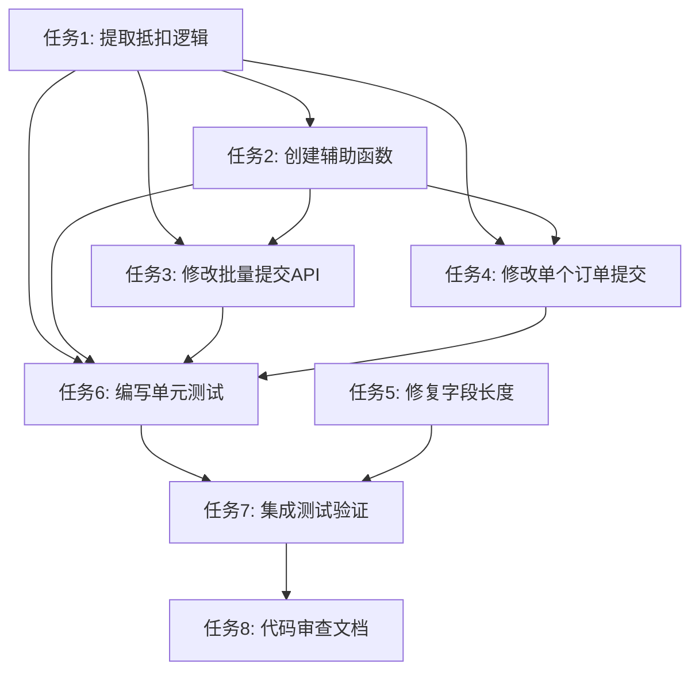

# 备货抵扣实时同步修复 - 任务清单

## 概述
- **任务目标**: 修复批量提交订单API缺少抵扣备货逻辑的问题，确保订单创建并抵扣备货后，备货管理模块能够实时显示正确的剩余数量
- **关联文档**: [需求规格文档](./spec.md), [技术设计文档](./design.md)
- **预估工时**: 6-8小时

## 任务列表

### 任务1: 提取抵扣逻辑为独立函数
**优先级**: P0
**预估工时**: 1.5小时
**依赖任务**: 无
**描述**: 将订单创建中的抵扣备货逻辑提取为独立的可复用函数，便于在单个订单提交和批量订单提交中共同使用
**输入**: 现有的订单抵扣代码（app.py 第620-711行）
**输出**: 新的独立函数 `process_order_deduction()`
**验收标准**:
- [ ] 创建 `process_order_deduction()` 函数，包含完整的抵扣逻辑
- [ ] 函数参数包括：order, product_id, order_quantity, deduct_stock, custom_deduct_quantity
- [ ] 函数返回实际抵扣的总数量
- [ ] 函数内部正确处理FIFO抵扣原则
- [ ] 函数正确创建StockOut记录并关联到StockIn
- [ ] 函数正确更新订单状态（已备货/部分备货/待备货）
- [ ] 函数正确创建InventoryLog记录
- [ ] 函数正确更新Product.current_stock

#### 子任务1.1: 设计函数签名和参数
**描述**: 确定函数的输入参数和返回值，确保能够满足所有调用场景
**验收标准**:
- [ ] 参数设计合理，包含所有必要信息
- [ ] 返回值设计清晰，便于调用者判断抵扣结果

#### 子任务1.2: 实现FIFO抵扣逻辑
**描述**: 实现按时间顺序先进先出的抵扣逻辑，确保从最早的备货记录开始抵扣
**验收标准**:
- [ ] 按stockin_date升序查询备货记录
- [ ] 正确计算每条备货记录的可用数量（quantity - 已抵扣）
- [ ] 正确处理备货记录已全部抵扣的情况

#### 子任务1.3: 实现StockOut记录创建
**描述**: 为每次抵扣操作创建StockOut记录，正确设置关联关系
**验收标准**:
- [ ] StockOut.stockin_id正确指向被抵扣的StockIn
- [ ] StockOut.order_id正确指向当前订单
- [ ] StockOut.quantity等于本次抵扣数量
- [ ] StockOut.stockout_no使用正确的编号生成规则

#### 子任务1.4: 实现订单状态更新
**描述**: 根据抵扣结果更新订单状态
**验收标准**:
- [ ] 全部抵扣时状态为"已备货"
- [ ] 部分抵扣时状态为"部分备货"
- [ ] 未抵扣时状态为"待备货"

### 任务2: 创建辅助函数
**优先级**: P1
**预估工时**: 0.5小时
**依赖任务**: 任务1
**描述**: 创建出货编号生成函数，确保编号格式正确且唯一
**输入**: 无
**输出**: `generate_stockout_number()` 函数
**验收标准**:
- [ ] 创建 `generate_stockout_number()` 函数
- [ ] 编号格式为日期-序号（如：2026-03-21-001）
- [ ] 编号唯一，不与现有编号冲突
- [ ] 正确处理同一天多个出货记录的序号递增

### 任务3: 修改批量提交订单API
**优先级**: P0
**预估工时**: 2小时
**依赖任务**: 任务1, 任务2
**描述**: 在 `/api/batch-submit-orders` API中添加抵扣备货的处理逻辑，调用新创建的抵扣函数
**输入**: 现有的batch_submit_orders函数（app.py 第749-845行）
**输出**: 修改后的API，包含完整的抵扣处理逻辑
**验收标准**:
- [ ] 正确解析前端传递的deductStock参数
- [ ] 正确解析前端传递的deductibleQuantity参数
- [ ] 在创建订单后调用process_order_deduction函数
- [ ] 正确处理抵扣失败的情况
- [ ] 保持现有的错误处理机制
- [ ] 保持现有的响应格式

#### 子任务3.1: 解析抵扣参数
**描述**: 从订单数据中正确解析抵扣相关的参数
**验收标准**:
- [ ] 正确解析deductStock字段（"on"表示启用）
- [ ] 正确解析deductibleQuantity字段（自定义抵扣数量）
- [ ] 对缺失参数提供合理的默认值

#### 子任务3.2: 集成抵扣逻辑
**描述**: 在订单创建流程中正确位置调用抵扣函数
**验收标准**:
- [ ] 在订单创建后、提交事务前调用抵扣函数
- [ ] 使用db.session.flush()获取order.id
- [ ] 正确传递所有必要参数

#### 子任务3.3: 更新错误处理
**描述**: 确保抵扣过程中的错误能够被正确捕获和处理
**验收标准**:
- [ ] 抵扣异常不影响其他订单处理
- [ ] 错误信息正确记录到failed_orders列表
- [ ] 数据库事务正确回滚

### 任务4: 修改单个订单提交逻辑
**优先级**: P1
**预估工时**: 1小时
**依赖任务**: 任务1, 任务2
**描述**: 重构单个订单提交的抵扣逻辑，使用新创建的独立函数，保持功能不变
**输入**: 现有的orders函数（app.py 第547-721行）
**输出**: 重构后的函数，调用process_order_deduction
**验收标准**:
- [ ] 使用process_order_deduction函数替换现有的抵扣代码
- [ ] 保持现有的功能完全不变
- [ ] 代码更简洁、可读性更好
- [ ] 正确处理自定义抵扣数量

### 任务5: 修复数据库字段长度问题
**优先级**: P2
**预估工时**: 0.5小时
**依赖任务**: 无
**描述**: 扩展InventoryLog.related_id字段长度，避免StockOut编号超长导致的错误
**输入**: 数据库表结构
**输出**: 数据库迁移脚本或ALTER语句
**验收标准**:
- [ ] related_id字段长度扩展到50
- [ ] 提供数据库迁移脚本
- [ ] 不影响现有数据

### 任务6: 编写单元测试
**优先级**: P1
**预估工时**: 1.5小时
**依赖任务**: 任务1, 任务2, 任务3, 任务4
**描述**: 为新创建的函数和修改的API编写单元测试，确保功能正确
**输入**: 新增和修改的代码
**输出**: 测试文件和测试用例
**验收标准**:
- [ ] 测试process_order_deduction函数的各种场景
- [ ] 测试generate_stockout_number函数
- [ ] 测试batch_submit_orders API的抵扣功能
- [ ] 测试覆盖正常流程和异常流程
- [ ] 所有测试通过

#### 子任务6.1: 测试抵扣函数
**描述**: 为process_order_deduction函数编写全面的测试用例
**验收标准**:
- [ ] 测试正常抵扣场景
- [ ] 测试备货不足场景
- [ ] 测试自定义抵扣数量场景
- [ ] 测试不抵扣场景
- [ ] 测试多条备货记录的FIFO抵扣

#### 子任务6.2: 测试批量提交API
**描述**: 为batch_submit_orders API编写集成测试
**验收标准**:
- [ ] 测试单个订单抵扣
- [ ] 测试多个订单批量抵扣
- [ ] 测试部分订单失败的情况
- [ ] 测试抵扣后备货剩余数量正确

### 任务7: 执行集成测试和验证
**优先级**: P0
**预估工时**: 1小时
**依赖任务**: 任务6
**描述**: 执行完整的集成测试，验证修复效果，确保备货抵扣后剩余数量实时更新
**输入**: 完整的修复代码
**输出**: 测试报告和验证结果
**验收标准**:
- [ ] 创建测试备货记录
- [ ] 通过API创建订单并抵扣备货
- [ ] 验证StockOut记录正确创建
- [ ] 验证备货管理页面显示正确的剩余数量
- [ ] 验证订单状态正确更新
- [ ] 验证Product.current_stock正确更新

#### 子任务7.1: 准备测试环境
**描述**: 准备测试数据和环境
**验收标准**:
- [ ] 创建测试产品
- [ ] 创建测试备货记录
- [ ] 确保测试数据不影响生产数据

#### 子任务7.2: 执行手动测试
**描述**: 按照测试场景执行手动测试
**验收标准**:
- [ ] 测试单个订单抵扣场景
- [ ] 测试批量订单抵扣场景
- [ ] 测试部分抵扣场景
- [ ] 测试不抵扣场景
- [ ] 记录测试结果

#### 子任务7.3: 验证数据同步
**描述**: 验证抵扣后备货管理模块的数据正确性
**验收标准**:
- [ ] 备货剩余数量计算正确
- [ ] 分组显示正确
- [ ] 页面刷新后数据一致

### 任务8: 代码审查和文档更新
**优先级**: P1
**预估工时**: 0.5小时
**依赖任务**: 任务7
**描述**: 进行代码审查，更新相关文档，确保代码质量
**输入**: 完成的代码和测试结果
**输出**: 代码审查报告和更新的文档
**验收标准**:
- [ ] 代码符合项目编码规范
- [ ] 添加必要的注释和文档字符串
- [ ] 更新API文档
- [ ] 记录修复的问题和解决方案

## 任务依赖关系

## 风险与注意事项

### 风险1: 数据一致性问题
- **描述**: 修改抵扣逻辑可能影响现有数据的一致性
- **应对措施**: 
  - 使用数据库事务确保原子性
  - 充分测试各种场景
  - 准备回滚方案

### 风险2: 性能影响
- **描述**: 批量抵扣可能增加数据库查询次数
- **应对措施**:
  - 优化查询，使用预加载
  - 批量操作减少数据库往返
  - 监控性能指标

### 风险3: 兼容性问题
- **描述**: 修改可能影响现有功能
- **应对措施**:
  - 保持API接口不变
  - 保持响应格式不变
  - 进行回归测试

### 风险4: 并发冲突
- **描述**: 多用户同时抵扣同一备货可能导致冲突
- **应对措施**:
  - 考虑添加行锁机制
  - 实现乐观锁或重试机制
  - 记录操作日志便于排查

## 注意事项

1. **代码修改原则**:
   - 最小化修改范围
   - 保持向后兼容
   - 添加充分的错误处理
   - 编写清晰的注释

2. **测试要求**:
   - 每个任务完成后进行单元测试
   - 所有任务完成后进行集成测试
   - 手动验证关键场景

3. **提交要求**:
   - 每个任务独立提交
   - 提交信息清晰描述修改内容
   - 关联到需求规格文档

4. **文档要求**:
   - 更新API文档
   - 记录修改的函数和参数
   - 更新用户手册（如需要）

## 验收检查清单

### 功能验收
- [ ] 批量提交订单时能够正确执行抵扣备货
- [ ] 抵扣后备货剩余数量实时更新
- [ ] 订单状态正确更新
- [ ] StockOut记录正确创建和关联
- [ ] Product.current_stock正确更新

### 质量验收
- [ ] 所有单元测试通过
- [ ] 集成测试通过
- [ ] 代码审查通过
- [ ] 无回归问题

### 文档验收
- [ ] API文档已更新
- [ ] 代码注释完整
- [ ] 测试报告完整

## 预估总工时

| 任务 | 工时 |
|------|------|
| 任务1: 提取抵扣逻辑 | 1.5小时 |
| 任务2: 创建辅助函数 | 0.5小时 |
| 任务3: 修改批量提交API | 2小时 |
| 任务4: 修改单个订单提交 | 1小时 |
| 任务5: 修复字段长度 | 0.5小时 |
| 任务6: 编写单元测试 | 1.5小时 |
| 任务7: 集成测试验证 | 1小时 |
| 任务8: 代码审查文档 | 0.5小时 |
| **总计** | **8.5小时** |

## 执行顺序建议

1. **第一阶段**（核心功能）: 任务1 → 任务2 → 任务3
2. **第二阶段**（代码优化）: 任务4 → 任务5
3. **第三阶段**（测试验证）: 任务6 → 任务7
4. **第四阶段**（收尾工作）: 任务8

建议按照上述顺序执行，确保每个阶段完成后再进入下一阶段。
