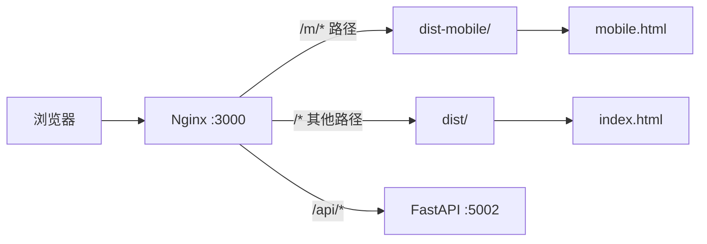

## 产品概述

为滨发协同ERP系统构建独立的移动端网页版UI前端，与PC端UI完全隔离运行。移动端UI深度对齐已有Android APK的Apple风格设计系统，实现专属的视觉风格、单栏触控友好布局和原生级交互体验。

## 核心功能

- **双入口构建体系**：通过Vite多页面配置实现PC端（`/`）与移动端（`/m/`）独立打包、独立路由、独立部署，两套代码共存于同一仓库但互不干扰
- **APK设计系统全量对齐**：将Android APK中Color.kt的Apple色系、Type.kt的14级排版、Shape.kt的10种圆角、Spacing.kt的11级间距完整映射为CSS设计Token，并补充按钮圆角、标签胶囊圆角、毛玻璃效果等细节
- **移动端专属组件库**：基于现有mobile组件（MCard、MStatCard、MList、MBottomSheet等13个）扩展补齐APK中的ErpBadge、ErpStatusBadge、ErpSkeletonLoader、ErpPullToRefresh、ErpFilterBar、DateNavigator等效组件，全部采用纯CSS实现以保证极致轻量
- **触控友好布局适配**：将PC端多栏表格/表单布局重构为单栏卡片流式布局，关键操作区域不小于44px触控热区，底部固定TabBar导航，支持安全区域适配和下拉刷新
- **路由隔离与权限复用**：移动端路由统一加`/m/`前缀，共享Pinia auth store和JWT认证逻辑，复用`filteredNavSections`权限过滤，NGINX按路径前缀分发到不同静态资源目录

## 技术栈选择

- **前端框架**：Vue 3.5 + TypeScript + Vite 7（与PC端统一技术栈，降低维护成本）
- **样式方案**：TailwindCSS 4.2 + CSS Custom Properties（移动端不引入PrimeVue，纯CSS组件以减小包体积）
- **状态管理**：Pinia 3（复用已有auth store、country store）
- **路由**：Vue Router 5（独立路由文件 `mobile-web.ts`，`/m/` 前缀隔离）
- **HTTP**：axios（复用已有API层和请求拦截器）
- **服务端状态**：@tanstack/vue-query 5（复用已有query hooks）
- **构建策略**：Vite多页面构建（两个HTML入口，共享代码通过manualChunks去重）

## 实施方案

### 整体架构

采用**Vite多页面多入口构建**策略，在同一仓库内实现PC端和移动端的完全隔离：

```
frontend-vite/
├── index.html              # PC端入口 → 构建输出 dist/
├── mobile.html             # 移动端入口 → 构建输出 dist-mobile/
├── src/
│   ├── main.ts             # PC端入口TS
│   ├── mobile-main.ts      # 移动端入口TS（新增）
│   ├── router/
│   │   ├── index.ts        # PC端路由（不变）
│   │   └── mobile-web.ts   # 移动端路由（新增，/m/ 前缀）
│   ├── mobile-web/         # 移动端专属代码（新目录）
│   │   ├── App.vue         # 移动端根组件
│   │   ├── layouts/        # 布局组件
│   │   ├── components/     # 移动端组件库
│   │   ├── views/          # 移动端页面
│   │   └── styles/         # 移动端样式
│   ├── stores/             # 共享状态管理（PC和移动端共用）
│   ├── api/                # 共享API层（PC和移动端共用）
│   └── types/              # 共享类型定义（PC和移动端共用）
```

**关键决策**：

- 不引入额外UI组件库：移动端使用纯CSS自定义组件，相比引入Vant/Naive-UI等库可减少100KB+ gzip体积，且能完美对齐APK设计风格
- 共享stores/api/types：避免代码重复，权限逻辑完全复用
- 独立路由文件：防止PC路由和移动端路由互相污染

### 路由隔离策略

移动端所有路由统一加 `/m/` 前缀：

| PC路由 | 移动端路由 | 说明 |
| --- | --- | --- |
| `/dashboard` | `/m/dashboard` | 仪表盘 |
| `/product` | `/m/product` | 产品管理 |
| `/stock` | `/m/stock` | 库存管理 |
| `/customer-order` | `/m/orders` | 客户订单 |
| `/purchase` | `/m/purchase` | 采购中心 |
| `/material` | `/m/incoming` | 来料登记 |
| `/material-calculator` | `/m/material-calculator` | 来料计算器 |
| `/production` | `/m/production` | 生产管理 |
| `/batch` | `/m/batch` | 批次查询 |
| `/case` | `/m/case` | 皮套管理 |
| `/notifications` | `/m/notifications` | 通知中心 |
| `/login` | `/m/login` | 登录页 |


### 部署架构



NGINX配置通过`location /m/` 将移动端请求路由到`dist-mobile/`目录，其余请求走`dist/`。移动端SPA的fallback也回退到`dist-mobile/index.html`。

### 构建脚本

```
{
  "build": "vue-tsc -b && vite build",
  "build:mobile": "vue-tsc -b && vite build --mode mobile",
  "build:all": "npm run build && npm run build:mobile"
}
```

`--mode mobile` 触发Vite使用`mobile.html`作为入口，输出到`dist-mobile/`目录，并注入`VITE_APP_TARGET=mobile`环境变量用于运行时区分平台。

### 设计Token扩展

在已有`mobile-tokens.css`基础上补充Android APK中缺失的Token：

| Token | 值 | 来源 |
| --- | --- | --- |
| `--m-radius-button` | 8px | Shape.kt ButtonShape |
| `--m-radius-chip` | 50px | Shape.kt ChipShape |
| `--m-radius-input` | 8px | Shape.kt InputShape |
| `--m-radius-dialog` | 16px | Shape.kt DialogShape |
| `--m-radius-avatar` | 10px | Shape.kt AvatarShape |
| `--m-radius-icon-box` | 12px | Shape.kt IconBoxShape |
| `--m-font-display-lg` | 32px/700 | Type.kt displayLarge |
| `--m-font-headline` | 20px/600 | Type.kt headlineMedium |
| `--m-font-title` | 16px/600 | Type.kt titleLarge |
| `--m-font-body` | 15px/400 | Type.kt bodyLarge |
| `--m-font-caption` | 12px/500 | Type.kt labelMedium |
| `--m-font-tab` | 9px/600 | 底部导航 |
| `--m-metric-block-shape` | 12px | Shape.kt MetricBlockShape |
| `--m-blur-tabbar` | blur(24px) saturate(180%) | 毛玻璃效果 |


### 组件体系规划

基于Android APK组件清单，补齐移动端Web组件：

| APK组件 | Web组件 | 状态 |
| --- | --- | --- |
| ErpCard | MCard.vue | 已有 |
| ErpCardHeader / ErpCardContent | slot实现 | 已有 |
| ErpMetricCard | MStatCard.vue | 已有 |
| - | MList.vue / MListItem.vue | 已有 |
| - | MBottomSheet.vue | 已有 |
| - | MSearchBar.vue | 已有 |
| - | MFilterChips.vue | 已有 |
| - | MToast.vue | 已有 |
| - | MSpinner.vue | 已有 |
| - | MProgress.vue | 已有 |
| - | MActionSheet.vue | 已有 |
| - | MFilePicker.vue | 已有 |
| ErpBadge | MBadge.vue | 待新增 |
| ErpStatusBadge | MStatusBadge.vue | 待新增 |
| ErpSkeletonLoader | MSkeleton.vue | 待新增 |
| ErpPullToRefresh | MPullRefresh.vue | 待新增 |
| ErpFilterBar | 增强MFilterChips.vue | 待增强 |
| DateNavigator | MDateNavigator.vue | 待新增 |
| - | MFormItem.vue | 待新增 |
| - | MDataTable.vue | 待新增 |


### 性能优化策略

- **Tree shaking**：移动端构建排除ECharts（~800KB gzip）、PrimeVue（~120KB gzip）、reka-ui、FontAwesome等PC端重依赖
- **代码分割**：通过Vite `manualChunks`将共享代码（axios、vue、pinia、vue-query）与移动端专属代码分离
- **首屏优化**：移动端路由全部使用`defineAsyncComponent`懒加载
- **触摸优化**：所有可点击元素`min-height: 44px`，添加`:active`缩放反馈，`-webkit-tap-highlight-color: transparent`
- **包体积预估**：移动端总包预计150-200KB gzip（PC端当前约600KB+ gzip）

### 权限复用机制

移动端路由守卫直接复用PC端的`authStore.init()`、`authStore.fetchNavSections()`和`filteredNavSections`计算属性，无需任何后端改动。路由守卫逻辑与PC端一致：非超级用户只能访问`filteredNavSections`中可见的路径。

## 设计风格

采用**Apple Human Interface风格**，与Android APK界面设计语言完全统一。以极简美学为核心，通过大圆角卡片、毛玻璃材质、微妙的阴影层级和流畅的弹簧动画，营造轻盈、优雅、专业的移动端操作体验。

## 页面规划

### 页面一：仪表盘（Dashboard）

- **顶部问候区**：左侧"上午好"文字+用户昵称大标题（28px/800字重），右侧44px圆角头像（首字母+蓝色背景）
- **今日概览卡片网格**：2×2网格布局，每张卡片含40px图标容器（12px圆角+10%透明度背景）、22px/700数字、13px标签、趋势箭头百分比
- **快捷入口区**：4列网格，每项含44px图标圆形容器（8%透明度背景）+12px文字标签
- **预警提醒列表**：MListItem组件，每行左侧图标+标题+副标题，右侧箭头指示可点击

### 页面二：列表管理页（以订单/产品/库存为例）

- **顶部搜索栏**：圆角16px白色搜索框，左侧搜索图标，placeholder文字，右侧筛选按钮（带红点徽章标识活跃筛选）
- **筛选标签栏**：水平滚动FilterChips组件，选中态蓝色填充+白字，未选中态灰色描边
- **数据卡片列表**：垂直滚动卡片流，每张卡片16px圆角白色背景+细阴影，卡片内信息层级清晰（标题/状态徽章/关键数据/时间）
- **底部浮动操作按钮**：56px圆形蓝色按钮，白色+号图标，阴影扩散，点击有弹簧缩放动画

### 页面三：表单录入页（以来料登记为例）

- **分组卡片表单**：每组一个16px圆角白色卡片，内含MFormItem组件（标签+输入框/选择器），间距统一
- **底部固定操作栏**：白色背景+顶部分割线，包含"重置"文字按钮和"提交"蓝色实心按钮（48px高，全宽或并排）
- **下拉选择器**：使用MBottomSheet实现，从底部弹出选项列表，带遮罩层和弹簧动画

### 页面四：个人中心

- **头部个人信息卡片**：大卡片布局，头像+用户名+工厂信息，背景微渐变
- **功能菜单列表**：MListItem组件，左侧图标+文字，右侧箭头，分组显示（通知、设置、关于、退出登录）
- **退出登录**：红色文字警告样式，点击弹出MActionSheet确认

### 底部导航栏（全局）

- **5个Tab**：概览（grid图标）、出货（文档图标）、快捷（中心蓝色+号按钮，48×48px，16px圆角，向上突出14px）、订单（时钟图标）、我的（用户图标）
- **材质效果**：白色72%透明度+毛玻璃blur(24px)，顶部0.5px细分割线
- **选中态**：文字变蓝色+顶部3px蓝色指示条，图标变蓝
- **动画**：Tab切换200ms淡入淡出，中心按钮点击0.92x缩放回弹

## 交互细节

- **卡片点击**：`:active`时缩放至0.97x + 阴影加深，200ms ease过渡
- **列表项点击**：轻量背景色变化（`rgba(0,0,0,0.02)`），44px最小触控高度
- **下拉刷新**：顶部下拉触发，旋转spinner+文字提示，释放后刷新数据
- **骨架屏加载**：列表/卡片/仪表盘三种变体，灰色占位块+shimmer动画
- **空状态**：居中图标+标题+副标题，与APK的ErpEmptyState一致

## Agent Extensions

### Skill

- **ui-designer**
- 用途：将Android APK的Shape.kt圆角系统、Spacing.kt间距系统、Type.kt排版系统精确映射为CSS设计Token，生成移动端专属的`tokens.css`文件和组件级CSS变量规范
- 预期成果：输出完整的设计Token映射表（APK → CSS），包含圆角、间距、字号、阴影、动画曲线等所有原子样式变量

- **ux-architect**
- 用途：设计移动端组件架构和布局框架，将PC端多栏布局转换为单栏触控友好布局的CSS系统规范，定义组件层级、响应式断点和安全区域适配策略
- 预期成果：输出移动端CSS架构方案，包括布局框架规范、组件组合模式、触控热区标准、安全区域适配方案

- **frontend-developer**
- 用途：实现移动端Vue组件库核心组件（MBadge、MStatusBadge、MSkeleton、MPullRefresh、MDateNavigator、MFormItem、MDataTable），确保组件API设计合理、动画流畅、性能优化到位
- 预期成果：可用的Vue 3组件代码，每个组件包含完整的TypeScript类型定义、CSS样式和交互动画

- **devops-engineer**
- 用途：配置Vite多页面构建、NGINX路由规则、Docker Compose多产物挂载，确保PC端和移动端独立构建、独立部署、互不影响
- 预期成果：可工作的构建配置、NGINX配置和Docker编排配置，两套前端应用通过路径前缀完全隔离