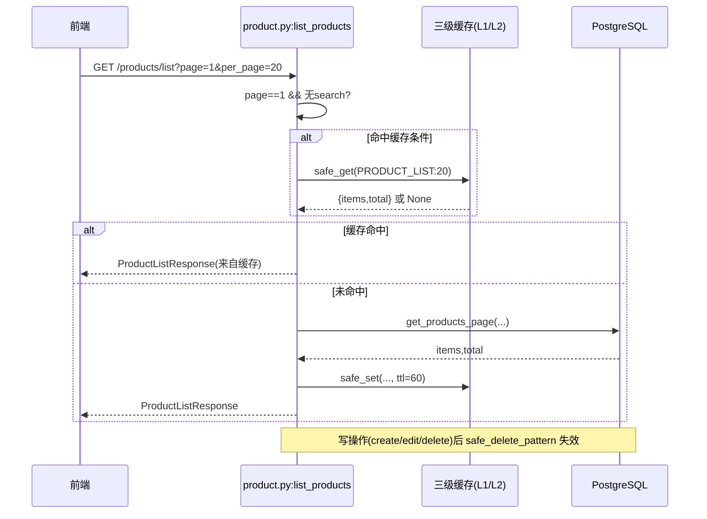

# P1 增量设计（先证伪，再设计）

> 架构师：高见远（Gao）｜团队：software-erp-p1｜工作目录：`D:\erp_system`
> 方法：对二手报告 `deliverables/四维对标及优化方案.md` 中 6 个 P1 项，逐条落到 `文件:行号` 实测核实，判定「成立 / 缩小范围 / 不成立」。
> 原则：**不采信任何未经验证的数字**；所有结论附实测命令与结果。

---

## 1. TL;DR

| 项 | 一句话判定 | 核心理由（详见第 2 节） |
|---|---|---|
| **A1 成功响应统一** | ❌ **不成立** | `success` 本就是**已落地的统一契约**（25 个 Pydantic schema 声明 `success: bool = True`；前端 `ApiResponse<T>` 声明扁平 `success`；336 处 `response_model=` 强制校验）。196 处内联 dict 是在**满足**该契约，不是缺失契约。加包装中间件会与 Pydantic 契约**双轨冲突**，并击穿 82 处前端 `.success` 读取。 |
| **A2 分页统一** | ⚠️ **缩小范围** | 轮子已**比报告描述更聪明**（`OFFSET_THRESHOLD=2000` 自动切换 + 空结果 fallback，`enhanced_pagination.py:15,71,86`）。22 文件 / 12 endpoint 用 offset 分页，这对**需要 total/pages/任意排序/跳页**的管理列表是**正确选择**。强推 keyset 会破坏这些语义。真正可迁移的仅极少数"大表深翻页"端点。 |
| **A6 order 域收敛** | ❌ **大部分不成立**（缩小范围） | 报告称"合并两空壳、内聚 5 个职责模块"——但**5 模块拆分早已完成**（`services/order/` 下 queries/commands/deduction/approval_flow/beile）。两个文件是**有意为之的两层向后兼容 Facade**（`order_crud.py:1-6`、`order_service.py:1-9` 均有说明）。"52 处引用"实测 51–52，准确；合并是 2→1 外观收敛，**收益低、触及 51 处引用 + 领域路由**。 |
| **A8 N+1 治理** | ❌ **不成立** | 13 处 `lazy='select'` 计数准确，但**性质被误判**：异步 SQLAlchemy 下 `lazy='select'` 未预加载即访问会**抛 `MissingGreenlet` 异常**，不是静默 N+1；且服务层**已在每个查询点显式 `selectinload`/`noload`**（`grouping.py:29-36,150`、`parts.py:357`、`projects.py:328-330,437-443`、`version_diff.py:87,157,312`）。改模型默认值冗余且会引发加载风暴。 |
| **A9 缓存铺开** | ⚠️ **缩小范围** | `@cache_result` = **45 处**（计数准确）。但"热点读接口（商品/客户/库存字典）**未覆盖**"为**假**：商品 `product_service.py:67`、客户 `customer.py:71,91`、供应商 `supplier.py:48,67`、库存 `stock_inventory_service.py` 5 处，**均已缓存**，只是机制不同。仅"商品分页 `/list` 首屏"存在窄缺口。 |
| **A12 Mutation 铺开** | ⚠️ **缩小范围** | `useApiMutation` 采纳率**甚至低于报告的 3 个文件**——实测仅 `useCustomer.ts` 1 个文件。但根因是：32 个文件（113 处）已用原生 `queryClient.invalidateQueries` 完成失效。迁移 32 个 Vue 文件 = 大范围 UI 回归风险 + 低收益。 |

**本次建议实际实施：仅 1 项窄化子集（A9-narrow）+ 1 项可选独立增强（A1-narrow 追踪头）**。其余 4 项不建议实施，理由见第 6 节。

---

## 2. 逐项核实结果表

### A1 成功响应统一 —— 判定：❌ 不成立

| 维度 | 报告前提 | 实测证据（命令 + 数字 + file:line） | 判定 |
|---|---|---|---|
| 内联计数 | 196 处内联 `'success': True` | `grep -rEc "['\"]success['\"]\s*:\s*True" fastapi_app` → **196**（单引号 177 + 双引号 19） | ✅ 数字准确 |
| 分布 | "全后端 endpoint" | 实测：**endpoints 114 / services 71 / tasks 6 / tests 5**。→ 其中 **6 处在 ARQ 后台任务**（非 HTTP 响应，中间件管不到）、**5 处在测试**（fixture/断言）。真正 HTTP 端点相关仅 114 处。 | ⚠️ 前提夸大 |
| 性质 | "各 endpoint 自拼 dict、无统一" | **`success` 是已声明契约字段**：`grep -rEl success fastapi_app/schemas` → **25 个 schema 文件**声明 `success: bool = True`，例如 `schemas/purchase_center.py:153,161,166`、`schemas/backup.py`（27 处）、`schemas/case.py:100-233`、`schemas/customer.py:38-49`、`schemas/approval.py:40-58`。 | ❌ **前提错误** |
| 强类型契约 | （报告未提） | `grep -rn "response_model=" fastapi_app` → **336 处**。端点 `purchase_center/order_routes.py:103,183,343…` 声明 `response_model=PurchaseOrderListResponse`，而该 schema `purchase_center.py:152-157` **首字段即 `success: bool = True`**。 | ❌ 已有统一 |
| 前端契约 | "前端解析需同步兼容" | 前端**已定义并消费**该契约：`frontend-vite/src/types/index.ts:4` `export interface ApiResponse<T> { success: boolean; data?: T; ... }`；`.success` 读取 **82 处**（`api/backup.ts`、`api/case.ts`、`api/notification.ts`…）。 | ❌ 双轨冲突 |

**结论**：`success` 不是"缺失的统一"，而是**已通过 Pydantic schema + 前端 TS 类型双向固化的统一契约**。若按报告加 `core/response.py` 中间件包装成 `{success, data, request_id}`：
- FastAPI 先按 `response_model` 序列化，中间件再包一层 → 前端收到 `{success, data:{success, orders:[...]}}`，**82 处 `.success` 读取与全部强类型响应全部错位**；
- 与 336 处 `response_model=` 形成**双轨契约**，OpenAPI 文档与实际响应不一致。

**唯一成立的真子集**：`request_id` 全链路追踪。当前 `grep -rn request_id fastapi_app/api` → **仅 1 处**，确属缺失；但正确做法是**加响应头 `X-Request-Id`**（不侵入 body），而非包装 body。

---

### A2 分页统一 —— 判定：⚠️ 缩小范围

| 维度 | 报告前提 | 实测证据 | 判定 |
|---|---|---|---|
| 轮子覆盖 | "仅 order 域在用" | `grep -rln enhanced_pagination fastapi_app` → **仅 4 文件**，全在 `services/order/`（approval_flow/commands/deduction/queries） | ✅ 准确 |
| 轮子能力 | "keyset 分页轮子" | **报告低估了它**：`enhanced_pagination.py:15` `OFFSET_THRESHOLD=2000`；`:71` `offset>2000` 自动切 keyset；`:86` keyset 空结果自动 fallback OFFSET；`:18-43` `optimized_count` 仅在**无 WHERE** 时用近似计数（有筛选强制精确 COUNT）。→ 已是"智能分页"。 | ✅ 已很完善 |
| 手写端点 | "20 个手写 endpoint" | `grep -rEl "limit_start\|limit_page_length\|page_size\|pageSize\|per_page" fastapi_app/api/v1/endpoints` → **22 文件**；`grep -rEn "async def .*(page: int\|page_size\|per_page)"` → **12 个函数签名**。报告"20"介于两者之间。 | ⚠️ 口径模糊 |
| 语义性质 | "对齐 erpnext `limit_start/limit_page_length`" | 手写端点均为管理列表（`product.py:34`、`case_endpoint.py:82,230,378,432`、`staging_order.py:27`、`purchase_center/misc_routes.py:23,55`…），**需要 `total`/`pages`/任意列排序/跳页**。keyset **无法廉价提供精确 total**，也**不支持任意排序键**。 | ❌ 强推有害 |
| 前端影响 | （报告未展开） | `frontend-vite/src/types/index.ts:13` `PaginatedResponse<T>` 声明 `total/pages/current_page`——offset 语义已固化到前端类型。 | ❌ 破坏契约 |

**结论**：offset 分页对"管理列表"是**正确设计**，不是债务。真正值得迁移的仅满足**全部**条件的端点：①大表（>10 万行）②稳定单调排序键（如 `id`/`created_at`）③不需要跳页/精确 total ④前端已用无限滚动。需逐个端点实测 EXPLAIN 才能定，**不建议批量迁移**。报告"深分页 P95 大幅下降"缺少基线数据支撑。

---

### A6 order 域收敛 —— 判定：❌ 大部分不成立（缩小范围）

| 维度 | 报告前提 | 实测证据 | 判定 |
|---|---|---|---|
| 两文件行数 | `order_service.py`(61) + `order_crud.py`(55) | 实测 `wc -l`：**61 / 55** | ✅ 准确 |
| 是否"重复 re-export 空壳" | "2 空壳" | **二者不是彼此的重复**，是**三层结构**：①`services/order/`（真实逻辑，5 模块）②`order_crud.py`（Facade→re-export 层①）③`order_service.py`（Facade→re-export 层② + `order_batch_create.py`）。`order_service.py:13-26` 显式 re-export `order_crud` 的 17 个符号 + `order_batch_create` 2 个符号。 | ⚠️ 表述失真 |
| "内聚 5 个职责模块" | 报告作为**待办** | **早已完成**：`ls fastapi_app/services/order/` → `queries.py`(9.7K) / `commands.py`(13K) / `deduction.py`(9.2K) / `approval_flow.py`(8.3K) / `beile.py`(16K) + `_common.py`。文件头 `order_crud.py:1-6` 注明"批次1-3 拆分，2026-08-22"。 | ❌ 已完成 |
| "52 处引用" | 引用 `order_crud.py:3` 自述 | 独立实测：`order_service` 非注释引用 **30**、`order_crud`（排除 `purchase_order_crud`）**34**、`order_service\.|order_crud\.` 代码调用 **51**。→ **51–52，准确**。 | ✅ 准确 |
| 隐藏耦合 | （报告未提） | `core/domains.py:59` `Domain.ORDER: ['order_service', 'order_batch_service', ...]` —— **领域事件路由依赖模块名字符串**。改名/删除会**静默破坏事件订阅**。 | ⚠️ 高风险点 |

**结论**：报告想做的"拆分收敛"**已经做完了**；剩下的是把**两层 Facade 压成一层**的纯外观清理。收益：-1 个 61 行文件；成本：改 51 处引用 + 触碰 `core/domains.py:59` 领域路由 + 破坏 `order_service.py` 文档承诺的向后兼容（`auxiliary_service.py:43` 仍 `from ...order_service import batch_create_orders`）。**收益/风险比不成立**。若确要做，只能"保留两个入口名、内部改为直连 `services/order/*`"，属纯重构，无功能收益。

---

### A8 N+1 治理 —— 判定：❌ 不成立

| 维度 | 报告前提 | 实测证据 | 判定 |
|---|---|---|---|
| 计数 | `customer_sampling.py:115-314` 有 13 处 `lazy='select'` | 实测该文件 **12 处**（`:115,118,119,120,125,132,138,226,233,314,412,470`）；全项目 **13 处**（第 13 处在 `shared_models/supplier.py:37`）。报告把行号范围限定在 115-314，但实际 `:412`、`:470` 也在该文件。 | ⚠️ 基本准确 |
| 性质 | 隐含"会导致 N+1" | **异步 SQLAlchemy 下 `lazy='select'` 不会静默 N+1，而是抛 `MissingGreenlet`**。`grouping.py:26-27` 注释明确写道："async 会话下未预加载即访问会抛错"。→ 它是"必须显式预加载"的**安全标记**，非性能陷阱。 | ❌ 性质误判 |
| 是否已治理 | （报告视为待办） | **服务层已在每个查询点显式治理**：`grouping.py:29-36` 定义 `_LIST_NOLOAD`（6 个 `noload`）+ `:150` `selectinload(pattern_maker)`；`projects.py:327-330` 三层 `selectinload` + `:437-443` 7 个 `noload`；`parts.py:357` `selectinload(supplier)`；`version_diff.py:87,157,312`。 | ❌ 已治理 |
| 项目惯例 | （报告未提） | 全项目 `lazy=` 分布：`'raise'` **6+ 处**（更严格的防 N+1 惯例）、`'selectin'` 仅 1 处、`'select'` 12 处。→ 项目主流是 `raise`（强制显式），customer_sampling 用 `select` 属**风格不一致**，非缺陷。 | ⚠️ 风格问题 |

**结论**：把 12 处模型默认值从 `select` 改 `selectin`：①**冗余**（查询点已 eager load）；②**有害**——模型级 `selectin` 对**所有**查询全局生效，未加 `noload` 的路径会被强制多打一批查询（如 `project→parts→supplier` 深链），反而可能制造加载风暴；③对 async 会话而言，正确做法本就是查询点显式控制（现状）。**不建议改**。若追求一致性，可另开"模型 lazy 策略统一为 `raise`"的独立重构（需全量回归），不属本次 P1。

---

### A9 缓存铺开 —— 判定：⚠️ 缩小范围

| 维度 | 报告前提 | 实测证据 | 判定 |
|---|---|---|---|
| 装饰器计数 | "仅覆盖 45 处 / 17 文件" | `grep -rn "@cache_result" fastapi_app --include=*.py \| grep -v __pycache__` → **45 处**（其中 8 处在 `tests/test_cache_metrics.py`，生产 37 处）；覆盖 **21 文件**（报告"17"略低）。 | ✅ 计数准确 |
| "热点读未覆盖" | "商品/客户/库存字典类未覆盖" | **假**。商品：`product_service.py:67` `@cache_result(products:all)`；客户：`customer.py:71,91` **手写缓存**（`_get_cached_customer_list`/`_set_cached_customer_list` + `CacheNamespace.CUSTOMER_LIST` + `safe_get/safe_set`）；供应商：`supplier.py:48,67` 同款手写缓存；库存：`stock_inventory_service.py:51,129,276,332,664` **5 处** `@cache_result`（含 `customers:all`）。 | ❌ 前提错误 |
| 真实缺口 | — | 唯一窄缺口：商品**分页列表** `/list`（`product.py:33-38` → `get_products_page`）**未缓存**；被缓存的 `get_products`（`product_service.py:67`）是"内部全量"用途，非端点主路径。 | ⚠️ 窄子集成立 |
| 机制并存 | （报告未提） | 项目存在**两套缓存机制**：①`@cache_result` 装饰器（声明式）②手写 `safe_get/safe_set` + `CacheNamespace`（命令式，见 `customer.py:14,71-100`）。客户/供应商列表**刻意只缓存"首页无搜索"**（`customer.py:73` 注释），是为**避免缓存键基数爆炸**的有意设计。 | ⚠️ 有意设计 |

**结论**：报告"扩至热点读接口"**大部分不成立**（已覆盖）。真正可做的窄子集：**为商品分页 `/list` 首屏（`page=1` 且无搜索）增加缓存**，复用 `customer.py` 的"首页无搜索才缓存"模式，**不缓存带搜索/深页**，避免键爆炸。这是唯一有实证支撑的子项。

---

### A12 Mutation 铺开 —— 判定：⚠️ 缩小范围

| 维度 | 报告前提 | 实测证据 | 判定 |
|---|---|---|---|
| 采纳率 | "仅被 3 个文件使用" | `grep -rn useApiMutation frontend-vite/src`（排除定义文件）→ 命中 `views/customer/composables/useCustomer.ts:11,90,95,100,104`（4 次调用）+ `CustomerView.vue:57`（仅注释）。**真实采纳 = 1 个文件**，比报告"3"更低。 | ✅ 前提成立 |
| 根因 | （报告未查） | 前端**根本不使用 `@tanstack/vue-query` 的 `useMutation`**（`grep useMutation` 排除 `useApiMutation` → **0**）。写操作统一用**原生 `useQueryClient` + `invalidateQueries`**：**32 文件 / 113 处**（`useApproval.ts:107,110,137,140`、`useCaseStockWorkbench.ts:213,260`、`useOrderDetailEdit.ts:76-79`…）。 | ⚠️ 已有既定模式 |
| 迁移成本 | "扩至全部写操作" | 需改 **32 个 Vue/composable 文件**，每处替换 toast+invalidate 手写逻辑。`useApiMutation` 仅封装 `showToast` + `invalidateQueries`（`useApiMutation.ts:19-36`），功能与现状**等价**。 | ❌ 低收益高险 |

**结论**：现状不是"没用轮子"，而是**用了另一套等价轮子**（原生 `invalidateQueries`）。把 32 个文件迁到 `useApiMutation` 是**纯风格统一**，功能零增量，却引入大范围 UI 回归面。**不建议**。若确需统一，应先补 `useApiMutation` 缺失能力（如 optimistic update、`onSettled`），再以新代码增量采用，**不回溯改造**。

---

## 3. 增量设计（仅对"成立 / 缩小范围"的子项）

### 3.1 A9-narrow：商品分页首屏缓存（**建议实施**）

**目标**：为商品列表首屏（无搜索、`page=1`）增加缓存，复用客户/供应商的成熟模式，不引入新机制。

**实现方案（关键结构示意，非完整实现）**：

```python
# fastapi_app/api/v1/endpoints/product.py（在现有 list_products 附近新增私有 helper）
# 注意：safe_get/safe_set 与 customer.py 同源，来自 core/redis_wrapper（非 cache_redis）
from fastapi_app.core.cache_keys import CacheNamespace, build_cache_key
from fastapi_app.core.redis_wrapper import safe_delete_pattern, safe_get, safe_set

_PRODUCT_LIST_CACHE_TTL = 60  # 秒，与 products:all 的 ttl=60 对齐
# 复用已存在的命名空间 CacheNamespace.PRODUCT_LIST = 'product:list'（cache_keys.py:74）
_PRODUCT_LIST_CACHE_PATTERN = f"{CACHE_KEY_PREFIX}{CacheNamespace.PRODUCT_LIST}:*"

async def _get_cached_product_page(page: int, per_page: int, search: str | None):
    # 仅 page==1 且无 search 才读缓存，避免键基数爆炸
    if page != 1 or search:
        return None
    key = build_cache_key(CacheNamespace.PRODUCT_LIST, per_page)
    return await safe_get(key, context="商品列表缓存")

async def _set_cached_product_page(page, per_page, search, items, total):
    if page != 1 or search:
        return
    key = build_cache_key(CacheNamespace.PRODUCT_LIST, per_page)
    await safe_set(key, {"items": items, "total": total}, _PRODUCT_LIST_CACHE_TTL,
                   context="商品列表缓存")
```

**关键约束（必须遵守）**：
1. **仅缓存 `page==1 && not search`** —— 与 `customer.py:73` 注释同款策略，防键爆炸；
2. **写操作必须失效** —— 在 `product.py` 的 create/edit/delete（`:41,74,82`）后调用 `safe_delete_pattern(_PRODUCT_LIST_CACHE_PATTERN)`，对齐 `customer.py:61-68 _invalidate_customer_caches`；
3. **命名空间已存在** —— `CacheNamespace.PRODUCT_LIST = 'product:list'`（`cache_keys.py:74`）**无需新增**；只需在 `product.py` 内拼接 pattern。改动面因此**收敛到单文件**。

**涉及文件清单**：
| 文件 | 改动 |
|---|---|
| `fastapi_app/api/v1/endpoints/product.py` | 新增 2 个私有 helper + 在 `list_products` 读路径接入 + 3 个写路径接入失效（`CacheNamespace.PRODUCT_LIST` 已存在，无需改 cache_keys.py） |

**数据结构/接口变更**：**无**。响应体仍是既有 `ProductListResponse`，前端零改动。

**调用流程**：


**前后端兼容性**：✅ 完全兼容。响应结构与 `response_model=ProductListResponse` 不变，仅缩短数据新鲜度窗口（≤60s），与客户/供应商列表现状一致。

---

### 3.2 A1-narrow：`X-Request-Id` 追踪头（**可选，独立于响应体**）

**目标**：补齐 `request_id` 全链路追踪（现状仅 1 处）。**不触碰响应体**，规避与 Pydantic 契约的双轨冲突。

**实现方案（结构示意）**：
```python
# fastapi_app/core/middleware.py 新增纯 ASGI/HTTP 中间件
class RequestIdMiddleware(BaseHTTPMiddleware):
    async def dispatch(self, request, call_next):
        rid = request.headers.get("X-Request-Id") or uuid4().hex
        request.state.request_id = rid          # 供日志/异常处理读取
        response = await call_next(request)
        response.headers["X-Request-Id"] = rid  # 仅加响应头，不改 body
        return response
```
- 与既有 `audit_middleware.py`、`core/exceptions.py` 的日志链路对接（将 `request_id` 注入结构化日志）；
- 异常响应体**仍走既有 `exception_handler.py`**，不新增 body 字段。

**涉及文件**：`fastapi_app/core/middleware.py`（新增中间件）、`fastapi_app/core/logger.py`（日志注入 `request_id`）、`fastapi_app/main.py`（注册中间件，**注意顺序须在最外层**）。

**兼容性**：✅ 前端零改动（仅响应头）。风险点：中间件注册顺序错误会影响 CORS/鉴权链，需回归验证。

---

## 4. 有序任务列表

> 仅列**建议实施**的任务。依赖关系：T01 独立；T02 可选、与 T01 并行。

| 任务ID | 标题 | 涉及文件 | 依赖 | 验收标准 | 风险等级 |
|---|---|---|---|---|---|
| **T01** | A9-narrow：商品分页首屏缓存 + 写失效 | `fastapi_app/api/v1/endpoints/product.py`（`CacheNamespace.PRODUCT_LIST` 已存在于 `cache_keys.py:74`，无需改） | 无 | ①`page=1` 无搜索二次请求命中 L2（可观测 `cache_hit` 指标）；②带 `search` 或 `page>1` **不写缓存**；③create/edit/delete 后 60s 内列表可见新数据；④`test_cache_metrics.py` 全绿 | 🟢 低 |
| **T02** | A1-narrow：`X-Request-Id` 响应头 + 日志注入 | `fastapi_app/core/middleware.py`、`fastapi_app/core/logger.py`、`fastapi_app/main.py` | 无（与 T01 并行） | ①任意请求响应头含 `X-Request-Id`；②同一请求的日志行携带同一 id；③CORS/鉴权/异常链路回归通过；④响应体**无任何变化**（对比快照） | 🟡 中 |

**并行性**：T01 与 T02 **无耦合，可并行**；二者均无前置依赖。

---

## 5. 回归风险与防护

| 任务 | 回归风险点 | 需要的测试覆盖 |
|---|---|---|
| **T01** | ①写后读到旧缓存（失效遗漏）；②缓存键基数爆炸（若误缓存 search/深页）；③`CacheNamespace` 新增导致 L1 广播失效未覆盖 | ①新增单测：create→list 立即一致；②断言 `_set_cached_product_page(page=2)` 不落缓存；③复用 `tests/test_cache_metrics.py` 的三级缓存埋点断言命中率；④并发压测：100 并发 `page=1` 仅 1 次 DB 查询（Lua 防击穿） |
| **T02** | ①中间件注册顺序破坏 CORS/鉴权；②`request.state.request_id` 在异常路径未初始化导致 500 | ①全量跑 `fastapi_app/tests/`（67 文件 / ~1176 测试）回归；②新增测试：未带 `X-Request-Id` 时自动生成；③异常响应仍为既有 `{detail}` 结构快照对比 |

**回归基线**：实施前后各跑一次全量 pytest，对比 `_pytest_baseline.txt`（已存在），**必须零新增失败**。

---

## 6. 不建议实施清单

| 项 | 不建议理由（实证） |
|---|---|
| **A1 响应包装中间件** | `success` 已是 25 schema + 前端 `ApiResponse<T>` 双向固化的契约；336 处 `response_model=` 强校验。包装中间件将**击穿 82 处前端 `.success`**、制造 Pydantic 双轨契约。196 处含 6 个 ARQ 任务（非 HTTP）+ 5 个测试，中间件本就不适用。→ 仅保留 A1-narrow 追踪头。 |
| **A2 批量迁移 keyset** | 轮子已智能（自动切换+fallback），offset 对管理列表是**正确语义**（total/pages/排序/跳页）；前端 `PaginatedResponse<T>` 已固化。批量迁移会**破坏分页语义与前端契约**，且"P95 下降"无基线。→ 仅对个别经 EXPLAIN 证实的深翻页大表端点**逐案评估**。 |
| **A6 合并两 Facade** | 5 模块拆分**早已完成**；两文件是**有意的向后兼容层**（含文档承诺）；51–52 处引用 + `core/domains.py:59` 领域路由耦合。合并是 2→1 外观收敛，**收益近零、风险中**。→ 不动。 |
| **A8 改 `lazy='selectin'`** | async 下 `select` 会抛错非静默 N+1；查询点**已显式 `selectinload`/`noload`**。模型级 `selectin` 全局生效，反而可能制造加载风暴。→ 不动（如追求一致，另开"统一为 `raise`"独立重构）。 |
| **A12 迁移 32 文件到 useApiMutation** | 前端用的是**等价的另一套**（原生 `invalidateQueries`，32 文件/113 处）；迁移功能零增量、UI 回归面大。→ 不动（新代码增量采用即可）。 |

---

## 附：核实所用命令汇总

```bash
# A1
grep -rEc "['\"]success['\"]\s*:\s*True" fastapi_app            # 196
grep -rEc "['\"]success['\"]\s*:\s*True" fastapi_app/api        # 114
grep -rEc "['\"]success['\"]\s*:\s*True" fastapi_app/services   # 71
grep -rEc "['\"]success['\"]\s*:\s*True" fastapi_app/tasks      # 6
grep -rEc "['\"]success['\"]\s*:\s*True" fastapi_app/tests      # 5
grep -rn "response_model=" fastapi_app --include="*.py" | wc -l  # 336
grep -rEl "success" fastapi_app/schemas --include="*.py" | wc -l # 25
grep -rn "\.success" frontend-vite/src | wc -l                   # 82
sed -n '4,10p' frontend-vite/src/types/index.ts                  # ApiResponse<T>

# A2
grep -rln "enhanced_pagination" fastapi_app --include="*.py"     # 4（全 order）
grep -rEl "limit_start|page_size|per_page" fastapi_app/api/v1/endpoints | wc -l  # 22
sed -n '15,99p' fastapi_app/services/enhanced_pagination.py      # 自动切换+fallback

# A6
wc -l fastapi_app/services/order_service.py fastapi_app/services/order_crud.py   # 61 / 55
ls fastapi_app/services/order/                                   # 5 职责模块已拆
grep -rEn "order_service\.|order_crud\." fastapi_app | grep -v purchase_ | wc -l # 51
grep -n "Domain.ORDER" fastapi_app/core/domains.py               # :59 领域路由

# A8
grep -c "lazy='select'" fastapi_app/shared_models/customer_sampling.py          # 12
grep -rn "selectinload|noload" fastapi_app/services/customer_sampling/          # 已治理

# A9
grep -rn "@cache_result" fastapi_app --include="*.py" | wc -l    # 45
sed -n '71,100p' fastapi_app/api/v1/endpoints/customer.py        # 手写缓存
sed -n '60,70p' fastapi_app/services/product_service.py          # products:all

# A12
grep -rn "useApiMutation" frontend-vite/src | grep -v "useApiMutation.ts:" | wc -l  # 7(含注释)
grep -rn "invalidateQueries" frontend-vite/src | wc -l           # 113 / 32 文件
```
