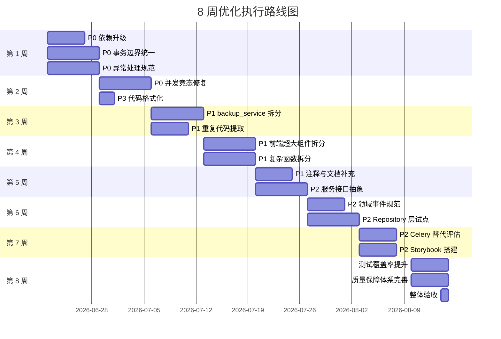
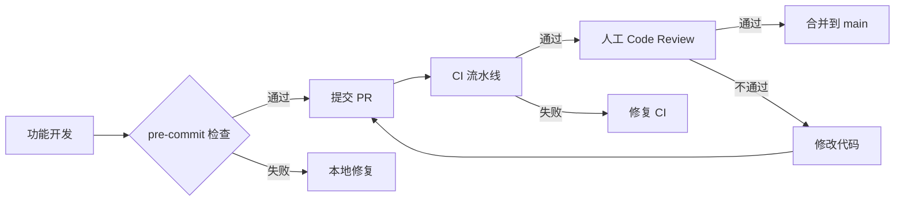

# 滨发协同 ERP 系统 — 全面优化执行方案

> **方案版本**：v1.0  
> **编制日期**：2026-06-18  
> **适用范围**：后端（fastapi_app/）、前端（frontend-vite/src/）、数据库、DevOps  
> **目标**：在 8 周内将系统综合代码质量从 67.5 分提升至 80+ 分，达到稳定生产运行标准

---

## 一、方案概述

### 1.1 目标

| 目标项 | 当前状态 | 目标状态 | 衡量指标 |
|---|---|---|---|
| 代码质量综合评分 | 67.5 / 100 | 80+ / 100 | 代码审查 + 静态扫描 |
| 后端测试覆盖率 | 约 35% | 75%+ | pytest --cov |
| 前端测试覆盖率 | 约 20% | 60%+ | vitest --coverage |
| God File 数量 | 10+ 个 | ≤ 3 个 | 单文件 > 600 行统计 |
| 核心接口 P95 延迟 | 800ms+ | < 500ms | Prometheus 监控 |
| 生产可用性 | — | 99.9% | 监控告警统计 |

### 1.2 核心原则

1. **安全优先**：所有 P0 级安全和稳定性问题必须在上机前解决
2. **小步快跑**：每个重构任务独立分支、独立测试、独立合并
3. **可观测**：所有修改必须补充或更新对应测试
4. **不破坏业务**：重构前后保持 API 契约兼容

### 1.3 执行周期

| 阶段 | 时间 | 主题 |
|---|---|---|
| 第一阶段 | 第 1-2 周 | 安全加固与稳定性修复（P0） |
| 第二阶段 | 第 3-4 周 | 核心模块代码重构（P1） |
| 第三阶段 | 第 5-6 周 | 架构优化与抽象引入（P1/P2） |
| 第四阶段 | 第 7-8 周 | 技术栈升级与质量保障体系完善（P2/P3） |

---

## 二、问题清单与优化方案

## 第一组：安全与稳定性修复（P0）

### 问题 P0-01：依赖组件存在已知安全漏洞

| 项目 | 内容 |
|---|---|
| **问题描述** | FastAPI 传递依赖 Starlette < 1.0.1（CVE-2026-48710）、python-multipart 0.0.26（CVE-2026-42561）、PyJWT 2.12.1（CVE-2026-48523）、Axios 1.7.9（CVE-2026-44490 等）、Redis 7.4.0（CVE-2025-49844） |
| **严重程度** | 🔴 P0 - Critical |
| **影响范围** | 全系统认证、文件上传、API 请求、缓存层 |
| **优化措施** | 升级 FastAPI ≥ 0.137.1、python-multipart ≥ 0.0.32、PyJWT ≥ 2.13.0、Axios ≥ 1.18.0、Redis 服务端 ≥ 7.4.9 |
| **实施步骤** | 1. 在 requirements/base.txt 和 package.json 中更新版本；2. 本地跑回归测试；3. 在 staging 环境验证文件上传、登录、WebSocket 等核心流程；4. 灰度发布 |
| **预期效果** | 消除已公开 CVE，降低认证绕过、DoS、RCE 风险 |
| **所需资源** | 后端 1 人、前端 1 人、测试 1 人，共 3 人·天 |
| **时间节点** | 第 1 周完成 |
| **验收标准** | `pip-audit` 和 `npm audit` 无 high/critical 漏洞；核心流程 E2E 通过 |

---

### 问题 P0-02：事务边界不一致导致数据不一致风险

| 项目 | 内容 |
|---|---|
| **问题描述** | 部分 service 函数内部直接调用 `db.commit()`/`db.rollback()`，部分依赖 endpoint 的 `db_transaction`；审批删除订单的领域事件曾在事务内发布 |
| **严重程度** | 🔴 P0 - High |
| **影响范围** | 订单、库存、采购计划、审批等核心业务流程 |
| **优化措施** | 建立统一事务策略：所有写操作在 endpoint 层使用 `db_transaction`；service 层只进行 `db.flush()` 或不提交；领域事件在事务提交后发布 |
| **实施步骤** | 1. 梳理所有含 `db.commit()` 的 service 函数；2. 将 commit 上移至 endpoint；3. 新增 CI 检查禁止 service 层直接 commit（除独立事务工具类）；4. 补充事务边界单元测试 |
| **预期效果** | 消除事务嵌套和提交不一致导致的数据异常 |
| **所需资源** | 后端 2 人，共 5 人·天 |
| **时间节点** | 第 1-2 周完成 |
| **验收标准** | service 层无直接 `db.commit()`（除明确标注的独立事务）；所有写接口单测通过 |

---

### 问题 P0-03：异常静默吞没

| 项目 | 内容 |
|---|---|
| **问题描述** | 代码中存在大量 `except Exception: pass` 或 `logger.warning(..., exc_info=True)` 后直接忽略，导致生产故障难以排查 |
| **严重程度** | 🔴 P0 - High |
| **影响范围** | 缓存失效、事件发布、外部服务调用、备份任务 |
| **优化措施** | 禁止裸 `except`；所有异常必须分类处理：可恢复异常记录并继续，不可恢复异常抛出自定义业务异常；关键路径异常接入 Sentry |
| **实施步骤** | 1. 启用 ruff S110 规则；2. 逐文件替换裸 except；3. 定义标准异常分类（业务/基础设施/并发/第三方）；4. 在 CI 中阻断新增裸 except |
| **预期效果** | 关键路径故障可追踪，排障时间减少 50% |
| **所需资源** | 后端 1 人，共 4 人·天 |
| **时间节点** | 第 1-2 周完成 |
| **验收标准** | `ruff check --select S110` 通过；所有 except 块有明确处理逻辑 |

---

### 问题 P0-04：并发与竞态条件

| 项目 | 内容 |
|---|---|
| **问题描述** | 编号生成、库存扣减、采购计划重算等关键操作存在并发风险；asyncio.create_task 存在 GC 风险 |
| **严重程度** | 🔴 P0 - High |
| **影响范围** | 订单号生成、库存数量、采购计划状态 |
| **优化措施** | 编号生成加 asyncio.Lock；库存扣减使用 SELECT FOR UPDATE；后台任务使用模块级 set 持有引用；领域事件提交后发布 |
| **实施步骤** | 1. 审计所有编号生成调用；2. 为 `AsyncNumberGenerator` 增加 per-prefix 锁；3. 审计库存变更函数，确保使用乐观锁或悲观锁；4. 统一后台任务引用管理模式 |
| **预期效果** | 消除重复订单号、库存超卖、事件丢失 |
| **所需资源** | 后端 2 人，共 6 人·天 |
| **时间节点** | 第 1-2 周完成 |
| **验收标准** | 并发压测 100 并发下无重复订单号、无库存负数 |

---

## 第二组：代码重构（P1）

### 问题 P1-01：后端 God File 严重

| 项目 | 内容 |
|---|---|
| **问题描述** | `backup_service.py` 3376 行、`backup.py` 2213 行、`stock_service.py` 1345 行、`purchase_plan_crud.py` 1068 行，单个文件承担过多职责 |
| **严重程度** | 🟠 P1 - High |
| **影响范围** | 维护效率、代码审查、测试覆盖、变更风险 |
| **优化措施** | 按职责拆分：backup_service → backup_orchestrator / backup_storage / backup_validation / backup_recovery / backup_policy / cleanup / metrics；stock_service → stock_query / stock_command / stock_event |
| **实施步骤** | 1. 为每个 God File 绘制函数依赖图；2. 识别内聚子模块；3. 按"小接口 + 大实现"原则拆分；4. 原文件改为 Facade 保持向后兼容；5. 逐步迁移调用者到新模块 |
| **预期效果** | 单文件行数下降 60%，测试覆盖率提升 25%，新功能开发效率提升 30% |
| **所需资源** | 后端 2-3 人，共 15 人·天 |
| **时间节点** | 第 3-4 周完成 backup_service 拆分；第 5-6 周完成 stock_service / purchase_plan_crud 拆分 |
| **验收标准** | 拆分后各文件 ≤ 600 行；单元测试覆盖率 ≥ 70%；API 契约不变 |

---

### 问题 P1-02：前端超大组件

| 项目 | 内容 |
|---|---|
| **问题描述** | `CustomerOrderView.vue` 1838 行、`ProductionView.vue` 1818 行、`StockOutTab.vue` 1757 行，一个组件混合了表格、表单、弹窗、状态管理、业务计算 |
| **严重程度** | 🟠 P1 - High |
| **影响范围** | 前端可维护性、性能、复用性 |
| **优化措施** | 按关注点拆分：TableContainer / FormContainer / DialogManager / FilterBar / composables（useOrderList / useOrderForm / useOrderActions） |
| **实施步骤** | 1. 为每个超大组件提取状态到 Pinia 或 composable；2. 拆分 UI 子组件；3. 复用通用 Table/Form/Dialog 组件；4. 补充组件测试 |
| **预期效果** | 单组件行数 ≤ 400 行；组件复用率提升 40%；Bug 修复时间减少 30% |
| **所需资源** | 前端 2 人，共 12 人·天 |
| **时间节点** | 第 3-5 周分阶段完成 |
| **验收标准** | 目标组件 script 块 ≤ 400 行；vitest 组件测试通过；无功能回退 |

---

### 问题 P1-03：函数复杂度过高

| 项目 | 内容 |
|---|---|
| **问题描述** | 大量函数超过 80 行，嵌套层级深，一个函数承担多个职责 |
| **严重程度** | 🟠 P1 - High |
| **影响范围** | 可读性、可测试性、Bug 率 |
| **优化措施** | 函数长度限制 80 行；单一职责；复杂条件拆分为命名良好的中间变量或辅助函数 |
| **实施步骤** | 1. 使用 ruff 或 radon 统计复杂函数；2. 识别 Top 20 复杂函数；3. 逐个拆分；4. 补充单元测试 |
| **预期效果** | 复杂函数数量减少 60%；新功能引入 Bug 率下降 25% |
| **所需资源** | 后端 2 人 + 前端 1 人，共 10 人·天 |
| **时间节点** | 第 3-5 周 |
| **验收标准** | 新增函数 ≤ 80 行；ruff 复杂度检查通过；单元测试覆盖率 ≥ 60% |

---

### 问题 P1-04：注释与文档不足

| 项目 | 内容 |
|---|---|
| **问题描述** | 后端注释率约 3.2%，前端约 2.1%；大量 public 函数缺少 docstring；复杂业务规则无说明 |
| **严重程度** | 🟠 P1 - Medium |
| **影响范围** | 团队 onboarding、维护成本 |
| **优化措施** | 强制 public 函数/类 docstring；复杂算法必须注释"为什么"；删除"what"型冗余注释 |
| **实施步骤** | 1. 启用 ruff D 系列规则；2. 为核心业务模块补充 docstring；3. 建立文档模板；4. 在 PR 审查中检查注释 |
| **预期效果** | 核心模块注释率达到 15%+；新人理解时间减少 40% |
| **所需资源** | 全团队，共 8 人·天 |
| **时间节点** | 第 3-6 周持续推进 |
| **验收标准** | ruff docstring 检查通过；核心函数覆盖率 100% |

---

### 问题 P1-05：重复代码

| 项目 | 内容 |
|---|---|
| **问题描述** | 分页响应结构、日期解析、权限校验、API 错误处理等逻辑在多处重复 |
| **严重程度** | 🟠 P1 - Medium |
| **影响范围** | 维护成本、一致性 |
| **优化措施** | 提取公共工具：分页响应 builder、日期解析器、统一 API 拦截器 |
| **实施步骤** | 1. 扫描重复代码块；2. 设计公共 API；3. 逐步替换；4. 补充工具函数测试 |
| **预期效果** | 重复代码减少 30%；变更影响范围缩小 |
| **所需资源** | 后端 1 人 + 前端 1 人，共 6 人·天 |
| **时间节点** | 第 3-4 周 |
| **验收标准** | 相同逻辑只在一处实现；相关单测通过 |

---

## 第三组：架构优化（P1/P2）

### 问题 P2-01：缺少服务抽象层

| 项目 | 内容 |
|---|---|
| **问题描述** | Services 之间直接依赖具体实现，缺少接口/抽象基类，难以单元测试和替换实现 |
| **严重程度** | 🟡 P2 - Medium |
| **影响范围** | 可测试性、模块解耦 |
| **优化措施** | 引入 `BaseCRUDService`、`BaseEventPublisher`、`BaseNotificationClient` 等抽象；核心服务通过 Protocol 或 ABC 定义接口 |
| **实施步骤** | 1. 识别最常被依赖的服务；2. 定义接口；3. 让实现类继承接口；4. 在 endpoint 层通过依赖注入使用接口 |
| **预期效果** | 单元测试可 mock 依赖；模块耦合度降低 30% |
| **所需资源** | 后端 2 人，共 8 人·天 |
| **时间节点** | 第 5-6 周 |
| **验收标准** | 核心服务有接口定义；单元测试使用 mock |

---

### 问题 P2-02：领域事件边界不规范

| 项目 | 内容 |
|---|---|
| **问题描述** | 部分事件在 service 层发布、部分在 endpoint 层发布；存在重复发布风险；事件订阅者职责不清晰 |
| **严重程度** | 🟡 P2 - High |
| **影响范围** | 事件一致性、跨模块解耦 |
| **优化措施** | 制定事件发布规范：写操作成功后由 endpoint 发布；service 层不直接发布领域事件；建立事件注册表 |
| **实施步骤** | 1. 梳理所有 `publish_domain_event` 调用；2. 将 service 层事件上移到 endpoint；3. 建立事件文档；4. 增加事件顺序和幂等性测试 |
| **预期效果** | 事件发布统一、无重复、无时序问题 |
| **所需资源** | 后端 2 人，共 6 人·天 |
| **时间节点** | 第 5-6 周 |
| **验收标准** | 仅 endpoint 发布领域事件；所有事件有文档说明 |

---

### 问题 P2-03：Repository 层缺失

| 项目 | 内容 |
|---|---|
| **问题描述** | SQL 复杂查询直接散落在 service 中，数据访问逻辑与业务逻辑混合 |
| **严重程度** | 🟡 P2 - Medium |
| **影响范围** | 可测试性、数据库优化 |
| **优化措施** | 引入 Repository 模式：每个领域一个 Repository 类，封装查询和持久化 |
| **实施步骤** | 1. 从 order/product/stock 领域试点；2. 提取 Repository 类；3. service 只调用 Repository；4. 逐步推广 |
| **预期效果** | SQL 优化集中化；service 层更纯粹；测试可 mock 数据层 |
| **所需资源** | 后端 2 人，共 10 人·天 |
| **时间节点** | 第 5-8 周 |
| **验收标准** | 核心领域有 Repository；service 层无 raw SQL |

---

## 第四组：技术栈优化（P2/P3）

### 问题 P2-04：Celery 与全异步架构割裂

| 项目 | 内容 |
|---|---|
| **问题描述** | FastAPI 全异步，但 Celery Worker 是同步模型，任务处理存在上下文切换和阻塞 |
| **严重程度** | 🟡 P2 - Medium |
| **影响范围** | 异步任务性能、代码一致性 |
| **优化措施** | 评估迁移至 `arq` 或 `dramatiq`；或保持 Celery 但将 CPU 密集型任务拆分到独立服务 |
| **实施步骤** | 1. 调研 arq/dramatiq；2. 写一个试点任务迁移；3. 评估性能差异；4. 决定是否全面迁移 |
| **预期效果** | 任务延迟降低 10-20%；代码风格更统一 |
| **所需资源** | 后端 1 人，共 5 人·天 |
| **时间节点** | 第 7-8 周评估，后续规划 |
| **验收标准** | 有试点任务和性能对比报告 |

---

### 问题 P2-05：前端缺少组件文档

| 项目 | 内容 |
|---|---|
| **问题描述** | 30+ 自定义 Ui* 组件缺少 Storybook 或文档，复用困难 |
| **严重程度** | 🟡 P2 - Low |
| **影响范围** | 前端开发效率 |
| **优化措施** | 引入 Storybook 或建立组件文档站点；为每个 Ui* 组件编写示例和 Props 说明 |
| **实施步骤** | 1. 搭建 Storybook；2. 为核心组件（Button/Table/Dialog/Form）写 story；3. 逐步覆盖所有组件 |
| **预期效果** | 组件复用率提升 30%；UI 一致性提升 |
| **所需资源** | 前端 1 人，共 5 人·天 |
| **时间节点** | 第 7-8 周启动 |
| **验收标准** | 核心组件有 Storybook 示例 |

---

### 问题 P3-01：import 排序与代码格式

| 项目 | 内容 |
|---|---|
| **问题描述** | import 未排序、行尾空白、全角符号等格式问题大量存在 |
| **严重程度** | 🟢 P3 - Low |
| **影响范围** | 代码整洁度 |
| **优化措施** | 运行 `ruff check --fix` 和 `prettier --write`；在 CI 中强制格式检查 |
| **实施步骤** | 1. 全量格式化；2. 配置 pre-commit hook；3. CI 阻断未格式化代码 |
| **预期效果** | 代码风格统一；审查聚焦业务逻辑 |
| **所需资源** | 全团队 1 人·天 |
| **时间节点** | 第 1 周 |
| **验收标准** | ruff + prettier CI 通过 |

---

## 三、执行路线图

---

## 四、质量保障体系

### 4.1 代码审查流程

### 4.2 CI 流水线检查项

| 阶段 | 检查内容 | 失败策略 |
|---|---|---|
| Lint | ruff、prettier、eslint | 阻断 |
| Type Check | mypy、vue-tsc | 阻断 |
| Unit Test | pytest、vitest | 阻断 |
| Security | bandit、pip-audit、npm audit | high/critical 阻断 |
| Coverage | 后端 ≥ 60%、前端 ≥ 40% | 警告 |
| E2E | Playwright 核心流程 | 阻断 |

### 4.3 测试覆盖率目标

| 层级 | 当前 | 4 周目标 | 8 周目标 |
|---|---:|---:|---:|
| 后端单元测试 | 35% | 60% | 75% |
| 后端核心服务 | 45% | 75% | 85% |
| 前端组件测试 | 20% | 40% | 60% |
| E2E 核心流程 | 10% | 30% | 50% |

### 4.4 性能基线

| 指标 | 当前基线 | 目标 |
|---|---|---|
| 首页 FCP | 2.5s | < 2.0s |
| API P95 | 800ms | < 500ms |
| 订单创建 | 1.2s | < 1.0s |
| 批量导入 1000 条 | 15s | < 10s |
| 并发用户 | 50 | 100+ |

---

## 五、资源与风险管理

### 5.1 人力资源

| 角色 | 人数 | 投入周期 |
|---|---|---|
| 后端高级工程师 | 2 | 全程 |
| 前端高级工程师 | 2 | 全程 |
| 测试工程师 | 1 | 第 2-8 周 |
| DevOps 工程师 | 1 | 第 1、7-8 周 |
| 技术负责人 | 1 | 全程（每周 20%） |

### 5.2 主要风险与应对

| 风险 | 影响 | 应对措施 |
|---|---|---|
| 重构引入回归 Bug | 高 | 每个重构任务必须有完整单测和 E2E 覆盖；灰度发布 |
| 依赖升级破坏兼容 | 高 | 先在 staging 验证；锁定版本；保留回滚方案 |
| 团队成员抵制新规范 | 中 | 开展代码规范培训；Review 中严格执行 |
| 时间进度延误 | 中 | 每周站会跟踪；P0 必须完成，P3 可延期 |
| 数据库迁移风险 | 高 | 所有 schema 变更通过 Alembic；上线前备份 |

### 5.3 验收节点

| 节点 | 时间 | 验收内容 |
|---|---|---|
| Milestone 1 | 第 2 周末 | P0 全部完成；CI 无 high 漏洞；核心流程 E2E 通过 |
| Milestone 2 | 第 4 周末 | God File 拆分完成；测试覆盖率达标 |
| Milestone 3 | 第 6 周末 | 架构抽象引入；事件规范落地 |
| Milestone 4 | 第 8 周末 | 综合评分 ≥ 80；性能基线达标；正式上线 |

---

## 六、附录

### 6.1 推荐工具链

| 用途 | 工具 |
|---|---|
| Python Lint | ruff |
| Python Type Check | mypy |
| Python Test | pytest + pytest-cov |
| Python Security | bandit + pip-audit |
| Frontend Lint | eslint + prettier |
| Frontend Type | vue-tsc |
| Frontend Test | vitest + @vue/test-utils |
| E2E | Playwright |
| Component Doc | Storybook |
| Performance | Lighthouse + Prometheus |

### 6.2 关键文件清单

| 文件 | 说明 |
|---|---|
| [fastapi_app/services/backup_service.py](file:///d:/erp_system/fastapi_app/services/backup_service.py) | 3376 行，需拆分 |
| [fastapi_app/api/v1/endpoints/backup.py](file:///d:/erp_system/fastapi_app/api/v1/endpoints/backup.py) | 2213 行，需拆分 |
| [frontend-vite/src/views/customer-order/CustomerOrderView.vue](file:///d:/erp_system/frontend-vite/src/views/customer-order/CustomerOrderView.vue) | 1838 行，需拆分 |
| [frontend-vite/src/views/production/ProductionView.vue](file:///d:/erp_system/frontend-vite/src/views/production/ProductionView.vue) | 1818 行，需拆分 |
| [fastapi_app/core/domain_events.py](file:///d:/erp_system/fastapi_app/core/domain_events.py) | 事件总线，需规范边界 |
| [fastapi_app/services/order_crud.py](file:///d:/erp_system/fastapi_app/services/order_crud.py) | 订单核心，需事务边界审查 |

---

**编制人**：AI 代码审查助手  
**审核人**：待技术负责人确认  
**生效日期**：2026-06-18
