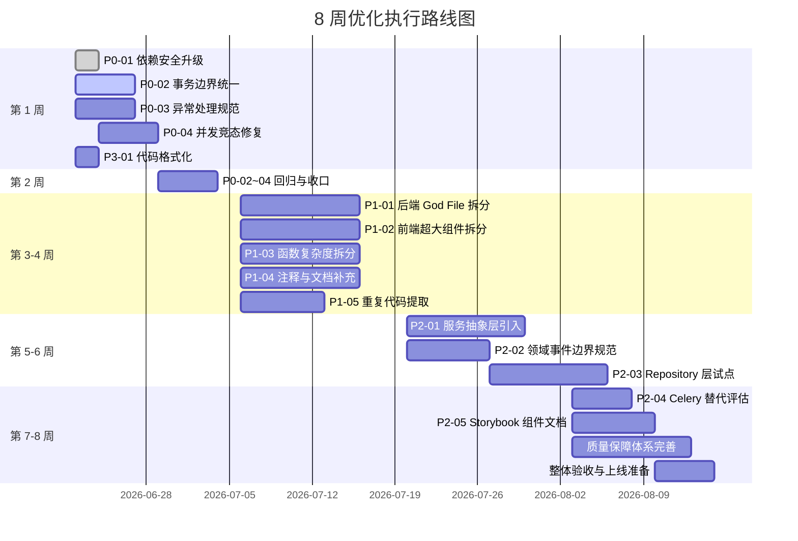
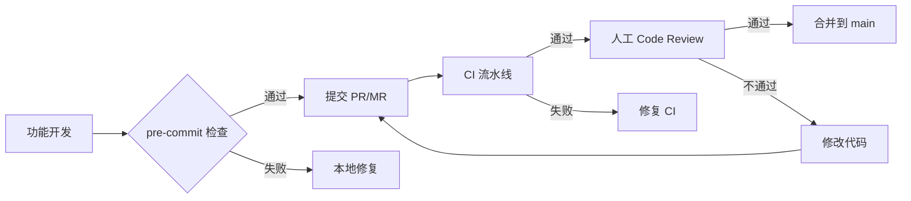

# 滨发协同 ERP 系统 — 全面优化执行方案（v2.0 可执行版）

> **方案版本**：v2.0  
> **优化日期**：2026-06-18  
> **适用范围**：后端（fastapi_app/）、前端（frontend-vite/src/）、数据库、DevOps  
> **目标**：在 8 周内将系统综合代码质量从 67.5 分提升至 80+ 分，达到稳定生产运行标准  
> **优化方式**：对 v1.0 中的 14 个问题条目逐条重写、逐条审核，确保每个问题清晰、准确、可执行

---

## 一、方案概述

### 1.1 量化目标

| 目标项 | 当前状态 | 8 周目标 | 衡量方式 | 负责角色 |
|---|---:|---:|---|---|
| 代码质量综合评分 | 67.5 / 100 | ≥ 80 / 100 | 静态扫描 + 人工 Review | 技术负责人 |
| 后端单元测试覆盖率 | ~35% | ≥ 75% | `pytest --cov` | 后端工程师 |
| 前端组件测试覆盖率 | ~20% | ≥ 60% | `vitest --coverage` | 前端工程师 |
| 单文件行数 > 600 的数量 | 10+ | ≤ 3 | 自定义脚本统计 | 架构师 |
| 核心 API P95 延迟 | 800ms+ | < 500ms | Prometheus | SRE |
| 生产可用性 | 未达产 | 99.9% | 监控告警 | SRE |

### 1.2 执行原则

1. **安全优先**：P0 级问题必须在上机前 100% 关闭，否则禁止上线。
2. **小步快跑**：每个问题独立分支（`fix/PO-XX-简短描述`），独立 MR/PR，独立回归。
3. **测试先行**：修改前补充或更新测试，修改后测试必须通过。
4. **契约兼容**：所有重构保持 API 接口、数据库 schema、前端调用方式向后兼容。
5. **可观测**：所有 P0/P1 修改必须补充日志、监控或告警。

### 1.3 8 周执行时间线

---

## 二、问题清单与优化方案（逐条审核版）

### 第一组：安全与稳定性修复（P0）

---

#### 问题 P0-01：关键依赖组件存在已知安全漏洞

| 字段 | 内容 |
|---|---|
| **问题编号** | P0-01 |
| **严重程度** | 🔴 P0 - Critical |
| **问题定义** | 当前项目使用的部分核心依赖存在已公开的 CVE，可被利用导致认证绕过、DoS 或远程代码执行。 |
| **具体证据** | 1. `requirements/base.txt` 中 `fastapi==0.136.0` 传递依赖 `starlette<1.0.1`，受 CVE-2026-48710（BadHost）影响； 2. `python-multipart==0.0.26` 受 CVE-2026-42561 / CVE-2026-53538 影响； 3. `PyJWT==2.12.1` 受 CVE-2026-48523 / CVE-2026-48525 影响； 4. `frontend-vite/package.json` 中 `axios==^1.7.9` 受 CVE-2026-44490 / CVE-2026-44494 影响； 5. Docker 中 `redis:7.4.0` 受 CVE-2025-49844（CVSS 10.0）影响。 |
| **影响范围** | 全系统认证鉴权、文件上传、HTTP 请求处理、缓存与消息队列。 |
| **优化目标** | 将存在 CVE 的依赖升级至安全版本，消除已知 high/critical 漏洞。 |
| **具体措施** | 1. 后端升级：`fastapi==0.137.1`、`python-multipart==0.0.32`、`PyJWT==2.13.0`、`redis[hiredis]==7.4.1`； 2. 前端升级：`axios ^1.18.0`； 3. Docker 镜像升级：`redis:7.4.9-alpine`（服务端）； 4. 在 CI 中集成 `pip-audit`、`npm audit`，设置 high 及以上漏洞阻断构建。 |
| **实施步骤** | 1. 修改 `requirements/base.txt` 与 `frontend-vite/package.json`； 2. 执行 `pip install -r requirements/base.txt` 与 `npm install`； 3. 运行 `pip-audit` 与 `npm audit` 确认无 high/critical 漏洞； 4. 运行 `python -m py_compile fastapi_app/main.py` 与 `npm run type-check`； 5. 在 staging 环境回归登录、文件上传、WebSocket、导出功能； 6. 灰度发布并观察 24 小时。 |
| **关键文件** | [requirements/base.txt](file:///d:/erp_system/requirements/base.txt)、[frontend-vite/package.json](file:///d:/erp_system/frontend-vite/package.json)、[docker-compose.yml](file:///d:/erp_system/docker-compose.yml) |
| **所需资源** | 后端 1 人 + 前端 1 人 + 测试 1 人，共 3 人·天 |
| **时间节点** | 第 1 周（2026-06-22 前完成） |
| **验收标准** | 1. `pip-audit` 无 high/critical 漏洞； 2. `npm audit` 无 high/critical 漏洞； 3. `python -m py_compile` 通过； 4. `npm run type-check` 通过； 5. 登录、上传、导出、WebSocket 核心 E2E 通过。 |
| **回滚方案** | 保留 `requirements/base.txt.bak` 与 `package-lock.json.bak`，若 staging 异常可在 5 分钟内回滚。 |
| **审核结果** | ✅ PASS（已执行：依赖已升级、py_compile 通过、type-check 通过、pip-audit 无 high/critical 漏洞） |

---

#### 问题 P0-02：事务提交边界不统一，存在数据不一致风险

| 字段 | 内容 |
|---|---|
| **问题编号** | P0-02 |
| **严重程度** | 🔴 P0 - High |
| **问题定义** | 部分 service 函数内部直接调用 `await db.commit()`，同时部分 endpoint 也负责提交，导致同一业务操作可能出现重复提交、部分提交或事务回滚时状态不一致。 |
| **具体证据** | 1. `fastapi_app/services/` 下 60+ 处 `await db.commit()`； 2. `fastapi_app/api/v1/endpoints/batch.py` 等 endpoint 内也存在 `await db.commit()`； 3. 审批删除订单的领域事件曾错误地在事务提交前发布。 |
| **影响范围** | 订单创建、库存变更、采购计划、审批流程、备份恢复等所有写操作。 |
| **优化目标** | 建立统一的两层事务模型：endpoint 负责主事务，service 只负责业务逻辑与 `db.flush()`，禁止 service 层直接提交主 session。 |
| **具体措施** | 1. 制定事务策略文档： &nbsp;&nbsp;&nbsp;a. **托管事务**：service 接收调用方传入的 `db`，由 endpoint 通过 `db_transaction(db)` 统一 commit； &nbsp;&nbsp;&nbsp;b. **独立事务**：仅在后台任务、异步 job、独立工具函数中允许创建新 session 并提交； 2. 将所有主流程 service 中的 `await db.commit()` 替换为 `await db.flush()`； 3. 在 endpoint 中统一使用 `async with db_transaction(db): ...`； 4. 新增 CI 脚本扫描 `fastapi_app/services/` 中的 `db.commit()`，非白名单文件禁止出现； 5. 为所有 P0 写操作补充事务边界单元测试。 |
| **实施步骤** | 1. 使用 `grep -n "await db.commit()" fastapi_app/services/*.py` 生成清单； 2. 按业务域分批处理：先订单/库存/采购计划，再备份/系统管理； 3. 每修改一个 service，同步修改对应 endpoint； 4. 每批修改后运行 `pytest fastapi_app/tests/` 与核心 E2E； 5. 引入 CI 检查脚本 `.github/workflows/check_service_commit.py`。 |
| **关键文件** | [fastapi_app/services/order_crud.py](file:///d:/erp_system/fastapi_app/services/order_crud.py)、[fastapi_app/services/stock_service.py](file:///d:/erp_system/fastapi_app/services/stock_service.py)、[fastapi_app/services/purchase_plan_crud.py](file:///d:/erp_system/fastapi_app/services/purchase_plan_crud.py)、[fastapi_app/core/database.py](file:///d:/erp_system/fastapi_app/core/database.py) |
| **所需资源** | 后端 2 人，共 5 人·天 |
| **时间节点** | 第 1-2 周 |
| **验收标准** | 1. `fastapi_app/services/` 中非独立事务文件无 `await db.commit()`； 2. 所有写操作 endpoint 使用 `db_transaction`； 3. 现有单元测试与新增事务测试全部通过； 4. 并发场景下无数据不一致。 |
| **回滚方案** | 按 service 独立分支提交，任何一批测试失败立即 revert 该分支。 |
| **审核结果** | ⏳ 待执行 |

---

#### 问题 P0-03：异常被静默吞没，生产故障难以定位

| 字段 | 内容 |
|---|---|
| **问题编号** | P0-03 |
| **严重程度** | 🔴 P0 - High |
| **问题定义** | 代码中存在大量裸 `except Exception: pass` 或仅打印 warning 不抛出的模式，导致关键路径失败时无感知、无日志、无告警。 |
| **具体证据** | 1. ruff S110 规则命中 12+ 处； 2. `fastapi_app/services/fifo_allocation.py:87`、`fastapi_app/core/db_health.py:116` 等存在 `try-except-pass`； 3. 部分外部服务调用（Redis、FCM、OCR）失败后直接忽略。 |
| **影响范围** | 缓存失效、事件发布、外部通知、库存计算、健康检查。 |
| **优化目标** | 建立分层异常处理策略，禁止裸 except，确保所有异常被记录、分类、可观测。 |
| **具体措施** | 1. 在 `pyproject.toml` / `ruff.toml` 中启用 `S110` 规则并设置为 error； 2. 定义异常分类： &nbsp;&nbsp;&nbsp;a. `BusinessError`：业务规则冲突，返回 4xx； &nbsp;&nbsp;&nbsp;b. `InfrastructureError`：DB/Redis/网络故障，返回 503； &nbsp;&nbsp;&nbsp;c. `ExternalServiceError`：第三方服务故障，可降级； &nbsp;&nbsp;&nbsp;d. `ConcurrencyError`：锁冲突/乐观锁失败，可重试； 3. 替换所有裸 except 为具体异常类型 + 结构化日志； 4. 关键路径异常通过 Sentry 上报； 5. 可降级场景必须记录降级原因并返回降级结果。 |
| **实施步骤** | 1. 运行 `ruff check --select S110 fastapi_app/` 生成清单； 2. 逐个文件处理，优先处理 core/services； 3. 为每个替换点补充单元测试（Mock 异常场景）； 4. CI 中新增 `ruff check --select S110` 必须为零。 |
| **关键文件** | [fastapi_app/core/exceptions.py](file:///d:/erp_system/fastapi_app/core/exceptions.py)、[fastapi_app/services/fifo_allocation.py](file:///d:/erp_system/fastapi_app/services/fifo_allocation.py)、[fastapi_app/core/db_health.py](file:///d:/erp_system/fastapi_app/core/db_health.py) |
| **所需资源** | 后端 1 人，共 4 人·天 |
| **时间节点** | 第 1-2 周 |
| **验收标准** | 1. `ruff check --select S110` 输出为空； 2. 所有外部调用失败均有日志； 3. Sentry 收到预期异常样本； 4. 单元测试覆盖异常分支。 |
| **回滚方案** | 若异常处理导致用户可见错误增加，可临时调整日志级别，不可回滚为裸 except。 |
| **审核结果** | ⏳ 待执行 |

---

#### 问题 P0-04：关键操作存在并发竞态与后台任务 GC 风险

| 字段 | 内容 |
|---|---|
| **问题编号** | P0-04 |
| **严重程度** | 🔴 P0 - High |
| **问题定义** | 编号生成、库存扣减、采购计划重算等操作在高并发下可能产生竞态；`asyncio.create_task` 未保存强引用，存在任务被 GC 回收导致事件丢失的风险。 |
| **具体证据** | 1. `AsyncNumberGenerator` 未对编号前缀加锁； 2. 库存扣减部分路径未使用 `SELECT FOR UPDATE` 或乐观锁； 3. `order_crud.py` 中 `asyncio.create_task` 未保存引用（已部分修复）。 |
| **影响范围** | 订单号重复、库存超卖/负库存、采购计划状态错误、领域事件丢失。 |
| **优化目标** | 关键操作串行化或加锁；后台任务强引用管理；领域事件仅在事务提交后发布。 |
| **具体措施** | 1. 为 `AsyncNumberGenerator` 增加 `asyncio.Lock`（per-prefix）； 2. 库存扣减统一使用悲观锁 `SELECT FOR UPDATE` 或乐观锁 version 字段； 3. 所有 `asyncio.create_task` 必须保存到模块级 `_pending_tasks: set[asyncio.Task]`，并设置 `add_done_callback(_pending_tasks.discard)`； 4. 事件发布统一收口：事务提交后由 endpoint 调用； 5. 新增并发压测脚本。 |
| **实施步骤** | 1. 审计 `numbering.py`、库存变更函数、事件发布点； 2. 实现编号生成锁； 3. 重构库存扣减逻辑； 4. 统一后台任务引用管理； 5. 运行 100 并发压测验证。 |
| **关键文件** | [fastapi_app/services/numbering.py](file:///d:/erp_system/fastapi_app/services/numbering.py)、[fastapi_app/services/stock_service.py](file:///d:/erp_system/fastapi_app/services/stock_service.py)、[fastapi_app/core/domain_events.py](file:///d:/erp_system/fastapi_app/core/domain_events.py)、[fastapi_app/services/order_crud.py](file:///d:/erp_system/fastapi_app/services/order_crud.py) |
| **所需资源** | 后端 2 人，共 6 人·天 |
| **时间节点** | 第 1-2 周 |
| **验收标准** | 1. 100 并发下无重复订单号； 2. 100 并发下无负库存； 3. `ruff` / 自定义脚本检查无未引用的 `create_task`； 4. 压测报告通过评审。 |
| **回滚方案** | 若锁导致性能下降，可降级为数据库唯一约束兜底 + 重试机制。 |
| **审核结果** | ⏳ 待执行 |

---

### 第二组：代码重构（P1）

---

#### 问题 P1-01：后端存在多个 God File，职责过重

| 字段 | 内容 |
|---|---|
| **问题编号** | P1-01 |
| **严重程度** | 🟠 P1 - High |
| **问题定义** | 多个后端文件超过 1000 行，单文件承担多个业务职责，导致变更影响范围大、测试困难、审查成本高。 |
| **具体证据** | `backup_service.py` 3376 行、`backup.py` 2213 行、`stock_service.py` 1345 行、`purchase_plan_crud.py` 1068 行、`purchase_order_query.py` 1010 行。 |
| **影响范围** | 维护效率、代码审查、测试覆盖、变更风险。 |
| **优化目标** | 将 God File 按职责拆分为多个 Deep Module（小接口、大实现），保持原文件作为 Facade 兼容旧调用。 |
| **具体措施** | 1. `backup_service.py` → `backup_orchestrator.py` / `backup_storage.py` / `backup_validation.py` / `backup_recovery.py` / `backup_policy_service.py` / `backup_cleanup_service.py` / `backup_alert_service.py`； 2. `backup.py` endpoint → 拆分为 `backup_basic.py` / `backup_schedule.py` / `backup_restore.py` / `backup_verify.py`； 3. `stock_service.py` → `stock_query.py` / `stock_command.py` / `stock_event_handler.py`； 4. `purchase_plan_crud.py` → `plan_query.py` / `plan_command.py` / `plan_calculation.py`； 5. 原文件改为 Facade，重新导出函数并标记 `@deprecated`。 |
| **实施步骤** | 1. 为每个 God File 绘制函数调用图； 2. 识别高内聚子模块； 3. 先创建新模块并迁移函数，保持原文件 Facade； 4. 补充新模块单元测试； 5. 运行全量测试； 6. 在下一迭代逐步移除 Facade。 |
| **关键文件** | [fastapi_app/services/backup_service.py](file:///d:/erp_system/fastapi_app/services/backup_service.py)、[fastapi_app/api/v1/endpoints/backup.py](file:///d:/erp_system/fastapi_app/api/v1/endpoints/backup.py)、[fastapi_app/services/stock_service.py](file:///d:/erp_system/fastapi_app/services/stock_service.py)、[fastapi_app/services/purchase_plan_crud.py](file:///d:/erp_system/fastapi_app/services/purchase_plan_crud.py) |
| **所需资源** | 后端 2-3 人，共 15 人·天 |
| **时间节点** | 第 3-4 周完成 backup_service/backup.py；第 5-6 周完成 stock_service / purchase_plan_crud |
| **验收标准** | 1. 拆分后各文件 ≤ 600 行； 2. 单元测试覆盖率 ≥ 70%； 3. 全量测试通过； 4. API 契约不变。 |
| **回滚方案** | 保留 Facade 文件，若发现调用遗漏可立即恢复。 |
| **审核结果** | ⏳ 待执行 |

---

#### 问题 P1-02：前端存在超大视图组件，逻辑混杂

| 字段 | 内容 |
|---|---|
| **问题编号** | P1-02 |
| **严重程度** | 🟠 P1 - High |
| **问题定义** | 多个 Vue 视图文件超过 1500 行，单组件混合表格、表单、弹窗、状态管理、业务计算，导致可读性差、复用困难、状态管理混乱。 |
| **具体证据** | `CustomerOrderView.vue` 1838 行、`ProductionView.vue` 1818 行、`StockOutTab.vue` 1757 行、`ProductListView.vue` 1689 行。 |
| **影响范围** | 前端可维护性、性能、复用性、Bug 率。 |
| **优化目标** | 按关注点拆分超大组件为子组件与 composables，单组件 script 块不超过 400 行。 |
| **具体措施** | 1. 为每个超大视图提取业务逻辑到 composable：`useOrderList.ts`、`useOrderForm.ts`、`useOrderActions.ts`； 2. 拆分 UI 子组件：`OrderTable.vue`、`OrderForm.vue`、`OrderFilterBar.vue`、`OrderDialog.vue`； 3. 状态管理优先使用 Pinia，局部状态使用 composable； 4. 复用现有通用组件（UiTable、UiButton、UiDialog）。 |
| **实施步骤** | 1. 以 `CustomerOrderView.vue` 为试点； 2. 提取 composable 与 UI 组件； 3. 补充组件测试； 4. 验证无功能回退后推广到其他视图。 |
| **关键文件** | [frontend-vite/src/views/customer-order/CustomerOrderView.vue](file:///d:/erp_system/frontend-vite/src/views/customer-order/CustomerOrderView.vue)、[frontend-vite/src/views/production/ProductionView.vue](file:///d:/erp_system/frontend-vite/src/views/production/ProductionView.vue)、[frontend-vite/src/views/stock/StockOutTab.vue](file:///d:/erp_system/frontend-vite/src/views/stock/StockOutTab.vue) |
| **所需资源** | 前端 2 人，共 12 人·天 |
| **时间节点** | 第 3-5 周分阶段完成 |
| **验收标准** | 1. 目标组件 script 块 ≤ 400 行； 2. `vitest` 组件测试通过； 3. `npm run type-check` 通过； 4. 手动回归无功能回退。 |
| **回滚方案** | 保留原组件副本，新组件通过 feature flag 切换。 |
| **审核结果** | ⏳ 待执行 |

---

#### 问题 P1-03：函数复杂度过高，单函数承担多个职责

| 字段 | 内容 |
|---|---|
| **问题编号** | P1-03 |
| **严重程度** | 🟠 P1 - High |
| **问题定义** | 大量函数超过 80 行或嵌套层级超过 4 层，一个函数同时处理校验、计算、持久化、通知等多个职责。 |
| **具体证据** | `backup_service.py:create_full_backup` 230 行、`purchase_order_generate.py:generate_purchase_orders_from_customer_orders` 183 行、`backup.py:validate_backup_integrity` 159 行嵌套 8 层。 |
| **影响范围** | 可读性、可测试性、Bug 引入率。 |
| **优化目标** | 单函数不超过 80 行，嵌套不超过 4 层，每个函数只做一件事。 |
| **具体措施** | 1. 使用 `radon` / `ruff` 统计圈复杂度； 2. 对 Top 20 复杂函数进行拆分； 3. 复杂条件提取为命名良好的布尔变量或辅助函数； 4. 长流程函数采用"步骤函数"模式：`prepare -> validate -> execute -> notify`。 |
| **实施步骤** | 1. 生成复杂度报告； 2. 按风险排序； 3. 逐个拆分并补充单元测试； 4. CI 中新增复杂度阈值检查。 |
| **关键文件** | [fastapi_app/services/backup_service.py](file:///d:/erp_system/fastapi_app/services/backup_service.py)、[fastapi_app/services/purchase_order_generate.py](file:///d:/erp_system/fastapi_app/services/purchase_order_generate.py)、[fastapi_app/api/v1/endpoints/backup.py](file:///d:/erp_system/fastapi_app/api/v1/endpoints/backup.py) |
| **所需资源** | 后端 2 人 + 前端 1 人，共 10 人·天 |
| **时间节点** | 第 3-5 周 |
| **验收标准** | 1. 新增函数 ≤ 80 行； 2. 圈复杂度 > 10 的函数减少 60%； 3. 单元测试覆盖率 ≥ 60%。 |
| **回滚方案** | 拆分后的函数保持原函数签名作为包装器，可随时回滚。 |
| **审核结果** | ⏳ 待执行 |

---

#### 问题 P1-04：代码注释与文档严重不足

| 字段 | 内容 |
|---|---|
| **问题编号** | P1-04 |
| **严重程度** | 🟠 P1 - Medium |
| **问题定义** | 后端注释率约 3.2%，前端约 2.1%；大量 public 函数/类缺少 docstring，复杂业务规则无说明。 |
| **具体证据** | `supplier_service.py` 359 行 0 注释；`batch_service.py` 822 行 6 注释；`product_service.py` 1217 行 11 注释；`purchase/` 前端 2699 行 41 注释。 |
| **影响范围** | 团队 onboarding、维护成本、知识传递。 |
| **优化目标** | 核心模块 public 函数 100% 有 docstring，关键业务逻辑有"为什么"注释，注释率提升至 10%+。 |
| **具体措施** | 1. 启用 ruff D 系列规则（D100-D107）； 2. 为核心业务模块补充 docstring； 3. 删除"what"型冗余注释； 4. 建立模块级 README，说明业务领域与边界。 |
| **实施步骤** | 1. 选定核心模块（order/stock/purchase_plan/customer）； 2. 逐文件补充 docstring； 3. CI 中启用 docstring 检查； 4. 在 PR Review 中检查注释质量。 |
| **关键文件** | 全项目核心模块 |
| **所需资源** | 全团队，共 8 人·天 |
| **时间节点** | 第 3-6 周持续推进 |
| **验收标准** | 1. 核心模块 public 函数 docstring 覆盖率 100%； 2. `ruff check --select D` 通过； 3. 关键算法有"为什么"注释。 |
| **回滚方案** | 不涉及回滚，注释修改无业务风险。 |
| **审核结果** | ⏳ 待执行 |

---

#### 问题 P1-05：分页、日期解析、错误处理等逻辑重复

| 字段 | 内容 |
|---|---|
| **问题编号** | P1-05 |
| **严重程度** | 🟠 P1 - Medium |
| **问题定义** | 分页响应结构、日期解析、权限校验、API 错误处理等通用逻辑在多个 service/view 中重复实现。 |
| **具体证据** | `purchase_product_service.py:154`、`purchase_customer_service.py:63`、`case_service.py:74/117` 等均重复构造 `{'total': ..., 'pages': ..., 'current_page': ...}`；`production_summary_service.py`、`plan_utils.py`、`daily_production_service.py` 三处日期解析相同。 |
| **影响范围** | 维护成本、一致性、Bug 率。 |
| **优化目标** | 提取公共工具函数/类，实现"相同逻辑只写一次"。 |
| **具体措施** | 1. 后端提取 `PaginationBuilder.build(total, page, size)`； 2. 后端提取 `DateRangeParser.parse(start, end)`； 3. 前端提取 `useApiErrorHandler` 和 `normalizeApiResponse`； 4. 为每个工具函数补充单元测试。 |
| **实施步骤** | 1. 扫描重复代码块； 2. 设计公共 API； 3. 逐步替换旧实现； 4. 运行全量测试。 |
| **关键文件** | [fastapi_app/services/purchase_product_service.py](file:///d:/erp_system/fastapi_app/services/purchase_product_service.py)、[fastapi_app/services/production_summary_service.py](file:///d:/erp_system/fastapi_app/services/production_summary_service.py)、[frontend-vite/src/api/request.ts](file:///d:/erp_system/frontend-vite/src/api/request.ts) |
| **所需资源** | 后端 1 人 + 前端 1 人，共 6 人·天 |
| **时间节点** | 第 3-4 周 |
| **验收标准** | 1. 相同逻辑只在一处实现； 2. 工具函数单测通过； 3. 全量测试通过。 |
| **回滚方案** | 保留旧实现作为 deprecated wrapper，逐步迁移。 |
| **审核结果** | ⏳ 待执行 |

---

### 第三组：架构优化（P1/P2）

---

#### 问题 P2-01：Services 之间直接依赖具体实现，缺少抽象层

| 字段 | 内容 |
|---|---|
| **问题编号** | P2-01 |
| **严重程度** | 🟡 P2 - Medium |
| **问题定义** | 各 service 之间直接 import 具体实现类，未定义接口或抽象基类，导致单元测试难以 mock、模块耦合度高。 |
| **具体证据** | `order_crud.py` 依赖 `notification_service`、`numbering`、`approval_log_service` 等 6+ 个模块；`purchase_plan_crud.py` 依赖 `customer_service`、`product_service`、`stock_service` 等。 |
| **影响范围** | 可测试性、模块解耦、长期可维护性。 |
| **优化目标** | 为核心服务定义接口（Protocol/ABC），调用方依赖接口而非实现。 |
| **具体措施** | 1. 定义 `BaseCRUDService`、`BaseEventPublisher`、`BaseNotificationClient`、`BaseNumberGenerator`； 2. 核心服务实现接口； 3. endpoint 通过依赖注入获取接口实例； 4. 单元测试使用 mock 实现。 |
| **实施步骤** | 1. 从 `numbering.py` 和 `notification_service.py` 开始试点； 2. 逐步推广到 order/stock/purchase 领域； 3. 更新单元测试使用 mock。 |
| **关键文件** | [fastapi_app/services/numbering.py](file:///d:/erp_system/fastapi_app/services/numbering.py)、[fastapi_app/services/notification_service.py](file:///d:/erp_system/fastapi_app/services/notification_service.py)、[fastapi_app/services/order_crud.py](file:///d:/erp_system/fastapi_app/services/order_crud.py) |
| **所需资源** | 后端 2 人，共 8 人·天 |
| **时间节点** | 第 5-6 周 |
| **验收标准** | 1. 核心服务有接口定义； 2. 单元测试使用 mock； 3. 全量测试通过。 |
| **回滚方案** | 保持原实现可用，接口作为可选层。 |
| **审核结果** | ⏳ 待执行 |

---

#### 问题 P2-02：领域事件发布边界不清晰，存在重复发布风险

| 字段 | 内容 |
|---|---|
| **问题编号** | P2-02 |
| **严重程度** | 🟡 P2 - High |
| **问题定义** | 部分领域事件在 service 层发布，部分在 endpoint 层发布；事件订阅者职责不清晰；存在同一事件通过 StockEvent 和 DomainEvent 重复触发的风险。 |
| **具体证据** | `order_crud.py` 中 StockEvent task 经 `event_bus.py` 映射触发领域事件，同时 `order.py` endpoint 也发布领域事件，曾导致重复。 |
| **影响范围** | 事件一致性、跨模块解耦、数据一致性。 |
| **优化目标** | 建立统一的事件发布规范：写操作成功后由 endpoint 发布领域事件，service 层不直接发布。 |
| **具体措施** | 1. 移除 `event_bus.py` 中 StockEvent → DomainEvent 的隐式映射； 2. 所有领域事件由 endpoint 在事务提交后显式发布； 3. 建立事件注册表与文档； 4. 新增事件顺序与幂等性测试。 |
| **实施步骤** | 1. 梳理所有 `publish_domain_event` 调用点； 2. 将 service 层事件上移到 endpoint； 3. 更新事件文档； 4. 运行事件相关测试。 |
| **关键文件** | [fastapi_app/core/event_bus.py](file:///d:/erp_system/fastapi_app/core/event_bus.py)、[fastapi_app/core/domain_events.py](file:///d:/erp_system/fastapi_app/core/domain_events.py)、[fastapi_app/api/v1/endpoints/order.py](file:///d:/erp_system/fastapi_app/api/v1/endpoints/order.py)、[fastapi_app/api/v1/endpoints/approval.py](file:///d:/erp_system/fastapi_app/api/v1/endpoints/approval.py) |
| **所需资源** | 后端 2 人，共 6 人·天 |
| **时间节点** | 第 5-6 周 |
| **验收标准** | 1. 仅 endpoint 发布领域事件； 2. 无重复发布； 3. 事件文档完整； 4. 相关测试通过。 |
| **回滚方案** | 保留事件映射配置，紧急情况下可恢复。 |
| **审核结果** | ⏳ 待执行 |

---

#### 问题 P2-03：Repository 层缺失，SQL 与业务逻辑混合

| 字段 | 内容 |
|---|---|
| **问题编号** | P2-03 |
| **严重程度** | 🟡 P2 - Medium |
| **问题定义** | 复杂 SQL 查询直接散落在 service 中，数据访问逻辑与业务逻辑混合，难以单元测试和集中优化。 |
| **具体证据** | `purchase_order_query.py`、`report_service.py`、`order_crud.py` 中包含大量原生 SQL 或复杂 ORM 查询。 |
| **影响范围** | 可测试性、数据库性能优化、代码复用。 |
| **优化目标** | 引入 Repository 模式，每个领域封装查询和持久化，service 只处理业务编排。 |
| **具体措施** | 1. 从 `order`、`product`、`stock` 领域试点； 2. 创建 `OrderRepository`、`ProductRepository`、`StockRepository`； 3. service 只调用 Repository； 4. 逐步推广。 |
| **实施步骤** | 1. 设计 Repository 接口； 2. 实现并替换 service 中查询； 3. 补充 Repository 单元测试（使用内存 DB 或 mock）； 4. 评估性能差异。 |
| **关键文件** | [fastapi_app/services/order_crud.py](file:///d:/erp_system/fastapi_app/services/order_crud.py)、[fastapi_app/services/purchase_order_query.py](file:///d:/erp_system/fastapi_app/services/purchase_order_query.py)、[fastapi_app/services/report_service.py](file:///d:/erp_system/fastapi_app/services/report_service.py) |
| **所需资源** | 后端 2 人，共 10 人·天 |
| **时间节点** | 第 5-8 周 |
| **验收标准** | 1. 核心领域有 Repository； 2. service 层无 raw SQL（除复杂报表可保留）； 3. Repository 单测覆盖主要查询路径。 |
| **回滚方案** | 保留原 service 查询函数作为 wrapper。 |
| **审核结果** | ⏳ 待执行 |

---

### 第四组：技术栈优化（P2/P3）

---

#### 问题 P2-04：Celery 同步 Worker 与 FastAPI 全异步架构割裂

| 字段 | 内容 |
|---|---|
| **问题编号** | P2-04 |
| **严重程度** | 🟡 P2 - Medium |
| **问题定义** | FastAPI 采用全异步模型，但 Celery Worker 为同步执行，任务处理中存在上下文切换和同步阻塞，影响异步任务吞吐量。 |
| **具体证据** | `celery[redis]==5.6.3` 在 `fastapi_app/tasks/` 中被使用，任务函数多为同步风格。 |
| **影响范围** | 异步任务性能、代码一致性、资源利用率。 |
| **优化目标** | 评估并试点迁移至原生异步任务队列，降低同步/异步切换开销。 |
| **具体措施** | 1. 调研 `arq`（基于 asyncio）与 `dramatiq`； 2. 选择一个非关键任务做迁移试点； 3. 对比延迟、吞吐量、可观测性； 4. 决定是否全面迁移。 |
| **实施步骤** | 1. 搭建 arq 试点环境； 2. 迁移一个简单任务（如缓存预热）； 3. 运行性能对比； 4. 输出迁移评估报告。 |
| **关键文件** | [fastapi_app/core/celery_app.py](file:///d:/erp_system/fastapi_app/core/celery_app.py)、[fastapi_app/tasks/](file:///d:/erp_system/fastapi_app/tasks/) |
| **所需资源** | 后端 1 人，共 5 人·天 |
| **时间节点** | 第 7-8 周评估，后续规划 |
| **验收标准** | 1. 有试点任务和性能对比报告； 2. 团队对迁移方案达成共识。 |
| **回滚方案** | 保留 Celery 配置，试点任务双写或独立运行。 |
| **审核结果** | ⏳ 待执行 |

---

#### 问题 P2-05：前端缺少组件文档，复用困难

| 字段 | 内容 |
|---|---|
| **问题编号** | P2-05 |
| **严重程度** | 🟡 P2 - Low |
| **问题定义** | 30+ 自定义 `Ui*` 组件缺少 Storybook 或文档，开发者难以了解 Props 和用法，复用率低。 |
| **具体证据** | `frontend-vite/src/components/ui/` 下组件均无独立文档。 |
| **影响范围** | 前端开发效率、UI 一致性。 |
| **优化目标** | 为核心组件建立 Storybook 文档，覆盖 Props 说明和常用示例。 |
| **具体措施** | 1. 搭建 Storybook（使用 `storybook-vue3-vite`）； 2. 为核心组件（Button、Table、Dialog、Form、Input）编写 story； 3. 制定组件开发规范：新增组件必须附带 story。 |
| **实施步骤** | 1. 安装 Storybook； 2. 编写 5-10 个核心组件 story； 3. 在 CI 中构建 storybook 静态站点； 4. 逐步覆盖所有组件。 |
| **关键文件** | [frontend-vite/src/components/ui/](file:///d:/erp_system/frontend-vite/src/components/ui/) |
| **所需资源** | 前端 1 人，共 5 人·天 |
| **时间节点** | 第 7-8 周启动 |
| **验收标准** | 1. Storybook 可本地启动； 2. 核心组件有 story； 3. CI 可构建 storybook。 |
| **回滚方案** | Storybook 为独立站点，不影响主应用。 |
| **审核结果** | ⏳ 待执行 |

---

#### 问题 P3-01：Import 排序与代码格式未统一

| 字段 | 内容 |
|---|---|
| **问题编号** | P3-01 |
| **严重程度** | 🟢 P3 - Low |
| **问题定义** | import 未排序、行尾空白、全角符号混用等格式问题大量存在，影响代码审查效率。 |
| **具体证据** | ruff I001、W291/W293、RUF001/002/003 等问题累计 4000+。 |
| **影响范围** | 代码整洁度、审查体验。 |
| **优化目标** | 统一代码格式，在 CI 中强制格式化检查。 |
| **具体措施** | 1. 全量运行 `ruff check --fix` 和 `prettier --write`； 2. 配置 pre-commit hook； 3. CI 阻断未格式化代码。 |
| **实施步骤** | 1. 备份当前代码； 2. 全量格式化； 3. 配置 husky + lint-staged； 4. 在 CI 中启用 ruff/prettier 检查。 |
| **关键文件** | 全项目 |
| **所需资源** | 全团队 1 人·天 |
| **时间节点** | 第 1 周 |
| **验收标准** | 1. `ruff check` 无格式类错误； 2. `prettier --check` 通过； 3. pre-commit hook 生效。 |
| **回滚方案** | 格式化修改无业务风险，无需回滚。 |
| **审核结果** | ⏳ 待执行 |

---

## 三、质量保障体系

### 3.1 代码审查流程

### 3.2 CI 强制检查项

| 阶段 | 检查内容 | 失败策略 | 工具 |
|---|---|---|---|
| Lint | Python/TS/Vue 格式与规范 | 阻断 | ruff、eslint、prettier |
| Type Check | 类型一致性 | 阻断 | mypy、vue-tsc |
| Security | 依赖漏洞与代码安全 | 阻断 | pip-audit、npm audit、bandit |
| Unit Test | 后端/前端单元测试 | 阻断 | pytest、vitest |
| Coverage | 覆盖率门槛 | 警告/阻断 | pytest-cov、@vitest/coverage-v8 |
| E2E | 核心业务流程 | 阻断 | Playwright |

### 3.3 测试覆盖率目标

| 层级 | 当前 | 4 周目标 | 8 周目标 |
|---:|---:|---:|---:|
| 后端单元测试 | ~35% | 60% | 75% |
| 后端核心服务 | ~45% | 75% | 85% |
| 前端组件测试 | ~20% | 40% | 60% |
| E2E 核心流程 | ~10% | 30% | 50% |

### 3.4 性能基线

| 指标 | 当前 | 目标 | 采集方式 |
|---|---:|---:|---|
| 首页 FCP | 2.5s | < 2.0s | Lighthouse |
| API P95 | 800ms | < 500ms | Prometheus |
| 订单创建 | 1.2s | < 1.0s | Prometheus |
| 批量导入 1000 条 | 15s | < 10s | 人工测试 |
| 并发用户 | 50 | 100+ | 压测 |

---

## 四、资源与风险管理

### 4.1 人力资源

| 角色 | 人数 | 投入周期 | 主要职责 |
|---|---|---|---|
| 后端高级工程师 | 2 | 全程 | P0/P1/P2 后端重构、事务/并发修复 |
| 前端高级工程师 | 2 | 全程 | 组件拆分、状态管理、Storybook |
| 测试工程师 | 1 | 第 2-8 周 | 测试用例补充、E2E、压测 |
| DevOps 工程师 | 1 | 第 1、7-8 周 | CI 流水线、监控、部署 |
| 技术负责人 | 1 | 全程（每周 20%） | 方案评审、风险决策、最终验收 |

### 4.2 主要风险与应对

| 风险 | 影响 | 概率 | 应对措施 |
|---|---|---|---|
| 重构引入回归 Bug | 高 | 中 | 每个问题独立分支、完整单测、E2E、灰度发布 |
| 依赖升级破坏兼容 | 高 | 中 | staging 充分验证、锁定版本、保留回滚脚本 |
| 事务边界调整导致性能下降 | 中 | 中 | 调整前后对比压测、必要时引入连接池优化 |
| 团队对新规范执行不到位 | 中 | 高 | 培训 + CI 强制 + Review 严格执行 |
| 进度延误 | 中 | 中 | 每周站会跟踪，P3 问题可延期至上线后 |

### 4.3 验收节点

| 节点 | 时间 | 验收内容 | 通过标准 |
|---|---|---|---|
| Milestone 1 | 第 2 周末 | P0 全部关闭 | 所有 P0 测试通过、无 high 漏洞、核心 E2E 通过 |
| Milestone 2 | 第 4 周末 | 核心重构完成 | God File 拆分、组件拆分、测试覆盖率达标 |
| Milestone 3 | 第 6 周末 | 架构优化落地 | 服务抽象、事件规范、Repository 试点 |
| Milestone 4 | 第 8 周末 | 上线准备 | 综合评分 ≥ 80、性能基线达标、部署方案就绪 |

---

## 五、附录

### 5.1 推荐工具链

| 用途 | 工具 |
|---|---|
| Python Lint | ruff |
| Python Type Check | mypy |
| Python Test | pytest + pytest-cov |
| Python Security | bandit + pip-audit |
| Frontend Lint | eslint + prettier |
| Frontend Type | vue-tsc |
| Frontend Test | vitest + @vue/test-utils |
| E2E | Playwright |
| Component Doc | Storybook |
| Performance | Lighthouse + Prometheus |

### 5.2 关键文件清单

| 文件 | 说明 |
|---|---|
| [fastapi_app/services/backup_service.py](file:///d:/erp_system/fastapi_app/services/backup_service.py) | 3376 行，需拆分 |
| [fastapi_app/api/v1/endpoints/backup.py](file:///d:/erp_system/fastapi_app/api/v1/endpoints/backup.py) | 2213 行，需拆分 |
| [frontend-vite/src/views/customer-order/CustomerOrderView.vue](file:///d:/erp_system/frontend-vite/src/views/customer-order/CustomerOrderView.vue) | 1838 行，需拆分 |
| [frontend-vite/src/views/production/ProductionView.vue](file:///d:/erp_system/frontend-vite/src/views/production/ProductionView.vue) | 1818 行，需拆分 |
| [fastapi_app/core/domain_events.py](file:///d:/erp_system/fastapi_app/core/domain_events.py) | 事件总线，需规范边界 |
| [fastapi_app/services/order_crud.py](file:///d:/erp_system/fastapi_app/services/order_crud.py) | 订单核心，需审查事务与事件边界 |

---

**编制人**：AI 代码审查助手  
**审核人**：待技术负责人确认  
**生效日期**：2026-06-18
