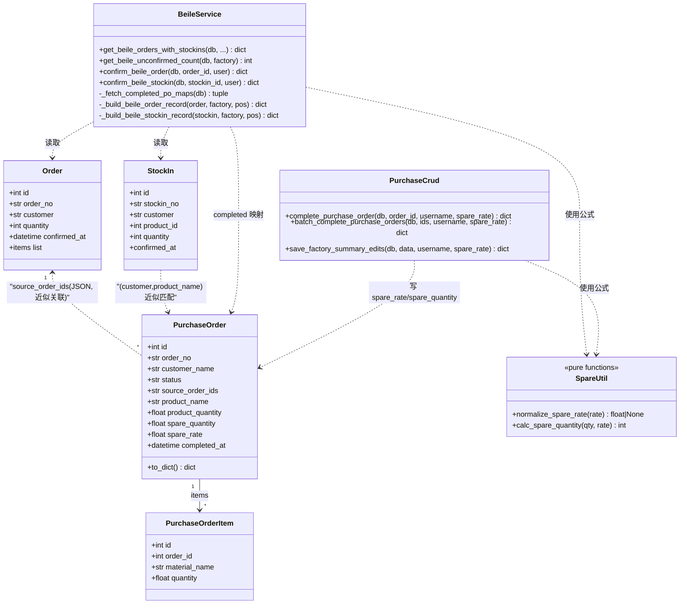
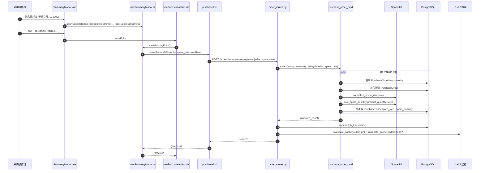
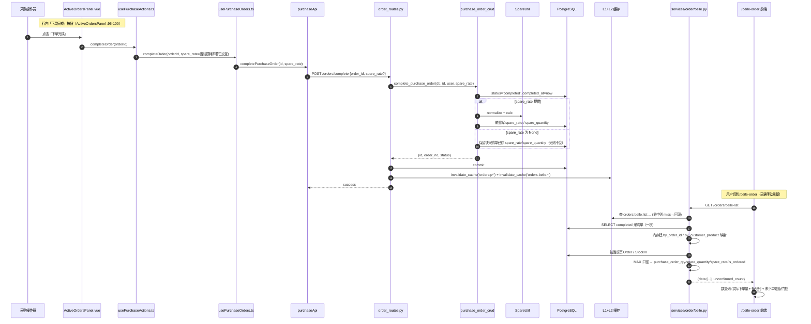
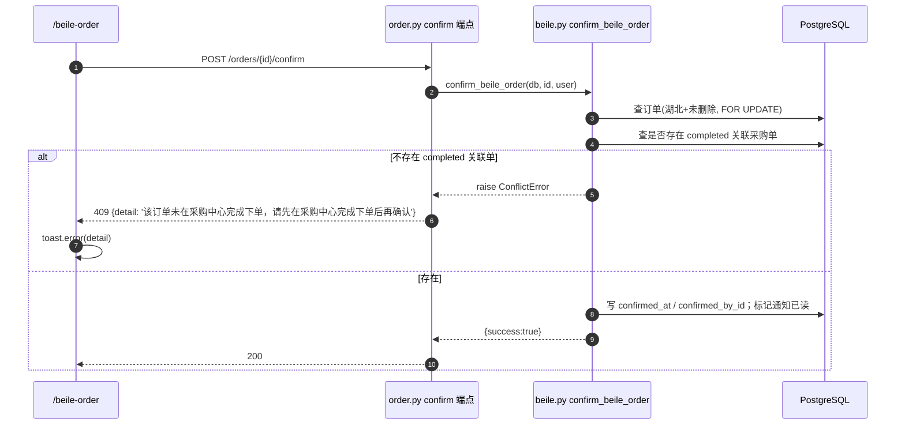
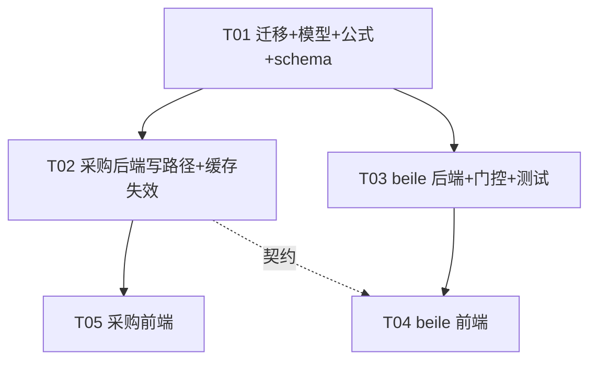

# /beile-order 订单数量与备品同步 —— 架构设计与任务分解

> 上游输入：`docs/beile-order-sync/01-产品需求文档.md`（PRD）。
> 本文档为**设计 + 任务分解**唯一交付物，**不含任何源码改动**，也**不含任何重启 / 停服务 / 在生产库跑迁移的步骤**。
> 语言：简体中文。所有 file:line 为实测值；若与代码现状不符以实际代码为准。

---

## Part A：系统设计

### 1. 实现方案总览

#### 1.1 核心难点与选型

| 难点 | 方案 | 理由 |
| --- | --- | --- |
| `/beile-order` 数量完全没读 `/purchase`（现状裸取 `item.quantity` / `stockin.quantity`） | 在 beile 列表构建阶段，用 `purchase_order` 反查「该客户订单的 completed 采购单」，把 `product_quantity` / `spare_quantity` 注入 beile 行 | 真相源唯一（`purchase_order`），改动集中在 `services/order/beile.py` |
| 关联只能靠 `source_order_ids`（JSON 数组字符串） | **禁 LIKE**；用「一次拉全量 completed 采购单 → Python 侧 `json.loads` → 内存建映射」的方式做**精确元素匹配** | 全库仅 43 条采购单（28 completed），全量拉取成本可忽略；复用仓内既有语义 `_parse_source_order_ids`，彻底规避 `source_order_ids LIKE '%6509%'` 误命中 `"[65091]"` 的陷阱 |
| 备品只活在前端会话态 | 新增 `purchase_order.spare_quantity` + `spare_rate` 两列，随「保存修改」与「下单完成/批量确认」落库 | 备品真相源是「损耗率」（用户原话），存率才能解释与补算；率可追溯到具体采购单 |
| 缓存导致非实时（beile 缓存前缀 `orders:beile:*`，采购侧只失效 `orders:p*`） | 采购侧写路径的失效函数补上 `orders:beile:*`；`factory-summary/save` 端点当前**完全没有失效调用**，需补 | 写入即失效，目标 ≤1s；保留 60s TTL 兜底 |
| 未下单却可确认 | 前端 `disabled` + 后端 `confirm_beile_*` 落库前校验，未通过抛 `ConflictError`（409） | 双端拦截；`ConflictError` 已存在（`fastapi_app/core/exceptions.py:49`，`status_code=409`），`db_transaction` 会把它映射为 `HTTPException(409, detail=message)`（`exceptions.py:199-201`） |

#### 1.2 与现状的差异（关键）

1. `purchase_order` **新增两列**：`spare_quantity NUMERIC(12,2)`、`spare_rate NUMERIC(8,2)`（单位千分之几），均**可空**。
2. 采购侧三个写端点（`/orders/complete`、`/orders/batch-complete`、`/orders/factory-summary/save`）请求体**新增可选 `spare_rate`**，并透传到 service 落库。
3. beile 列表服务新增「completed 采购单内存映射」，为每行注入 `purchase_order_qty` / `spare_quantity` / `spare_rate` / `is_ordered`。
4. beile 两个确认端点新增「是否已下单」门控。
5. 采购侧缓存失效补齐 beile 前缀；`factory-summary/save` 补失效。
6. 前端 `/beile-order` 数量列改口径、新增备品列与未下单徽章/门控；导出/打印同源；`/purchase` 汇总弹窗把损耗率随动作提交。

#### 1.3 架构模式

沿用既有分层：`api/v1/endpoints`（HTTP/权限/缓存失效）→ `services`（业务）→ `shared_models`（ORM）。新增逻辑全部落在既有分层内，不引入新框架、不新增第三方依赖。
关键约束（质量门禁 `scripts/quality_gate.py`）：**单个函数 ≤80 行、service 文件 ≤800 行、禁止批量循环内 N+1 查询**。

---

### 2. 数据库变更

#### 2.1 新列定义

| 列名 | 类型 | 可空 | 默认 | 注释 |
| --- | --- | --- | --- | --- |
| `spare_quantity` | `NUMERIC(12,2)` | ✅ 是 | 无（NULL） | `备品数量 = ceil(订单数量 × 损耗率‰)，随下单/保存写入` |
| `spare_rate` | `NUMERIC(8,2)` | ✅ 是 | 无（NULL） | `损耗率快照(千分之几)，用于追溯备品按多少损耗率算出` |

- 表：`purchase_order`。两列**必须可空且不带 server_default**，避免在既有大表上触发 `SET DEFAULT` 全表重写 / 长事务锁表。
- 单位：`spare_rate` 以**千分之几**存储（与前端 `lossRate` 输入框、PRD §3.2 公式一致），例如用户原例 `50` 表示 50‰。
- 历史行语义：**未知**（NULL = 该采购单在本次改造前完成，无损耗率记录）。展示层按 `COALESCE(spare_quantity, 0)` 处理为 `0`，`spare_rate` 为 NULL 时前端不显示率。

#### 2.2 迁移文件

- 新增文件：`migrations/versions/pg_standalone_046_po_spare_fields.py`
- `revision = 'pg_standalone_046_po_spare_fields'`，`down_revision = 'pg_standalone_045_global_role'`（当前 head，见 `migrations/versions/pg_standalone_045_global_role.py:39-40`）。
- ⚠️ **import 自检（重要地雷）**：`migrations/versions/pg_standalone_006_add_material_production_indexes.py` **全文缺 `from alembic import op`** 却调用 `op.*`，全新安装 / 灾备恢复会崩。本迁移必须**同时**写 `from alembic import op` 与 `import sqlalchemy as sa`，并在提交前单跑校验（见 2.5）。
- `upgrade()`（DDL 一次性，尽量幂等）：

```python
from alembic import op
import sqlalchemy as sa

revision = 'pg_standalone_046_po_spare_fields'
down_revision = 'pg_standalone_045_global_role'
branch_labels = None
depends_on = None


def upgrade():
    op.execute('ALTER TABLE purchase_order ADD COLUMN IF NOT EXISTS spare_quantity NUMERIC(12,2);')
    op.execute('ALTER TABLE purchase_order ADD COLUMN IF NOT EXISTS spare_rate NUMERIC(8,2);')
    op.execute("COMMENT ON COLUMN purchase_order.spare_quantity IS '备品数量=ceil(订单数量×损耗率‰)，随下单/保存写入';")
    op.execute("COMMENT ON COLUMN purchase_order.spare_rate IS '损耗率快照(千分之几)，用于追溯备品按多少损耗率算出';")


def downgrade():
    op.execute('ALTER TABLE purchase_order DROP COLUMN IF EXISTS spare_quantity;')
    op.execute('ALTER TABLE purchase_order DROP COLUMN IF EXISTS spare_rate;')
```

- 索引：**本迁移不新增索引**（`purchase_order` 仅 43 行，且 beile 侧按 `status='completed'` + 内存匹配）。若后续采购单量级增长，再评估 `CREATE INDEX ... (customer_name, product_name) WHERE status='completed'`。

#### 2.3 历史数据回填策略

- **不回填**。历史 completed 采购单的损耗率在数据库中从未存在，无法反推；强行按经验值回填会制造错误追溯。
- 展示层约定：历史行 → `is_ordered=true`、`spare_quantity=0`（COALESCE）、`spare_rate=null`。
- 如需人工校准，走一次性的 `/purchase`「汇总下单 → 保存修改」把率写回（运营动作，不在本迁移内）。

#### 2.4 回滚预案

- 结构回滚：`alembic downgrade pg_standalone_045_global_role`（即本迁移 `downgrade()`），删除两列，**无数据可丢**（两列均为本次新增）。
- 注意：downgrade 会**丢弃本次已写入的率/备品数据**（无反向重建）。如需保留数据须先 `pg_dump` 备份。

#### 2.5 迁移验证（禁止在生产库执行）

- 改迁移后**必须**在**非生产库**（如本地 sqlite 不适用 DDL，用临时 PG 或 CI 沙箱）单跑 `alembic upgrade head` 与 `alembic downgrade -1` 验证 import 完整、幂等、可回滚。
- ⛔ **禁止**在生产库（本机 192.168.0.95）执行 `alembic upgrade`。生产上线时由运维按发布流程单独执行。

---

### 3. 文件清单

> 全部为相对仓库根 `D:\erp_system` 的路径。**(新)** = 新增文件。

#### 3.1 后端

| 文件 | 改动 |
| --- | --- |
| `migrations/versions/pg_standalone_046_po_spare_fields.py` | **(新)** 新增 `spare_quantity` / `spare_rate` 两列迁移（含完整 import，幂等 DDL） |
| `fastapi_app/shared_models/purchase_order.py` | `PurchaseOrder` 增 `spare_quantity` / `spare_rate` 两个 `mapped_column`；`to_dict()` 增对应输出字段 |
| `fastapi_app/services/purchase_utils.py` | 新增纯函数 `normalize_spare_rate(rate)`、`calc_spare_quantity(qty, rate)`（**备品公式唯一实现处**） |
| `fastapi_app/api/v1/endpoints/purchase_center/schemas.py` | `OrderIdRequest` / `BatchCompleteRequest` / `FactorySummarySaveRequest` 增可选 `spare_rate` |
| `fastapi_app/schemas/order.py` | `OrderListResponse` 保持 `unconfirmed_count`（曾增 `unordered_count`，已随横幅下线移除） |
| `fastapi_app/services/purchase_order_crud.py` | `complete_purchase_order` / `batch_complete_purchase_orders` / `save_factory_summary_edits` 接收 `spare_rate` 并写库 |
| `fastapi_app/api/v1/endpoints/purchase_center/order_routes.py` | 3 端点透传 `spare_rate`；`_invalidate_orders_cache` 补 beile 失效；`factory-summary/save` 补失效调用 |
| `fastapi_app/services/order/beile.py` | 新增 completed 采购单内存映射、`_build_beile_*_record` 注入新字段、确认门控、错误文案常量 |
| `fastapi_app/api/v1/endpoints/order.py` | `beile-list` 透传 `unconfirmed_count`；确认端点保持不吞 `ConflictError`（交全局 handler 转 409） |
| `fastapi_app/tests/services/test_beile_orders.py` | fixture `tables` 补 `PurchaseOrder.__table__`；新增数量/备品/门控用例 |

#### 3.2 前端

| 文件 | 改动 |
| --- | --- |
| `frontend-vite/src/types/index.ts` | `OrderSKU` / 相关类型按需扩展（如备用） |
| `frontend-vite/src/api/order.ts` | `OrderListApiResponse` 保持 `unconfirmed_count?`；`beileList` 类型保持 |
| `frontend-vite/src/views/beile-order/composables/useBeileOrders.ts` | `BeileOrderRow` 增 `purchase_order_qty/spare_quantity/spare_rate/is_ordered`；`handleConfirm` 增未下单前置校验与错误 toast；导出/打印列头与单元格改口径（`SUMMARY_HEADERS` / `SUMMARY_COL_WIDTHS` / `buildSummaryTbody`） |
| `frontend-vite/src/views/beile-order/components/BeileOrderRow.vue` | 数量列改口径 + 「已下单/未下单」徽章 + tooltip；新增「备品数量」列单元格；确认按钮 `disabled` + tooltip |
| `frontend-vite/src/views/beile-order/BeileOrderTab.vue` | 表头新增「备品数量」列（110px）；行调用传新 props |
| `frontend-vite/src/views/hubei/HubeiView.vue` | 页头保留「未确认」汇总横幅；「未下单」汇总横幅曾新增、已按业务反馈移除 |
| `frontend-vite/src/api/purchase.ts` | `completeOrder` / `batchComplete` / `saveFactoryEdits` 增可选 `spare_rate` 参数 |
| `frontend-vite/src/views/purchase/composables/usePurchaseOrders.ts` | `completeOrder` / `batchComplete` 透传 `spare_rate` |
| `frontend-vite/src/views/purchase/composables/useSummaryModal.ts` | 新增 `lossRateTouched` 标记；`saveFactoryEdits` 携带 `spare_rate`；`calcSpareQuantity` 保持**唯一公式源** |
| `frontend-vite/src/views/purchase/composables/usePurchaseActions.ts` | `handleCompleteOrder` / `handleBatchComplete` 携带当前损耗率 |
| `frontend-vite/src/views/purchase/components/SummaryModal.vue` | 损耗率输入框下方补小字说明 |
| `frontend-vite/src/test/BeileOrderTab.confirm.test.ts` | 补未下单门控断言 |
| `frontend-vite/src/test/BeileOrderTab.export.test.ts` | 补备品列/新口径断言 |
| `frontend-vite/src/test/useSummaryModal.test.ts` | 补 `saveFactoryEdits` 携带损耗率断言 |

---

### 4. 数据结构与接口

#### 4.1 新增列（`purchase_order`）

见 §2.1。ORM 声明（追加到 `shared_models/purchase_order.py` 的 `PurchaseOrder`）：

```python
spare_quantity: Mapped[float | None] = mapped_column(Numeric(12, 2), comment='备品数量=ceil(订单数量×损耗率‰)')
spare_rate: Mapped[float | None] = mapped_column(Numeric(8, 2), comment='损耗率快照(千分之几)')
```

`to_dict()` 追加（放在 `product_quantity` 附近）：`'spare_quantity': float(self.spare_quantity) if self.spare_quantity is not None else None`、`'spare_rate': float(self.spare_rate) if self.spare_rate is not None else None`。

#### 4.2 请求 schema 变更（逐字段）

| schema | 文件:行 | 新增字段 | 类型 | 可空/默认 | 含义 |
| --- | --- | --- | --- | --- | --- |
| `OrderIdRequest` | `api/v1/endpoints/purchase_center/schemas.py:24` | `spare_rate` | `float \| None` | 是 / `None` | 下单完成时携带的损耗率（千分之几）；`None` = 不覆盖已存值 |
| `BatchCompleteRequest` | 同上 `:97` | `spare_rate` | `float \| None` | 是 / `None` | 批量确认时对所有涉及采购单统一覆盖的损耗率 |
| `FactorySummarySaveRequest` | 同上 `:123` | `spare_rate` | `float \| None` | 是 / `None` | 保存修改时对该次涉及的所有采购单覆盖的损耗率 |

> 说明：`FactorySummaryEditItem`（`:113`）保持 `extra=allow` 不动，率放在**顶层**（一次保存一个率，符合 PRD「对该次涉及的所有采购单覆盖写」）。
> `fastapi_app/schemas/purchase_center.py:326` 存在同名 `FactorySummarySaveRequest` 旧定义，`order_routes.py` 实际 import 的是 `endpoints.purchase_center.schemas` 版本（`order_routes.py:13-23`）。为避免两份漂移，建议同步在该旧定义补 `spare_rate: float | None = None`（或在设计评审时确认其为死代码）。

#### 4.3 beile-list 响应新增字段（逐字段）

行级（`_build_beile_order_record` / `_build_beile_stockin_record` 返回 dict，追加字段）：

| 字段 | 类型 | 可空 | 含义 |
| --- | --- | --- | --- |
| `purchase_order_qty` | `number` | 否 | **展示用下单数量**：已下单 = completed 关联采购单 `product_quantity` 的 **MAX**；未下单 = 原数量（订单=`quantity`，备货=`stockin.quantity`） |
| `spare_quantity` | `number` | 否 | 已下单 = completed 关联采购单 `spare_quantity` 的 **MAX**（NULL 视作 0）；未下单 = `0`（前端显示「—」） |
| `spare_rate` | `number \| null` | 是 | 已下单 = MAX 对应采购单的 `spare_rate`（千分之几）；未下单 / 历史 NULL = `null` |
| `is_ordered` | `boolean` | 否 | 是否已下单（存在 `status='completed'` 的关联采购单） |

保留既有字段 `quantity`（首个 SKU 原数量）与 `items`（SKU 明细）不变，仅新增字段，保证向后兼容。`/beile-order` 前端「数量」列改用 `purchase_order_qty`。

顶层（`OrderListResponse`，`fastapi_app/schemas/order.py:90`）：

> 曾新增 `unordered_count: int = 0`（未下单汇总计数，供顶部横幅使用）。
> 该横幅已按业务反馈移除，计数函数与响应字段**一并下线**，接口只保留 `unconfirmed_count`。

> P2-1（可选）：顶层再加 `spare_quantity_total: int`（已下单行备品合计）。非本次必需。

> ⚠️ **多 SKU 近似性声明**：PRD §3.2 的 `Q_display = MAX{product_quantity | p∈P(O)}` 是**按客户订单**维度的口径。当一个湖北订单含多个 SKU、且各 SKU 落到不同采购单时，行级 `purchase_order_qty` 取全订单维度 MAX，可能与「按 SKU 分别下单」的直觉不符。数据现状以单产品订单为主，本次按 PRD 口径实现；如需按 SKU 展示，列为后续增强（见 §9 待明确）。

#### 4.4 前端类型

```ts
// api/order.ts → OrderListApiResponse
// 曾增 unordered_count?: number，已随顶部横幅下线移除

// views/beile-order/composables/useBeileOrders.ts → BeileOrderRow（追加）
purchase_order_qty?: number
spare_quantity?: number
spare_rate?: number | null
is_ordered?: boolean
```

---

### 5. 关联查询方案（含为什么不用 LIKE）

#### 5.1 关联定义

- `P(O) = { p | O.id ∈ parse(p.source_order_ids) 且 p.status='completed' }`，`source_order_ids` 为 JSON 数组字符串（如 `"[65091]"`）。
- ⛔ **禁止** `purchase_order.source_order_id`（全库 0 条非空，弃用）。
- ⛔ **禁止** `source_order_ids LIKE '%' || order_id || '%'`：`order_id=6509` 会误命中 `"[65091]"`。
- 复用仓内既有语义：`fastapi_app/services/purchase/_common.py::_parse_source_order_ids(po)`（内部委托 `purchase_utils.parse_source_order_ids`，JSON 字符串 → `list[int]`，解析失败返回 `[]`）。

#### 5.2 选定方案：全量 completed 采购单 → 内存映射（**主方案**）

`purchase_order` 仅 43 行（28 completed），一次 `SELECT` 全量 completed 采购单（仅取必要列）成本可忽略，且完全规避 SQL 侧 JSON 解析的类型/转义风险：

```python
# services/order/beile.py 内部（示意；注意行数 ≤80，必要时拆 helper）
async def _fetch_completed_po_maps(db: AsyncSession):
    """一次查询 completed 采购单，内存建两套映射（无 N+1）。

    返回 (by_order_id, by_customer_product):
      by_order_id[order_id] = [po, ...]         # 由 source_order_ids 解析
      by_customer_product[(customer, product)] = [po, ...]
    """
    rows = (await db.execute(
        select(
            PurchaseOrder.source_order_ids,
            PurchaseOrder.customer_name,
            PurchaseOrder.product_name,
            PurchaseOrder.product_quantity,
            PurchaseOrder.spare_quantity,
            PurchaseOrder.spare_rate,
        ).where(PurchaseOrder.status == PurchaseOrderStatus.COMPLETED)
    )).all()

    by_order_id: dict[int, list] = {}
    by_customer_product: dict[tuple[str, str], list] = {}
    for r in rows:
        for oid in parse_source_order_ids(r.source_order_ids):
            by_order_id.setdefault(oid, []).append(r)
        by_customer_product.setdefault((r.customer_name or '', r.product_name or ''), []).append(r)
    return by_order_id, by_customer_product
```

- 订单行：`pos = by_order_id.get(order.id, [])` → `is_ordered = len(pos) > 0`；`purchase_order_qty = max((float(p.product_quantity or 0) for p in pos), default=0)`；`spare_quantity = max((float(p.spare_quantity or 0) for p in pos), default=0)`；`spare_rate = max((float(p.spare_rate) for p in pos if p.spare_rate is not None), default=None)`。
- 备货行：`pos = by_customer_product.get((stockin.customer or '', product_name or ''), [])`，其余同上。
- 取 MAX **不求和**（PRD Q3）：同一客户订单拆到多供应商时，各采购单 `product_quantity` 是同一值，求和会重复计数。

#### 5.3 备选方案：SQL 侧精确 JSON 元素匹配（**仅在数据量增长后选用**）

```sql
-- 精确 JSON 元素匹配（非 LIKE）；source_order_ids 为 TEXT，需先做 JSON 形状守卫
SELECT p.product_quantity, p.spare_quantity, p.spare_rate
FROM purchase_order p
WHERE p.status = 'completed'
  AND p.source_order_ids ~ '^\s*\[[0-9,\s]*\]\s*$'            -- 形状守卫，防 cast 报错
  AND EXISTS (
    SELECT 1 FROM jsonb_array_elements_text(p.source_order_ids::jsonb) e
    WHERE e::bigint = ANY(:order_ids)
  );
```

- 必须带 `~ '^\s*\[[0-9,\s]*\]\s*$'` 形状守卫，否则脏数据（非 JSON）会让 `::jsonb` 抛错中止整个查询。
- 本次**不采用**：Python 侧方案已复用既有解析语义、更健壮，且数据量极小。

#### 5.4 备货行近似匹配的失效边界（**必须显式标注**）

备货行按 `(customer_name, product_name)` 匹配，属**近似匹配**，失效边界：

1. **同客户 + 同产品名**存在多张不同客户订单的采购单时，任一 completed 即视为「该备货已下单」，可能**张冠李戴**（把订单 A 的下单当成订单 B 的备货依据）。
2. `customer_name` 需**完全相等**（含前后空格 / 别名 / 全半角差异会漏配）。
3. `product_name` 取自 `Product.name`（备货侧）与采购单 `product_name`（下单来源），**命名口径不一致会漏配**。
4. 备货早于采购单产生的**跨期**记录会漏配（备货当时确无下单）。
5. 客户名 / 产品名重命名后，历史备货与新采购单无法匹配。

以上均需产品知晓并接受（PRD Q2 已采纳该规则）。

---

### 6. 类图（Mermaid）



---

### 7. 时序图（Mermaid）

#### 7.1 主流程一：汇总下单保存损耗率（/purchase 保存修改）



#### 7.2 主流程二：下单完成并同步到 /beile-order



#### 7.3 门控：未下单确认被拒（后端）



---

## Part B：任务分解

### 8. 依赖包

**无新增**（后端纯 SQLAlchemy/FastAPI 既有依赖；前端 Vue3/Vite/Tailwind 既有依赖）。若采用 §5.3 备选方案，PostgreSQL `jsonb_array_elements_text` 为内置函数，亦无需新增依赖。

### 9. 有序任务列表（5 个任务，按依赖顺序）

> 每个任务给出：编号 / 目标文件 / 依赖 / 验收点。**工程师可逐条照做。**
> 通用纪律：单个函数 ≤80 行；service 文件 ≤800 行；批量循环内禁止逐行查询（N+1）；不得重启 / 停生产服务；不得在生产库跑迁移。

#### T01 — 数据库迁移 + 模型 + 备品公式 + 请求/响应契约

- **目标文件**
  - `migrations/versions/pg_standalone_046_po_spare_fields.py`（新）
  - `fastapi_app/shared_models/purchase_order.py`
  - `fastapi_app/services/purchase_utils.py`
  - `fastapi_app/api/v1/endpoints/purchase_center/schemas.py`
  - `fastapi_app/schemas/order.py`
  - （一致性）`fastapi_app/schemas/purchase_center.py`（补 `spare_rate` 或有据废弃）
- **依赖**：无（首个任务）
- **内容**
  1. 迁移文件：`from alembic import op` + `import sqlalchemy as sa` **两行都要有**；DDL 用 `ADD COLUMN IF NOT EXISTS`；`downgrade()` 对称删列；`down_revision='pg_standalone_045_global_role'`。
  2. `PurchaseOrder` 增两列（§4.1）；`to_dict()` 增 `spare_quantity` / `spare_rate`（`None` 安全）。
  3. `purchase_utils.py` 增两个纯函数（**前后端同源的唯一后端实现**）：
     - `normalize_spare_rate(rate) -> float | None`：`None → None`（表示跳过）；非有限或 `<0 → 0.0`；`>1000 → 1000.0`；否则原值。
     - `calc_spare_quantity(qty, rate) -> int`：`rate` 归一后为 `None/<=0`、或 `qty` 非有限/`<=0` → `0`；否则 `math.ceil(qty * rate / 1000)`。语义与前端 `calcSpareQuantity` 完全一致。
  4. 三个请求 schema 增可选 `spare_rate: float | None = None`（§4.2）。
  5. `OrderListResponse` 保持既有字段（曾增 `unordered_count`，已下线）。
- **验收点**
  - 迁移文件 import 完整、可 `upgrade`/`downgrade`（在**非生产库**验证）；两列可空、无 server_default。
  - `python -c "from fastapi_app.services.purchase_utils import calc_spare_quantity"` 通过；单测（可放 T03 一并写）：`calc_spare_quantity(9999,50)==500`、`(10000,0)==0`、`(0,50)==0`、`(-5,50)==0`、`(10000,1200)==10000`、`(100,1)==1`、`(100,0.5)==1`。
  - `python scripts/quality_gate.py` 不新增违规。

#### T02 — 采购侧写路径：损耗率落库 + 缓存失效补齐

- **目标文件**
  - `fastapi_app/services/purchase_order_crud.py`
  - `fastapi_app/api/v1/endpoints/purchase_center/order_routes.py`
- **依赖**：T01
- **内容**
  1. `complete_purchase_order(db, order_id, username, spare_rate=None)`：置 `completed` 后，若 `spare_rate is not None` → `order.spare_rate = normalize_spare_rate(spare_rate)`；`order.spare_quantity = calc_spare_quantity(order.product_quantity, order.spare_rate)`。为 `None` 则**不动**已存值。
  2. `batch_complete_purchase_orders(db, order_ids, username, spare_rate=None)`：循环内对每张单同样处理（循环内**不再逐单查询**，沿用既有批量取数）。
  3. `save_factory_summary_edits(db, data, username, spare_rate=None)`：编辑应用后，对本次涉及的每个 `PurchaseOrder`：若 `spare_rate is not None` → 覆盖写 `spare_rate` + 重算 `spare_quantity`（用该单 `product_quantity`）。需先**批量**取回涉及采购单（`select(PurchaseOrder).where(id.in_(...))`），避免循环内查询。
  4. `order_routes.py`：
     - `POST /orders/complete`、`POST /orders/batch-complete`：把 `data.spare_rate` 透传给 service。
     - `POST /orders/factory-summary/save`：传 `data.spare_rate`；**并在成功路径补缓存失效**（当前无任何失效调用）。
     - `_invalidate_orders_cache()` 内追加 `await invalidate_cache('orders:beile:*')`（保留原 `orders:p*`；两者并列，避免误动 `orders:unprocessed:*` 的既有语义）。
- **验收点**
  - 完成/批量/保存三端点均能写入 `spare_rate`+`spare_quantity`；`spare_rate=None` 时不覆盖已存值。
  - 采购侧写入后 `orders:beile:*` 被清（可在日志 `Redis 缓存失效: pattern=orders:beile:*` 观察）。
  - 无新增 N+1（循环内无 `db.get`/`select` 逐条）。

#### T03 — beile 后端：关联查询 + 新字段 + 确认门控 + 后端测试

- **目标文件**
  - `fastapi_app/services/order/beile.py`
  - `fastapi_app/api/v1/endpoints/order.py`
  - `fastapi_app/tests/services/test_beile_orders.py`
- **依赖**：T01
- **内容**
  1. `beile.py` 增 `_fetch_completed_po_maps(db)`（§5.2，一次查询建两套映射；注意拆分 helper 保证单函数 ≤80 行）。
  2. `get_beile_orders_with_stockins`：在构建 records 前调用一次映射；`_build_beile_order_record(order, factory, pos)` / `_build_beile_stockin_record(stockin, factory, pos)` 注入 `purchase_order_qty` / `spare_quantity` / `spare_rate` / `is_ordered`（MAX 口径，§4.3）。**不得**在循环内查询。
  3. `confirm_beile_order`：在写 `confirmed_at` 前，校验存在 completed 关联采购单；否则 `raise ConflictError('该订单未在采购中心完成下单，请先在采购中心完成下单后再确认')`。文案抽为模块常量 `BEILE_NOT_ORDERED_DETAIL`。
  4. `confirm_beile_stockin`：按 `(customer, product_name)` 校验存在 completed 采购单；否则同 `ConflictError`。
  5. `api/v1/endpoints/order.py`：`list_beile_orders` 透传 `unconfirmed_count`；两个 confirm 端点保持让 `ConflictError` 冒泡（`db_transaction` 已映射为 409）。
  6. `test_beile_orders.py`：fixture `tables` 追加 `PurchaseOrder.__table__`（**必须**，否则 sqlite 建表缺表）；新增用例：已下单 MAX 口径、备品 MAX 口径、混合状态取 completed、未下单行 `is_ordered=false`、`spare_rate=0` 边界、未下单确认抛 `ConflictError`。
- **验收点**
  - 单文件跑通：`C:/Users/Administrator/AppData/Local/Programs/Python/Python313/python.exe -m pytest fastapi_app/tests/services/test_beile_orders.py`。
  - beile-list 响应新增 4 个行级字段；Pydantic 未丢字段。
  - 未下单确认返回 409，`detail` 文案精确匹配；`confirmed_at` 仍为 NULL。

#### T04 — beile 前端：数量/备品/未下单提示/门控/导出打印 + 前端测试

- **目标文件**
  - `frontend-vite/src/types/index.ts`
  - `frontend-vite/src/api/order.ts`
  - `frontend-vite/src/views/beile-order/composables/useBeileOrders.ts`
  - `frontend-vite/src/views/beile-order/components/BeileOrderRow.vue`
  - `frontend-vite/src/views/beile-order/BeileOrderTab.vue`
  - `frontend-vite/src/views/hubei/HubeiView.vue`
  - `frontend-vite/src/test/BeileOrderTab.confirm.test.ts`
  - `frontend-vite/src/test/BeileOrderTab.export.test.ts`
- **依赖**：T03（接口契约）
- **内容**
  1. `BeileOrderRow` 增 4 字段。
  2. `useBeileOrders.ts`：`handleConfirm` 前置——若 `item.is_ordered === false` 则 `toast.error(NOT_ORDERED_TOAST)` 并 return；导出/打印：`SUMMARY_HEADERS` 增「备品数量」、`SUMMARY_COL_WIDTHS` 同步，`buildSummaryTbody` 数量列改用 `purchase_order_qty` 且新增备品列（未下单显示「—」）。
  3. `BeileOrderRow.vue`：数量列显示 `purchase_order_qty`（已下单加粗 + 徽章「已下单」；未下单常规字重 + 警示徽章「未下单」+ `title="该订单未在采购中心完成下单"`）；新增「备品数量」列（未下单显示「—」）；确认按钮 `:disabled="item.is_ordered === false || isConfirming"` + `title="请先在采购中心完成下单"`。
  4. `BeileOrderTab.vue`：表头新增「备品数量」列（110px，位置在「数量」列之后）；传新 props 给行组件。
  5. 文案常量集中：前端 `NOT_ORDERED_TOAST = '请先在采购中心完成下单'`、`NOT_ORDERED_TIP = '该订单未在采购中心完成下单'`、`NOT_ORDERED_DETAIL = '该订单未在采购中心完成下单，请先在采购中心完成下单后再确认'`（与后端 detail **逐字一致**）。
- **验收点**
  - 三个前端测试文件全绿（含新增备品列 / 未下单门控断言）。
  - 页面数量列、备品列、按钮禁用与 tooltip 均符合 PRD §3.4。
  - 导出 XLS 与打印预览含备品列且数量同源（AC-12）。

#### T05 — 采购前端：损耗率随动作提交 + 类型/接口打通 + 测试

- **目标文件**
  - `frontend-vite/src/api/purchase.ts`
  - `frontend-vite/src/views/purchase/composables/usePurchaseOrders.ts`
  - `frontend-vite/src/views/purchase/composables/useSummaryModal.ts`
  - `frontend-vite/src/views/purchase/composables/usePurchaseActions.ts`
  - `frontend-vite/src/views/purchase/components/SummaryModal.vue`
  - `frontend-vite/src/test/useSummaryModal.test.ts`
- **依赖**：T02（接口契约）
- **内容**
  1. `purchaseApi.completeOrder(id, spare_rate?)`、`batchComplete(ids, spare_rate?)`、`saveFactoryEdits(edits, spare_rate?)`——`spare_rate` 省略时不进请求体。
  2. `useSummaryModal.ts`：新增 `lossRateTouched = ref(false)`，在 `applyLossRate` 中置 `true`；`saveFactoryEdits()` 调 `purchaseApi.saveFactoryEdits(edits, lossRateTouched.value ? lossRate.value : undefined)`。（`calcSpareQuantity` 保持**唯一公式源**不动；`toggleEditMode(false)` 现有重置逻辑保留。）
  3. `usePurchaseActions.ts`：`handleCompleteOrder` → `purchaseOrders.completeOrder(orderId, summary.lossRateTouched ? summary.lossRate : undefined)`；`handleBatchComplete` → 同理传入。
  4. `usePurchaseOrders.ts`：`completeOrder` / `batchComplete` 增 `spare_rate` 形参并透传。
  5. `SummaryModal.vue`：损耗率输入框下方补小字 `备品 = 订单数量 × 损耗率‰（向上取整）`。
  6. `useSummaryModal.test.ts`：断言 `saveFactoryEdits` 在交互后携带 `spare_rate`；未交互时不携带（避免用 0 覆盖已存率）。
- **验收点**
  - 「保存修改」「下单完成」「批量确认」三条路径均能在有交互时把率提交（网络面板/单测可见）。
  - 未交互损耗率时不发送 `spare_rate`（后端保留已存值）。
  - 前端测试全绿。

### 10. 任务依赖图



> 说明：T02 与 T03 相互独立（均只依赖 T01），可并行；T04 依赖 T03 的接口契约、T05 依赖 T02 的接口契约。

---

### 11. 共享知识（跨文件约定）

1. **字段命名**：DB 列 `spare_quantity` / `spare_rate`；API 字段同名 snake_case；前端 `BeileOrderRow` 同名。
2. **备品公式唯一实现处（必须同源）**：
   - 后端唯一来源：`fastapi_app/services/purchase_utils.py::calc_spare_quantity` / `normalize_spare_rate`。
   - 前端唯一来源：`frontend-vite/src/views/purchase/composables/useSummaryModal.ts::calcSpareQuantity`。
   - 两处语义必须逐字一致：`ceil(qty × rate/1000)`，`rate<=0/None` 或 `qty` 非法 → `0`，`rate>1000` 截断 `1000`。**任何一处改动必须同步另一处。**
3. **率单位**：千分之几（‰）。前端输入 `max=1000`，后端 `normalize_spare_rate` 截断 `1000`。
4. **错误 / 提示文案常量（逐字一致）**：
   - 后端 `detail`（409）：`该订单未在采购中心完成下单，请先在采购中心完成下单后再确认`（`beile.py` 模块常量 `BEILE_NOT_ORDERED_DETAIL`）。
   - 前端 toast（gate 前置拦截）：`请先在采购中心完成下单`。
   - 前端 tooltip（数量列未下单徽章）：`该订单未在采购中心完成下单`。
   - 前端工具提示（按钮禁用）：`请先在采购中心完成下单`。
5. **门控判定函数**：后端统一放 `services/order/beile.py`（`_fetch_completed_po_maps` + 映射查询）；前端统一在 `useBeileOrders.ts::handleConfirm` 内以 `item.is_ordered` 判定。
6. **缓存失效调用位置**：采购侧写路径集中在 `order_routes.py::_invalidate_orders_cache`（本次追加 `orders:beile:*`）；确认端点沿用 `order.py` 中 `cache_mgr.invalidate(InvalidationStrategy.DOMAIN, CacheDomain.ORDER)`（`CacheDomain.ORDER='orders:*'`，天然覆盖 beile）。
7. **"已下单"定义**：仅 `status='completed'`；`pending` 不算（PRD Q4）。
8. **取数口径**：数量、备品均**取 MAX 不求和**（PRD Q3）。
9. **多 SKU 近似性**：行级 MAX 为全订单维度，已在 §4.3 声明。
10. **`source_order_ids`**：唯一可用关联字段；`source_order_id`（单值）全库 NULL，禁用；**禁 LIKE**。
11. **L1/L2 缓存**：beile 列表与计数键 `orders:beile:*`（`ttl=60, local_ttl=15`）；`invalidate_cache` 先删 L2 再删 L1，并在广播开关开启时通知其他 worker。
12. **测试运行**：后端用系统 Python 单文件跑（全量 pytest 有 event loop 污染）；前端用 vitest 跑改动相关文件。

---

### 12. 待明确事项与风险

| # | 事项 | 影响 | 建议 |
| --- | --- | --- | --- |
| R1 | **多 worker 下 L1 脏窗口**：`CACHE_L1_BROADCAST_ENABLED` 默认关闭（`core/cache.py:56`），多 worker 时其他进程 L1 最长 `local_ttl=15s` 旧值 | AC-10「≤1s」在多 worker 下不成立 | 本机现状为单 uvicorn（--reload）进程，单进程内 ≤1s 成立。若将来多 worker，需开启广播或把 beile 缓存 `local_ttl` 降到 ≤1s |
| R2 | **只读副本延迟**：`beile-list` 走 `get_async_read_db`，`ASYNC_DATABASE_REPLICA_URL` 若已配置，主从延迟可独立导致 >1s 可见 | AC-10 | 确认该变量是否配置；若配置且延迟敏感，beile-list 改走主库或接受延迟 |
| R3 | **多 SKU 订单口径**：行级 MAX 为全订单维度（§4.3） | 多 SKU 订单数量展示可能与「按 SKU 分别下单」直觉不符 | 数据以单产品为主，本次按 PRD 口径；如需按 SKU，后续增强 `items[].purchase_order_qty` |
| R4 | **备货行近似匹配**：`(customer, product_name)` 近似（§5.4） | 极端场景张冠李戴 | 已由 PRD Q2 采纳；需产品知晓，长期建议给 `StockIn` 加关联字段 |
| R5 | 历史 completed 采购单 `spare_quantity=NULL` → 显示 `0` | 用户可能疑惑「历史单备品为何是 0」 | 展示层可对 `spare_rate IS NULL` 的行加「未记录损耗率」灰字（可选，非必需） |
| R6 | `fastapi_app/schemas/purchase_center.py:326` 的 `FactorySummarySaveRequest` 与 endpoints 版本重复 | 若被其他模块 import 会漂移 | T01 中确认其引用方；死代码则标注，否则同步补 `spare_rate` |
| R7 | 迁移在生产库需运维单独执行 | schema 漂移会导致 500 | 上线清单中登记「先迁移后发布」，禁止开发自动跑 |

---

## 附：独立图表文件

- `docs/beile-order-sync/class-diagram.mermaid`（类图）
- `docs/beile-order-sync/sequence-diagram.mermaid`（时序图）

---

## 变更记录 CR-1（2026-09-18）

**触发**：真实生产数据实测——湖北订单 69 条中仅 **7** 条有 `status='completed'` 关联采购单，
其余 62 条会被判「未下单」，但这 62 条里**只有 2 条尚未确认**（`65087`/`65091`）。
若全量标记，页面变成「红色海洋」，而真正待处理的动作只有 2 个。
**用户裁决**：把「未下单」**收敛为「只标 / 只拦未确认的记录」**。

> **后续变更**：该「未下单」汇总横幅已按业务反馈从页面移除，其配套的
> `unordered_count` 计数函数与响应字段一并下线（见下方「6. 影响面小结」的注记）。
> 行级徽章、tooltip、确认按钮禁用与双端门控**保持不变**。

### 1. 口径不变、收敛点明确
- 「未下单」的**事实口径不变**：无 `status='completed'` 关联采购单即未下单。
- `is_ordered` 是**事实字段**，仍是严格判定结果，**不受本次收敛影响**（不改它）。
- 收敛**只发生两层**：
  1. **计数**（`unordered_count`，**已下线**）：曾由「所有未下单」→「**未确认 且 未下单**」的**待处理数**；
  2. **前端展示/门控**：未下单徽章、tooltip、确认按钮禁用、`handleConfirm` 前置拦截，
     均**只对未确认的行生效**。

### 2. 后端改动
- `services/order/beile.py::get_beile_unordered_count`（**已删除**）：曾为订单加 `Order.confirmed_at IS NULL`、
  备货加 `StockIn.confirmed_at IS NULL`，语义为「未确认且未下单（待处理数）」。
- **预期影响面**：真实数据横幅计数曾由 63 → **3**（2 条订单 + 1 条备货 `35045`）。

### 3. 幂等早退顺序（行为回退修复）
- **目标顺序**：查记录 → 不存在 `404` → **已确认 → 幂等成功 `200`（`already_confirmed=True`）**
  → 未确认 → 门控（未下单 → `ConflictError` `409`）→ 写入。
- **理由**：门控目的是「防止误确认尚未下单且尚未确认的记录」；对**已确认**的历史记录
  既无动作也无风险。若幂等早退晚于门控，一条已确认的历史订单再次调用确认接口会返回 `409`，
  而改动前是幂等 `200` —— 属行为回退，必须避免。
- `confirm_beile_order` / `confirm_beile_stockin` 现状即为该顺序，本次补测试
  `test_confirm_already_confirmed_unordered_returns_idempotent_200` 固化（订单/备货各一例）。

### 4. 前端改动
- `BeileOrderRow.vue`：数量列「未下单」徽章与 tooltip **仅当 `item.confirmed === false`** 才显示；
  已确认的历史行显示原数量、不打徽章、不加 tooltip（回归改动前视觉）。
  确认按钮 `disabled` 收敛为 `isConfirming || (item.confirmed === false && item.is_ordered === false)`，
  tooltip 同条件；`item.confirmed === true` 仍走「已确认」徽章分支。
  备品列逻辑不变（已下单=数值，未下单=「—」）。
- `useBeileOrders.ts::handleConfirm`：前置拦截收敛为 `item.confirmed !== true && item.is_ordered === false`。
- **导出 / 打印**：不改——未下单行数量沿用原口径、备品列仍为「—」，不给导出/打印加徽章（AC-12 同源）。

### 5. 测试
- 后端：`is_ordered` 事实口径三类互斥用例（未确认+未下单 / 已确认+未下单 / 未确认+已下单）；
  契约回归断言响应不再携带 `unordered_count`；
  新增「已确认 + 未下单 → 200 / `already_confirmed=True`」用例。
- 前端：新增「已确认的历史行（已确认 + 未下单）不打徽章、数量原口径、无确认按钮」用例；
  原有「未确认 + 未下单 → 徽章 + 按钮禁用 + tooltip」用例保持。

### 6. 影响面小结
| 维度 | 收敛前 | 收敛后（CR-1） |
| --- | --- | --- |
| `unordered_count` 语义 | 所有未下单（历史总数） | 未确认且未下单（待处理数）；**该计数已随后续变更整体下线** |
| 真实数据横幅 | 63 | ≈3（**横幅已移除**） |
| 已确认 + 未下单 再次确认 | （若门控在前）409 回退 | 200 幂等成功 |
| 已确认 + 未下单 前端视觉 | 红色「未下单」徽章 | 原数量、无徽章（回归） |

