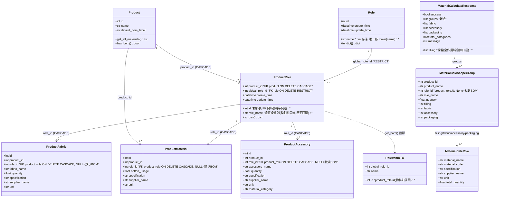
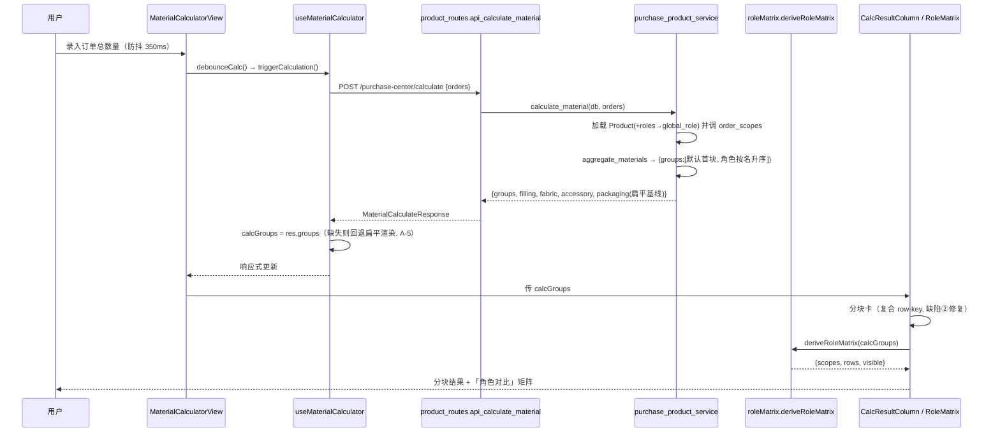
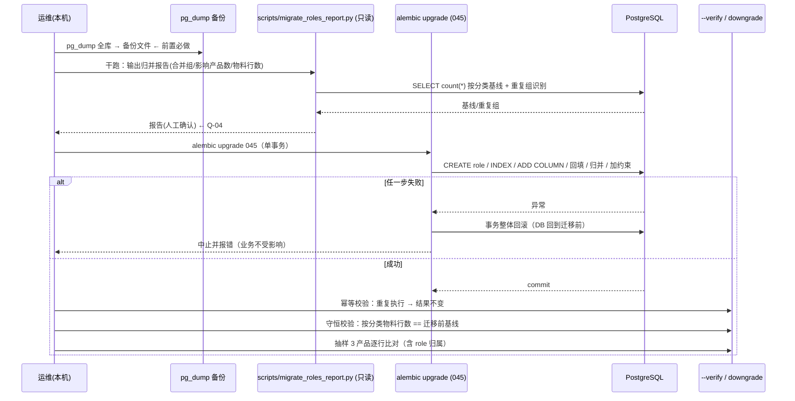
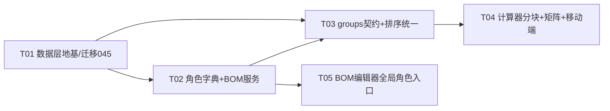

# 02 · 架构设计与任务分解：BOM 全局角色字典 + 计算器按角色分块 + 跨角色共有物料矩阵

| 项 | 内容 |
|---|---|
| 架构师 | 高见远（software-architect） |
| 日期 | 2026-09-17 |
| 输入 | `docs/bom-multi-role/01-PRD.md`（v1.0，11×P0 / 4×P1 / 4×P2 / Q-01~08 / A-1~14） |
| 仓库 | `D:\erp_system`（生产兼开发机 192.168.0.95，PostgreSQL，`erp-prod` 服务） |
| 交付边界 | **只出设计与任务清单，不改任何源码、不执行迁移** |
| 与实现关系 | 本文件已按**最终实现**核对（含 F1–F8 修复批次），描述的是落地口径而非设计初稿；任务落地状态见 §5.0 |
| 事实基线 | 已逐文件核对；对主理人基线有 1 处纠正（见 §9.3）与 2 处补充（§9.4） |

> ℹ️ **图表单一来源**：本文 §3.1 与 §4 的 5 个 Mermaid 图（1×`classDiagram` + 4×`sequenceDiagram`）直接内嵌于本文件，是**唯一来源**；不存在独立副本文件，无需同步两份。

---

## 1. 实现方案总览

### 1.1 三个正交目标与架构落点

| 目标 | 架构落点 | 关键约束 |
|---|---|---|
| G1 角色主数据全局化 | 新增全局字典表 `role`；把现有 `product_role` 降级为「产品 × 全局角色」关联表（加列 `global_role_id`，**保留其 `id` 不变**） | 三张物料表 `role_id` 外键**零改动**；迁移=加列+回填（轻迁移） |
| G2 计算口径角色化 | `aggregate_materials` 改产 `models: groups`（默认 BOM 恒首块）；`calculate_material` 加载 `Product.roles` + 全局角色名 | 旧扁平字段**保留**（原口径），schema 只追加不替换 |
| G3 跨角色可比 | 前端从 `groups` **派生**「角色对比矩阵」纯函数 | 契约零膨胀；确定性可单测；移动端复用同一纯函数 |

### 1.2 候选方案对比（决策 1：全局角色数据模型）

| 维度 | 候选 A：复用 `product_role` 作关联表（加列 `global_role_id`） | 候选 B：新建关联表 `product_role_scope`，三张物料表改指 `role.id` |
|---|---|---|
| 物料表是否迁移 | **否**（`role_id` 仍指 `product_role.id`） | **是**：需 UPDATE 三表 `role_id` + DROP/ADD 外键 + 重建索引 |
| 迁移类型 | 加列 + 回填 + 加唯一约束（PostgreSQL DDL 事务内可回滚） | 数据搬迁 + 外键重建（长事务、需停机窗口、失败即脏数据） |
| 回滚难度 | **低**：downgrade 丢列/表即可，物料表未被触碰 | **高**：回滚需反向搬迁，且期间写入会丢失归属 |
| 对 `uq_product_material_product_role`（product_id, role_id） | 语义不变（role_id 仍是产品内关联行 id） | 语义变为 (product_id, global_role_id)，需重建唯一约束 |
| `ondelete CASCADE` 语义 | 删产品→级联关联行→级联物料行 ✅；删全局角色→**RESTRICT 拒绝** ✅ | 删产品需级联关联表→级联物料；删全局角色需 RESTRICT |
| `bom_service` / `purchase_order_generate` 改动面 | 中（解析逻辑改为「全局角色→关联行」） | 大（所有 `role_id` 语义变更，回归面扩大） |
| 大小写不敏感唯一 | 功能性唯一索引 `lower(name)`，**无需 citext 扩展** | 同 A |
| 结论 | **推荐** | 不采纳 |

**推荐 A 的理由**：本次最重风险是「生产机 DB 迁移不可逆」。A 把风险集中在 `product_role`（27 行级别的小表），**三张物料表（承载真实 BOM 数据）完全不迁移**，天然满足 REQ-P0-04 的「零丢失 / 可回滚 / 幂等」。B 的收益（物料直接指全局角色）在业务上无额外价值——物料本就带 `product_id`，经关联表解析归属在语义上等价且更紧。

### 1.3 候选方案对比（决策 5：矩阵计算位置）

| 维度 | 前端从 `groups` 派生（推荐） | 后端新增矩阵字段 |
|---|---|---|
| 契约体积 | 零增长 | 每产品多一份矩阵，跨产品再翻倍 |
| 是否需跨产品聚合 | 否（矩阵天然按 product 分组） | 需在服务端再次分组 |
| 数据充分性 | `groups` 已含 name/spec/supplier/unit/qty/role | 无额外信息 |
| 可测性 | 纯函数 + 单测（`roleMatrix.spec.ts`） | 后端单测 |
| 移动端复用 | 同一 TS 纯函数直接复用 | 需两端各自渲染逻辑 |
| 结论 | **推荐** | 不采纳（仅当将来需导出服务端矩阵时再上移） |

### 1.4 候选方案对比（决策 6：排序口径统一）

| 方案 | 影响面 | A-10 影响 |
|---|---|---|
| **统一为角色名升序**（PRD §5 / Q-05 默认）——抽公共纯函数 `order_scopes()`，计算器与 `_scope_order` 共用 | 改 `_scope_order` 签名（补 role_names）+ 更新 `test_purchase_order_generate_scope.py` 19 项断言（机械改动）；采购明细按 (name,spec,unit) 合并 → 顺序仅装饰性 | ✅ 两页天然一致 |
| 保持 `role_id` 升序 + 两页独立按名排序 | 不动 19 项断言，但规则分叉、未来易漂移 | ✅ 仍可满足（A-10 仅约束 /product 与 /material-calculator，不含采购单） |
| 结论 | **采纳「统一为角色名升序」**（默认 BOM 恒首）。理由：Q-05 明确要求、抽公共 helper 后规则单点、回归改动机械化且可断言。**保底退化方案**：若联调发现采购单顺序有下游硬依赖（当前未见），可退化为第 2 行。 | — |

---

## 2. 文件清单及相对路径

> 约定：🆕 新建 / ✏️ 修改 / ♻️ 复用(仅参考)。行数为估算。

### 2.1 后端

| 文件 | 类型 | 改动要点 | 估行 |
|---|---|---|---|
| `fastapi_app/shared_models/product_material.py` | ✏️ | ① 新增 `Role` 模型（表 `role`，含 `lower(name)` 函数唯一索引）；② `ProductRole` 加 `global_role_id`（FK `role.id`, `ondelete='RESTRICT'`）+ 关系 `global_role` + 唯一约束 `uq_product_role_product_global(product_id, global_role_id)`；③ `Role.to_dict()` | +45 |
| `fastapi_app/shared_models/__init__.py` | ✏️ | 导出 `Role` | +1 |
| `migrations/versions/pg_standalone_045_global_role.py` | 🆕 | 迁移（详见 §3.3 / §4.4），`down_revision='pg_standalone_044_seed_beile_export_print'`（对齐生产已应用链） | ~120 |
| `scripts/migrate_roles_report.py` | 🆕 | 归并**干跑报告**脚本（只读，输出合并明细/守恒计数/重复组）+ `--verify` 校验幂等 | ~150 |
| `fastapi_app/services/product/__init__.py` | 🆕 | 域包 facade：`from .role_service import ...`（带 `__all__`） | ~15 |
| `fastapi_app/services/product/role_service.py` | 🆕 | 全局角色 CRUD（list/create/rename/delete）+ 被引用保护 + `lower` 唯一冲突 → 明确错误契约 | ~130 |
| `fastapi_app/services/product/bom_role_resolver.py` | 🆕 | 纯函数集：`resolve_role_rows(payload_roles, existing_product_roles, db)` → `(role_ids, temp_role_map, logs)`；把角色解析从 `bom_service` 抽出，避免 958 行文件继续膨胀 | ~110 |
| `fastapi_app/services/bom_service.py` | ✏️ | ① `get_bom` 的 `roles` 改为带 `global_role_id` 且**按 (name, id) 升序**；② `save_bom` 角色段替换为调用 `bom_role_resolver`（支持 `global_role_id` / `role_key` / `id` 三种入参）；③ `copy_bom` 的角色名模式改走全局角色查找或新建 | +60 / −40 |
| `fastapi_app/services/purchase_product_service.py` | ✏️ | ① `aggregate_materials` 改产 `{'groups':[...]}` + 同时产扁平基线；② `calculate_material` 增加 `selectinload(Product.roles→global_role)` 用全局名；③ 顺序改调 `order_scopes` | +70 / −25 |
| `fastapi_app/utils/scope_order.py` | 🆕 | 公共纯函数 `order_scopes(present: set[int\|None], role_names: dict[int\|None,str]) -> list[int\|None]`（None 首 + 名升序 + id 兜底） | ~30 |
| `fastapi_app/services/purchase_order_generate.py` | ✏️ | `_scope_order` 改为委托 `order_scopes`（签名补 role_names）；`_load_bom_context` 载入全局角色名 | ~15 |
| `fastapi_app/api/v1/endpoints/purchase_center/role_routes.py` | 🆕 | `GET/POST /purchase-center/roles`、`PUT/DELETE /purchase-center/roles/{id}`，`require_permission('product_manage')` | ~90 |
| `fastapi_app/api/v1/endpoints/purchase_center/__init__.py` | ✏️ | 注册 `role_routes` 路由 | +3 |
| `fastapi_app/schemas/purchase_center.py` | ✏️ | 新增 `RoleItemDTO/RoleCreate/RoleRename/RoleListResponse/RoleDeleteResponse`；新增 `MaterialCalcRow/MaterialCalcScopeGroup`；`MaterialCalculateResponse` 追加 `groups`（保留扁平）；**删除死类** `MaterialCalculateRequest` | +80 / −8 |
| `fastapi_app/api/v1/endpoints/purchase_center/schemas.py` | ✏️ | 消除 `BomSaveRequest` 同名重复（见 §9.3）：改为从 `schemas/purchase_center.py` re-export 或统一到 canonical | ±10 |
| `fastapi_app/core/container.py` | ✏️ | 新增 `get_role_service()`（沿用既有 `get_xxx_service` 模式） | +8 |
| `fastapi_app/tests/test_bom_role.py` | ✏️ | 适配 `get_bom` 角色带 `global_role_id` / 排序；补全局角色复用断言 | ±30 |
| `fastapi_app/tests/test_global_role.py` | 🆕 | 角色字典 CRUD + 被引用禁止删除 + `lower` 唯一冲突 | ~120 |
| `fastapi_app/tests/test_global_role_migration.py` | 🆕 | 迁移幂等 + 守恒（按分类计数）+ 重复组归并 + downgrade（单文件跑） | ~150 |
| `fastapi_app/tests/test_calculate_material_scope.py` | 🆕 | 借 9-11 `TestScopeGrouping` 重建：默认首块、不分摊、空作用域不产出、`role_name` 退化、扁平基线与 groups 自洽 | ~180 |
| `fastapi_app/tests/test_calculate_material_packaging.py` | ✏️ | 适配 `calculate_material` 返回 `groups` + 扁平（保守：同时断言两处） | ±40 |
| `fastapi_app/tests/test_purchase_order_generate_scope.py` | ✏️ | 19 项断言顺序改「名升序」 | ±30 |
| `docs/contract/snapshot.json`（`scripts/contract_snapshot.py` 产物） | ✏️ | 同步 `/calculate` 响应契约（新增 groups） | 自动 |

### 2.2 前端

| 文件 | 类型 | 改动要点 | 估行 |
|---|---|---|---|
| `frontend-vite/src/api/purchase.ts` | ✏️ | 新增 `MaterialCalcScopeGroup`、`MaterialCalcRow`（补 `role_id` 语义）；`MaterialCalcResult` 追加 `groups`；`calculate` 返回类型更新 | +35 |
| `frontend-vite/src/api/role.ts`（或并入 `products.ts`） | 🆕 | `roleApi.list/create/rename/remove` | ~40 |
| `frontend-vite/src/utils/roleMatrix.ts` | 🆕 | **纯函数** `deriveRoleMatrix(groups, categories?)`（详见 §3.4）：共有判定 + 单位一致性合计 + 按单位拆行 + P1-01 三级排序 | ~170 |
| `frontend-vite/src/utils/__tests__/roleMatrix.spec.ts` | 🆕 | 矩阵纯函数单测（合并/分行/单位冲突/排序/空态） | ~160 |
| `frontend-vite/src/composables/useMaterialCalculator.ts` | ✏️ | `calcResults`→`calcGroups`；`hasResults`/`calcStatus` 改按 groups；**保留 groups 缺失时回退扁平渲染**（A-5） | +50 / −20 |
| `frontend-vite/src/views/material-calculator/components/CalcResultColumn.vue` | ✏️ | ① 分块卡（`mc-scope-card`，默认恒首块）；② `row-key` 由 `material_name` → **复合键 `__rk`**（缺陷②）；③ 折叠键带作用域前缀 | +80 / −40 |
| `frontend-vite/src/views/material-calculator/components/RoleMatrix.vue` | 🆕 | 角色对比矩阵（横滑 + 末列合计 + 单位冲突拆行 + 空态/单列隐藏） | ~220 |
| `frontend-vite/src/views/material-calculator/MaterialCalculatorView.vue` | ✏️ | 接入 `calcGroups` + 挂载 `RoleMatrix` | ±30 |
| `frontend-vite/src/views/material-calculator/components/OrderQuantityColumn.vue` | ✏️ | 行 key 用 `uid`（同名多 SKU 稳定） | ±15 |
| `frontend-vite/src/mobile/views/material-calculator/MMaterialCalculatorView.vue` | ✏️ | 分块卡 + 矩阵折叠/横滑（P1-03） | +120 |
| `frontend-vite/src/views/product/composables/bomTypes.ts` | ✏️ | `Role` 加 `global_role_id?: number`（与 `role_key` 共存） | +3 |
| `frontend-vite/src/views/product/composables/useProductListActions.ts` | ✏️ | ① 修 `138-139`：加载后**保持 `selectedRole=null`**（默认停靠，REQ-P0-09）；② 新增「选择已有全局角色」→ 落 `global_role_id`；`saveBom` 的 `rolesPayload` 携带 `global_role_id`；③ 不破坏 `selectRoleById` / `resolveCopyTargetRole` | +60 / −25 |
| `frontend-vite/src/views/product/components/BomEditor.vue` | ✏️ | 角色栏新增「选择已有角色」下拉 + 当前作用域徽标（P1-04）；「添加物料」在角色作用域显式提示归属 | +90 |
| `frontend-vite/src/views/product/composables/useBomQuickCopy.ts` / `useBomCopyDialog.ts` | ✏️ | 复核 `resolveCopyTargetRole`（目标角色解析需兼容全局角色） | ±20 |

---

## 3. 数据结构与接口

### 3.1 类图（Mermaid）



### 3.2 字段级定义

**表 `role`（🆕 全局角色字典）**

| 字段 | 类型 | 约束 | 注释 |
|---|---|---|---|
| `id` | SERIAL | PK | — |
| `name` | VARCHAR(100) | NOT NULL | 全局角色名；**trim 后存储**，保留用户输入大小写 |
| `create_time` | TIMESTAMPTZ | DEFAULT now() | — |
| `update_time` | TIMESTAMPTZ | DEFAULT now() | — |
| — | — | **UNIQUE INDEX `uq_role_name_lower` ON `role` (`lower(name)`)** | 实现 §5「trim + 大小写不敏感唯一」，**不引入 citext 扩展**。**该索引由 ORM 与迁移双声明**（`Role.__table_args__ = (Index('uq_role_name_lower', text('lower(name)'), unique=True),)` + 迁移 `CREATE UNIQUE INDEX`），两侧表达一致以消除 DDL 漂移（见 §5 F8） |

**表 `product_role`（✏️ 降级为「产品 × 全局角色」关联表，`id` 不变）**

| 字段 | 变更 | 约束 | 注释 |
|---|---|---|---|
| `id` | 不变 | PK | **三张物料表 FK 仍指向此列 → 物料表零迁移** |
| `product_id` | 不变 | FK `product.id` ON DELETE CASCADE | 删产品级联清关联 |
| `global_role_id` | 🆕 | FK `role.id` **ON DELETE RESTRICT**（回填后 `NOT NULL`） | 全局角色归属；RESTRICT 提供 DB 级保护 |
| `role_name` | 保留 | VARCHAR(100) | **遗留镜像列**：改名时同步，保证回滚后旧代码仍显示正确名 |
| — | 🆕 约束 | `UNIQUE (product_id, global_role_id)` `uq_product_role_product_global` | REQ-P0-02/REQ-P0-01：同产品同角色仅一份 BOM |

**三张物料表**：**字段与外键均不变**（`role_id` → `product_role.id`，`NULL`=默认 BOM）。

**响应 DTO `MaterialCalcScopeGroup`**（`schemas/purchase_center.py`）

| 字段 | 类型 | 说明 |
|---|---|---|
| `product_id` | int | — |
| `product_name` | str | — |
| `role_id` | int \| None | **None = 默认 BOM**（恒首块） |
| `role_name` | str | 来自全局角色名；缺失退化 `角色#<id>` |
| `quantity` | float | 该产品订单总数量（各作用域共用，不分摊） |
| `filling/fabric/accessory/packaging` | list[MaterialCalcRow] | 各分类聚合行 |

> **守恒不变式（A-5）**：`Σ(groups)` ≡ 扁平字段（`filling/fabric/accessory/packaging`）。`groups` 为**只追加**字段，扁平字段保留原口径（全作用域合并）；`role_id=None` 块**恒首**；每块 `quantity` = 该产品订单总数量（各作用域共用，**不分摊**）。前端**不消费新字段也能渲染**（回退扁平）。

**请求 DTO**：`CalculateMaterialRequest{orders:list[MaterialOrderItem{product_id,quantity}]}`（canonical 位置见 §9.3）；`BomSaveRequest` 的角色项 `RoleItem` 扩展为 `{id?, global_role_id?, role_key?, role_name}`。

### 3.3 迁移 DDL 骨架（`pg_standalone_045_global_role.py`）

```python
revision = 'pg_standalone_045_global_role'
down_revision = 'pg_standalone_044_seed_beile_export_print'  # 对齐生产已应用链（042~044 亦已在 prod）

def upgrade():
    op.execute("CREATE TABLE IF NOT EXISTS role ("
               "id SERIAL PRIMARY KEY,"
               "name VARCHAR(100) NOT NULL,"
               "create_time TIMESTAMPTZ NOT NULL DEFAULT now(),"
               "update_time TIMESTAMPTZ NOT NULL DEFAULT now());")
    op.execute("COMMENT ON TABLE role IS '全局角色字典(跨产品复用)';")
    # trim + 大小写不敏感唯一（无需 citext）；ORM `Role.__table_args__` 亦声明同名索引，二者一致
    op.execute("CREATE UNIQUE INDEX IF NOT EXISTS uq_role_name_lower ON role (lower(name));")
    # 加列（先 nullable，回填后再收紧）
    op.execute("ALTER TABLE product_role ADD COLUMN IF NOT EXISTS global_role_id INTEGER;")
    op.execute("COMMENT ON COLUMN product_role.global_role_id IS '全局角色ID(role.id); 与 product_id 组合唯一';")
    # 1) 上卷：按 lower(btrim(name)) 去重入全局字典（幂等）
    op.execute("INSERT INTO role(name) "
               "SELECT DISTINCT btrim(role_name) FROM product_role "
               "WHERE btrim(role_name) <> '' "
               "ON CONFLICT DO NOTHING;")  # 冲突靠 uq_role_name_lower? 见注①
    # 2) 回填 global_role_id（仅未回填行，幂等）
    op.execute("UPDATE product_role pr SET global_role_id = r.id "
               "FROM role r WHERE pr.global_role_id IS NULL "
               "AND lower(btrim(pr.role_name)) = lower(r.name);")
    # 3) 同产品重复角色归并（三张表按 (表, 用量列) 策略表驱动；见 §4.4）
    ...
    # 4) 加唯一约束 + 收紧 NOT NULL（存在无法回填的空白名则中止）
    op.execute("ALTER TABLE product_role ADD CONSTRAINT uq_product_role_product_global "
               "UNIQUE (product_id, global_role_id);")
    op.execute("ALTER TABLE product_role ALTER COLUMN global_role_id SET NOT NULL;")
    op.execute("ALTER TABLE product_role ADD CONSTRAINT fk_product_role_global_role "
               "FOREIGN KEY (global_role_id) REFERENCES role(id) ON DELETE RESTRICT;")

def downgrade():
    op.execute("ALTER TABLE product_role DROP CONSTRAINT IF EXISTS fk_product_role_global_role;")
    op.execute("ALTER TABLE product_role DROP CONSTRAINT IF EXISTS uq_product_role_product_global;")
    op.execute("ALTER TABLE product_role DROP COLUMN IF EXISTS global_role_id;")
    op.execute("DROP TABLE IF EXISTS role;")
    # 注②：归并掉的重复 product_role 行不还原（已并入者保持合并），需在发布说明登记
```

> 注① `ON CONFLICT DO NOTHING` 不带 `(lower(name))` 时**不能**命中函数唯一索引；若首个 `INSERT` 因大小写不同名产生冲突，需 `ON CONFLICT ((lower(name))) DO NOTHING`。实现时以实测为准（迁移单测覆盖）。
> 注② downgrade 不还原已被合并的重复角色行——这是「可回滚」的边界：**结构可回滚，被合并的数据不反向拆分**（无信息可反向）。发布前需明确告知。

### 3.4 矩阵纯函数签名（决策 5/7/8）

```ts
// frontend-vite/src/utils/roleMatrix.ts
export interface MatrixScope {
  key: string            // `p|${product_id}|r|${role_id ?? 'default'}`
  productId: number
  roleId: number | null  // null = 默认 BOM
  roleName: string
}
export interface MatrixRow {
  key: string            // `${category}|${name}|${spec}|${supplier}|${unit}`
  category: string       // filling|fabric|accessory
  materialName: string
  specification: string
  supplierName: string
  unit: string
  cells: Record<string, number | null>  // scope.key -> 用量；null = 该作用域无此物料
  scopeCount: number     // 出现该物料的作用域数（P1-01 一级排序）
  unitConflict: boolean  // true = 父行（单位不一致，不合计）
  total: number | null   // 单位一致=子集和；父冲突行=null
}

export type MatrixCategory = 'filling' | 'fabric' | 'accessory'

export function deriveRoleMatrix(
  groups: MaterialCalcScopeGroup[],
  categories: MatrixCategory[] = ['filling', 'fabric', 'accessory'],
): {
  scopes: MatrixScope[]      // 列：默认 BOM 恒首（与 groups 顺序一致）
  rows: MatrixRow[]          // 行：已按 P1-01 排序
  visible: boolean           // scopes.length >= 2（P1-02）
}

/** 单位一致性判定；仅同单位子集求和；不一致则按单位拆行 */
export function splitByUnitConflict(rows: MatrixRow[]): MatrixRow[]
```

**排序（P1-01，稳定三级）**：共有角色数 `scopeCount` 降序 → `total` 降序 → `category, materialName, specification, supplierName` 升序；拆行后子行按 `unit` 升序稳定追加。

---

## 4. 程序调用流程（Mermaid 时序图）

### 4.1 打开 BOM 弹窗（加载全局角色）

```mermaid
sequenceDiagram
    participant U as 用户
    participant B as BomEditor.vue
    participant A as useProductListActions.ts
    participant API as productApi / roleApi
    participant R as product_routes / role_routes
    participant S as bom_service.get_bom
    participant DB as PostgreSQL

    U->>B: 点击「BOM表配置」
    B->>A: openBomModal(row)
    A->>API: loadBom(productId)
    API->>R: GET /purchase-center/product/{id}/bom
    R->>S: get_bom(db, product_id)
    S->>DB: select Product + material_rows/fabrics/accessories/roles(→global_role)
    DB-->>S: 行集
    S-->>R: { roles:[{id,global_role_id,name}...(按name,id升序)], default_bom_label, materials }
    R-->>API: success_response(product, materials)
    API-->>A: 响应
    A->>A: bomRoles = roles; selectedRole = null  ← 修缺陷①(默认停靠默认BOM)
    A->>API: roleApi.list()  ← 供「选择已有角色」下拉
    API->>R: GET /purchase-center/roles
    R-->>API: 全局角色列表
    API-->>A: 全局角色候选
    B-->>U: 渲染角色栏 + 当前作用域徽标(默认BOM)
```

### 4.2 保存 BOM（含新建全局角色 + `role_key` 映射）

```mermaid
sequenceDiagram
    participant U as 用户
    participant A as useProductListActions.saveBom
    participant R as product_routes.api_save_product_bom
    participant S as bom_service.save_bom
    participant RR as bom_role_resolver
    participant RS as role_service
    participant DB as PostgreSQL

    U->>A: 点击「保存BOM」
    A->>A: 组装 rolesPayload（含 global_role_id / role_key / id）
    A->>R: POST /product/{id}/bom (BomSaveRequest)
    R->>S: save_bom(db, product_id, data, user)
    S->>RR: resolve_role_rows(payload.roles, product.roles, db)
    loop 每个角色项
        alt 带 global_role_id（已有全局角色）
            RR->>DB: 查/建 product_role(product_id, global_role_id)
        else 带 role_key（全新全局角色）
            RR->>RS: create_role(name)  ← lower(name) 唯一校验
            RS-->>RR: role.id
            RR->>DB: 建 product_role(product_id, global_role_id)
            RR->>RR: temp_role_map[role_key]=product_role.id
        else 带 id（既有关联行）
            RR->>DB: 校验归属（陈旧 id → ValueError → HTTP 400「角色 &lt;id&gt; 不属于该产品」）；role_name 变化→改名全局角色+同步镜像
        end
    end
    RR-->>S: (role_ids, temp_role_map, logs)
    S->>S: _resolve_role_id(物料)：role_id→role_key→temp_role_map
    S->>DB: upsert fabrics/accessories/fillings + 删除未提交行
    S-->>R: 'BOM 保存成功'
    R-->>A: success
    A->>A: 关闭弹窗 + showToast('保存成功')
```

### 4.3 计算器请求与分块/矩阵渲染



### 4.4 迁移脚本执行



---

## 5. 任务列表（有序，含依赖与完成判据）

> 执行者：**[ENG]** 工程师 / **[QA]** 验证。`E2E` = 必须真实浏览器（`channel='msedge'`）端到端。

### 5.0 落地状态（实测，与最终代码对齐）

> 本节记录**任务在仓库中的真实落地情况**，用于区分「设计初稿」与「最终实现」。本文件其余章节描述的是**最终实现口径**。

| 任务 | 状态 | 落地要点 |
|---|---|---|
| **T01** 数据层地基 | ✅ 已完成 | `Role` 模型 + 迁移 `pg_standalone_045_global_role.py`（`down_revision='pg_standalone_044_seed_beile_export_print'`）+ `migrate_roles_report.py` |
| **T02** 角色字典 + BOM 服务 | ✅ 已完成 | `role_service` / `bom_role_resolver` / `role_routes` / `container.get_role_service()` |
| **T03** 计算器 `groups` 契约 + 排序统一 | ✅ 已完成 | `aggregate_materials` 产 `groups`（默认首块）+ 保留扁平；`order_scopes()` 统一口径 |
| **T04** 计算器分块卡 + 矩阵 + 移动端 | ✅ 已完成 | `deriveRoleMatrix` 纯函数 + `CalcResultColumn.vue` 复合 `row-key` |
| **T05** BOM 编辑器全局角色入口 + 默认停靠 | ✅ 已完成 | `selectedRole=null` 默认停靠 + 「选择已有全局角色」下拉 |

**修复批次（对设计的收紧，均已在代码落地）**：

| 批次 | 提交 | 内容 |
|---|---|---|
| **F1–F7** | `04312c2` | `product_role.global_role_id` 收紧为 `NOT NULL`；修复各违约写入点（`copy_bom` 角色名分支、源角色复制循环、`bom_role_resolver._ensure_new_globals` 改 async）；陈旧 `role_id` → `ValueError` → HTTP 400「角色 <id> 不属于该产品」 |
| **F8** | `113ebd5` | `role.name` 大小写不敏感唯一索引 `uq_role_name_lower` 补进 **ORM**（`Role.__table_args__`），消除 ORM↔迁移 DDL 漂移 |

### T01 · 数据层地基：全局角色模型 + 迁移 045 + 归并报告
- **涉及文件**：`shared_models/product_material.py`、`shared_models/__init__.py`、`migrations/versions/pg_standalone_045_global_role.py`、`scripts/migrate_roles_report.py`、`tests/test_global_role_migration.py`
- **依赖**：无
- **优先级**：P0
- **完成判据（可断言）**：
  1. `pytest fastapi_app/tests/test_global_role_migration.py` 单文件通过：迁移后按分类物料行计数**守恒**；迁移重复执行结果不变（幂等）；`downgrade` 后 `product_role` 无 `global_role_id` 列、`role` 表不存在、三张物料表行数不变。
  2. 同产品重复角色组（构造 2 行同名 `product_role`）迁移后仅剩 1 行，且 `product_material` 唯一约束 `uq_product_material_product_role` 未被违反。
  3. `lower(name)` 唯一索引：插入 `'爸爸'` 后再插 `'爸爸 '`/`'DAD'`（同名不同大小写）被拒。
  4. `scripts/migrate_roles_report.py` 干跑**不写库**，输出合并组/影响产品数/物料行数。
- **执行者**：[ENG] 实现 + [QA] 复核守恒脚本
- **E2E**：**否**（但「生产机迁移演练」须在停机窗口按 §10 手工执行，算人工验收点）

### T02 · 后端：全局角色字典服务 + BOM 服务改造 + 角色端点
- **涉及文件**：`services/product/{__init__,role_service,bom_role_resolver}.py`、`services/bom_service.py`、`api/v1/endpoints/purchase_center/role_routes.py`、`.../purchase_center/__init__.py`、`schemas/purchase_center.py`、`.../purchase_center/schemas.py`、`core/container.py`、`tests/test_global_role.py`、`tests/test_bom_role.py`
- **依赖**：T01
- **优先级**：P0
- **完成判据**：
  1. `GET /purchase-center/roles` 返回全局角色；`POST` 新建；`PUT` 改名；`DELETE` 对**被引用**角色返回 **409** 且文案含引用数（REQ-P0-02 / Q-02）。
  2. `get_bom` 的 `roles` 每项含 `{id, global_role_id, name}` 且按 `(name, id)` 升序（REQ-P0-10）。
  3. `save_bom`：`role_key`（新建全局角色）与 `global_role_id`（关联已有）两条路径均能正确落库并由物料 `role_id` 归属（沿用 `_resolve_role_id` 语义）；旧客户端不传 `roles` 时行为不变。
  4. `test_bom_role.py`、`test_global_role.py` 单文件通过；`db_transaction` 包裹下无中间态。
- **执行者**：[ENG] 实现 + [QA] 单文件回归
- **E2E**：部分（A-1 跨产品复用、A-13 改名、A-14 删除保护 → 见 T05 联调）

### T03 · 后端：计算器 `groups` 契约 + 排序口径统一
- **涉及文件**：`services/purchase_product_service.py`、`utils/scope_order.py`、`services/purchase_order_generate.py`、`schemas/purchase_center.py`、`tests/test_calculate_material_scope.py`、`tests/test_calculate_material_packaging.py`、`tests/test_purchase_order_generate_scope.py`
- **依赖**：T01、T02
- **优先级**：P0
- **完成判据：
  1. `POST /purchase-center/calculate` 返回 `groups`（默认 BOM 恒首块；每块量 = 单 SKU 用量 × 总数量，**不分摊**）+ **保留扁平字段**且数值 == 迁移前原口径（A-5）。
  2. 1 默认 BOM + 2 角色 → 3 块；空作用域不产出块；`role_name` 缺失退化为 `角色#<id>`（REQ-P0-05）。
  3. `order_scopes` 被计算器与 `_scope_order` 共用；`test_purchase_order_generate_scope.py` 断言更新为「名升序」并通过（Q-05）。
  4. `scripts/contract_snapshot.py` 已同步 `/calculate` 快照；`test_calculate_material_*` 单文件通过。
- **执行者**：[ENG] 实现 + [QA] 契约快照比对
- **E2E**：部分（A-4/A-5/A-10 由 T04 联调断言）

### T04 · 前端：计算器分块卡 + 对比矩阵 + 移动端 + row-key 修复
- **涉及文件**：`api/purchase.ts`、`utils/roleMatrix.ts`、`utils/__tests__/roleMatrix.spec.ts`、`composables/useMaterialCalculator.ts`、`views/material-calculator/components/{CalcResultColumn,RoleMatrix,OrderQuantityColumn}.vue`、`views/material-calculator/MaterialCalculatorView.vue`、`mobile/views/material-calculator/MMaterialCalculatorView.vue`
- **依赖**：T03
- **优先级**：P0
- **完成判据**：
  1. 分块卡渲染正确，默认 BOM 恒首块；`row-key` 改造后同分类同名不同规格/供应商/单位**全部渲染无丢行**（A-9，缺陷②）。
  2. 矩阵：同名+同规格+同供应商跨角色落同一行；同名不同规格/供应商**分行**（A-6）；单位不一致行按单位拆行、末列不出现跨单位相加（A-7）；排序符合 `scopeCount↓ → total↓ → 类别/名称升序`（A-8）；单作用域隐藏矩阵并提示（A-11）。
  3. `roleMatrix.spec.ts` 单测通过；`groups` 缺失时回退扁平渲染不报错（A-5）。
  4. `vue-tsc -b` 通过。
- **执行者**：[ENG] 实现 + [QA] E2E
- **E2E**：**是**（A-4/A-5/A-6/A-7/A-8/A-9/A-11/A-12，`channel='msedge'`，含移动视口 MO）

### T05 · 前端：BOM 编辑器全局角色入口 + 默认停靠修正
- **涉及文件**：`views/product/composables/{bomTypes.ts,useProductListActions.ts,useBomQuickCopy.ts,useBomCopyDialog.ts}`、`views/product/components/BomEditor.vue`、`api/role.ts`
- **依赖**：T02
- **优先级**：P0
- **完成判据**：
  1. 打开 BOM 弹窗默认高亮「默认BOM」（`selectedRole === null`），**不再**默认落 `bomRoles[0]`（A-3，缺陷①）；`selectRoleById` / `resolveCopyTargetRole` 行为不变（既有单测/断言不回归）。
  2. 角色栏可「选择已有全局角色」并关联到当前产品（不复制记录）；新建角色仍走 `role_key` 路径；两产品引用同一角色为**同一 global_role_id**（A-1）。
  3. 角色作用域下点「添加物料」有明确归属提示；顶部常驻当前作用域徽标（P1-04）。
  4. 角色改名后物料归属不变（按 id）（A-13）；删除被引用角色被拒并提示（A-14）。
  5. `vue-tsc -b` 通过。
- **执行者**：[ENG] 实现 + [QA] E2E
- **E2E**：**是**（A-1/A-3/A-13/A-14 + A-10 两页口径一致）

**任务依赖图**



---

## 6. 依赖包列表

**无新增第三方依赖。**

| 类别 | 结论 | 说明 |
|---|---|---|
| 后端 | 不新增 | 唯一性用 **`lower(name)` 函数唯一索引**，**不引入 `citext` 扩展**（避免生产机 `CREATE EXTENSION` 权限/可回滚复杂度）；迁移用既有 `alembic` + 裸 SQL（沿用 `pg_standalone_*` 风格） |
| 前端 | 不新增 | 矩阵为自研纯 TS（无表格库依赖）；样式复用既有 CSS 变量与 `UiDataTable` |

---

## 7. 共享知识（跨文件约定）

| # | 约定 | 说明 |
|---|---|---|
| 1 | **作用域标识** | `role_id` 在**物料表与 groups/DTO** 中恒等于 **`product_role.id`**（产品内关联行 id）；`role_id IS NULL / None` = **产品级默认 BOM**。全局角色身份是 `product_role.global_role_id`，**不直接出现在物料表**。 |
| 2 | **默认 BOM 恒首** | 任何作用域清单：`[None] + 其余`；其余按 **角色名升序（名同按 id 升序）**，由唯一 helper `order_scopes()`（后端）/ groups 顺序（前端）保证。 |
| 3 | **重合判定键** | 共有物料矩阵 key = **`(物料名称, 规格型号, 供应商)`**，**不含单位**；`row-key` 复合键另含 `category + unit` 以保证渲染唯一。 |
| 4 | **复合 key 组成** | 前端行键：`${scopeKey}|${category}|${material_name}|${specification}|${supplier_name}|${unit}`（`scopeKey = p|${product_id}|r|${role_id ?? 'default'}`）。 |
| 5 | **单位换算边界** | 仅**填充类 filling** 在单位 ∈ {`克`,`g`} 时按 `/1000` 转 kg 展示（最多 3 位小数、去尾零）；**仅用于展示**，底层存储仍为克。其他分类原样 `${qty} ${unit}`。单位不一致时**禁止相加**（矩阵按单位拆行）。 |
| 6 | **`lazy='raise'` 禁止 getattr 探测** | `Product.material_rows/fabrics/accessories/roles` 均 `lazy='raise'`；判断是否加载必须 `sa_inspect(x).unloaded`（参考 `bom_service._loaded_relation`），**直接 getattr 会抛 InvalidRequestError**（生产 500 根因）。 |
| 7 | **迁移幂等约定** | 只对 `global_role_id IS NULL` 的行回填；`INSERT ... ON CONFLICT DO NOTHING`；DDL 用 `IF NOT EXISTS`；**重复执行结果不变**。迁移为**单事务**，任一步失败整体回滚，业务零影响。 |
| 8 | **旧客户端兼容** | `/calculate` 与 `get_bom` 均**只追加不替换**；`roles` 键、`groups` 键缺失时前端回退旧逻辑；`save_bom` 的 `roles` 键不存在时保持原状（既有门控）。 |
| 9 | **数量语义** | 一产品仅一个订单总数量；**每个作用域都用该总数量展开，不分摊**；扁平兼容字段 = 全作用域合并口径（原样）。 |
| 10 | **角色名来源** | 展示名一律取自 **全局 `role.name`**；`product_role.role_name` 仅为回滚兼容镜像，**改名时同步**。 |
| 11 | **历史快照** | `PurchaseOrderItem.remark = 来源BOM：<角色名>` 为字符串快照，**改名/删除不改写历史**（Q-03）。 |
| 12 | **测试运行** | 用**系统 Python**；**全量 pytest 有 conftest event loop 污染 → 必须单文件跑**。 |
| 13 | **质量门禁** | 改门禁后必跑 `scripts/_selftest_gate.py`；**禁止直接 `--update-baseline`**；新代码不得提高 N+1/宽泛 except/超长函数/巨型组件/service commit 基线。 |

---

## 8. 风险登记表

### 8.1 SEVERE

| # | 风险 | 触发条件 | 影响面 | 缓解措施 | 检出方式 |
|---|---|---|---|---|---|
| S1 | **生产机 DB 迁移不可逆/失败** | 迁移在业务高峰执行；中途异常 | BOM 编辑、计算器、采购单全链路不可用 | ① 迁移前 **pg_dump 全库备份**；② **单事务**（失败整体回滚）；③ **低峰窗口**；④ 先 `migrate_roles_report.py` 干跑人工确认 | 迁移前备份文件存在；`alembic upgrade` 退出码 0；`--verify` 守恒 |
| S2 | **存量角色归并误并** | 两产品下本意不同的同名角色（如「爸爸」vs「爸爸 」）被合并 | 角色 BOM 归属串数据（跨产品共享同一 global_role_id） | ① 仅 `trim + lower` **完全一致**才合并（Q-04）；② 干跑报告列全部合并组；③ **人工确认后**才执行；④ 抽样 3 产品逐行比对 | `migrate_roles_report.py` 输出合并组；A-2 守恒断言；抽样比对 |
| S3 | **契约变更致旧客户端/快照失效** | 删除/改名扁平字段而非追加 | 旧客户端白屏；合同快照测试红 | ① `groups` **只追加**，扁平字段保留原口径；② 同步 `scripts/contract_snapshot.py` 快照，跑 `benchmark_compare.py` | 契约快照 diff；A-5 |
| S4 | **dev/prod 前端产物不一致 →「改了看不到」** | 改了源码但未重建 dist / 未部署 | 用户看到旧 UI，误判未交付 | ① 发布前 `npm run build` 重建 `dist`；② 用指纹校验（如构建后 grep `role-matrix` / `bom-role-tab`）；③ E2E 打在**真实部署产物**上 | 构建产物指纹比对；E2E 通过 |

### 8.2 MEDIUM

| # | 风险 | 触发条件 | 影响面 | 缓解措施 | 检出方式 |
|---|---|---|---|---|---|
| M1 | **`--reload` 静默失效 → 新前端配旧后端** | 后端未重启，`/calculate` 仍返回旧扁平结构 | 计算器结果空白且不报错 | 沿用 9-11 守卫：`useMaterialCalculator` 检测 `res.groups` 非数组即显式报错提示「请重启后端」（注释已在 `backups/.../useMaterialCalculator.ts:136`） | 前端显式报错；A-5 E2E |
| M2 | **`bom_service.py` 已 958 行 > 800 行规范** | 继续在 `save_bom` 内联角色解析 | 违反服务文件行数规范，超长函数基线上升 | 角色解析抽到新 `services/product/bom_role_resolver.py`；新增逻辑不内联进 `bom_service` | `scripts/quality_gate.py`（超长函数/巨型组件基线） |
| M3 | **`_scope_order` 排序变更波及采购单** | 统一为名升序后采购明细顺序变化 | 采购单明细顺序（非数量）变化；19 项断言红 | 采购明细按 (name,spec,unit) 合并 → 顺序仅装饰性；更新 19 项断言；若发现下游硬依赖顺序则退化方案 | `test_purchase_order_generate_scope.py`；采购单人工抽检 |
| M4 | **归并重复角色违反填充唯一约束** | 同产品两条同名角色各带填充行，合并后 (product_id, kept_role_id) 重复 | 迁移报错中止 | 归并时对 `product_material` 保留 min(id) 并删除其余（策略表驱动）；迁移单测覆盖 | `test_global_role_migration.py` 重复组用例 |
| M5 | **`product_role.role_name` 镜像未同步** | 改名只改全局角色，未同步镜像 | 回滚后旧代码显示旧名 | 改名时单条 `UPDATE ... FROM role` 同步镜像；发布说明登记 | 迁移/改名单测；回滚演练 |

### 8.3 MILD

| # | 风险 | 触发条件 | 影响面 | 缓解措施 | 检出方式 |
|---|---|---|---|---|---|
| L1 | `order_scopes` 与旧内联排序行为不一致 | 重构引入 off-by-one/漏 None | 默认 BOM 被丢弃 | 单测覆盖 `None` 显式并入（历史真坑） | `test_calculate_material_scope.py`：默认 BOM 首块 |
| L2 | 移动端矩阵横滑溢出 | 列数多时布局破 | 现场核对不便 | 折叠卡 + 横滑容器；移动视口 E2E | A-12 MO |
| L3 | 角色名超长/特殊字符 | `name` 超 100 或含 `|` `:` | 复合 key 或显示异常 | DB `VARCHAR(100)` 限制 + 前端 key 用分隔符转义/不含分隔符的字段拼接 | 边界单测 |
| L4 | 缓存未失效 | 保存 BOM 后产品列表缓存旧 | 列表 has_bom 显示滞后 | 沿用 `cache_mgr.invalidate(CacheDomain.PRODUCT)`；角色 CRUD 亦触发 | 手工验证 |

---

## 9. 待明确事项

### 9.1 Q-01 ~ Q-08 最终结论

| 编号 | 问题 | 最终结论 | 理由 / 备注 |
|---|---|---|---|
| Q-01 | 同产品同角色多份 BOM？ | **不允许**（采纳默认） | `uq_product_role_product_global(product_id, global_role_id)` 强制；多变体用角色命名区分 |
| Q-02 | 角色删除影响？ | **禁止删除被引用角色**（采纳默认） | 应用层校验返回 **409** + DB 级 `FK ON DELETE RESTRICT` 双保险；需先解绑 |
| Q-03 | 历史采购单影响？ | **`remark` 为快照，不改写**（采纳默认） | 改名/删除不回写历史文本；「当前名」走 P2-03（本次不做） |
| Q-04 | 同名角色是否合并？ | **合并**（`trim + lower` 完全一致才合并）+ **干跑报告人工确认**（采纳默认并加护栏） | 误并是 S2 风险源，故强制先出报告 |
| Q-05 | 稳定序？ | **角色名升序**（`None` 恒首，名同按 id 升序），抽公共 `order_scopes` 统一计算器与 `_scope_order`（采纳默认） | 保底退化方案见 §1.4 |
| Q-06 | 默认 BOM 是否进矩阵？ | **计入，作首列**（列名用 `default_bom_label`）（采纳默认） | 与分块口径一致 |
| Q-07 | 单位不一致是否拆行？ | **接受拆行**（采纳默认） | 前端纯函数 `splitByUnitConflict` 实现 |
| Q-08 | 迁移窗口/停机？ | **幂等 + 低峰 + 可回滚 + 先备份**（采纳默认） | 单事务；失败整体回滚，业务零影响 |

### 9.2 范围外遗留登记（本次不做，不得顺手扩大）

| 遗留 | 现状 | 处置 |
|---|---|---|
| `services/purchase/_list.py::_fetch_bom_data` 仍按**整产品**取料 | 采购汇总视图口径未作用域化 | **登记，不在本次范围**（业务上采购汇总需总量，合理） |
| 角色级权限 / RBAC | 无 | 不做（PRD §2.2） |
| 按角色分别录入订单数量 | 与 9-11 语义冲突 | 不做 |
| 多单位自动换算引擎 | 仅展示规则 | 不做（REQ-P2-04） |
| `purchase_order_generate` 作用域化逻辑 | 已作用域化 | 不重做；仅排序口径对齐（T03） |
| 矩阵导出（CSV/打印）、全局角色独立管理页、历史 remark 实时回填 | — | P2，不做 |

### 9.3 对主理人事实基线的**纠正**（1 处）

**关于「`MaterialCalculateRequest` 与 `MaterialCalculateResponse` 现状是两处都有同名 schema」——实际不精确。** 经逐行核对：

| 类名 | `fastapi_app/schemas/purchase_center.py` | `fastapi_app/api/v1/endpoints/purchase_center/schemas.py` | 实际用途 |
|---|---|---|---|
| `BomSaveRequest` | **有**（第 60 行，**宽松 dict 版**） | **有**（第 104 行，**强类型版**） | 端点用**强类型版**；宽松版**仅**被 `tests/test_purchase_center.py:34-35` 引用 |
| 计算**请求** | `MaterialCalculateRequest`（第 71 行，**死代码，无人引用**） | `CalculateMaterialRequest`（第 126 行，**端点实际使用**） | 名称不同 → 非「同名重复」 |
| `MaterialCalculateResponse` | **有**（第 75 行） | **无** | 端点从此导入（`product_routes.py:26-34`） |

**证据**：`product_routes.py:13-17` 导入 `BomSaveRequest/CalculateMaterialRequest`（来自 endpoints 版），`:26-34` 导入 `MaterialCalculateResponse`（来自 schemas 版）；全仓 grep 显示 `schemas/purchase_center.py` 的 `MaterialCalculateRequest` 仅自声明、无外部引用。

**统一结论（决策 4 落地）**：
1. **canonical 位置 = `fastapi_app/schemas/purchase_center.py`**（遵循「Schema 一律归 `schemas/`」）。
2. **新增** `MaterialCalcRow`、`MaterialCalcScopeGroup`；`MaterialCalculateResponse` **追加 `groups`**（保留扁平）。
3. **删除死类** `schemas/purchase_center.py:MaterialCalculateRequest`。
4. **消除 `BomSaveRequest` 同名重复**：以**强类型版**为 canonical（迁入 `schemas/purchase_center.py`），端点内 `endpoints/.../schemas.py` 改为 `from fastapi_app.schemas.purchase_center import BomSaveRequest, CalculateMaterialRequest  # noqa: F401` re-export（保持既有导入路径可用）；同步更新 `tests/test_purchase_center.py:34-35` 用强类型 DTO。
5. 本次**不**做大规模 DTO 迁移（属 P1 可选），只做上述最小闭合，避免无谓 churn。

### 9.4 对基线的**补充**（2 处，供后续决策）

1. **`bom_service.py` 现状 958 行，已超「服务文件 ≤800 行」规范**（见风险 M2）。本次应借机抽 `bom_role_resolver`，但**不**做 `bom_service` 全面拆分（超范围）。
2. **`purchase_order_generate.py` 的 `_scope_order` 现为纯函数（无 role_names 入参）**，统一排序需**改签名**（补 `role_names`）；实测调用点 `_load_bom_context` 在调用前（第 273-275 行）已构建 `ctx.role_names`，**改造成本低**。

---

## 10. 实施顺序与发布策略

| 阶段 | 动作 | 环境 | 停机窗口 |
|---|---|---|---|
| 1 | **源码实现**（T01→T05，先后端后前端） | dev | 否 |
| 2 | **后端单文件 pytest**（`test_global_role_migration` / `test_global_role` / `test_bom_role` / `test_calculate_material_scope` / `test_calculate_material_packaging` / `test_purchase_order_generate_scope` / `test_purchase_center`）——**严禁全量跑** | dev | 否 |
| 3 | `python scripts/quality_gate.py`（+ 改门禁时 `_selftest_gate.py`）；`scripts/contract_snapshot.py` 同步快照 | dev | 否 |
| 4 | 前端 `vue-tsc -b` + `npm run build` | dev | 否 |
| 5 | **真实浏览器 E2E**（`channel='msedge'`）：A-1/3/4/5/6/7/8/9/10/11/13/14 + 移动视口 A-12 | dev/preview | 否 |
| 6 | **迁移演练**（在**克隆库/备份库**上跑 045 + `--verify` + downgrade），确认守恒与幂等 | 演练库 | 否 |
| 7 | **生产机迁移前**：`pg_dump` 全库备份 + `migrate_roles_report.py` 干跑 + 人工确认归并报告 | **prod** | — |
| 8 | **生产发布**：`alembic upgrade head`（045）→ 重启 `erp-prod` 后端 → 部署前端 `dist` → 冒烟 | **prod** | **是**（低峰窗口，建议业务空闲时段，见 Q-08/S1） |
| 9 | 发布后校验：按分类物料行守恒、抽样 3 产品逐行比对、A-1/A-4/A-6/A-10 现场复核 | **prod** | 否 |

**必须在停机窗口做的步骤**：第 8 步（迁移 + 后端重启 + 前端替换）——因生产机即本机、`erp-prod` 重启期间服务不可用，且 DB DDL 需独占；其余步骤均可在业务运行中并行完成。

**回滚预案**：若发布后出现 S2（误并）或数据异常 → 立即 `alembic downgrade -1` 回退本迁移 045（结构回到 044 时点，业务恢复）+ 从前置 `pg_dump` 恢复被合并的重复角色行（若确需反向拆分）。**已合并的重复行不随 downgrade 自动还原**（见 §3.3 注②），发布说明须预先声明。
