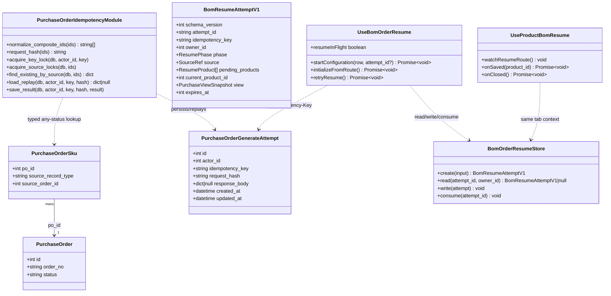
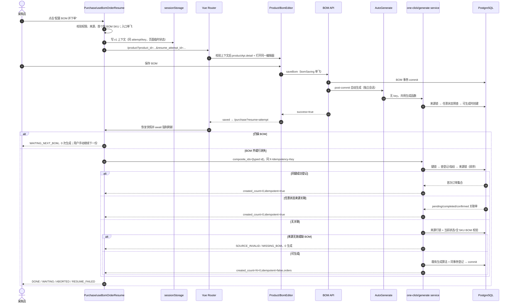
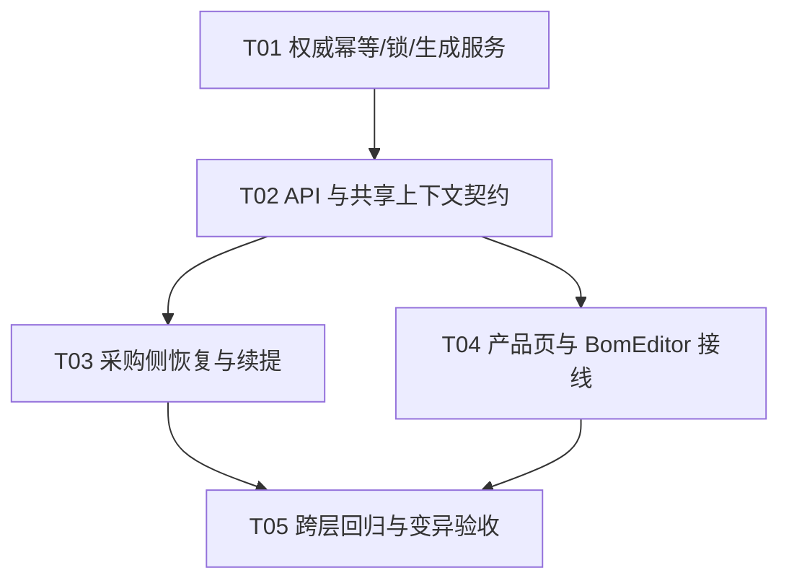

# BOM 缺失下单续提：增量架构与任务分解

> 状态：已实现，待完整验证（本文保留设计口径；验证证据以交付总结为准）。本文只规定 P0：PC `/purchase` 单条 `order:<id>` / `stockin:<id>`。
>
> 核心目标：不重建来源单、不丢采购页面临时状态；BOM 保存后权威重校验并续提；自动/人工/刷新/重试/完成并发均不重复生成采购单。

## 0. 架构决策摘要

1. **沿用现有栈**：Vue 3 + TypeScript + Vue Router + Pinia + Vue Query、FastAPI + SQLAlchemy + PostgreSQL；不新增框架、路由、BOM 编辑器或生成算法。
2. **两层前端恢复**：URL 只带尝试/产品 ID；完整上下文放当前标签页 `sessionStorage`，版本 `v1`、绝对 TTL 24 小时、绑定用户 ID。返回后先强制刷新，再决定是否调用续提。
3. **三层后端防重**：
   - `purchase_order_generate_attempt` 与生成事务同库同事务，登记“用户 + 幂等键 + 请求指纹 + 成功/预期业务结果”；
   - 复用 `core.pg_locks` 的事务级 advisory lock，同键串行、同来源串行；
   - 在来源状态/BOM 门控前，按 `purchase_order_sku.source_record_type + source_order_id` 查询**任意状态**关联采购单。
4. **删除生成入口里的 pending 清理调用**：`purchase_order_generate.py` 的 `_cleanup_pending_for` 不再参与生成。旧逻辑“删 pending 再建”会破坏幂等返回、丢失已补录内容，且无法覆盖 completed。
5. **保留 `uq_po_pending_dedup` 为最后防线，但不依赖它作承诺**。不修改完成操作；来源锁与任意状态预查已经覆盖“完成后旧续提”。
6. **`created_count` 按当前 HTTP 调用真实新增数计量**：首次新建为实际插入数；已有单、同键重放均为 0。重放复用首次成功的订单集合与业务终态，不把已有单伪装成新增。
7. **P0 不自动连跳多 SKU**：每份 BOM 保存后都回采购页；仍缺 BOM 时等待用户点击下一份。
8. **`source_order_ids` 只登记客户订单 ID**：备货来源由 `purchase_order_sku` 的 typed 快照关联。这样既避免把 stockin ID 误当 Order 查询，也避免 Order/StockIn 同数字 ID 在 pending 唯一索引上碰撞阻断另一来源。

## 1. 只读现状证据与根因

| 位置 | 已核实事实 | 设计约束 |
|---|---|---|
| `PurchaseView.vue:68-89` | 仅传待生成行给面板，没有续提事件 | 在面板加入口，编排放手柄/composable，不膨胀页面 |
| `ActiveOrdersPanel.vue:91-94` | 缺 BOM 只有只读文案 | 改为文案 + 权限门控按钮 |
| `usePurchaseHandlers.ts:27-36,64-80` | 30 秒刷新、WebSocket 和初始加载已存在 | 返回时仍须独立 await 强制刷新，不能把推送当校验 |
| `ProductListView.vue:43-44,111-113` | 复用 `BomEditor.open`，不读路由上下文 | 只加可选续提接线，普通产品编辑不变 |
| `useProductListActions.ts:169-186` | 关闭已有保存中拦截与 dirty 确认 | 只有真正关闭后才发取消事件 |
| 同文件 `348-489` | `bomSaving` 防重；成功仅关闭/失效查询，无成功回调 | 保存 API 成功后才发 `saved`；失败/校验失败不发 |
| `order_routes.py:115-161` | 端点接收 `X-Idempotency-Key` 并透传 | 复用端点，补当前用户 ID，不新建生成接口 |
| `purchase_order_generate.py:377-445` | key 未消费；409 清理 pending；425-438 只回查 pending 且 `created_count=len(existing)` | 根因是缺少请求级登记和全状态来源防重，不能只改前端 |
| 同文件 `448-483` | 自动与人工共用生成函数 | 防重必须放在共用服务内 |
| `_unprocessed.py:30-84` | 已处理优先 typed SKU，旧 JSON 仅无歧义时兜底 | 续提预查采用同一类型安全原则 |
| 同文件 `313-320` | 多 SKU 必须全有 BOM | 续提不能按首个 SKU 提前生成 |
| `purchase_order.py:104-116` | 唯一索引仅 pending | 不能覆盖 completed 后旧请求 |
| 同文件 `229-280` | SKU 有来源类型/ID 与索引 | 是任意状态业务幂等的权威关联 |
| `core/pg_locks.py:16-44` | 已有 60 位 key 与 `pg_advisory_xact_lock` | 直接复用，不引入 Redis 锁作为真相 |
| `core/arq_app.py:106-133` | ARQ Redis 幂等明确 fail-open | 不能承担本需求权威幂等 |
| `core/redis_wrapper.py:188-215` | Redis 锁有 TTL/token，但 Redis 可不可用 | 可作短暂互斥工具，不能与 PG 提交原子，不采用 |
| `product_routes.py:206-236` | BOM 保存要求 `product_manage`，提交后注册副作用 | 不扩权；保存成功不等于采购单已生成 |
| `_auto_generate.py:88-120` | BOM 提交后先撤销再自动生成 | 自动与返回续提必须在服务层互斥 |
| `request.ts:243-281` | 写请求默认不重试 | 续提保持不自动重试；401 原配置重放仍由同键保护 |
| `schemas/purchase_center.py:259-267` | 成功响应是扁平 `success/...` | 追加字段，不能改成 `{code,data,message}` 双层包装 |
| `router/index.ts:32,52` | `/product`、`/purchase` 已有 | 无新路由 |

当前迁移链已用只读 `alembic heads` 核实为单 head：`pg_standalone_104_dedup_default_bom_rows`。本阶段未连接数据库、未重启服务、未运行业务测试。

## 2. 最小变更架构

### 2.1 调用分层

```text
ActiveOrdersPanel（入口/权限展示）
  → useBomOrderResume（采购侧状态机、恢复、续提）
  → bomOrderResume.ts（上下文类型、校验、sessionStorage）
  → /product?product_id=...&resume_attempt_id=...
  → useProductBomResume（产品详情/权限/路由校验）
  → BomEditor → saved / closed
  → /purchase?resume=...
  → 强制刷新 → POST one-click-generate（同键）

POST one-click-generate
  → generate_purchase_orders_from_customer_orders（唯一生成入口）
  → 同键登记/重放 + 来源锁 + 任意状态关联预查
  → 当前来源行锁与状态/BOM 校验
  → 既有 _generate_per_customer
```

### 2.2 不选方案

- 不新增 `/bom` 页面或第二套 BOM 表单。
- 不恢复旧人工审核页签，不重新创建 Order/StockIn。
- 不用前端列表快照、WebSocket、`has_bom` 文案作最终可生成依据。
- 不用 Redis/前端单飞作全部防重；不引入通用幂等中间件。
- 不给 `purchase_order_sku(source_record_type,source_order_id)` 加全局唯一约束：同一来源可有多个 SKU，且现有撤销/删除语义不能在本任务重写。
- 不为“完成后旧续提”修改 `complete_purchase_order`：完成只改变已有 PO 状态；续提在来源锁内先看到该 PO 即返回，无需扩大完成链路改动面。

## 3. 前端设计

### 3.1 路由与上下文

- 去程：`/product?product_id=<正整数>&resume_attempt_id=<uuid>`。
- 回程：`/purchase?resume=<uuid>`。
- session key：`fb_bom_order_resume_v1:<attempt_id>`。
- `attempt_id = crypto.randomUUID()`；`idempotency_key = "po-resume:" + attempt_id`，总长小于 64。
- TTL：创建后 24 小时，过期/版本不符/用户不符/结构不符均 fail closed，清除上下文和查询参数，不发写请求。
- sessionStorage 写失败时**不跳转**，提示当前浏览器无法保存续提上下文；避免变成无上下文的产品页死路。

```ts
type ResumePhase =
  | 'CONFIGURING' | 'RETURNING' | 'RESTORING_REVALIDATING'
  | 'WAITING_NEXT_BOM' | 'RESUMING' | 'RESUME_FAILED'
  | 'DONE' | 'CANCELLED' | 'ABORTED'

interface ResumeProduct {
  product_id: number
  product_name: string
  product_barcode?: string | null
}

interface PurchaseViewSnapshot {
  active_tab: 'active' | 'history'
  purchase_page: number
  unprocessed_page: number
  selected_ids: number[]
  main_scroll_top: number       // .main-content.scrollTop
  table_scroll_left: number     // .pc-table-wrap.scrollLeft
}

interface BomResumeAttemptV1 {
  schema_version: 1
  attempt_id: string
  idempotency_key: string
  owner_id: number
  phase: ResumePhase
  return_route: '/purchase'
  source: {
    composite_id: string
    record_type: 'order' | 'stockin'
    source_order_id: number
    order_no: string
  }
  pending_products: ResumeProduct[]  // 仅展示/导航快照，不作生成真相
  current_product_id: number
  view: PurchaseViewSnapshot
  last_error?: string
  created_at: number
  updated_at: number
  expires_at: number
}
```

明确不存：来源数量、抵扣、备注、BOM 草稿、汇总弹窗编辑。这些或已在数据库，或不属于 P0 恢复边界。

### 3.2 入口与多 SKU

1. 仅 `has_bom=false` 行显示入口；当前 `/purchase` 已受采购权限保护，按钮再要求 `auth.hasPermission('product_manage')`。无权限显示“缺 BOM，请联系产品管理员”，不提供可点击跳转。
2. 从最新 `items` 取首个 `has_bom === false` 的 SKU；只有旧数据没有逐项信息时才回退顶层 `product_id/product_name`。无法得到一致的正整数产品 ID、来源类型/ID 与 `composite_id` 不匹配时停止并提示刷新。
3. `startConfiguration` 导航单飞；新主动作创建尝试。`WAITING_NEXT_BOM` 的“继续配置”复用原尝试、原幂等键和原页面快照，只更新 `current_product_id` 与最新缺失展示列表。
4. 返回后按最新行重算缺失 SKU；每次只回采购页，不自动进入下一份。

### 3.3 BomEditor 事件接线

`useProductListActions(confirmDialog, hooks?)` 增加可选 hooks，由 `BomEditor` 转成组件事件。现有 `saveBom` 已约 142 行，先拆为“校验/二次确认、payload 构建、API 持久化与成功事件”三个 <80 行函数，不能继续在原函数里追加分支；`BomEditor.vue` 已 419 行，同时将既有角色菜单/键盘交互原样抽到 `useBomRoleMenu.ts`，使组件降到 400 行以下后再接事件。

- `saved: [{ product_id: number }]`：仅在 `saveBom` API 明确 `success=true`、基线刷新并关闭后触发一次。
- `closed: [{ product_id: number | null }]`：仅 `requestCloseBom` 通过保存中/dirty 检查且实际关闭后触发。

约束：

- `success=false`、异常、前端校验失败、dirty 确认被拒绝均不发事件。
- 保存成功路径只发一次 `saved`，不得因 `bomDialogVisible` 变为 false 再发 `closed`；禁止用单纯 visible watch 同时推导两种事件，否则 `RETURNING` 会被误覆盖为 `CANCELLED`。
- hooks 在 API try/catch 外或以独立安全边界调用；路由失败不得被误报成“BOM 保存失败”。
- 普通 `/product` 未传监听时保持原行为。
- 快速复制/复制弹窗的既有直接写行为不在本任务改写；续提自动返回只认明确的“保存 BOM”成功事件。

### 3.4 产品页编排 `useProductBomResume`

- watch 路由查询并以 `attempt_id:product_id` 单飞打开；先读并校验上下文，再 `productApi.detail(product_id)`，最后 `bomEditorRef.open({id,name})`。
- 要求 `phase=CONFIGURING`、URL 产品等于 `current_product_id`、来源/返回路由合法、上下文属于当前用户且未过期。
- 无权限、无效产品、上下文不匹配：不打开其他产品、不发续提；标记 `ABORTED`（能读取上下文时）并回 `/purchase?resume=...` 展示原因。上下文不存在时只回 `/purchase` 并提示，不写。
- `saved`：先持久化 `RETURNING`，再 `router.replace('/purchase?resume=...')`。
- `closed`：先持久化 `CANCELLED`，再回同一 resume URL；采购页只恢复快照，不续提。
- `RETURNING/RESUMING` 重复进入产品 URL时不重开编辑器，转回采购页恢复；终态/已消费 URL 不自动写。

### 3.5 采购页状态机 `useBomOrderResume`

| 状态/事件 | 必须行为 |
|---|---|
| 新入口 | 校验权限和来源 → 捕获页签、两类页码、选择、滚动 → 写上下文 → 单飞导航 |
| `RETURNING/RESUMING/RESUME_FAILED` 挂载或手动重试 | 恢复快照 → await 新鲜待生成/采购列表 → 再判定 |
| 行存在且仍缺 BOM | `WAITING_NEXT_BOM`，展示最新缺失项，0 次生成调用 |
| 行存在且 BOM 齐 / 行消失 | `RESUMING`，同 attempt 同 key 调一次；行消失不等于成功 |
| 本次新建 | `DONE`，`created_count>0`，展示订单号，刷新派生查询并消费上下文 |
| 已有/重放 | `DONE`，`idempotent=true`、`created_count=0`，提示无需重复下单并消费上下文 |
| `MISSING_BOM` | 以后端缺失项更新展示，回 `WAITING_NEXT_BOM`，不自动跳 |
| 无关联且 `SOURCE_INVALID` / 403 / 同键冲突 | `ABORTED`，不盲目重试，消费自动续提能力并保留可读原因；若来源删除/状态变化前已有 PO，仍按上行已有单进入 `DONE` |
| 网络/5xx/响应形状不可信 | `RESUME_FAILED`，保留同 key；手动重试仍先刷新 |
| `CANCELLED` 回程 | 恢复快照、正常刷新，0 次续提，消费上下文 |
| 刷新/重复回跳 | 从同 key 上下文恢复，先读后写；`RESUMING` 刷新也先重校验再同键重放 |
| `DONE/CANCELLED/ABORTED` 后旧 URL | 上下文已消费，移除 resume 参数，0 写请求 |

实现细节：

- `resumeInFlight` 防同页双发；不把该内存锁当后端承诺。
- `oneClickGenerate` 不传 `retryable:true`，因此无 502/503/504 自动写重试。401 刷新后的 Axios 原配置重放保留同头，由后端幂等保护。
- 初始化 resume 时不再并行跑原有初始加载，避免“旧列表先返回触发续提”的竞态；普通挂载保持原加载。
- 恢复页码后等待 query key 更新，再 await invalidate/refetch。页码越界则夹到最后有效页并重新取数；选择仅保留新数据中仍存在的 ID；DOM 更新后恢复 `.main-content` 与表格横向滚动。
- `success=true` 必须同时有非空 `orders`，且满足 `created_count>0` 或 `idempotent=true`；否则按不可信响应进入 `RESUME_FAILED`，不得显示假成功。
- 页面文件保持 `<400` 行；各 composable 函数保持 `<80` 行，解析、存储、刷新、响应归约各拆小函数。

## 4. 后端权威幂等与并发设计

### 4.1 新增登记表（必须迁移的理由）

表：`purchase_order_generate_attempt`。

| 列 | 类型/约束 | 用途 |
|---|---|---|
| `id` | Integer PK | 内部主键 |
| `actor_id` | Integer FK `user.id`，非空 | 键按用户隔离，避免跨用户重放/泄露 |
| `idempotency_key` | String(64)，非空 | 原请求键 |
| `request_hash` | String(64)，非空 | 规范化来源集合 SHA-256 |
| `response_body` | JSONB，可空 | 首次成功或预期业务结果；处理中未提交时为空 |
| `created_at` / `updated_at` | TIMESTAMPTZ，非空，默认 now | 审计/未来运维 |

`UNIQUE(actor_id, idempotency_key)`。P0 永久保留，强于原注释的 10 分钟；不增加清理任务。只有 HTTP 人工请求传 key，自动生成不写该表。

为什么不能只用现有设施：

- `RedisIdempotencyStore` 明确故障放行，且 Redis SET 与 PostgreSQL commit 不原子，不能证明“已提交但响应未知”。
- 任意状态来源关联能防止同来源重复，但不能识别“同键不同 payload”，也不能跨进程复用首次响应。
- 因而必须有一张与业务写入同事务的 DB 登记表；不是为偏好新增表。

### 4.2 请求规范化与键处理

1. 接受现有 `order:<id>`、`stockin:<id>`，旧裸数字仍按 order 兼容；拒绝未知前缀、0/负数、空项。
2. 请求指纹基于“规范化 typed ID 去重排序后的 JSON”SHA-256；同集合不同顺序视为同 payload。
3. 有 key 时先取 `number_lock_key('PURCHASE_GENERATE_KEY', actor_id + ':' + key)` 的事务锁。
4. 查登记：
   - hash 不同：409 `IDEMPOTENCY_CONFLICT`，不进入任何生成/清理；
   - 已有成功结果：返回其订单集合和终态，当前 `created_count=0`、`idempotent=true`；
   - 已有预期失败（如曾缺 BOM）：不直接重放，重新权威校验并更新登记，允许同键修复后续提；
   - 无登记：继续。
5. 预期业务结果与登记在同一事务提交；意外异常回滚，登记与业务写入一起消失。并发同键由 advisory lock 串行，不存在可见的永久 processing 脏行。

### 4.3 来源级互斥与全状态预查

在共用生成函数内、无论有无 key 均执行：

1. 对全部规范化来源按 `(record_type, source_id)` 排序，依次获取 `number_lock_key('PURCHASE_GENERATE_SOURCE', composite_id)`。固定顺序避免多来源 AB-BA。
2. 查询 `PurchaseOrderSku(po_id) → PurchaseOrder`，精确匹配每对 `(source_record_type, source_order_id)`，**不加状态过滤**，按 PO ID 去重/排序。
3. 旧无 SKU 快照数据只采用 `_unprocessed.py` 同款“无歧义裸 ID”JSON 兜底；Order/StockIn 同数字 ID 时不得猜测。若只能命中歧义 legacy 关联，返回 `SOURCE_INVALID` 并要求数据核查，0 写入；绝不把 Order 的单返回给 StockIn，或反向串单。
4. 已有来源先幂等返回，再进入来源状态/BOM 门控。批量旧调用若只有部分来源已有，则锁定全部来源后仅对剩余来源生成，响应合并已有单和真实新单；`created_count` 只算新单。P0 始终单来源。
5. 删除 `_cleanup_pending_for` 在生成函数的调用；已有 pending 不再删掉重建。保留 pending 唯一索引捕获非预期漏洞。

锁顺序为“键锁（可选）→ 来源锁（排序）→ 来源行锁”。不同 key 不互相等待；相同 key 先串行；自动任务只取来源锁，因此与人工续提覆盖同一临界区。

### 4.4 当前来源与 BOM 权威校验

- 对无现有关联的来源，`_load_source_records` 改为 `FOR UPDATE` 读取；比对请求 ID 与实读 ID 全集，缺任何一条即 `SOURCE_INVALID`。
- Order 必须未软删且状态仍为 `ORDER_STATUS_PENDING_STOCK`；StockIn 必须仍存在。已有关联的来源按上节先返回，不被此门控误拒。
- 重新读取当前全部 SKU 与 BOM；任一缺失返回 `MISSING_BOM` 和 `{product_id,product_name}`，0 生成。
- 来源行锁与既有编辑/删除的 `FOR UPDATE` 配合，防止校验期间并发改删；数量、抵扣、备注只从当前记录计算。
- 生成后若无任何新单且又无任何已有关联单，抛错回滚，不能返回 `success=true,created_count=0,orders=[]`。
- 历史已有重复单只返回，不在本任务自动删单或修复。

### 4.5 并发证明

- **自动 vs 续提**：二者共用同一来源 advisory lock。后到者在第一事务提交后做任意状态预查，只能返回已生成单。
- **完成 vs 旧续提**：完成操作针对已存在 PO；续提预查不看状态，pending/completed/confirmed 都返回同一 PO，不会落到 pending-only 索引重建分支。
- **响应未知同键重放**：首次 PO 与登记已同 transaction commit；重试先命中登记，返回同一订单集合，0 新增。
- **同键不同 payload**：登记指纹不符 409，且发生在来源锁和生成之前。
- **来源删除/状态改变**：无关联时在当前行锁下重新校验，明确失败；有关联时按 PRD 优先幂等返回现有关联单。
- **0 单假成功**：成功响应的非空 orders/计数不变量在服务层断言；异常路径整个事务回滚。

## 5. API 契约

### 5.1 请求

`POST /api/v1/purchase-center/orders/one-click-generate`

```http
X-Idempotency-Key: po-resume:<uuid>
Content-Type: application/json

{"composite_ids":["order:123"]}
```

P0 前端只发一个 typed ID；后端保留既有批量兼容。key 可选以兼容旧客户端，但新续提必传；>64 仍 422。路由继续要求 `product_manage` 或 `purchase_center_manage`，并把 `_current_user.id` 传入服务。BOM 保存仍只认 `product_manage`。

### 5.2 成功/预期业务响应

保持扁平 `{success,...}` 包装，追加 `code/missing_bom`；`orders` 元素至少含 `{id,order_no,status?}`。

| 场景 | HTTP | 字段语义 |
|---|---:|---|
| 本次新建 | 200 | `success=true,code="OK",created_count=N>0,idempotent=false,orders=[新单]` |
| 自动/他人已生成、任意状态已有 | 200 | `success=true,code="OK",created_count=0,idempotent=true,orders=[关联单]` |
| 同键成功重放 | 200 | 复用首次成功订单集合/终态；当前 `created_count=0,idempotent=true` |
| 仍缺 BOM | 200 | `success=false,code="MISSING_BOM",created_count=0,idempotent=false,orders=[],missing_bom=[...]` |
| 来源删除/无效/歧义 | 200 | `success=false,code="SOURCE_INVALID",created_count=0,orders=[],missing_bom=[]`，message 指明 typed 来源/原因 |
| 同键不同 payload | 409 | `detail.code="IDEMPOTENCY_CONFLICT"`，0 写入 |
| 参数/权限/基础设施 | 422/403/5xx | 沿用现有语义；前端只有用户手动重试才同键重发 |

`missing_bom` 项为 `{product_id:number, product_name:string}`。前端 `@/types` 定义 `OneClickGenerateRequest/Response`、`GeneratedOrderRef`、`MissingBomProduct` 与上述 code union；`UnprocessedOrder` 补齐后端已经返回的 `source_order_id/product_id/customer_name`。生成物 `openapi.json/api.d.ts` 由后端 schema 重导，不手改。

成功不变量：`success=true ⇒ orders.length>0 && (created_count>0 || idempotent=true)`。所有 idempotent 响应 `created_count=0`，修正当前 `purchase_order_generate.py:435` 的假新增计数。

## 6. 数据结构与接口图



## 7. 关键时序



取消与响应未知的关键分支：

- `closed` 只在 dirty 流程实际关闭后发出；回采购页恢复快照但不调用 G。
- 首次 G 已 commit 而响应丢失时，重试先中登记；即使登记不可用代码路径被变异，来源锁 + 任意状态预查仍阻止同来源重复。
- BOM 保存失败不发 saved，停留编辑器且保留输入；保存成功只表示 BOM 持久化，采购结果以 G 为准。

## 8. 精确文件清单与实现顺序

标记：A 新增，M 修改。生成物只能由命令生成。

### 第一步：后端权威基础设施

- A `fastapi_app/shared_models/purchase_order_generate_attempt.py`
- M `fastapi_app/shared_models/__init__.py`
- A `migrations/versions/pg_standalone_105_purchase_order_generate_idempotency.py`（`down_revision=pg_standalone_104_dedup_default_bom_rows`）
- M `migrations/destructive_ddl_baseline.json`（仅人工审阅 downgrade 删新表后登记）
- A `fastapi_app/services/purchase_order_idempotency.py`
- M `fastapi_app/services/purchase_order_generate.py`
- A `tests/test_purchase_order_resume_idempotency.py`

### 第二步：API 与共享上下文契约

- M `fastapi_app/api/v1/endpoints/purchase_center/order_routes.py`
- M `fastapi_app/schemas/purchase_center.py`
- M `fastapi_app/tests/test_purchase_center.py`
- M `frontend-vite/src/types/index.ts`
- M `frontend-vite/src/api/purchase.ts`
- M `frontend-vite/src/api/request.ts`（post 可选 headers；不改变默认重试）
- A `frontend-vite/src/utils/bomOrderResume.ts`
- A `frontend-vite/src/test/bomOrderResumeContext.test.ts`
- M `frontend-vite/src/test/apiRequest.test.ts`
- M `frontend-vite/openapi.json`（导出）
- M `frontend-vite/src/types/api.d.ts`（生成）

### 第三步：采购侧恢复与续提

- A `frontend-vite/src/views/purchase/composables/useBomOrderResume.ts`
- M `frontend-vite/src/views/purchase/composables/usePurchaseHandlers.ts`
- M `frontend-vite/src/views/purchase/PurchaseView.vue`
- M `frontend-vite/src/views/purchase/components/ActiveOrdersPanel.vue`
- A `frontend-vite/src/test/bomOrderResumePurchase.test.ts`
- M `frontend-vite/src/test/purchaseOrderNoColumn.test.ts`

### 第四步：产品页与 BomEditor 接线

- A `frontend-vite/src/views/product/composables/useProductBomResume.ts`
- A `frontend-vite/src/views/product/composables/useBomRoleMenu.ts`（纯搬迁既有角色菜单/键盘交互，使 `BomEditor.vue` <400 行）
- M `frontend-vite/src/views/product/ProductListView.vue`
- M `frontend-vite/src/views/product/components/BomEditor.vue`
- M `frontend-vite/src/views/product/composables/useProductListActions.ts`
- A `frontend-vite/src/test/productBomResume.test.ts`
- M `frontend-vite/src/test/bomEditorUnsavedConfirm.test.ts`（仅必要时补事件回归，不放宽原断言）
- M `frontend-vite/src/test/bomEditorRoleTabs.test.ts`（角色菜单抽离零行为变化回归）

### 第五步：跨层回归与旧契约更新

- M `tests/e2e_api/test_write_paths.py`（把“同键 400”旧锁改为同键 200、同 PO、0 新增；按测试 key 前缀清理新登记表）
- M `fastapi_app/tests/test_response_helper.py`（idempotent 示例计数改 0）
- M `fastapi_app/tests/test_purchase_auto_generate.py`（保留原自动测试，补 typed 任意状态查询）
- M `frontend-vite/src/test/PurchaseView.autorefresh.test.ts`（适配 resume 初始化单飞，不断言重复加载）
- M `frontend-vite/src/test/mobileViewsDataLayer.test.ts`（仅当现有只读断言需要加强；不得新增移动端生成行为）

## 9. 迁移、部署与回滚

1. `105` 只新增登记表/约束/索引；`down_revision` 指向已核实的 `104`，保持单 head。不得对生产库 autogenerate。
2. downgrade 仅删除本任务新建的 `purchase_order_generate_attempt`，不碰采购单/来源单；该 DROP 须先人工审阅再更新 destructive baseline，不能用辅助函数绕过门禁。
3. 空测试库验证 `upgrade head → alembic check`；另验证 `105 → 104 → 105`，重升级后表/约束唯一。
4. 生产实施顺序必须是：**备份/运维窗口 → 迁移 105 → 同版本后端与前端一起发布**。本任务不允许架构/实现代理执行生产迁移或重启。
5. 代码回滚：旧后端不读新表，旧前端不发 resume 参数；可回滚代码且保留新表，无业务破坏。若执行 schema downgrade，已生成 PO 不受影响，但同键结果登记会丢失，因此回滚后不得再用新前端。
6. 不在旧代码未迁移时提前重启新后端，否则登记查询会因表不存在而失败；发布检查须先验证当前 head 为 105。

## 10. 测试矩阵与 Red→Green / 变异检查

### 10.1 后端聚焦矩阵

| 场景 | 核心断言 |
|---|---|
| Order 首次生成 | 新 PO=1，`created_count=1`、非 idempotent，来源状态沿用现算法 |
| StockIn 同数字 ID | `order:7` 与 `stockin:7` 各自只命中自己的 typed 关联 |
| 同键重放/响应未知 | 两次返回同 PO ID 集；第二次 0 新增、`created_count=0` |
| 同键不同 payload | 409；新来源也无写入；登记指纹不被覆盖 |
| 无 key 旧客户端重复 | typed 任意状态预查仍返回同 PO，保持业务防重 |
| 已完成 + 旧续提 | completed PO 原样返回，0 新 PO，无 pending cleanup |
| 自动 vs 续提并发 | 两独立 session 同时生成，同来源最终 PO=1；二者订单 ID 一致 |
| 来源锁真实性 | 外部事务持来源 advisory lock 时续提等待；释放后继续（移锁即红） |
| 缺 BOM / 多 SKU | 缺失列表准确、0 PO；全部补齐才生成 |
| 无 PO + 删除/软删/无效状态 | `SOURCE_INVALID → ABORTED`，0 写入；不创建来源单 |
| 已有 PO + 来源删除/状态改变 | 关联预查优先，仍返回既有 PO、`idempotent=true → DONE`，0 新 PO；不得误走 ABORTED |
| 生成 0 单 | 抛错回滚，不出现成功空 orders/假计数 |
| 历史 pending 已有 | 不删除重建，已补录价格/备注保持，返回原 PO |
| 歧义 legacy ID | fail closed，不串 Order/StockIn，不写新单 |
| 混合批量（兼容） | 已有部分返回、缺失部分生成；count 只算新单，不重复 |
| 迁移 | 单 head；空库 upgrade/check；downgrade/upgrade 幂等 |

关键并发用例必须跑真实 PostgreSQL 和独立事务，不能用 mock 的“锁被调用”代替。测试夹具要清理新建来源/PO，也要按测试 key 前缀清理 `purchase_order_generate_attempt`，不因永久登记留下垃圾。现有 `tests/e2e_api` 仅在专用临时后端/测试库条件满足时运行，绝不连本机生产。

### 10.2 前端聚焦矩阵

- 上下文 round-trip、TTL、版本、owner、篡改/非法来源、storage 写失败。
- 无权限不跳；无效/不匹配产品不打开；重复路由 watch 只 open 一次。
- 多 SKU 首项选择、旧数据顶层回退、无法解析停止。
- 保存成功一次才返回，且只 emit 一次 saved、绝不再 emit closed；`success=false`/异常/校验失败不返回且草稿保留；dirty 拒绝取消无 closed。
- 返回必须先完成强制刷新再决定写；仍缺 BOM 0 写，BOM 齐/行消失才调用。
- 多 SKU 每次回采购页，不自动连跳；最新缺失由后端/新列表重算。
- 双击入口/保存/续提各自单飞；网络未知后手动重试仍同 key；不启用写自动重试。
- 新建、已有、缺 BOM、来源失效、0 单异常响应的 UI 状态正确。
- 配置中/校验中/续提中/失败/完成后刷新与旧 URL 均不重复写。
- 页签、页码、有效选择、滚动恢复；失效选择剔除、页码夹紧。
- 移动端保持只读，普通产品编辑与既有 BOM 安全测试不退化。

### 10.3 Red→Green 顺序

1. 先写新后端契约：同键第二次期望 200/同 PO/0 新增；当前实现会为 400 或 pending 重建，记录 Red。
2. 写 completed 预查、Order/StockIn 撞号、自动/续提并发；当前实现分别因 pending-only/裸 ID/无来源锁而失败。
3. 写前端入口、路由恢复、保存事件、刷新后同键续提；当前无入口/上下文/事件，记录 Red。
4. 再按任务实现到 Green；每轮只跑一次并保存输出，临时日志/变异补丁结束清理。
5. 最后跑原自动生成、BOM dirty/read-failure、采购汇总/完成、移动端只读回归，不能只跑新测试。

### 10.4 必做变异实验

| 变异 | 必须变红的测试 |
|---|---|
| 去掉任意状态 typed 预查 | completed + 旧续提、同数字 ID |
| 去掉来源 advisory lock | 外部持锁等待测试、自动/续提并发 |
| 去掉 request_hash 比较 | 同键不同 payload |
| 绕过登记重放 | 响应未知同键重试 |
| `created_count=len(existing)` | 所有幂等响应计数断言 |
| 恢复 `_cleanup_pending_for` | pending 原 PO/补录内容保持测试 |
| 刷新 Promise 未完成就续提 | 返回调用顺序测试 |
| 重试生成新 key / 开自动写重试 | key 稳定与请求配置测试 |
| 保存失败也 emit saved / 保存成功同时 emit closed | 保存失败不返回/不续提；保存成功仅一次 saved、不得被 CANCELLED 覆盖 |
| 把来源门控移到任意状态预查之前 | 已有 PO + 来源删除/状态改变仍幂等 DONE；无 PO 删除才 ABORTED |
| 自动跳下一份 SKU / 终态不清上下文 | 多 SKU 停留、旧 URL 0 写 |

## 11. 最小验证命令

以下仅供实现阶段；本架构阶段未执行。

### 后端（在提权 PowerShell、测试库独占条件满足时）

```powershell
@(
  'tests/test_purchase_order_resume_idempotency.py',
  'fastapi_app/tests/test_purchase_auto_generate.py',
  'fastapi_app/tests/test_purchase_center.py',
  'fastapi_app/tests/test_response_helper.py',
  'tests/test_po_dedup_index_migration.py',
  '-q'
) | Set-Content logs/_pytest_bom_resume_args.txt
pwsh -File logs/_run_pytest_elevated.ps1 `
  -ArgsFile D:\erp_system\logs\_pytest_bom_resume_args.txt `
  -OutFile D:\erp_system\logs\_pytest_bom_resume.log
```

OpenAPI 与静态检查：

```powershell
python scripts/check_openapi_frontend_alignment.py --export frontend-vite/openapi.json
python scripts/check_openapi_frontend_alignment.py --verbose --snapshot frontend-vite/openapi.json
ruff check fastapi_app tests fastapi_app/tests utils
mypy --config-file mypy.ini --no-native-parser
```

迁移只在临时空库/CI 验证；不得对本机生产库执行 upgrade/downgrade/autogenerate。

### 前端

```powershell
cd frontend-vite
npm run gen:api
$env:TEMP = "$PWD/.vitest-tmp"
$env:TMP = $env:TEMP
npx vitest run src/test/bomOrderResumeContext.test.ts src/test/bomOrderResumePurchase.test.ts src/test/productBomResume.test.ts src/test/bomEditorUnsavedConfirm.test.ts src/test/bomEditorRoleTabs.test.ts src/test/purchaseOrderNoColumn.test.ts src/test/PurchaseView.autorefresh.test.ts src/test/mobileViewsDataLayer.test.ts
npm run type-check
npm run lint
npm run check:api
npm run check:api:pc
npm run check:routes
npm run check:dto
npm run check:types
```

跨层改动合入前还需 CI 三 job 等价门禁及全量测试；`tests/e2e_api/test_write_paths.py` 只能在 `E2E_API_BASE_URL` 和 `ERP_E2E_REAL_DATABASE_URL` 均明确指向专用测试环境时执行。

## 12. 任务分解

### 12.1 Required Packages

无新增第三方包。沿用已锁版本的 FastAPI、SQLAlchemy、Alembic、PostgreSQL、Vue、Vue Router、Pinia、Vue Query、Axios、Vitest。

### 12.2 Task List（按依赖顺序）

| ID | 名称 | 具体文件 | 依赖 | 优先级 | 测试与验收 |
|---|---|---|---|---|---|
| **T01** | **项目基础设施：权威幂等数据层、来源锁与生成收口** | T01 全部后端文件：新 model/migration/idempotency service、models init、destructive baseline、`purchase_order_generate.py`、`tests/test_purchase_order_resume_idempotency.py` | 无 | P0 | 先 Red 后 Green；真实 PG 同键/撞号/completed/自动并发/锁等待/0 单；单 head；生成函数 <80 行；不再调用 pending cleanup |
| **T02** | **API 与前后端共享契约、session 上下文** | T02 的 route/schema/API request/types、`bomOrderResume.ts` 与对应测试、OpenAPI 生成物 | T01 | P0 | actor ID 到服务；key header 原样传递且不自动重试；响应 code/count/missing_bom；上下文 TTL/owner/版本测试；`check:types` 无漂移 |
| **T03** | **采购侧入口、页面恢复与续提状态机** | T03 的 purchase composable/handlers/view/panel 与两组测试 | T02 | P0 | 权限入口；Order/StockIn；刷新先于写；多 SKU 不连跳；失败/刷新/重复回跳同键；视图恢复；组件/函数长度门禁 |
| **T04** | **产品页路由打开与 BomEditor saved/closed 接线** | T04 的 product composable（含 role-menu 抽离）/view/editor/actions 与测试 | T02 | P0 | 正确产品才打开；无效/无权限 fail closed；保存成功才返回；取消/失败不续提；普通编辑与 dirty/read-failure/role-tabs 回归；`BomEditor.vue` <400 行、`saveBom` 各函数 <80 行 |
| **T05** | **跨层契约更新与回归验收** | T05 的 e2e/response/auto-generate/autorefresh/mobile 测试文件 | T03 + T04 | P0 | 更新旧假幂等锁；自动/汇总/完成/BOM/移动端全回归；变异检查；最小命令与 CI 三 job 全绿 |

T03/T04 可并行，但联调必须在两者完成后；T01/T02 不得拆成“先上前端、后补后端”的半功能发布。

### 12.3 Shared Knowledge

- 来源身份永远使用 `record_type + source_order_id`，不得用裸数字 ID。
- 前端所有提交真相来自后端当前 Order/StockIn/BOM；session 快照只用于显示/导航/视图恢复。
- 同 attempt 跨多 SKU、刷新、失败重试保持同 key；新用户主动作才生成新 key。
- `created_count` 是当前调用真实新增数；`idempotent=true` 时恒 0，`orders` 是关联单而非新单证明。
- `success=true` 不允许空 orders；`MISSING_BOM` 可重试，`SOURCE_INVALID` 不盲试，网络未知同键人工重试。
- 成功响应保持扁平 `success` 包装；后端 403/422/409/5xx 语义不统一吞成成功。
- 自动与人工必须继续共用生成服务；禁止恢复第二套算法或在 BOM 回调里创建来源单。
- 新 Vue 组件 <400 行、函数 <80 行；生成物不手改；测试必须看过 Red 并做指定变异。

### 12.4 依赖图



## 13. Diff 预算与实施切分

完整需求包含 DB 权威幂等、并发测试、前端恢复和异常矩阵，**在不降低防重/不丢数据目标的前提下，总有效 diff 无法诚实承诺 ≤400 行**。预计总量约 900–1200 行（不含 `openapi.json/api.d.ts` 生成物），按同一任务内的审查包控制：

1. T01 后端基础设施 + 真 PG 测试：目标 350–450 行。
2. T02 契约 + 上下文：目标 250–350 行。
3. T03 采购侧 + 测试：目标 250–350 行。
4. T04 产品侧 + 测试：目标 200–300 行。
5. T05 旧契约更新与变异：目标 150–250 行。

这些是同一任务一次实施、一次验收的切分，不是分批上线；每个包优先复用现有 helper，超出时先减重复测试夹具/注释和抽象，不得删减权威锁、类型隔离、异常恢复或回归断言。

## 14. 明确不做的 P1/P2 与 PRD 简化

- P1：移动端、多 SKU 自动连续配置、采购单高亮/复制单号、BOM 草稿全路由离开保护。
- P2：指标分析、批量来源点检/批量续提编排。后端仅保留既有批量兼容，不设计新的批量部分成功语义。
- 不加薄状态查询端点：新鲜待生成查询 + 权威续提响应已足够。
- 不引入 XState/Redux、通用幂等框架、Redis 结果缓存或跨标签页同步。
- 不序列化汇总弹窗、不恢复 BOM 未保存草稿、不做历史重复单清理或 legacy 回填。
- 不把永久 DB 登记 TTL 缩短为 10 分钟；24 小时只是浏览器上下文 TTL，两者不得混淆。

## 15. Anything UNCLEAR / 假设

1. 无 typed SKU 且 Order/StockIn 同数字 ID 的历史 PO 无法可靠判型；默认 fail closed 并提示数据核查，不在本任务猜测回填。这可能让极少数旧来源需要人工修复，但优于串单/重复单。
2. 用户主动删除 PO 后 SKU 级联消失，来源可重新进入生成，沿用现有“删 PO 使来源回到待生成”语义；“任意状态”不等于“已物理删除”。
3. 同一来源历史上已有多张关联单时全部按 ID 返回，0 新增；P0 不自动判定哪张该删。
4. 业务失败登记只用于识别同键 payload 并允许同键重校验；只有成功结果直接重放。意外异常回滚不产生登记，符合“没有已提交首次结果可复用”的语义。
5. 采购中心后端仍保持粗粒度权限；`purchase_center_manage` 可直接调用生成，但不能因此获得 BOM 保存权限。前端配置入口必须额外要求 `product_manage`。
6. 普通浏览器后退到不带 resume 的 `/purchase` 不自动续提；遗留未终态上下文只保留到 TTL，新的主动作可创建新尝试，后端仍防重。

## 16. 本阶段验证说明

本阶段仅新增本架构文档。结论来自只读代码、测试、迁移与 Alembic head 调查；未修改业务代码、未连接生产数据库、未重启服务、未提交代码。按 `AGENTS.md`“仅文档改动免测”规则未运行测试；上述 Red→Green 与变异检查均为实现阶段强制验收计划，不表示已执行。
