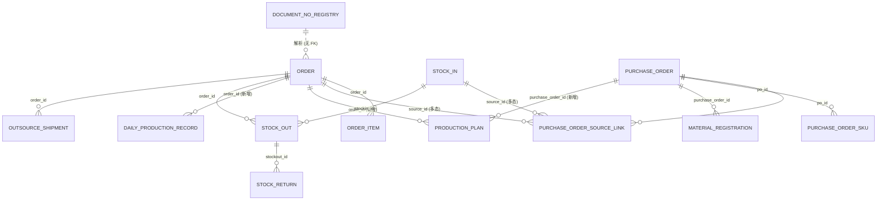
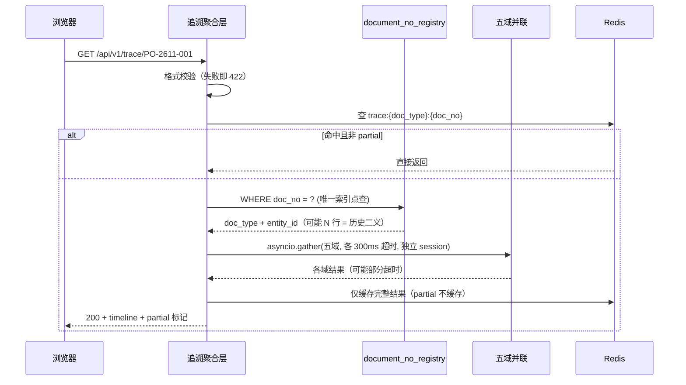

# PO 单号生成机制与全链路追溯设计方案

> 版本：v1.1（定稿）
> 日期：2026-11-09
> 适用系统：滨发协同系统（binfa-erp）
> 定位：可执行设计方案，不是调研报告。所有"现状"结论均来自代码核对；所有"目标值"标注假设前提，未实测者一律标【待锁定】。

---

## 0. 一句话结论

**本需求的瓶颈不在"单号怎么编"，而在"单号与实体之间缺一层解析、工序与订单之间缺关联键"。**

现有取号内核（`numbering_counter` 原子递增 + 格式守卫 + 每日巡检）已经相当扎实，**不推翻、不重写存量单号**；单号的**书写格式按本次要求改短**（§3），存量历史单号一个字不改。真正要做三件事：

1. 建 `document_no_registry`，把"字符串 → 实体主键"变成一次唯一索引点查，解决 `PO` 前缀被客户订单与采购单共用造成的二义；
2. 给排产、日生产补关联列（它们今天**没有任何订单/采购单关联字段**）；
3. 建一条能"残缺但快速"返回的聚合链路，并把每个节点的**关联强度如实告诉用户**。

> 范围前提：按**单机生产部署**（nginx :3000 → uvicorn 127.0.0.1:5002 + PostgreSQL + Redis/ARQ）设计。用户问题中"高并发、分布式"部分作为**机制说明与演进路径**，不作本期建设目标——单机上分布式 ID 是负收益。

### 0.1 已识别问题与处置对照

本文件是设计，「已闭合」指方案层面给出了可执行处置。**其中第 9 条（单号改短）已于 2026-11-09 落到代码**：`shared/numbering_format.py`、`services/numbering_sequence.py`、`services/numbering.py`、`tasks/numbering_audit_task.py`、迁移 `pg_standalone_116_numbering_short_format` 及 6 个相关测试文件；**尚未执行迁移、未重启服务、未跑测试**（本会话进程派发异常，无法取证据）。其余 8 条仍为设计，未动代码。

| # | 发现的问题 | 处置 | 位置 |
|---|---|---|---|
| 1 | 排产/日生产/包装**没有任何订单或 PO 关联列**，"查生产"物理上不成立 | P0 补键（`order_id`/`purchase_order_id`/`link_source`/`link_confidence`/`link_basis`）+ 分级回填；未决一律留 NULL | §4.5、§4.7 |
| 2 | **全库无质检实体**，结论只在 `remark` 自由文本 | 不建表、不抽关键词；页底「未纳入追溯」如实说明，P1 有写入方再建 | §2.4、§8.3、§12 |
| 3 | **全库无应收/核销/对账表** | 财务只做派生测算并标 `finance_scope=derivable_only`，`received_amount` 恒 `null` 而非 0 | §5.3、§8.3 |
| 4 | `PO` 前缀被客户订单与采购单共用，同一字符串二义 | `document_no_registry` 解析 + 界面强制类型标签；历史二义 `is_legacy` 放行、新撞号 409 | §3.3、§4.3 |
| 5 | 两表 `unique` 只是**表级**，counter 丢行会静默跨表重号 | 部分唯一索引 `WHERE is_legacy=false`，新撞号 fail loud；巡检做跨表重复扫描 | §4.3、§6.4 |
| 6 | `source_order_ids` 是 order.id/stockin.id **混装无类型数组**，按 order 回填会造假关联 | 不落库、只进待认领报表；权威源改用 `purchase_order_sku` 的类型化列 | §4.7 |
| 7 | 观测口径会伪造"全绿"（`numbering_audit` 列名、UTC 时区、`trace_elapsed_ms` 不存在、nginx 日志选错文件） | 改用已核实字段与文件；立 **NO DATA ≠ PASS** 规则并给采样数下限 | §9.4 |
| 8 | 回填的 `downgrade` 会把双写期**真实关联**当回填产物删掉 | 加 `link_source='system_matched' AND created_at>=cutover_at AND id<=backfill_max_id` 限定 | §10.3 |
| 9 | 单号 16 位偏长（本次新要求） | 改为 `PO-2611-001`（11 位，月流水），正则取 4/8 位交替、9 个索引零停机重建 | §3.1–§3.2 |

另有 3 项属"需要 owner 给数"，方案已给出默认值并标注【待锁定】：基线数据 N、包装唯一命中率、应收单价来源。

---

## 1. 业界单号生成机制：四种范式与三个开源实现

### 1.1 四种范式

| 范式 | 代表 | 唯一性来源 | 吞吐 | 连续性 | 代价 |
|---|---|---|---|---|---|
| **DB 序列 / 行锁计数器** | PG SEQUENCE、Odoo `no_gap`、ERPNext `tabSeries`、SAP NRIV | 单一权威行/序列，事务内递增 | 中（单行锁串行） | 可配置 | 数据库成为取号必经点，高并发排队 |
| **号段模式** | 美团 Leaf-segment、滴滴 TinyID | DB 原子占段（`max_id += step`），内存分发 | 高（一次往返供 step 个） | 否（重启浪费整段） | 需双 buffer、重启处理 |
| **时间戳 + 机器位** | Snowflake 及变体 | 机器 ID + 毫秒 + 序号 | 极高（纯内存） | 否（时间有序） | **时钟回拨**必须显式处理；机器 ID 需协调 |
| **随机/时间有序 ID** | UUIDv7（RFC 9562）、ULID | 随机位概率保证 | 极高 | 否 | **不可人读**（26–36 字符），无法口头传递与对账 |

### 1.2 GitHub 上的三个真实实现

**Odoo `ir.sequence`** —— 双模式，是"连续性按对象分级"的经典：
- `standard` 走 PostgreSQL SEQUENCE，快但可跳号；`no_gap` 在事务内行锁递增（源码 `odoo/addons/base/ir/ir_sequence.py::_update_nogap` 执行 `SELECT number_next ... FOR UPDATE NOWAIT` 后 `UPDATE`），回滚则号回滚，代价是串行化；
- `use_date_range=True` 生成 `ir_sequence_date_range` 子序列，按年/月独立分段——与本项目 `(prefix, number_date)` 同构；
- `padding` 仅在不足时补零，超出位数**自动扩位**而非报错——与本项目 `zfill(3)` 不截断一致。

**ERPNext / Frappe `naming_series`** —— 单行计数器 + 行锁：
- `tabSeries` 以序列名为键存 `current`，取号时 `SELECT current FROM tabSeries WHERE name=%s FOR UPDATE`，再 `UPDATE tabSeries SET current=current+1`；
- 官方文档明确承认该设计的并发缺陷：所有单据挤同一条计数器时会出现 `Record has changed since last read in table 'tabSeries'`、锁等待、批量导入卡死；官方解法是**拆分命名系列**（按分支/项目/成本中心分流），而不是换算法；
- 对本项目的直接警示：**共享计数器就是并发瓶颈的物理位置**。把 `PO` 同时给客户订单与采购单，等于把两个高频写路径压在同一行。

**Apache OFBiz** —— 反面参照：`SequenceValueItem(seqName, seqId)` 用数字序列兼任人读单号。业务一旦要求前缀/日期/类型区分，就得二次改造，因为单号与主键绑死了。

### 1.3 SAP number range：无间隙与高吞吐不可兼得

`NRIV(client, object, subobject, nrrangenr)` 维护 `fromnumber/tonumber/nrlevel`，两种取号制：

- **buffered**：应用侧一次预留一批（如 10/100 个）在内存分发，吞吐极高，进程崩溃丢整段；
- **unbuffered / no gaps**：每次落库加锁，保证连续，受行锁限制。

关键在于 SAP **只对会计凭证类对象强制无间隙**（断号是审计问题），采购订单等业务单据允许缓冲跳号。这是本方案最重要的外部依据：**"是否连续"应按单据类型分级，而非全局一刀切**。

### 1.4 结论：本项目"允许跳号"是对的

| 需求 | 是否成立 | 依据 |
|---|---|---|
| 单号不得重复 | **硬要求** | 重号导致追溯指向错误实体、对账串单 |
| 单号必须连续 | **不成立** | 单号不是凭证号，无审计意义上的连续性要求；为连续性付的是行锁串行 + 回滚阻塞 |

现有实现：计数器独立短事务提交，业务回滚只跳号、不回收序号。这消灭了"读到最大号但业务未提交即放锁"的重号窗口。**空洞可以用单号区间报表解释，重号无法解释。**

---

## 2. 现状诊断：三个断点

### 2.1 已具备的能力（不重做）

| 能力 | 位置 | 说明 |
|---|---|---|
| 格式契约单一来源 | `fastapi_app/shared/numbering_format.py` | `^[A-Z]+-(?:[0-9]{4}|[0-9]{8})-[0-9]+$`（**交替超集**：新 4 位年月 + 旧 8 位日期并存），被 9 张表的部分表达式索引、取号、巡检、对账**共用同一字面量** |
| 原子取号 | `services/numbering_sequence.py` | `INSERT ... ON CONFLICT (prefix, number_date) DO UPDATE SET last_seq = GREATEST(last_seq, CAST(:seed AS BIGINT)) + 1 RETURNING last_seq`，独立短事务 |
| 批量连号 | 同上 `allocate_sequence_range` | 单语句一次 `+count`，段内连续，与单号版混用不重号 |
| 连续性种子 | `read_daily_max` | 按编号第 2 段日期等值 + 格式正则过滤，命中 `idx_*_no_date_seq` 部分表达式索引 |
| 每日巡检 | `tasks/numbering_audit_task.py`（ARQ 03:10） | 落 `numbering_audit`，字段 `scope / counter_behind / detail / checked_at`；格式违规是**独立行**，`detail='format violations=N'`；保留 30 天 |
| 启动对账 | `services/numbering_reconcile.py` | 按 `(prefix, date)` 抬水位，只升不降 |
| 编号台账 | 9 张表 / 10 个前缀 | `PO`(order, purchase_order)、`BH`(stock_in)、`SO`(stock_out)、`SR`(stock_return)、`FH`(outsource_shipment)、`PP`(purchase_plans)、`CS`(customer_sampling)、`CSI/CSO`(case_movement) |

**一个易被忽略的正确设计**：counter 冲突分支用 `GREATEST(last_seq, seed)` 而非 `last_seq + 1`，保证计数行落后于数据时"先追平再递增"，任何组合下不倒退。改成后者会在计数行被重建后把序号拉回历史编号之下，直接撞唯一约束。

### 2.2 断点一：`PO` 前缀双用，字符串本身有二义

迁移 `pg_standalone_089_po_prefix_unify` 把采购单前缀 `CG` 统一为 `PO`，与客户订单共用同一 `(PO, 日期)` 计数器。意图是"新号绝不重号"，后果是：

- **同一字符串可能同时存在于 `order` 与 `purchase_order`**，只能靠来源/类型区分；
- 两表 `unique=True` 都是**表级**约束，跨表撞号不会被数据库拦住；
- `read_daily_max` 只读**本表**当日最大号。一旦 counter 的 `(PO, 日期)` 行丢失（库恢复、手工清理、迁移窗口），采购单取号会拿到客户订单已占用的序号，而**表级唯一约束不报错**——静默重号。

这不是"格式设计得不好"，而是"格式承载了它不该承载的语义"。解法不是改格式（见 §3.1），而是补一层解析。

### 2.3 断点二：生产域没有任何关联键

| 表 | 现有可用于关联的列 | 结论 |
|---|---|---|
| `production_plan`（排产） | `customer_name / product_name / barcode / quantity / plan_date / status` | **无 order_id / order_no / po_id** |
| `daily_production_record`（日生产） | `batch_no`（自由文本）、`remark` | **无订单关联列** |
| `packaging_record`（包装） | `customer / product_name / barcode` 字符串 | **连 `product_id` 都没有** |
| `craft_work`（手工部） | `worker_name + quantity` | **无产品维度，永久不可追溯** |
| `stock_in`（备货） | `customer / product_id / quantity / batch_no` | **无 order / po 关联**；但它是合法的第二类锚点 |

即：**"通过 PO 号查生产/包装信息"在今天的模型下物理上不成立**。这是 P0 的主战场。

### 2.4 断点三：两个工序在系统里没有实体

- **质检**：全库无任何检验实体表，结论只存在于 `daily_production_record.remark` / `packaging_record` 自由文本。
- **财务对账/应收**：无应收单、对账批次、核销记录。代码里的"对账"只有 `numbering_reconcile`（单号水位对账）。

两处必须**如实呈现"系统未记录"**，不从备注抽关键词糊节点。**假数据比空白伤害大得多**：空白推动流程改进，假数据会让财务在对账单上签字。

### 2.5 工序 × 关联载体 × 强度（现状）

| 工序 | 单据 | 关联载体 | 强度 | 备注 |
|---|---|---|---|---|
| 采购 | `purchase_order` | `purchase_order_sku.(source_record_type, source_order_id)` | strong | 类型化列，非 FK；另有两处历史兜底字段 |
| 来料收货 | `material_registration` | `purchase_order_id` FK + `purchase_order_no` 快照 | strong | FK+快照双写是正确姿势 |
| 排产 | `production_plan` | **无** | none → P0 补键 | 只能按客户+产品+条码近似 |
| 日生产 | `daily_production_record` | `batch_no` 自由文本 | none | `batch_no` 永远只能作 low 弱证据 |
| 包装 | `packaging_record` | 客户+产品+条码字符串 | none | **本期关闭**：唯一命中率无法抽样（无人有生产库权限），按"宁缺毋滥"不进 MVP |
| 外发 | `outsource_shipment` | `order_id` FK | strong | `FH-` 单号 |
| 质检 | — | **无实体** | none | P1 才可能建 |
| 出库 | `stock_out` | `order_id` FK（CASCADE）、`stockin_id` FK | strong | |
| 退货 | `stock_return` | `stockout_id` / `order_id` FK | strong | `SR-` 单号 |
| 财务 | — | **无实体** | none（仅派生） | 只做应收测算 |

---

## 3. PO 单号编码规则设计

### 3.1 结论：改为短格式 `PO-2611-001`

```
PO-2611-001
│  │    └── 月内序号，zfill(3)，不截断（>999 自动变 4 位，正则仍兼容，排序按 BIGINT）
│  └─────── 业务期间，YYMM（北京口径，business_period_str）
└────────── 单据家族前缀
```

| 方案 | 长度 | 说明 |
|---|---|---|
| `PO-20261109-0001`（原格式） | 16 字符 | 年月日全码 + 4 位序号，存量单号保持此形态 |
| `PO-261109-001`（按日流水） | 13 字符 | 年份取两位 + 3 位序号，仍保留"日"；月容量不足时作为退路 |
| **`PO-2611-001`（定稿）** | **11 字符（−31%）** | 年 + 月 + 3 位序号，序号按**月**滚动 |

只砍位数与"日"，**不砍分隔符**：`read_daily_max`、巡检、对账都靠 `split_part(col,'-',2/3)` 取期间段与序号段，去掉分隔符要同时重写这 4 处 SQL 与 9 个表达式索引，收益只有 2 个字符，不值。

**换成月流水会连带三个变化，必须一并接受**：

1. **单号不再携带"日"**。想知道下单日期，看单据字段或列表，**不要从单号推断**。现有靠 `PO-20261109-…` 读日期的口头习惯会失效，需在培训与客服话术里改口径。
2. **取号水位从"每天一行"变成"每月一行"**。`numbering_counter` 的键由 `'20261109'` 变成 `'2611'`，同一行的并发争用从 1 天摊到 1 个月——量级上无风险（本项目写路径是百/日级），但 `numbering_counter` 上"当月行"会成为热点行，压测要专门看它。
3. **月序号容量 999，需要一次容量判断**。按现状日单量估算，`PO` 前缀（客户订单 + 采购单共用）月累计可能到数千，3 位会溢出成 `PO-2611-1000`（12 位，仍唯一、正则仍匹配，只是宽度不再整齐）。处置见 §3.4「序号位数」的判定门槛——**上线满一个月看 `numbering_counter.last_seq`，>900 即把位数调成 4 位**。

### 3.2 这次"改短"的真实代价：三件事必须同时成立

原方案建议不动格式，理由不是审美，而是 `NUMBERING_FORMAT_REGEX` 同时是 **9 张表 `idx_*_no_date_seq` 部分表达式索引的谓词**、`read_daily_max` 的过滤器、巡检与对账 SQL、对齐测试的同一字面量。PostgreSQL 不做正则蕴含推断——查询谓词与索引谓词任一处置词漂移，索引即静默失配、查询退回顺扫，**且不报错**。

既然要改，就必须把这三件事一次做全，否则会出现"单号变短了，取号退化成全表扫描"的隐性故障：

**① 正则必须是"超集"，存量单号一个字都不改**

```python
# 只接受旧的 8 位日期与新的 4 位年月（YYMM）
NUMBERING_FORMAT_REGEX = r'^[A-Z]+-(?:[0-9]{4}|[0-9]{8})-[0-9]+$'
```

**用交替而不是 `[0-9]{4,8}`**：后者会把 5/6/7 位（`PO-2026110-5` 这类手工错误）也判成合法，脏数据用例当场失效。只认 4 位或 8 位，中间位数一律算违规。若此前已发布过 6 位日期版本，才需要再加一支 `|[0-9]{6}`——本仓库尚未发布过，不预留死分支。

这是整个切换能成立的关键：存量 `PO-20261109-0001` 仍然匹配，9 张表的历史行不需要 `UPDATE`（重写单号会同时污染打印件、对账单、供应商往来）。新旧由**期间段位数**天然区分，`read_daily_max` 的 `split_part(col,'-',2) = '2611'` 永远不会命中 8 位的 `'20261109'`。

**② 9 个部分表达式索引必须重建，且要零停机**

不能先改代码再改索引，也不能反过来——两种顺序之间都有一个"查询谓词与索引谓词不一致"的窗口，窗口内 9 个索引全部失效（正确性不受影响，但取号变全表扫）。零停机顺序是**先建带临时名的新索引、再切代码、最后删旧索引**：

```sql
-- ① 服务照常跑，旧查询继续用旧索引
CREATE INDEX CONCURRENTLY idx_order_no_date_seq_v2
  ON "order" (split_part(order_no,'-',2), CAST(split_part(order_no,'-',3) AS BIGINT))
  WHERE order_no ~ '^[A-Z]+-(?:[0-9]{4}|[0-9]{8})-[0-9]+$';
-- …其余 8 张表同构
-- ② 发布代码（常量换成超集正则），查询开始命中 _v2 索引
-- ③ 确认无慢查询后，逐个删除旧索引
DROP INDEX CONCURRENTLY idx_order_no_date_seq;
```

索引名与模型 `__table_args__` 的 `postgresql_where` 字面量必须同步改；`fastapi_app/tests/test_numbering_predicate_alignment.py` 会把"常量 vs 模型 vs 迁移"三处钉死，任何一处漏改会直接变红——这正是它存在的意义，不要绕过它。

**③ 计数键空间按期间串自然分叉，巡检口径要写明**

`numbering_counter.number_date` 是 `String(8)`，存的是**期间串而不是日期类型**：旧键 `'20261109'`、新键 `'2611'`，两者不相等，因此互不覆盖、不会重号。启动对账 `reconcile_numbering_counters` 按 `split_part` 分组 upsert，会同时维护两个键空间，**不需要改 SQL**。

但有两处必须跟着改，否则会出现"单号是新格式、水位按旧口径算"的错配：

- `business_date_str()` 的 `%Y%m%d` 改为 `%y%m`，并**改名为 `business_period_str()`**（它已经不再返回"日期"，留着旧名字后面一定会有人误用）；旧名保留一版 deprecated alias，避免 4 处调用点同时改。
- `read_daily_max` 与 `numbering_audit_task` 的语义从"当日"变成"当期（本月）"，函数名建议同步改为 `read_period_max`。SQL 结构不用动（仍是 `split_part(col,'-',2) = :period`），但**注释与报表口径必须改**，否则运维会按"日"去读一张按月的表。

连带影响：**每日巡检的"今日"只覆盖新格式行**，历史 8 位日期行不再进入 `counter_behind` 统计（它们已冻结，不再产生新号）。这一点必须写进运维手册，否则巡检报表会出现"数据量突然掉一个数量级"的误判。

**回滚**：常量回退为只认 8 位的旧正则即停止发新格式号；已发出的 11 位单号**不回收、不改写**（与"单号一旦发出即为事实"一致），代价是回滚后库里长期存在两种形态。索引按 ①②③ 逆序处理即可。

### 3.3 PO 双用的处置：不拆前缀，拆语义

继续让 `order` 与 `purchase_order` 共用 `PO`，把"这是什么单"从字符串搬到 `doc_type`：

- 任何界面、导出、打印件的 PO 号**不得裸展示**，必须带单据类型标签；
- 追溯入口做"字符串 → 类型"解析，命中哪类进哪个视图；
- 新单据类型（如生产工单 `WO`）分配**新前缀**，不动存量。

拆前缀被否决：①089 已把存量 `CG-` 改写为 `PO-`，再拆只影响新单，存量仍二义；②拆前缀替代不了解析层；③本机即生产、无测试环境，纯收益为零的格式变更不该做。

### 3.4 其它规则

| 项 | 规则 | 理由 |
|---|---|---|
| 序号位数 | `zfill(3)` 不截断 | 月容量 999；溢出自动变 4 位（`1000`）仍唯一。**判定门槛**：上线满一个月看 `numbering_counter.last_seq`，>900 即把 padding 改 4 位（只影响新号，无需迁移）。**代价**：同月超过 999 后字符串排序与数值排序不一致（`'1000' < '999'`），按单号排序要用 `CAST(split_part(...,3) AS BIGINT)` |
| 跨月/跨年 | 期间段自然滚动，无年度重置 | 期间已含年月，重置是多余状态；`2612` → `2701` 自然递增 |
| 跳号 | **允许，设计语义**；**禁止补号** | 补号破坏 `GREATEST` 水位单调，重开重号窗口 |
| 作废 | 状态位 `cancelled`，单号保留 | 单号一旦发出即为事实 |
| 重开 | 新单号 + `reopened_from` 指向原单 | 保留血缘，不复活旧号 |
| 单号与主键 | 单号是业务键（`UNIQUE`），所有 FK 指向 `id` | 避免 OFBiz 式"单号即主键"的二次改造 |
| 生成后修改 | **永不 UPDATE 单号** | 单号是外部对账锚点，改了就对不上 |
| 形态共存 | 2026-11-09 之前的 16 位、之后的 11 位**永久共存** | 存量不可重写；解析侧靠「4 或 8 位期间」兼容，前端展示按原文，不做"补零/补日期"美化 |

### 3.5 五条编号不变量（可写成测试断言）

- **I1 全域唯一**：9 表 `UNION ALL` 后 `GROUP BY doc_no HAVING count(*)>1`，在排除历史二义（`is_legacy=true`）后返回 0 行。
- **I2 格式恒定**：任一编号表 `col !~ NUMBERING_FORMAT_REGEX` 行数为 0；且**新旧两种形态都必须匹配**（用 `PO-2611-001` 与 `PO-20260101-0001` 双样本断言，防止有人把正则改窄成只认新格式、把历史行判成违规）。
- **I3 水位单调**：`last_seq` 只增不减，且 `>= 当期（本月）该前缀 data_max`。
- **I4 登记完整**：9 表中每条编号在 registry 有且仅有一行；新数据允许 ≤24h 延迟，仅告警。
- **I5 可丢弃**：registry 整体 DROP 后 I2/I3 仍成立——证明它是派生解析层，不是权威源。

---

## 4. 数据关联模型

### 4.1 三层结构

```
权威层    各业务表（id 主键 + 单号业务键 + 真实 FK）
             ↑ 同事务登记
解析层    document_no_registry（字符串 → 实体主键）
             ↑ 可索引桥接
桥接层    purchase_order_source_link（采购单 ↔ 订单/备货，多对多）
```

**为什么必须有解析层**：单号本身有二义（§2.2），而工序表之间又没有统一的字符串列。解析层把"字符串 → 主键"收敛成一次唯一索引点查，后续 JOIN 全走主键。

### 4.2 ER 关系



`order ↔ purchase_order` 与 `stock_in ↔ purchase_order` 都是 **M:N**：一张订单可拆给多个供应商，一张采购单也可合并多张订单/备货。

### 4.3 `document_no_registry`（核心新表）

| 字段 | 类型 | 说明 |
|---|---|---|
| `id` | Integer PK | |
| `doc_no` | String(32) NOT NULL | 单号原文，写入前 `upper().strip()` 归一 |
| `doc_type` | String(24) NOT NULL | 大写枚举，见下 |
| `entity_table` | String(64) NOT NULL | 物理表名（表名可变，故与 `doc_type` 分开存） |
| `entity_id` | **BIGINT** NOT NULL | 必须 BIGINT：用 text 会隐式 cast，索引失效 |
| `is_legacy` | Boolean NOT NULL DEFAULT false | 历史二义标记，**只由迁移/运维脚本置位** |
| `legacy_reason` | String(40) NULL | `089_prefix_unify` / `counter_lost` / `unknown` |
| `match_basis` | String(40) NULL | 该行如何被识别 |
| `created_at` / `updated_at` | TIMESTAMPTZ | |

索引：

```sql
-- 新数据：一个单号只能指向一个实体，撞了就是取号内核出问题 → fail loud
CREATE UNIQUE INDEX uq_doc_registry_doc_no_live
  ON document_no_registry(doc_no) WHERE is_legacy = false;

-- 历史二义：允许同号多行共存（089 归并遗留），但必须可查
CREATE INDEX idx_doc_registry_doc_no ON document_no_registry(doc_no);

-- 防同一实体重复登记
CREATE UNIQUE INDEX uq_doc_registry_entity
  ON document_no_registry(entity_table, entity_id);
```

**为什么是"部分唯一索引"而不是二选一**（关键取舍）：

- `UNIQUE(doc_no)` 严格唯一：089 遗留二义数据会让今天合法的采购单**永远建不出来**，追溯层变成写路径单点故障；
- `UNIQUE(doc_no, doc_type, entity_id)` 放行：新撞号（counter 行丢失）与历史二义**长得一模一样**，等于把"取号内核坏了"降级成"页面显示 2 张单"，而我们恰恰要靠这层发现故障；
- `WHERE is_legacy = false`：历史行标记后允许多行，**新行默认 false，第二次登记必然 `IntegrityError` → 整单回滚 → 409**，两个性质同时成立。

配套铁律：`is_legacy` 不得在业务写入路径暴露，并**收回应用账号对该列的 UPDATE 权限**，否则它会变成消音开关。

`doc_type` 枚举（大写）：`SALES_ORDER` / `STOCK_IN` / `STOCK_OUT` / `STOCK_RETURN` / `PURCHASE_ORDER` / `PURCHASE_PLAN` / `MATERIAL_REGISTRATION` / `PRODUCTION_PLAN` / `DAILY_PRODUCTION_RECORD` / `PACKAGING_RECORD` / `QUALITY_INSPECTION` / `OUTSOURCE_SHIPMENT` / `CUSTOMER_SAMPLING` / `CASE_MOVEMENT`。

**`MATERIAL_REGISTRATION` 保留在枚举里但不产 registry 行**——它没有自身单号列（只有 `purchase_order_no` 快照），永远不可能成为"被输入的单号"，但从来料登记行反查 PO 是真实需求。

### 4.4 `purchase_order_source_link`（桥接表）

| 字段 | 类型 | 说明 |
|---|---|---|
| `id` | Integer PK | |
| `po_id` | Integer FK → `purchase_order.id` ON DELETE CASCADE | |
| `source_type` | String(24) NOT NULL | **小写窄枚举**：`order` / `stockin`（多态 id，由它定空间） |
| `source_id` | Integer NOT NULL | |
| `confidence` | String(10) NULL | `high` / `medium` / `low`；**未关联行留 NULL，不写 `unknown`** |
| `match_basis` | String(40) NOT NULL | `fk` / `typed_column` / `three_tuple` / `batch_no_text` / `manual` |
| `link_source` | String(20) NOT NULL | `system_matched` / `manual_confirmed` |
| `created_at` / `updated_at` | TIMESTAMPTZ | |

约束：`UNIQUE(po_id, source_type, source_id)`；索引 `(source_type, source_id)` 支撑反向查询。

**`strength` 不落库**（这是一处重要修正）：`strength` 是**关联边的静态属性**，不是行的属性。15 条边里 7 条是 FK 边（`order→stock_out`、`purchase_order→material_registration` 等），它们根本没有 `link_source` 列，若按行属性推导会被全部判成 `none`，时间轴直接空掉。正确做法是落一张常量表 `LINK_EDGE_RULES`（边 → strength + 判据），聚合层与单测共用一份，不允许把 strength 散在 SQL 里。

**为什么 `source_type` 小写而 `doc_type` 大写**：`source_type` 必须兼容既有 `purchase_order_sku.source_record_type` 的取值（`'order'` / `'stockin'`），不能改；`doc_type` 是对外契约枚举，必须与物理表名区分。两套词汇通过常量映射，表注释写死"不得互相赋值"：

```python
DOC_TYPE_TO_SOURCE_TYPE = {'SALES_ORDER': 'order', 'STOCK_IN': 'stockin'}
```

### 4.5 生产两域补键（包装延后）

`production_plan` / `daily_production_record` 各加 5 列（同构）：

| 字段 | 类型 | 说明 |
|---|---|---|
| `order_id` | Integer FK → `order.id` ON DELETE **SET NULL** | 订单侧 |
| `purchase_order_id` | Integer FK → `purchase_order.id` ON DELETE **SET NULL** | PO 侧（备货驱动工序只有 PO 归属，是合法态） |
| `link_source` | String(20) NULL | `manual_confirmed` / `system_matched`；NULL = 未关联 |
| `link_confidence` | String(10) NULL | `high`/`medium`/`low`；**NULL = 尚未关联**（不写 `unknown`，避免第二处真值源） |
| `link_basis` | String(40) NULL | 同一套 `match_basis` 枚举 |

三个设计决定：

1. **不做逐级串联**（`plan_id` → `daily_record_id`）。逐级链是"匹配的匹配"，误差会传播；且排产未关联时整链断死。两表各带直连列，取数是 2 次单表点查。
2. **FK 用 `ON DELETE SET NULL`**。删订单不得连带删生产记录——2026-10-24 事故就是"删订单 N 连带删掉由备货 N 生成的采购单"，同型风险必须提前掐死。
3. **FK 以 `NOT VALID` 建、回填完再 `VALIDATE CONSTRAINT`**，历史脏数据不阻塞上线。

**`packaging_record` 本期只加列、不建索引、不回填、不查询**：包装节点已因"唯一命中率无法抽样"关闭，列先留着是为了开启时不必再改结构；但索引与回填等门禁通过（`unique_hit_pct ≥ 50%` 且 `barcode_ambiguous ≤ 5`）后再做。

**多候选不入库**：三元组一对多时不写 `order_id`（红线），候选由聚合层**查询时实时计算**。不建候选池表，避免陈旧数据与第三处真值源。

### 4.6 关联强度的定义（语义地基）

三个**正交**维度，不可合并：

**strength —— 这条边凭什么连上**（边属性，来自 `LINK_EDGE_RULES`）

- `strong`：写入路径保证的结构关联——DB 外键，**或**应用强制维护的类型化关联列（如 `purchase_order_sku.(source_record_type, source_order_id)`）；
- `weak`：属性匹配——`customer + product + barcode` 唯一命中，或 `batch_no` 文本命中；
- `none`：无载体，或已核查判定不成立。

补键边的 strength 由 `link_source` 推导：`manual_confirmed` → strong，`system_matched` → weak，NULL → none。

**confidence —— 这次匹配有多可信**

- `high`：结构关联，或三键全等 + 时间窗 + 唯一命中；
- `medium`：两键唯一；
- `low`：仅一键唯一，或 `batch_no` 文本命中；
- `unknown`：库里 `link_confidence` 为 NULL 的纯映射（未尝试 / 无果 / 多候选）。

四条硬约束：①必须是 DB 列的**纯函数**，不得有独立来源；②`confidence != 'unknown' ⟺ order_id != null`（写成测试断言）；③`unknown` 同时承载"未尝试/无果/多候选"三态，前端无法分流，故每节点必须带 `match_detail:{attempted, candidate_count}`；④对外**四值**，不再把 `medium` 压成 `low`——压平会丢掉"两键唯一"这一整档判档能力。

`match_basis` 是**封闭枚举**（5 值）：`fk` / `typed_column` / `three_tuple` / `batch_no_text` / `manual`。禁止拼接串（`barcode+customer` 这类）——顺序、分隔符、转义都会造成静默契约漂移。`json_untyped_array` 与 `bare_id_ambiguous` 只作**迁移报表码**，不进契约、不入库。

**state —— 这件事发生没发生**：`present` / `not_happened` / `missing_data` / `not_applicable`。

产品硬要求"M3 未发生节点要显示原因"，本质就是要求把这三者分开表达。

### 4.7 回填分级矩阵

| 情形 | `match_basis` | `confidence` | 落库 |
|---|---|---|---|
| 存量 FK / sku 权威行 | `fk` / `typed_column` | high | 写 link 行 |
| 三键全等 + 时间窗 + 唯一 | `three_tuple` | high | 写 link 行 |
| 两键唯一 | `three_tuple` | medium | 写 link 行 |
| 仅一键唯一 / `barcode+customer` | `three_tuple` | low | 写 link 行 |
| `batch_no` 文本命中 | `batch_no_text` | low（**恒 low，不得升强**） | 写 link 行 |
| **裸 ID 两侧都命中**（order.id 与 stock_in.id 撞号） | `bare_id_ambiguous` | — | **不落库**，进待认领报表 |
| **`source_order_ids` JSON 混装数组** | `json_untyped_array` | — | **不落库**，进待认领报表 |
| 零命中 / 多命中不收敛 | — | — | 关联列保持 NULL |
| 人工确认 | `manual` | high | 写 link 行 + `manual_confirmed` |

**一条必须遵守的规则**：`purchase_order.source_order_ids` 是 **order.id 与 stockin.id 混装的无类型 JSON 数组**（见 `services/purchase_order_crud.py:691-699` 原始注释）。它**只能进"待认领报表"，绝不能默认 `type='order'` 回填**——那会批量生产"由备货 N 生成"被记成"来自订单 N"的假关联，正是 2026-10-24 P0 事故的同型错误，只是从删除路径搬到了追溯路径。

回填顺序固定：**先权威（sku 类型化行）→ 再裸 ID 判型（两侧唯一存在才认）→ 最后报告未决**。高置信先占位，低置信不覆盖。

### 4.8 索引清单

| 索引 | 类型 | 服务的查询 | 选择性 |
|---|---|---|---|
| `uq_doc_registry_doc_no_live` | 部分 UNIQUE (doc_no) WHERE `is_legacy=false` | 追溯唯一入口 | 1 行 |
| `idx_doc_registry_doc_no` | B-tree (doc_no) | 同号多单集合查询 | 1–2 行 |
| `uq_doc_registry_entity` | UNIQUE (entity_table, entity_id) | 覆盖率巡检、防重复登记 | 1 行 |
| `uq_po_source_link` | UNIQUE (po_id, source_type, source_id) | 双写幂等 | 1 行 |
| `idx_po_source_link_source` | B-tree (source_type, source_id) | **订单/备货 → 采购单反向** | 1–3 行 |
| `idx_pp_order_id` / `idx_pp_po_id` | B-tree | 排产双向聚合 | 中高 |
| `idx_dpr_order_id` / `idx_dpr_po_id` | B-tree | 日生产双向 | 中 |
| `idx_pp_link_pending` | 部分 (plan_date) WHERE `link_confidence IS NULL` | 运营"待补关联"清单 | 小集 |

**明确不建**：①任何 `*_no` 快照列索引（快照只服务导出）；②`inventory_log.related_id`（`String(500)` 逗号拼接串，任何匹配都是顺扫）；③`batch_no` 跨表文本索引（自由文本，等真实需求再上 trgm）。

**除 §3.2 的单号格式切换外，本期 0 处新增/修改引用 `NUMBERING_FORMAT_REGEX` 的索引**——追溯方案本身不碰 `numbering_format.py` 与 `test_numbering_predicate_alignment.py`；格式切换是一次独立的、必须与 9 个索引谓词同批发布的变更。

---

## 5. 查询链路与检索效率

### 5.1 固定五步解析（不可跳步）

```
① 格式校验（正则，非法直接 422，不打库）
② document_no_registry 点查 → (doc_type, entity_table, entity_id)
   未命中 → 一次性兜底探测 → 命中则自动补登记 + 告警；仍未命中 → 404
③ 用 entity_id 取主记录（主键点查，不用单号 JOIN）
④ 沿显式 FK 展开一层（不做通用图遍历）
⑤ 各域结果按业务时间轴归并，带 partial 标记返回
```



### 5.2 为什么不直接按字符串 JOIN

1. 各表 `order_no` 只有 `split_part` 部分表达式索引（专为取号 `MAX` 设计），字符串等值 JOIN 用不上，直接顺扫；
2. 无 FK 保障，脏数据（大小写、空格、历史 `CG-`）会**静默丢行**——追溯结果"少了"而不是报错，这是最坏的失败模式；
3. `PO` 双用会让 JOIN 跨表放大（同一字符串命中两类单据）；
4. 单条大 SQL 无法逐域超时/降级，一个慢表拖死整个接口。追溯必须能"残缺但快速"返回。

### 5.3 接口契约

| 接口 | 方法 | 说明 | 主要错误码 |
|---|---|---|---|
| `/api/v1/trace/{doc_no}` | GET | 全链路聚合。参数：`doc_type`（可选，歧义卡片选中后单车直取）、`domains`（可选） | 404 `DOC_NO_NOT_FOUND`；422 `DOC_NO_FORMAT_INVALID` / `ERR_DOC_TYPE_MISMATCH`；429；503 全失败 |
| `/api/v1/trace/resolve/{doc_no}` | GET | 轻量解析，只走 registry | 同上（无 503） |
| `/api/v1/trace/batch` | POST | 批量，>500 条转 ARQ 异步 | 429 `TOO_MANY_DOC_NOS` |
| `/api/v1/trace/batch/{task_id}` | GET | 轮询状态与下载链接 | 404 |

**读侧永不返回 409**：歧义走 `200 + anchor.ambiguous=true + anchor.candidates[]`。409 `ERR_DOC_NO_AMBIGUOUS_NEW` 只保留给**写侧**——新撞号是取号内核故障信号，必须与历史二义严格区分。

响应骨架：

```json
{
  "doc_no": "PO-2611-001",
  "anchor": {
    "doc_type": "SALES_ORDER",
    "entity_id": 10231,
    "ambiguous": false,
    "view": "order",
    "candidates": [
      {"doc_no":"PO-2611-001","doc_type":"PURCHASE_ORDER","title":"采购单",
       "partner_name":"XX织造","amount":8400.0,"created_at":"...","updated_at":null,
       "score_hint":"同号，类型不同"}
    ]
  },
  "partial": false,
  "warnings": [],
  "missing": [
    {"domain":"production","code":"timeout","reason":"生产域加载超时","retryable":true}
  ],
  "timeline": [
    {"stage":"purchase","state":"present","strength":"strong","confidence":"high",
     "match_basis":"typed_column","match_detail":{"attempted":true,"candidate_count":0},
     "occurred_at":"...","items":[]}
  ],
  "excluded_stages": [
    {"stage":"quality","reason":"QUALITY_NO_ENTITY","message":"系统未记录此环节"},
    {"stage":"packaging","reason":"BELOW_MATCH_GATE","message":"关联置信度不足，待数据验证后开启"},
    {"stage":"craft_work","reason":"NO_PRODUCT_DIMENSION","message":"无独立数据源"}
  ],
  "domains": {
    "finance": {
      "state": "missing_data",
      "finance_scope": "derivable_only",
      "derived": {"ar_amount_derived": 12500.0, "ar_source": "order_minus_return",
                  "formula": "订单金额 - 已退金额", "provenance": "v1"},
      "no_source": {"received_amount": null, "reason": "NO_FINANCE_LEDGER"}
    },
    "cross_check": [
      {"metric":"出库数量 vs 订单数量","left":{"value":1200,"doc_nos":["SO-20261110-0002"]},
       "right":{"value":1250,"doc_nos":["PO-2611-001"]},"diff":-50,
       "level":"warn","reason":"尚有 50 未发"}
    ]
  }
}
```

**五条契约硬约束**：

1. `received_amount` 无数据时必须是 `null`，**不能用 0**——0 会被读成"未收款"，这是财务语义的实质差异。
2. `missing[]` 只装**异常**（timeout / no_link / degraded），不装 `not_happened`——否则每张未进生产的正常单都会 `partial=true`，全站黄态、告警阈值失效。灰态由 `domains[x].state=="not_happened"` 表达。
3. `weak` 节点必须带 `candidates[]`，`confidence=low` 时文案不得断言归属。
4. `state` 与 `strength` 分列，前端不得合并渲染成一个状态。
5. `cross_check[]` 必须带 `doc_nos`，否则差异无法下钻，财务场景等于半残。

### 5.4 聚合实现

- 五域并行 `asyncio.gather`，**每域独立 `AsyncSession`**——同一 `AsyncSession` 不能并发执行，否则报 "concurrent operations not permitted"；
- 每域 `SET LOCAL statement_timeout` 300ms（`TRACE_DOMAIN_TIMEOUT_MS = max(300, 域P95×2)`，上线前用 500 条样本实测），超时降级 `missing_data` + `missing[]`；
- 域内一律"先解析主键再 `IN`"，禁止字符串 `LIKE`、禁止 `a OR b` 跨表条件（规划器会放弃索引转 nestloop 全扫）；
- 只读视图 `v_trace_order` / `v_trace_purchase` / `v_trace_stockin` **不服务线上 API**，只用于导出、对账、巡检与人工核查。理由：视图无法给单域设超时，且多表 JOIN 会行放大到数百行。

> 视图名不用 `v_trace_po`：`PO` 恰是本项目的双用前缀，用它给视图命名等于把歧义焊进 schema。三个锚点各一张视图，语义自解释。

### 5.5 缓存

| 项 | 决定 |
|---|---|
| Key | `trace:{doc_type}:{doc_no}`（带类型前缀，防二义共用） |
| TTL | 60s |
| 缓存内容 | **仅完整结果**（`partial=false` 且 `missing` 为空） |
| 不缓存 | `partial=true`、404、空结果 |
| 失效 | 关联写入（新出库、新生产记录、人工确认）与作废/重开时 `DEL` |

**"partial 结果不缓存"是必须的**：把残缺结果缓存 60 秒，会让一次瞬时超时变成一分钟的"假残缺"，用户据此判断"这单没入库"，而实际只是某域慢了。

### 5.6 性能判据：改成可证伪的硬超时

原方案只有"P95 ≤ 800ms @基线 N"，但**N 拿不到**（本机 `psql` 不在 PATH、解释器受限、无生产库凭据），这条不可证伪，等于没有验收。改为双轨：

| 判据 | 阈值 | 性质 |
|---|---|---|
| **单次查询硬超时** | 3s，超时降级返回已聚合部分并明示"数据量大，结果不完整" | **主判据，现在就能测** |
| P95（冷） | ≤ 800ms | 目标值，【待锁定】N 后启用，**不作验收门槛** |
| P95（缓存命中） | ≤ 200ms | 同上 |
| 取号 P95 | ≤ 15ms（现状约 1–3ms） | 新增 registry 仅 +1 INSERT 同事务 |

与其挂一个永远验不了的漂亮数字，不如挂一条"最坏情况下系统怎么表现"的可测承诺——后者才是用户真正感知到的。

---

## 6. 跨模块与跨系统一致性

### 6.1 同库：登记与业务同事务

```
BEGIN
  ├─ allocate_sequence(...)   ← 独立短事务，已提交（业务回滚只跳号）
  ├─ INSERT purchase_order ...
  ├─ INSERT purchase_order_sku ...
  ├─ INSERT document_no_registry (...)   ← 同事务
COMMIT
```

四个失败点：

| 失败点 | 后果 | 判断 |
|---|---|---|
| 取号成功、业务回滚 | 跳号，registry 无行 | **可接受**（既有语义，空洞可解释） |
| 业务成功、registry 写失败 | 整单回滚 | **可接受**——单库无 2PC 成本，宁可业务失败也不留下不可追溯的单据 |
| registry 唯一冲突（新撞号） | `IntegrityError` → 回滚 → 409 | **必须如此**——这是取号内核故障的唯一信号 |
| 连接中断（客户端重试） | 命中幂等键 `purchase_order_generate_attempt` | 已有设施，推广到其余写路径 |

### 6.2 过渡期：谁是权威

| 数据 | 权威 | 过渡策略 |
|---|---|---|
| 采购单来源 | `purchase_order_sku.(source_record_type, source_order_id)` | 新写入同时写 `purchase_order_source_link`；`source_order_ids` 只读不写，标记 deprecated |
| 单号 → 实体 | `document_no_registry` | 双写期允许缺行（告警），P1 起强制 |
| 生产记录归属 | 新补的 `order_id` / `purchase_order_id` | 新数据强制带键；历史按 §4.7 分级，未决不写 FK |

### 6.3 跨系统（未来 MES / WMS / 供应商对账）

单库同事务只在"一个数据库"内成立。外部系统也要写单号时，必须切 **outbox 最终一致**：

```
业务事务 { INSERT 单据; INSERT outbox(status='pending') }
                    ↓ ARQ 消费者
              POST 外部系统（带 Idempotency-Key）
                    ↓
        成功 → 'sent'；失败 → retry_count+1, next_retry_at 退避
                    ↓ 超过 N 次
              'dead' + 告警（人工介入）
```

字段：`id / aggregate_type / aggregate_id / payload(jsonb) / status(pending|sending|sent|dead) / retry_count / next_retry_at`，索引 `(status, next_retry_at)` 供 `FOR UPDATE SKIP LOCKED` 取待发。

### 6.4 每日巡检新增断言（复用 03:10 ARQ 通道）

| 断言 | SQL 思路 | 告警阈值 |
|---|---|---|
| 跨表重号 | 9 表 `UNION ALL` 单号，`GROUP BY doc_no HAVING count(*)>1` 且不含 `is_legacy` | > 0 即 High |
| registry 覆盖率 | 各表编号数 − 已登记数 | 新数据 > 24h 未登记即告警 |
| 孤儿引用 | `material_registration.purchase_order_id`、`stock_out.order_id` 指向不存在实体 | > 0 即 High |
| `is_legacy` 只减不增 | 记录当日 `count(*) WHERE is_legacy` | 增加即缺陷 |
| 数量口径差异 | 订单数量 vs 出库合计 vs 退货合计 | 差异 > 0 出明细 |
| 待补关联趋势 | `link_confidence IS NULL` 计数 | 趋势上升告警 |

---

## 7. 异常场景与全链路追溯处理

| # | 场景 | 现象 | 检测 | 自动处置 | 用户可见 |
|---|---|---|---|---|---|
| 1 | 单号不存在 | 404 | registry 点查 + 兜底探测 | 探测命中则补登记并告警 | "未找到该单号，请核对类型" |
| 2 | 同号两单（历史） | 返回 N 条候选 | `is_legacy=true` 多行 | 按 `SALES_ORDER > PURCHASE_ORDER` 选主候选 | 首屏"该号码对应 2 张单据" |
| 3 | 同号两单（新撞号） | 写入 409 | 部分唯一索引冲突 | 整单回滚 + 告警取号水位 | "单号冲突，请联系管理员" |
| 4 | registry 缺行 | 追溯 404 | 覆盖率巡检 | 兜底探测 + 自动补登记 | 首次 404，重试成功 |
| 5 | 业务行已删、registry 残留 | 节点指向不存在实体 | 关联查询空 | 标记 orphan，不删行 | 节点灰显"单据已删除" |
| 6 | 生产域无关联键 | 节点空 | 补键列为 NULL | 进"待补关联"清单 | "未关联（历史数据）"，黄态 |
| 7 | 质检无实体 | 节点空 | 固定判断 | 不查库 | "系统未记录此环节"，虚线占位 |
| 8 | 财务无台账 | 金额空 | 固定判断 | 只返回派生测算 | "系统未记录收款"（**不是 0**） |
| 9 | Redis 不可用 | 全量走库 | 连接异常 | 跳过缓存直查 | 无感（仅变慢） |
| 10 | 某域查询超时 | 部分节点缺失 | `statement_timeout` | 该域降级 `missing_data` | 顶部"部分数据未加载"+ 重试 |
| 11 | 批量追溯超 500 条 | 429 | 参数校验 | 转 ARQ 异步 | "已转后台，完成后通知" |
| 12 | 跨年单号 | 查询正常 | 日期段解析 | 无特殊处理 | 正常 |
| 13 | 历史 `CG-` 前缀 | 可查，但不属任一锚点 | **它匹配格式正则**，只是 registry 无行 | 兜底探测 `purchase_order`，命中则返回并打 `W_LEGACY_PREFIX` | 正常展示 + "历史前缀"提示，**不计入格式违规** |
| 14 | `batch_no` 文本误匹配 | 弱关联错挂 | 恒 `confidence=low` | 只进候选，不自动确认 | "可能与本单相关，需人工核实" |
| 15 | 备货单无上游订单 | 上游段空 | 固定判断 | 返回备货锚点视图 | "该备货单未关联客户订单" |

**兜底自愈的边界**：404 探测只在 4 张主表（`order` / `purchase_order` / `stock_in` / `stock_out`）做**精确等值**查询。**不做模糊匹配、不做前缀猜测**——自愈机制一旦会猜，就会把错误固化进权威层。

---

## 8. 前端呈现：六态渲染矩阵

### 8.1 信息架构

追溯页不做一级导航，入口两处：①模块内单据详情的"查看全链路"；②顶部全局搜索框。理由：追溯是**单据的附属视图**，没有自己的数据域；做成一级导航会让用户以为它是一个模块。

首屏：单号 + 类型标签 + 数据质量提示 → **五段工序时间轴**（采购 → 入库 → 生产 → 出库 → 财务）→ 数量/金额一致性横幅 → 弱关联记录（默认折叠）→ **未纳入追溯的环节及原因** → 明细区。

**质检、包装、手工部不占时间轴节点**（这是产品与前端一致定稿的硬结论）：灰色空节点会被读成"这单没做质检"，而事实是"系统没有质检数据"——含义相反。三者常驻渲染在页底"未纳入追溯的环节及原因"区块，逐条给出理由：质检"系统未建立检验数据模型"、包装"关联置信度不足，待数据验证后开启"、手工部"无独立数据源"。后端返回的 `message` / `no_source_reason` 直接作为文案来源，前端不写业务判断。

### 8.2 六种状态（不是四种）

`state` 定"发生没发生"，`strength` 定"算不算本单"，`status` 定"能不能信"。三者组合出六种必须视觉可区分的呈现：

| # | 组合 | 边框 | 图标 | 值区 | 文案 |
|---|---|---|---|---|---|
| 1 | 强关联 + 已发生 | 4px 实线 `primary-700` #2d5ab8 | ● | 真实值 + 时间 + 操作人 | 无前缀 |
| 2 | 弱关联 + 已发生 | 4px 实线 + warning 角标 | ●+▲ | 真实值 + 「疑似关联」徽标（#ffe6cc/#7d4d12，5.9:1）+ `match_basis` + 候选 N 张 | "可能与本单相关，需人工核实" |
| 3 | 未发生 | 2px **虚线** slate-300 | ○ | **不渲染值位**（DOM 内无 `[data-field]`） | "未发生 · {reason}" |
| 4 | 无关联/无数据源 | 2px **点线** slate-400 | ⊘ | 不渲染值位 | "系统未记录此环节" |
| 5 | 派生值 | 单元格 1px **dashed** info-600 | ƒ | 值 + 「系统测算」徽标（#e5fafe/#005a6e，6.7:1）+ formula tooltip | "{label}（系统测算，非财务确认）" |
| 6 | 降级 | 4px 实线 warning-500 | ▲ | **骨架块 + 文本原因** + 重试 | "{域}加载超时" |

四重冗余编码：**边框线型 × 图标形状 × 文案前缀 × 值区是否渲染**，同时输出 `data-state` / `data-strength` / `data-status` 供测试；`aria-label` = 前缀 + 值。

**弱关联候选不自动选中第一张**——自动选等于替用户确认，与"人工核实"自相矛盾。

### 8.3 三条固定占位规则

1. **质检与手工部无条件走 4 号**：不看 `domains` 有无字段、不做关键词扫描、不从备注提取。文案固定"系统未记录质检环节（无系统数据源）"。理由：前端一旦开始从备注猜质检，同一单号在不同人屏幕上会显示不同结论，追溯就失去作为凭证的资格。
2. **财务 `received_amount === null` 渲染「—」**（一个破折号，不空、不写 0），紧邻固定"系统未记录收款 · 未接入财务台账"。**禁止 `?? 0`**——0 会被读成"已确认未收款"，这是会进对账表的错。
3. **备货锚点照常渲染五段**，上游两段走 4 号"无上游单据（备货直发）"，顶部中性说明条，**不进红色告警区、不画客户订单占位节点**（画了等于暗示订单丢了）。

### 8.4 组件拆解（全部 < 400 行门禁）

| 组件 | 职责 | 预估行数 |
|---|---|---|
| `TracePage.vue` | 路由容器、查询编排、状态分发 | ~180 |
| `TraceSearchBar.vue` | 输入、本地正则校验、类型提示 | ~120 |
| `TraceTypeBadge.vue` | 单据类型标签 | ~80 |
| `TraceTimeline.vue` | 五段垂直时间轴 | ~220 |
| `TraceStageCard.vue` | 单段卡片（抽 `TraceStateCell` 后 ~150） | ~150 |
| `TraceStateCell.vue` | 状态 → 样式唯一出口 | ~90 |
| `TraceStrengthBadge.vue` | 强度徽标 | ~60 |
| `TraceCandidatesPanel.vue` | 候选单列表与人工核实 | ~120 |
| `TraceMismatchAlert.vue` | 差异横幅 + 下钻 | ~140 |
| `TraceStubNotice.vue` | 备货锚点说明条 | ~50 |
| `TraceDomainSkeleton.vue` | 降级骨架（必须带文本） | ~70 |
| `TraceExportButton.vue` | 导出 Excel（保留 null 语义） | ~90 |

数据层：`useTraceQuery.ts`（请求、取消、去抖、并发上限）、`useTraceTimeline.ts`（归并排序）、`traceStageState.ts`（状态判定纯函数，~110）、`traceWarnings.ts`（code → 文案，~60）、`traceFormat.ts`。不需要 Pinia——单页状态，跨页不共享。

### 8.5 前端硬断言（vitest）

1. 全页不得出现裸 PO 号——任何 `PO-` 字符串必须与类型标签同 DOM 子树；
2. `state=not_happened` 的节点不得渲染 `0`，且 DOM 内无该值位；
3. `partial=true` 时必须有降级提示条且不可折叠隐藏；
4. `received_amount` 的值位文本严格等于 `—`（**断言范围收到单元素，不要用 `/0(\.00)?/` 全局负匹配**——日期、单号、数量里都含 0，会假红）；
5. 负向文案断言范围收到 `[data-role="attribution"]`（否则"需人工核实"与"确认为本单"按钮撞词假红）。

`vitest.config.ts` 在 `export default` 之前设 `TEMP/TMP/TMPDIR` 指向仓内 `.vitest-tmp`（配置模块在主进程先于 worker 执行），否则 EPERM 会造出"0 test 全绿"假象。

---

## 9. 测试与验收

### 9.1 编号唯一性专项（最高优先级）

**真并发结论**：单进程内 `asyncio.gather` 会被 `numbering.py` 的模块级 `asyncio.Lock` 串行化，且可能复用同一连接，`ON CONFLICT` 的原子性从未被挑战 → **永久绿假测试**。必须用 `ThreadPoolExecutor(20)`，每线程 `asyncio.run()` 自建独立 engine；跨进程用 `multiprocessing`。

| ID | 前置/操作 | 断言 |
|---|---|---|
| NO-01 | 20 线程 × 10 次单号（seed=0，前缀 `ZZ`，`number_date='9912'`） | 200 个号，`set` 大小 200，min=1 max=200，counter=200 |
| NO-02 | 10 线程 × 5 次 `range(count=3)` | 15 段互不相交、并集 45、每段连续 |
| NO-03 | 库里已有 777 号后取号 | 返回 778（`GREATEST` 追平 seed），绝不回落 |
| NO-04 | 删 counter 行后取号 | seed 兜底得 778，行重建，不重号 |
| NO-05 | order 与 purchase_order 同日同 seq，双写 registry | 第二次 `IntegrityError` → 回滚 → API 409 |
| NO-06 | `last_seq` 由 100 改 5 | 取号 101/102/103 单调不减 |
| NO-07 | 跨月边界：2026-11-30 23:59:59 → 2026-12-01 00:00:01（monkeypatch `business_period_str`） | 期间段由 `2611` 切到 `2612`、seq 归 1、两号均匹配正则；**不因 UTC 与北京差 8 小时在月末最后一天串月** |
| NO-08 | 预置当月 999 | 得 1000（4 位）仍匹配正则；断言 `CAST(split_part(doc_no,'-',3) AS BIGINT)=1000`，**不要用字符串排序断言** |
| NO-09 | 预置 `PO-2026110-5`（日期 7 位）/ `PO-20261105-abc`（非数字） | 真脏行被正则过滤，不参与 max，不抛 bigint 语法错 |
| NO-09b | 预置 `CG-20261105-001` | **它匹配正则、不是格式违规**：断言解析成功 + `W_LEGACY_PREFIX` 警告 + 不被丢弃；不计入"格式违规基线 = 0" |

### 9.2 追溯一致性用例

| ID | 断言 |
|---|---|
| TR-01 | 强关联节点 `strength=="strong"` 且 `source_id` 等于 DB 直查的真实源单主键（不是"字段存在"） |
| TR-02 | 弱关联 `strength=="weak"`、`match_basis` 非空、`confidence ∈ {low, medium}`、`candidates[]` ≥ 1 |
| TR-03 | 候选 > 1 必标 `ambiguous` 并返回全部候选 id |
| TR-04 | `confidence=="low"` 时文案不含"对应/属于/即为" |
| TR-05 | 质检**不在时间轴**（`[data-stage="quality"]` 不存在），但必须出现在 `excluded_stages` 且 `reason=="QUALITY_NO_ENTITY"`；即使后端塞了 `domains.quality.items` 也不得渲染 |
| TR-06 | `received_amount is None` 且 JSON 为 `null`；前端渲染 `—` |
| TR-07 | `STOCK_IN` 锚点 HTTP **200** 不得整体 404，带 `NO_UPSTREAM_ORDER` |
| TR-08 | `partial==true` ⇒ `missing[]` 非空且每项含 `domain`+`code`+`reason` |
| TR-09 | 同号两单：两条候选 `doc_type` 互异，首屏出现"该号码对应 2 张单据" |
| TR-10 | 反向定位抽样 200，成功率 ≥ 99%（≥198），失败样本留明细 |
| TR-11 | 缓存 key 含 `doc_type`，不得跨号/跨类型串数据 |

### 9.3 变异检查（交付前必跑，改坏 → 确认红 → 还原）

| 把哪行改坏 | 期望变红 |
|---|---|
| `GREATEST(last_seq, seed)+1` 改回 `last_seq+1` | NO-01 / NO-03 / NO-06（**这条不变红 = 整套取号测试作废**） |
| registry 部分唯一索引去掉 `WHERE is_legacy=false` | NO-05 |
| `received_amount` 的 `None` 改 `or 0` | TR-06 |
| 质检分支改成从 `remark` 取值 | TR-05 |
| `strength` 恒返回 `strong` | TR-02 |
| `ON CONFLICT DO NOTHING` 静默吞冲突 | NO-05、NO-01 |
| STOCK_IN 直接 404 | TR-07 |

### 9.4 观测与验收（证据来源必须真实）

> **NO DATA ≠ PASS**：每条采集命令必须同时输出采样数 `n`。`n` 低于下限（P95 类 ≥50、比率类 ≥20、巡检类 ≥1）时判定"未达标/阻塞"，**禁止判绿**。凡"数据源不存在 → 命令返回空 → 被读成 0 → 判达标"的路径，一律视为方案缺陷。
>
> `numbering_audit` 里 `scope='PO'` 有 `order` 与 `purchase_order` **两行**，按 `detail` 中的表名分组，**不得按 scope 去重**。

| 指标 | 阈值 | 采集方式（**已验证**） |
|---|---|---|
| 格式违规数 | = 0 | `numbering_audit` 中 `detail='format violations=N'` 的独立行 |
| `counter_behind` | = 0 | `numbering_audit.counter_behind` |
| 追溯 P95 | 见 §5.6（主判据为 3s 硬超时） | **应用内暂无耗时字段**：`utils/logger.py::Logger.access` 只有 `addr - "METHOD path" status - size bytes`。短期只能取 nginx `$request_time`，**必须标注"含网络开销、偏大"** |
| `partial` 占比 | < 20%（>40% 告警） | 日志计数比值 |
| trace 5xx 率 | < 0.5%（≥1% 回滚） | nginx access log |
| 409 / `23505` | = 0（>0 即 P1） | `grep -c '23505' logs/*.log` |

**三个会伪造"全绿"的坑（已在方案中修正）**：

1. `numbering_audit` **没有** `inspection_result` / `violations` 列，按错列名查会直接报错；
2. `checked_at` 存 **UTC**，北京 03:10 巡检 = UTC 前一天 19:10，用 `checked_at::date = current_date` 查不到今晨那次，**空结果会被读成"违规=0 通过"** → 必须用 26 小时滚动窗口；
3. 主流量走 443 → `logs/nginx-access-ssl.log`；只 grep `logs/nginx-access.log`（3000）会漏绝大部分请求。`request_time` 必须按字面匹配取值，不能按字段号（UA 含空格会错位）。

> **阶段 C 前置阻塞**：应用内 `trace_elapsed_ms` 打点缺失前，P95 只能靠 nginx 粗口径，**不得据此宣称达标**。

**上线验收清单**：

- **前**：跨表重复扫描 = 0（不含 legacy）｜registry 覆盖率 100%｜孤儿引用 = 0｜未决关联明细已交业务并留回执｜快照演练计时完成｜前端 dist 已备份｜六条变异已跑并还原（日志存档）
- **时**：`/api/health/ready` 200 且 `logs/prod_runner.json` 有 `ready:true` + `frontend_ok:true`｜五个 NSSM 服务 `SERVICE_RUNNING`｜冒烟含 1 个 `BH-` 锚点｜迁移耗时 < 演练 2×
- **后 24h**：格式违规 = 0、`counter_behind` = 0（巡检落库截图）｜5xx = 0｜同号两单提示真实触发样本人工复核 ≥ 1 次
- **后 7 天**：反向定位扩样 500 仍 ≥ 99%｜未决关联趋势下降｜缓存命中率与 DB 负载曲线归档

### 9.5 缺陷分级

Blocker（当日，禁上线无例外）：重号/错号、迁移不可回滚、追溯返回错误归属、生产数据被测试污染。
High（24h）：某域节点缺失或整体 404、`received_amount` 落 0、STOCK_IN 误判失败、P95 超阈值 1.5×。
Medium（5 工作日，可挂账）：`match_basis` 缺失、文案断言归属、`partial` 无 `missing[]`。
门禁：Blocker = 0 且 High = 0 → Go；任一 Medium 未挂账 → No-Go。

---

## 10. 分阶段实施

### 10.1 三个阶段

| 阶段 | 内容 | 退出条件 |
|---|---|---|
| **P0（让需求成立）** | 迁移 116（registry + source_link + 两域补键 + `CONCURRENTLY` 索引）｜迁移 117（registry 灌入 + link 合并 + 补键回填）｜追溯 API + 域聚合｜前端追溯页 | 可查近 30 天真实单据；强关联可下钻；弱关联与未发生正确区分 |

**U0（单号改短）独立于以上三个阶段**：它不依赖 registry，registry 也不依赖它，可以单独先发一批让单号立刻变短。但它有自己的一次性成本（9 个索引重建 + 常量/取号/巡检三处同步），必须按 §3.2 的「建 `_v2` → 切代码 → 删旧索引」三步执行，**不能和 116/117 混在同一个夜晚**——那天已经有一次迁移，再叠一次索引重建，出问题时分不清是谁导致的。
| **P1（让数据完整）** | 未决关联人工认领｜三张导出视图｜Redis 缓存｜巡检四类新断言｜`qc_record` + 最小录入｜包装门禁验证后开启 | 回填覆盖率 ≥ 95%；未决清单清空或业务确认保留 |
| **P2（按触发条件）** | 物化视图 / 分区归档 / outbox 对接 MES/WMS | 单 PO 关联行 > 2000 或 QPS > 20 或出现外部系统写单号 |

### 10.2 里程碑与关键路径

| 里程碑 | 依赖 | 关键路径 |
|---|---|---|
| M1 迁移 116 上线（建表 + 补键列） | 库快照演练通过 | ✅ |
| M2 registry 影子双写接通 | M1；写路径加登记 | ✅ |
| M3 回填 117 执行 | M2；重复扫描 = 0 | ✅ |
| M4 追溯 API 可用 | M2（不依赖 M3） | |
| M5 前端追溯页开放 | M4 | |
| M6 P1 收尾 | M3 + M5 | |

关键路径 **M1 → M2 → M3**：迁移与回填必须在生产窗口内串行完成；前端可并行开发（mock 数据），不占关键路径。

阶段 B 准入新增两个前置：**D-7 演练全绿**、**D-3~D-1 夜窗压测**。

### 10.3 上线纪律（硬约束）

- 所有索引 `CREATE INDEX CONCURRENTLY`。**Alembic 必须用 `autocommit_block()` 包裹**，否则单 head 迁移会报错或退化成锁表建索引；
- `CONCURRENTLY` 失败会留 `INVALID` 索引：建后查 `pg_index.indisvalid`，失败即 `REINDEX INDEX CONCURRENTLY` 修复；
- 结构变更与数据回填**分两个迁移**，各自可 `downgrade`；
- 回填分批 5000 行、带游标断点、幂等可中断；跑两遍行数不变即自检通过；单批耗时超阈值自动降速；
- 回填与 08:42 全量备份、03:00–03:30 巡检**错峰**；
- **`DROP COLUMN` 会丢掉已回填的 `order_id` / `link_source` / `link_confidence`**，回滚前必须先导出，别当成"加个列而已"；
- 前端发布前备份 `frontend-vite/dist`（`swap-dist` 不留回退副本）；
- **代码可回滚，数据会前进**：回滚方案必须容忍"已登记 registry 行与已发出的新单号不回收"。
- **`upgrade` 必须指定目标版本**（`upgrade pg_standalone_116` / `upgrade pg_standalone_117`），**严禁 `upgrade head`**——会把两条迁移一次跑完，影子期（观察 registry 双写是否漏登记）直接作废。
- **116 必须全程幂等**（`IF NOT EXISTS` / `DO $$` 包约束）。`autocommit_block()` 会在进块前提交，一旦 `CONCURRENTLY` 失败，表已落库但版本号没写，重跑 116 会 `already exists` 卡死且无退路。
- **117 的 `downgrade` 必须带 `WHERE` 限定**：`AND link_source='system_matched' AND created_at >= cutover_at AND id <= backfill_max_id`。否则会把双写期写入的**真实关联**当回填产物一起清掉——那不是无损回滚，是删生产正确数据。
- **registry 灌入用 `ON CONFLICT (doc_no) DO NOTHING`**：D+8 时 registry 已有 8 天真实新行，被历史灌入覆盖 `created_at` 会让"新增撞号告警"与覆盖率指标全部失效。
- **`cutover_at` 落盘且不 fallback**：取 `erp-prod` 停止成功那一刻写入 `logs/release/cutover_at.txt`；117 读不到该文件即 `raise` 退出，**绝不 fallback 到 `now()`**。判档用 `created_at = cutover_at`（历史）/ `> cutover_at`（新增），不用 `>=`。
- **回填改单事务（不拆批）**：117 为纯数据，要么全成要么全回滚，不需要断点表与残留清理。撤退线：演练实测 > 12 分钟即回退到拆批方案（单事务超 15min 会长期持快照、压 vacuum）。整段必须落在 21:00–23:30 夜窗。

### 10.4 演练方案（无测试环境下的唯一正路）

- 演练库固定 `erp_rehearsal`（`pg_dump -Fc` 从生产恢复），**不用 `erp_system_test`**——后者已被并发/造数污染，未决比例与回填耗时失真；
- 产出 `backups/rehearsal/<ts>/timings.tsv`（`step, start, end, elapsed_s, rows_affected, lock_wait_ms`）；
- 偏差判定：单步 > 预估 2× = High（调批大小重跑）；**整体 > 2× = No-Go（推迟）**；
- 两个**故障注入**作为"回滚可用"的正面证据：①回填跑到第 5 批 `kill -9` → 验证断点续跑且 `count(*)` 守恒；②故意在唯一索引列注入重复值使 `CONCURRENTLY` 失败 → 验证 `pg_index` 能检出 INVALID 并修复。两项不过，阶段 B 不启动。

### 10.5 回滚（分层）

| 层 | 触发 | 动作 | 耗时 |
|---|---|---|---|
| L1 单单元 | 某域查询异常 | 关闭该域（配置开关），页面降级 | < 5min |
| L2 整体 | 5xx ≥ 1%、重号、错误归属 | **切回旧代码 → 启服 → 清 `trace:*` → 健康校验 → 放量** | 18–30min |
| L3 数据损坏 | 回填写错 | 停回填 → 按断点表反向清理 → 重跑；**不删新单号** | 1–2h |

**顺序不可颠倒**：不得先清缓存后切代码——旧代码会把新结构响应重新预热。清理用 `--scan --pattern 'trace:*'` + `UNLINK`，**红线：禁止 `FLUSHALL` / `FLUSHDB` / `KEYS`**（TTL 仅 60s，最坏自愈）。

**生产库禁入项**：runbook 中不得出现 `clear_all_data.py` / `simple_clear.py`；所有脚本首行加库名守卫（回填脚本仅允许生产库，清理类仅允许测试库）。测试造数只按 `doc_no LIKE 'ZZ%'` 精确删，`numbering_counter` 不代跑复位。

**压测口径**：上线窗口内只冒烟（≤50 req/s、≤5min、只读）；1000 并发压测放 D-3~D-1 夜窗、在演练库跑、不得与生产迁移同夜。**本机即生产机，压测与生产共享 CPU/IO，结论只能判定"`numbering_counter` 单行热点是否死锁/超时"，不能作为容量结论。** 压测期间生产 P95 抬头 > 2× 立即 `pg_terminate_backend`（预授权：值班运维可直接执行、事后报备）。

---

## 11. 风险清单

| 风险 | 概率 | 影响 | 应对 |
|---|---|---|---|
| 历史关联缺失，页面大面积"未关联" | 高 | 中（信任） | 上线前出缺口报表 + 明确"历史缺口"话术；绝不推测式假关联 |
| 回填打满 IO 影响业务 | 中 | 高 | 分批 5000 + 批间停顿 + 错峰；单批超阈值降速 |
| 同号二义被误读 | 中 | 中（对账扯皮） | 界面强制类型标签；对外文件带类型；口头报号规范 |
| 新撞号被误判为历史二义 | 低 | 高（掩盖内核故障） | `is_legacy` 只由迁移置位 + 收回应用账号 UPDATE 权限；409 与 200 严格区分 |
| `CONCURRENTLY` 失败留无效索引 | 中 | 中 | 查 `pg_index.indisvalid`；`REINDEX CONCURRENTLY` |
| 补键 FK 误设 CASCADE | 低 | 高（删单连带删生产记录） | 一律 `SET NULL`，评审强制检查 |
| 观测口径造假绿（UTC 时区/错列名/错日志文件/耗时字段不存在） | **高** | 高（验收失效） | 用 §9.4 已核实的字段与文件；`trace_elapsed_ms` 缺失即阶段 C 阻塞 |
| **单号格式切换期索引失配**（常量与 9 个索引谓词不同批发布） | 中 | **高**（取号退化为全表扫，且不报错） | 严格按 §3.2「建 `_v2` 索引 → 切代码 → 删旧索引」三步；`test_numbering_predicate_alignment.py` 必须绿 |
| 新旧单号形态长期共存（16 位历史 + 11 位新号） | **必然** | 中（人工核对易误判） | 解析侧用 4/8 位交替正则；前端/导出按原文展示，**不做补零或补日期美化**；对外文件带类型标签 |
| 服务 PAUSED 后无法 start（1056） | 低 | 高（停机） | 先 `sc stop` 再 `sc start`；变更窗口有人值守 |
| 无测试环境，迁移只能在生产验证 | 高 | 高 | `erp_rehearsal` 快照演练 + 故障注入；迁移幂等可中断 |
| **演练库与生产库同 PG 实例**（`erp_rehearsal` 只是同实例的另一个 database） | 高 | 高 | 演练与压测一律只在 21:00–23:30 夜窗；期间盯生产 P95，抬头 > 2× 立即 `pg_terminate_backend`（**预授权：值班运维可直接执行，事后 30 分钟报备**） |

---

## 12. 决策与权衡（被否决的方案）

| 被否决方案 | 否决理由 |
|---|---|
| 各工序表都存 PO 字符串 + 全局索引 | 9 表各加列加索引，写入放大；仍需 N 次字符串 JOIN；无 FK 致脏数据静默丢行；`PO` 双用造成跨表放大；无法回答"谁引用了这个单号" |
| 统一 `event_store` 事件溯源 | 20+ 表各有生命周期与状态机，改造等于重写全部写路径；单机内网规模下"时序回放"收益远低于成本；生产不能长时间停机 |
| 独立 Elasticsearch 集群 | 单机 5 服务再多养一个 JVM 集群超出运维能力；ES 解决模糊检索，本需求是**精确点查** |
| 拆分 `PO` / `CG` 前缀 | 089 已改写存量，再拆只影响新单、存量仍二义；替代不了解析层，净收益为零；格式变更会静默废掉 9 个部分表达式索引 |
| 只把序号 4 位改 3 位（`PO-20261109-001`） | 只短 1 个字符，不解决"长"的观感；但**不需要重建任何索引**——若不想承担 §3.2 的切换成本，这是唯一零风险退路 |
| 显示层缩短、库里仍存长号（别名） | 单号会出内网（对账单、供应商、客户回函），对方只认字符串；库里一套纸面一套必然对不上，追溯还多一层映射 |
| 去掉分隔符（`PO261109001`） | `read_daily_max`/巡检/对账全靠 `split_part` 取段，去分隔符要重写 4 处 SQL + 9 个表达式索引，只多省 2 个字符 |
| 按日流水（`PO-261109-001`，13 位） | 只短 3 位；且日容量 999 对 `PO`（订单 + 采购单共用）偏紧，旺季易溢出成 4 位。保留为「需要日粒度」或「月容量实测不足」时的退路 |
| `UNIQUE(doc_no)` 严格唯一 | 历史二义数据会让合法采购单永远建不出来，追溯层变成写路径单点故障 |
| `UNIQUE(doc_no, doc_type, entity_id)` 放行 | 新撞号与历史二义无法区分，等于把取号内核故障降级成"页面显示 2 张单" |
| 把 `strength` 存成行属性 | 7 条 FK 边没有 `link_source` 列，会被全部判成 `none`，时间轴直接空掉 |
| 把无类型 JSON 数组默认按 `order` 回填 | 会把"由备货 N 生成"记成"来自订单 N"，2026-10-24 P0 的同型错误 |
| 视图命名 `v_trace_po` | `PO` 恰是双用前缀，等于把歧义焊进 schema |
| 新建应收/对账表 | 无写入方（无收款流程），工期翻倍；本期只交付"对账的输入" |
| 从 `remark` 抽取质检 | 自由文本抽取会产出可被当真的事实，比空白危险；财务据此签字是实质风险 |
| **建 `qc_record` 空表** | 无写入方、无读取方的表是死重量；等第一条真实录入路径出现再建，那时的字段才是对的（现在建等于猜 schema） |
| **追溯入口信号量 = 1** | 5 域各占 1 条连接、入口只允许 1 个并发，按 P95 800ms 算吞吐上限 1.25 QPS，排队必然溢出 → 全量 429。入口并发取 4–8（可配），域连接池与入口信号量解耦；**429 只用于队列溢出，域超时一律 `200 + partial`** |
| 把 `medium` 压成 `low` | 丢掉"两键唯一"整档判档能力，分级形同白做；改为四值 + `match_detail` 分流 `unknown` 的三种成因 |
| 号段模式（Leaf） | 单机单实例下过度设计；列为多实例部署时第一顺位演进（`allocate_sequence_range` 已是铺垫） |

---

## 13. 适用范围与待确认

### 13.1 适用范围

**适用**：单机/单库、日均单据 10³–10⁴、内网、以精确单号点查为主的 ERP。

**不适用**：多实例/分库分表（需切号段）、跨组织多租户（单号需加租户段）、需要无间隙凭证号的财务系统（需 `no_gap` 语义）。

### 13.2 待确认（不阻塞开发）

1. **基线数据 N**：日单量与各表行数。本机无人有库权限，两条 SQL 见附录，跑不出来则 P95 目标值继续挂【待锁定】。
2. **应用内耗时打点** `trace_elapsed_ms`：缺失前 P95 只能取 nginx 粗口径，**阶段 C 不得开放**。
3. **应收单价权威来源**：`daily_production_record.unit_price`（唯一单价快照）还是 `product` 价？
4. **是否对接外部财务系统**（金蝶/用友）：影响导出字段对齐。
5. **多 PO 场景主单选择**：一张排产行归属多张采购单时 `purchase_order_id` 取哪张（建议最早创建，其余走 link 反查）。
6. **包装门禁**：`unique_hit_pct ≥ 50%` 且 `barcode_ambiguous ≤ 5` 才开启；未验证前保持关闭。
7. **人力与工期**：本方案不给绝对工期，需按实际投入折算。

---

## 附录 A：基线数据采集 SQL（需库权限执行）

```sql
-- ① PO 月单量曲线（格式切换后 counter 键是 YYMM，按月一行；历史 8 位键按月取 max 合并）
--    注意：numbering_counter.number_date 是字符串而非 date 列
SELECT to_char(d,'YYMM') AS period,
       COALESCE(c4.last_seq, 0) + COALESCE(c8.mx, 0) AS po_seq
FROM generate_series(date_trunc('month', current_date) - interval '11 months',
                     date_trunc('month', current_date), interval '1 month') d
LEFT JOIN numbering_counter c4
  ON c4.prefix='PO' AND c4.number_date = to_char(d,'YYMM')
LEFT JOIN LATERAL (
  SELECT MAX(last_seq) AS mx FROM numbering_counter c8
  WHERE c8.prefix='PO' AND c8.number_date LIKE to_char(d,'YYYYMM') || '%'
) c8 ON TRUE
ORDER BY 1;

-- ② 近似行数（建议先 ANALYZE；含软删行，可能偏高约两成）
SELECT relname, n_live_tup FROM pg_stat_user_tables ORDER BY n_live_tup DESC;
```

## 附录 B：对现有代码的改动边界

| 改动 | 对象 | 风险 |
|---|---|---|
| 新增 | `migrations/versions/pg_standalone_116_trace_structure.py` | 低（纯新增，`autocommit_block` 建索引） |
| 新增 | `migrations/versions/pg_standalone_117_trace_backfill.py` | 中（数据写入，可中断） |
| 新增 | `services/trace/{registry,aggregator}.py`、`api/v1/endpoints/trace.py` | 低（旁路只读） |
| 修改 | 各写路径加 registry 登记（采购单、备货、出库、退货、外发、排产、日生产） | **中**（写路径变更，需幂等与回滚验证） |
| 修改 | `shared_models/{production_plan,daily_production_record,packaging_record}.py` 加列 | 低（nullable） |
| 修改 | `shared/numbering_format.py`：正则改为超集 `^[A-Z]+-(?:[0-9]{4}|[0-9]{8})-[0-9]+$` | **高**（改窄会把历史行判成违规；改错会让索引静默失配） |
| 修改 | `services/numbering.py::generate_number_async` 的 `zfill(4)` → `zfill(3)`；`numbering_sequence.business_date_str` 改名为 `business_period_str` 且 `%Y%m%d` → `%y%m`（保留旧名 deprecated alias 一版）；`read_daily_max` 建议改名 `read_period_max` | 中（单号粒度变更点，语义从「日」变「月」） |
| 修改 | 9 张表 `idx_*_no_date_seq` 的谓词 + 各模型 `postgresql_where` + 重建迁移（`CONCURRENTLY`，先建 `_v2` 再删旧） | **高**（必须与常量同批发布，否则取号退化为全表扫） |
| **不动** | `services/numbering_sequence.py` 的取号算法（`ON CONFLICT ... GREATEST`）、`numbering_counter` 表结构、9 张表的历史单号 | 零（本方案核心约束：存量单号不可重写） |
