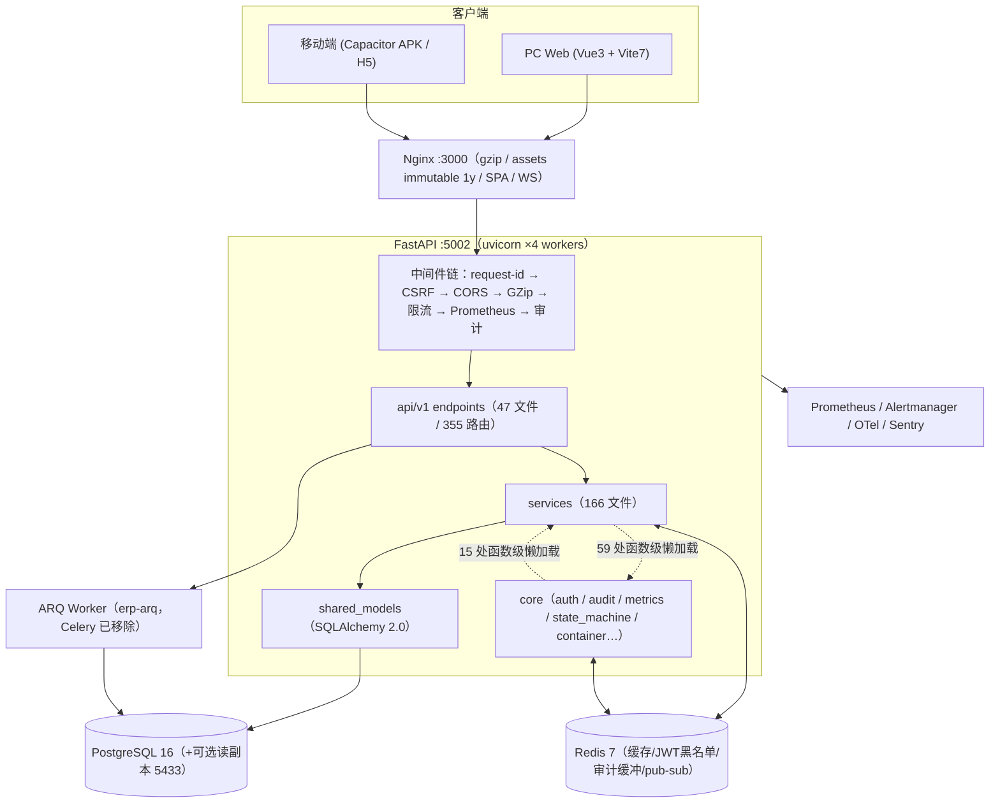

# ERP 系统 23 模块代码质量评估报告

- 日期：2026-08-22
- 范围：用户指定的 23 个业务模块（后端 + 前端 + 测试 + 基础设施）
- 方法：4 路并行代码勘察（后端映射/前端映射/技术栈/架构耦合）+ Mimosa 安全扫描（172 项发现，高危项已逐行人工复核）+ 生产健康检查 + 纯单元测试树执行（834 通过 / 1 错误）
- 审核边界（诚实声明）：**非字面逐行人工阅读**，而是全量文件覆盖的工具化扫描 + 高风险模块/高危发现逐行深审。运行时验证限于只读健康检查与全 mock 单测（本机即生产服务器，按安全规范未执行启停类/集成类验证）。

## 0. 规模底数

| 维度 | 数值 |
|---|---|
| 后端（fastapi_app） | 80,172 行 / 397 文件（不含测试 66,878 行） |
| 其中 endpoints / services / schemas | 47 文件 12,565 行 / 166 文件 36,819 行 / 26 文件 3,346 行 |
| API 路由总数 | 355 |
| 前端（frontend-vite/src） | 64,135 行（277 个 .vue + 160 个 .ts），其中移动端 5,743 行 |
| 测试 | 1,957 个用例 / 114 文件（根树 1,127 集成 + 应用树 830 纯单元） |
| utils/ | 6,310 行 / 25 文件 |

## 1. 代码质量评估（分模块）

评级标准：A=可直接长期维护；B=有明确改进项；C=需重构；D=高风险需立即处理。

| # | 模块 | 后端入口 | 规模(端点/服务 LOC) | 评级 | 主要风险（file:line） |
|---|---|---|---|---|---|
| 1 | 采购中心 | api/v1/endpoints/purchase_center/ | 1812/2683 | B− | 事务样板×4（order_routes.py:132-176）；207/183 行长函数（purchase_order_generate.py:48, purchase_order_query.py:278）；per_page 无上界（order_routes.py:186） |
| 2 | 供应商管理 | endpoints/supplier.py | 295/226 | B | 5 路由重复 commit/缓存失效样板（supplier.py:146-161 起）；无专属 service；循环 await（purchase_supplier_service.py:152） |
| 3 | 物料计算器 | purchase_center/product_routes.py | 328/1029 | B | BOM 逐行循环（bom_service.py:222，已自注释为有意）；151 行导出函数（export_utils.py:223） |
| 4 | 来料登记 | endpoints/material_registration.py | 497/787 | B+ | 分页规范（le=100）、异常类型化；遗留循环 await-get（_commands.py:83）；items 无分页（:367） |
| 5 | 核心业务(导航节) | dashboard.py + core/nav_context.py | 123/950 | B | 导航/权限映射硬编码（nav_context.py:27-54）与 DB 权限行双源漂移（20+ 个 scripts/*_nav.py 补丁脚本）；容错返回旧缓存（:168-170） |
| 6 | 产品清单 | endpoints/product.py | 105/361 | B− | /search 无分页（product.py:51）；搜索语义在 4 个路由重复（product.py:51, auxiliary.py:177, product_routes.py:92,144） |
| 7 | 客户订单 | order.py + staging_order.py | 501/1930 | C | order_crud.py 850 行巨石（审批+扣减混杂 :816-831）；17 处 multi-sku TODO；事务混用（order.py:216 vs 296-312）；删除后事件错误被吞（:323） |
| 8 | 出库管理 | stock.py + staging_stockout.py | 657/1770 | C− | 4 处 f-string SQL 片段（stock_inventory_service.py:725-728，nosec 标注）；**已知多 SKU 聚合错误**（:754、:203 自注释）；导出无分页（stock.py:352） |
| 9 | 出货计划 | purchase_plan.py | 618/2000 | C+ | 4 处宽泛 except→500（:272,301,335,366）；4 个列表端点无分页（:60,417,441,494）；186 行聚合函数（purchase_plan_queries.py:375） |
| 10 | 生产报表 | daily_production.py | 276/569 | B− | /export 无分页（:215）；仅捕获 ValueError（service:181）；排产 if/elif×5（production_plan_service.py:233） |
| 11 | 批次号查询 | order_batch.py | 242/806 | B− | 263 行创建函数+逐客户 savepoint（order_batch_create.py:39,70-78）；/whitelist 无分页（:207）；状态重算循环（order_batch_service.py:486） |
| 12 | 板房管理 | customer_sampling.py + pattern_maker.py | 671/2319 | C+ | 24 路由重复相同 except 样板（customer_sampling.py:67-354，全局异常处理器已存在）；821 行 crud + 464 行 version_diff；前端 6,436 行/39 文件为全站最大模块 |
| 13 | 湖北订单 | 共用 order.py（factory='湖北' 内联过滤） | 共用 | C | 无端点隔离，继承客户订单全部风险；逻辑分裂于 order/beile.py 与 order_crud.py |
| 14 | 湖北外发 | outsource.py | 287/805 | A− | 全库最干净域：14 路由、5 个内聚服务模块；双权限可见性特例（nav_context.py:19-21） |
| 15 | 数据查询(导航节) | auxiliary.py | 491/332 | B− | 跨域 DELETE 端点混入 aux 路由（auxiliary.py:312-360）；前端 /aux/query 为死代码（src/api/auxiliary.ts:18 后端无此路由）；N+1（auxiliary_service.py:130） |
| 16 | 订单查询 | 同客户订单（移动端视图） | 共用 | B+ | 分页完备（order.py:43-44） |
| 17 | 订单流水 | report.py | 196/398 | B− | raw SQL 但白名单+escape_like+绑定参数（report_service.py:133-145 合规）；同步会话入线程导出（:166-174）；4 个近重复日志端点 |
| 18 | 皮套管理 | case_endpoint.py | 493/1140 | B | /search 无分页（:63）；导入耦合 batch.py |
| 19 | 系统管理(导航节) | user/permission/backup/tasks/dead_letter/monitoring | — | B | 导航漂移同 #5；POST /vitals 无鉴权为文档化例外（router.py:276-283） |
| 20 | 用户管理 | user.py + permission.py | 317/256 | B+ | 全路由 require_superuser 一致；直接位翻转 user.status（user_service.py:113） |
| 21 | 客户管理 | customer.py | 328/264 | B | 端点层 commit（customer.py:294-301）；/active-names 无分页（:178） |
| 22 | 审批管理 | approval.py | 205/458 | B+ | 唯一使用集中状态机的域（core/state_machine.py）；但超管 gating 与导航可见性不一致（approval.py:42 等，非超管可见入口但 403） |
| 23 | 数据备份 | backup/（6 个端点文件） | 2083/10410 | C+ | 内部为六边形架构（ports/adapters，全库最佳）；但体量最大：232/196/178/160 行长函数、18 处宽泛 except（validation.py）、动态 SQL 含 DROP/CREATE DATABASE（recovery_test_service.py:184-188，白名单+nosec） |

**横向质量事实（正向）**：
- 全库 **0 处吞异常**（无 `except: pass`），~150 处 `except Exception` 全部有日志/转发；
- 鉴权一致性好：355 路由中除 auth/monitoring（文档化例外）外全部挂 `get_current_user_id`，34/47 端点文件用 `require_permission`；
- 前端组件化纪律强：**没有任何视图组件超过 500 行**，最大文件是类型定义（types/index.ts 658）；
- 订单/审批状态常量已集中（shared_models/order.py:22-34, approval.py:34-37）；
- 前端无硬编码密钥，唯一硬编码地址是 .env.capacitor 的局域网 API 地址（部署配置性质）。

## 2. 架构分析

问题定位（按严重度）：

1. **core ↔ services 运行时双向依赖**：core→services 15 处、services→core 59 处函数级懒加载规避循环导入（如 core/event_bus.py:24→notification_service，而 notification_service.py:19 模块级反向导入 core.exception_handler）。5 个 core 模块依赖 notification_service 的**私有函数** `_get_async_redis_client`（core/health.py:96,203 等）——-notification_service 实际成为 core 的隐性基础设施中心。
2. **无 Repository 层**：服务直接持有 ORM Session 与查询构造，355 路由的业务规则下沉不彻底；同一搜索语义在 4 个路由重复实现即为症状。
3. **状态机只有审批域统一**（core/state_machine.py，TRANSITIONS 表 + can_transition）：staging 三份近似拷贝（staging/order.py:181-191, stockin.py:115-154, stockout.py:210-220）；采购订单状态内联字面量散布 8 处（purchase_order_crud.py:287,333 等）；外发状态内联（outsource/_common.py:117,121）。
4. **事务边界失控**：约定为 `get_async_db` 成功统一提交 + 服务层只 flush（database.py:142-163 文档明确），但存在 31 处违规手动 commit（api 层 9 处、services 层 22 处）。典型多步跨提交：综合 Excel 导入每个 sheet 独立提交且失败只 rollback 后续（batch_import_service.py:140-176 + 5 处 commit），已上报的 imported 计数可大于实际落库；单号生成在独立会话独立提交（numbering.py:96-111），两提交之间崩溃烧号。
5. **备份域三套并存**：legacy 平铺模块（services/backup_*.py 薄包装）、hexagonal 包（services/backup/，ports.py 171 行 Protocol 接口 + adapters.py，全库架构最佳实践）、端点层。应收敛为单一包。
6. **导航/权限双源真相**：DB Permission 行（由 20+ 个 ad-hoc scripts/*_nav.py 补丁维护）vs 硬编码 PERMISSION_URL_MAP/SECTION_ORDER（nav_context.py:27-54），已实际产生过漂移（采购中心导航修复脚本即证据）。

## 3. 技术栈评估

| 层 | 选型（版本） | 评价 |
|---|---|---|
| 语言 | Python（CI/ruff/mypy 锁 3.12；**系统实际 3.13 运行/打包**） | ⚠️ 版本漂移：工具链目标与运行时不一致，行为差异风险 |
| Web 框架 | FastAPI 0.137.1 + uvicorn 0.46（httptools）+ msgspec 0.21 | ✅ 现代主流，msgspec 编码器是正确性能选择 |
| ORM/DB | SQLAlchemy 2.0.49 + asyncpg 0.31 + PostgreSQL 16 + Alembic 1.16 | ✅ async 全链路；psycopg3 仅用于迁移，职责清晰 |
| 任务队列 | ARQ 0.28（Celery 及 flower 已于 2026-05 移除） | ✅ 轻；残留仅 .env 注释与 deploy 脚本一处 celery-exporter 文案 |
| 安全 | PyJWT 2.13 + cryptography 46（**生产已启 ES256**，.env:48）+ argon2-cffi | ✅ 无 python-jose（规避其 CVE 历史）；Redis 黑名单吊销 + fail-closed 变体 |
| 数据处理 | polars 1.35 + openpyxl（**无 pandas**） | ✅ 内存友好 |
| 观测 | Prometheus client + structlog + Sentry + OTel 1.30 | ✅ 齐备，p95/slow_query/连接池均已埋点 |
| 前端 | Vue 3.5 + Vite 7 + TS 6 + PrimeVue 4 + Tailwind 4 + Pinia 3 + TanStack Query 5 | ✅ 一线现代栈；axios 封装（request.ts 330 行）含 401 单飞刷新/重放、GET 去重、退避重试 |
| 移动端 | Capacitor 8 + PWA | ✅ 合理复用 Web 资产 |
| 测试 | pytest 8 + Vitest 4 + Playwright 1.60（**无 e2e 用例**） | ⚠️ 后端 1957 用例量大，前端仅 11 个测试文件，e2e 空转 |

**替代方案评估（如实）**：当前栈与项目规模高度匹配，**不建议框架级迁移**——任何"迁移后性能提升 X%"的数字在没有基准测试的情况下都是编造。可量化的真实选项：keyset 分页对深翻页已是 O(1)（enhanced_pagination.py，OFFSET>2000 自动切换）；导出异步化（ARQ 现成）可把长导出请求的线程占用转移出 worker。真正的技术债是**工具链一致性**（Python 3.12/3.13）与**门槛**（见 §5/§6），不是选型。

## 4. 性能分析

**已落地的优化（有代码/提交证据）**：JWT 切 ES256（2752f7e, 84394b0）；首屏与登录延迟专项（f88d1cd）；L1 权限缓存 30s/活跃用户缓存 10s（deps.py:72,173）；msgspec 默认编码；nginx gzip level6 + /assets 1y immutable + uploads 直读磁盘；连接池按 workers 预算低于 DB_MAX_CONNECTIONS−20、pre_ping+LIFO；读副本 2s 快失败降级主库；前端 GET 去重 + 401 单飞 + 502-504 退避。

**遗留瓶颈（按影响排序）**：
1. **无分页列表/导出集群**：purchase_plan.py:60,417,441,494；production_plan.py:43,259；production_summary.py:39,177；stock.py:352；product.py:51；case_endpoint.py:63；order_batch.py:207；material_registration.py:367——数据量增长后首当其冲的延迟与内存尖峰源。
2. **循环查询/N+1**：auxiliary_service.py:130（批量出库编排）；order_batch_service.py:486（逐单状态重算）；material_registration/_commands.py:83；purchase_supplier_service.py:152。
3. **已知聚合错误（性能+正确性双重）**：stock_inventory_service.py:754、:203——按 order_type 分组 sum(quantity) 在多 SKU 下结果错误，代码已自注释承认。
4. **导出在请求路径同步生成 Excel**：report_service.py:166-174 还把同步会话放进线程；大导出会占住 worker 并发额度。
5. **per_page 无上界**：purchase_center/order_routes.py:186（ge=1 无 le，对比 order.py 的 le=500）——单请求可拖全表。
6. **逐 sheet/逐表提交的 I/O 放大**：batch_import_service.py 5 处 commit；backup 逐表循环。

**运行时数据现状**：/metrics 已暴露 response_time_p95_seconds、slow_query_total、db 连接池利用率等，但仓库内无近期基线快照；建议采集一周基线后再定数值预算（见 §6）。

## 5. 优化建议（P0/P1/P2）

**P0（正确性/安全，下一变更窗口前必须决策）**
1. 密钥治理：`config/jwt/private.pem.bak-2048/4096` 已 git 暂存——从暂存区移除 + .gitignore + 若曾推送则轮换密钥；`config/postgres/init-replica.sh:29` PGPASSWORD、`scripts/reset_admin_password.py:7` NEW_ADMIN_PASSWORD 改环境变量注入。
2. 修正 stock_inventory_service.py:754/:203 多 SKU 聚合错误（库存正确性）。
3. 事务边界收敛：31 处手动 commit 收敛到 get_async_db/db_transaction；综合导入改单事务或补偿队列；numbering.py 烧号问题加回收表或并入主事务。

**P1（1-2 个迭代）**
4. 状态机统一：staging 三份拷贝、采购/外发字面量接入 core/state_machine（审批域已有范本）。
5. order_crud.py（850 行）拆分为审批/扣减/查询三个模块，收口 17 处 multi-sku TODO。
6. 无分页端点补分页 + per_page 统一上界（le=500 对齐）。
7. core↔services 解耦：把 notification_service 的 redis client 上提为 core 组件；container 统一接管服务工厂。
8. 备份域 legacy 平铺模块并入 hexagonal 包，消除三套并存。
9. Python 版本全链路统一（建议锁 3.12 或整体升 3.13，CI/ruff/mypy/deploy 四处同步）。
10. 前端：pattern-room（6.4k 行）与 purchase/customer-order 大 composable 拆分；为核心流程补 Vitest。

**P2（持续改进）**
11. mypy 从 20 文件扩面到 services 全量；覆盖率门槛 40%→60%→75% 分阶段；bandit CI 命令补 `-c bandit.yaml`；npm audit 入 CI。
12. 测试树治理：双树合并策略、清理根树内提交的过期产物（test_failures.txt、*.stale-20260821、frontend-vite/dist.bak-202608151307——后者还是本次安全扫描 40+ 条噪音的来源）。
13. Playwright e2e 落地（登录 + 订单/出库/备份三条主链路）；修复 test_approval.py::test_pending_count 的 teardown 连接竞态（全 mock 树中唯一尝试真实连接的用例）。
14. 杂项：/aux/query 前端死代码删除；approval 权限 gating 与导航一致性；生产报表导出迁 ARQ 异步。

## 6. 质量保障措施

- **审查清单**（在 docs/CODE_STANDARDS.md 基础上增补）：新端点必须有分页与上界；事务只走 get_async_db/db_transaction（服务层 flush-only）；状态变更必须经 state_machine；nosec 必须附白名单证明；外部输入一律绑定参数（拼接/format/f-string SQL 一票否决——与 Mimosa 生成前约束一致）；导航/权限变更必须同时更新 DB 与 PERMISSION_URL_MAP 并附对账脚本输出。
- **覆盖率目标**：分层设定——订单/出库/备份（资金与库存正确性域）≥85%；其余业务服务 ≥70%；scripts/迁移豁免；CI 门槛按 40→60→75 三步走，每步一个迭代。
- **性能指标**：先采集一周 /metrics 基线，再固化预算（示例起点：读接口 p95 <300ms、写接口 p95 <800ms、导出全部异步化后 worker 占用 <70%、DB 连接池利用率峰值 <80%）。
- **CI 强化**：bandit 挂配置文件、pip-audit 设为失败门、前端加 npm audit、保留 file_size_gate（1200 行阈值）。
- **发布与回滚**：main→build→deploy-windows.ps1 已自动化（alembic upgrade head 为唯一系统变更步骤）；回滚依赖 alembic downgrade 预案 + 备份域现成的 recovery_test_service 恢复演练能力（这是现有资产，建议纳入季度演练）。
- **生产机操作规范**（本机即生产）：任何启停/重启需在变更窗口执行并确认恢复（重启中断 ~25s）；集成/e2e 测试只允许指向独立测试库，禁止指向生产实例。

## 7. 上线结论

1. **生产当前健康**：`/api/health` 返回 healthy，前端 :3000 返回 200，prod_runner 监护运行中。
2. **本轮审核为纯只读，未修改任何代码**——生产运行的就是被审核的工作树代码，因此"审核完毕后直接上线运行"在事实上等价于**维持现状（无需发布动作）**；执行任何重启反而会造成 ~25s 服务中断。
3. 834/835 纯单元测试通过（1 个 teardown 竞态错误，非业务失败）；集成树（1,127 用例）与 e2e 因需真实测试库/运行服务器，按生产机安全规范本轮未执行，建议在下一个维护窗口跑全量。
4. P0 三项（密钥入库、多 SKU 聚合错误、事务收敛）建议在下一个变更窗口处理后再谈增量发布；是否安排窗口由你决定。

## 附：Mimosa 安全扫描复核摘要（scan-2026-08-22T05-33-29，172 项）

- **确认为真**：硬编码凭据 2 处（init-replica.sh:29、reset_admin_password.py:7）；路径穿越集中在 scripts//备份服务的运维路径拼接（prod_runner.py:130 等，多数为受控输入但建议统一 resolve 校验）；JWT .pem.bak 入库（git status 证据，非扫描发现）。
- **复核为误报**：enhanced_pagination.py:83,89,120 与 production_summary_service.py:101,135 的"SQL 注入 HIGH"——实为 SQLAlchemy 表达式 + 绑定参数（text() 处用 `:t` 绑定，like 经 escape_like 后仍参数化）。
- **噪音源**：frontend-vite/dist.bak-202608151307 旧构建产物贡献 40+ 条跨文件污点 MEDIUM（含 MongoDB 类目，本项目无 MongoDB，纯模式匹配误报）——删除该目录可让后续扫描信噪比大幅提升。
