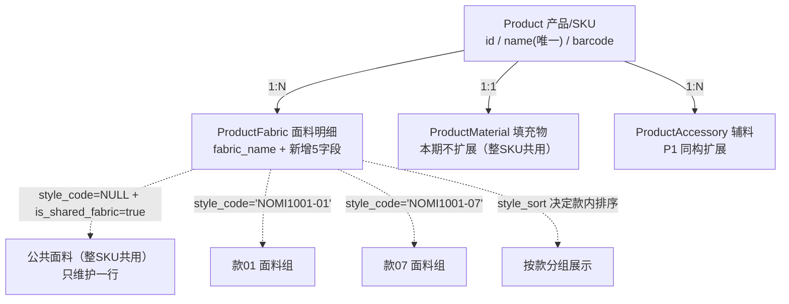

# 盲盒产品 SKU 层级面料 BOM 落地方案

> 版本：v1.0（方案稿） ｜ 作者：架构师-高见远 ｜ 日期：2026-08-29 ｜ 状态：待评审
> 上游输入：产品经理 PRD《盲盒产品 SKU 层级面料 BOM 区分》
> 目标系统：D:\erp_system（FastAPI + SQLAlchemy 2.0 async + Alembic + Vite/Vue3 前端 + Tkinter server_manager）

---

## 0. 方案摘要（TL;DR）

1. **推荐路线 A（轻量字段扩展）**：直接给 `product_fabric` 增加 `style_code / style_name / is_shared_fabric / style_usage / style_sort` 五个字段。**不新建中间款式表**。理由：现有 `_save_material_bom_items` 是"单模型类 + 字典透传"的通用 1:N 框架，路线 A 只需加列 + 加 5 行保存逻辑 + `to_dict()` 加键，`get_bom / copy_bom / preview_bom / has_bom` 全部兼容；路线 B 需新增模型、重构服务层与前端 BOM 编辑器，成本数倍且当期收益低。
2. **款号规则**：`{SKU码}-{两位序号}`，如 `NOMI1001-01` ~ `NOMI1001-07`。SKU 码来源优先级：`product.barcode` → `product.name`（清洗），本期不新增 `sku_code` 字段（P2 可选）。
3. **公共面料约定**：`style_code = NULL 且 is_shared_fabric = true` 表示"整 SKU 共用"，**只维护一行**；按款查询时程序合并进每个款（标注"共享"）；采购汇总时**全局只计一次**。
4. **存量兼容零迁移**：现有面料行 `style_code` 为空 → 自动视为整 SKU 共用；仅需一条 `UPDATE` 把 `is_shared_fabric` 置 true，向后 100% 兼容。
5. **落地四阶段**：①模型+迁移 → ②服务层+API → ③前端 Vite（Tkinter 复核）→ ④数据补录启用。新增 2 个聚合接口，前端 BOM 编辑器按款分组。
6. **本期范围**：P0 面料款式层级全部落地；P1（辅料同构、公共面料引用、按款汇总导出）预留接口与字段；P2（版本历史、批量生成、工单联动、对照表界面）给出设计预留，不实现。

---

## 1. 现状与问题

### 1.1 现有结构（已探查确认）

| 层 | 文件 | 关键内容 |
|---|---|---|
| ORM | `fastapi_app/shared_models/product_material.py` | `ProductFabric`（1:N，`fabric_name`）、`ProductMaterial`（1:1，`cotton_usage`）、`ProductAccessory`（1:N，`accessory_name`） |
| 领域服务 | `fastapi_app/services/bom_service.py` | `has_bom / get_bom / save_bom / copy_bom / preview_bom / search_for_bom_copy`；`_save_material_bom_items` 通用框架（`_meta` 映射 `fabric_name/accessory_name`） |
| API | `fastapi_app/api/v1/endpoints/purchase_center/product_routes.py` | GET/POST `/product/{id}/bom`、`/bom-preview`、`/copy-bom`；`BomSaveRequest.fabrics` 为 `list[dict]`（字段透传） |
| 前端 | `frontend-vite/src/views/product/components/BomEditor.vue`、`BomPreview.vue`、`composables/bomTypes.ts`、`api/product.ts` | 面料/辅料表格编辑、预览、复制 |
| 迁移 | `migrations/versions/`（最新 `pg_standalone_037_backup_dr_monthly.py`） | 下一个版本号 `pg_standalone_038_...` |
| Tkinter | `server_manager.py` | 未检索到 fabric/BOM 编辑入口（grep 命中 0），阶段三需复核确认 |

### 1.2 业务问题

- 现有"产品 → 面料 1:N"只能表达**整 SKU 一套面料**，无法表达"盲盒内 6/7 个隐藏款各用一套面料"。
- 后果：面料用量无法按款核算、改某款面料无法定位影响范围、盲盒生产无法按款备料。

---

## 2. 数据结构设计

### 2.1 两条路线评估与推荐

| 维度 | 路线 A：轻量字段扩展 | 路线 B：中间款式表 |
|---|---|---|
| 方案 | 给 `product_fabric` 加 5 字段；公共面料用 `style_code=NULL + is_shared_fabric=true` 表达 | 新增 `product_style`（款）+ `product_style_fabric`（款面料关联），SKU→款→面料三张表 |
| 服务层改动 | `_save_material_bom_items` 加 5 行字段读写；`copy_bom` 复制新字段；`get_bom` 加分组输出 | 新增模型、新增 Product 关联、重写 `_save_material_bom_items` 的款式感知逻辑、`copy_bom/preview_bom/get_bom/has_bom` 全部重写 |
| 前端改动 | `BomEditor.vue` 表格加列、按款分组；类型文件加字段 | BOM 编辑器整体重构为"款→面料"两级树形编辑，工作量大 |
| 数据规模 | 每 SKU 行数 ≈ 公共(3~5) + 7款×每款面料(2~5) ≈ 20~40 行，可控 | 更规范，但小数据量下 join 收益不明显 |
| 历史追溯 | 每行内联 `style_code/style_name`，天然快照、改款不影响他款 | 需快照表或版本表配合 |
| 存量兼容 | `style_code=NULL` 天然 = 整 SKU 共用，零迁移 | 需数据搬运脚本 |
| **推荐** | **✅ 推荐（P0 采用）** | 暂缓（若未来"款"成为独立主数据再迁移） |

**推荐理由（结合现有代码）**：
1. `_save_material_bom_items` 是单模型类通用框架，`items` 为 dict 列表透传（`BomSaveRequest.fabrics: list[dict]`），新增字段**零协议破坏**；
2. `get_bom` 直接返回 `product.get_all_materials()`（flat list），路线 A 仅需在 `to_dict()` 增加键并额外输出 `styles` 分组，`has_bom` 判定逻辑不变；
3. 款数小（6~7）、每款面料少，冗余行数在工程上完全可接受，且满足 P0"每款独立可追溯"的硬要求；
4. 路线 B 的"公共面料共享引用不重复维护"收益，用 P1 的"公共行单次维护 + 查询合并"机制即可等价实现，不必引入三表结构。

### 2.2 层级示意图



### 2.3 `product_fabric` 新增字段定义

| 字段 | 类型 | 可空 | 默认 | 说明 |
|---|---|---|---|---|
| `style_code` | `VARCHAR(50)` | 是 | NULL | 款号，格式 `SKU码-01`；**NULL = 整 SKU 共用（公共面料）** |
| `style_name` | `VARCHAR(100)` | 是 | NULL | 款式名称（内联冗余，便于追溯与导出） |
| `is_shared_fabric` | `BOOLEAN` | 否 | `false` | 是否公共面料（整 SKU 共用，跨款共享） |
| `style_usage` | `NUMERIC(10,4)` | 是 | NULL | 单款标准用量（每款 1 件）；公共面料行为 NULL |
| `style_sort` | `INTEGER` | 是 | NULL | 款内排序号（01→07），用于分组展示顺序 |

**字段语义约定**（重要，避免二义）：
- 款式面料行（`style_code IS NOT NULL`）：以 `style_usage` 为权威用量；旧字段 `quantity` 保存时**同步冗余**（`quantity = style_usage`），保证旧代码/旧导出不受影响。
- 公共面料行（`style_code IS NULL`）：`quantity` = 整盒（整 SKU）用量，`style_usage = NULL`。
- 一张面料 = 一个 `fabric_name`；同一面料出现在多个款 = 多行（每行 `style_code` 不同），P0 接受该冗余。

### 2.4 唯一约束与索引（PostgreSQL）

> ⚠️ 注意：PG 唯一约束对 NULL 不生效（NULL ≠ NULL），所以**不能用**普通复合唯一索引 `(product_id, style_code, fabric_name)` 覆盖公共面料行，必须使用**部分唯一索引**：

| 索引名 | 定义 | 作用 |
|---|---|---|
| `uq_pf_style` | `UNIQUE (product_id, style_code, fabric_name) WHERE style_code IS NOT NULL` | 同一 SKU 同一款内面料名唯一 |
| `uq_pf_shared` | `UNIQUE (product_id, fabric_name) WHERE style_code IS NULL AND is_shared_fabric = true` | 公共面料整 SKU 内面料名唯一（共享引用不重复） |
| `idx_pf_style_lookup` | `(product_id, style_code)` | 按款查询/筛选加速 |

### 2.5 存量数据语义（向后兼容）

- 现有面料行 `style_code = NULL` → 自动视为"整 SKU 共用"，查询时合并进每个款并标注"共享"；
- `has_bom()`、`get_bom()` 原有返回结构不变，新增字段为增量；
- 不做数据搬运，仅一次标记性 `UPDATE`（见 6.4）。

---

## 3. 编码规则

### 3.1 款号编码规则

- 规则：`{SKU码}-{两位序号}`，序号从 `01` 递增，补零两位。
- 校验正则：`^[A-Za-z0-9_-]+-\d{2}$`（服务端 `core/validators.py` 增加 `validate_style_code`）。
- 6 款 → `-01` ~ `-06`；7 款 → `-01` ~ `-07`；同 SKU 内款号唯一（由 `uq_pf_style` 保证）。

### 3.2 SKU 码来源与兜底（产品无独立 SKU 码）

| 优先级 | 来源 | 说明 |
|---|---|---|
| ① | `product.barcode` | 盲盒通常"一盒一条码 = SKU 条码"，直接作为 SKU 码 |
| ② | `product.name` | 唯一字段；清洗规则：去首尾空白、去括号内容（如 "NOMI1001 盲盒(6款)" → `NOMI1001`）、全角转半角 |
| ③（P2 可选） | 新增 `product.sku_code` 字段 | 若后续需要显式 SKU 编码再增加，本期不建 |

**本期推荐**：直接取 ①barcode → ②name 兜底，不新增 `sku_code` 字段（避免过度设计）。
**示例**：`barcode='NOMI1001'` 或 `name='NOMI1001 盲盒'`（清洗后 `NOMI1001`）→ 款号 `NOMI1001-01` … `NOMI1001-07`。

### 3.3 款式名称：内联字段 vs 对照表（推荐内联）

| 方案 | 优点 | 缺点 |
|---|---|---|
| **内联 `style_name`（推荐 P0）** | 零额外表、随 BOM 行保存、天然历史快照；改某款名称不动其他款 | 名称重复存储（每款每面料行重复一次，可接受） |
| 独立对照表 `product_style(product_id, style_code, style_name, style_sort)` | 名称集中维护 | 需新增模型 + 维护界面 + join 逻辑；BOM 行仍需冗余 `style_code` 保追溯，收益有限 |

**推荐**：P0 用内联字段；P2 若用户确认问题⑧"需要正式款号-款式名称对照表界面"，再补建 `product_style` 字典表（仅做名称/排序管理，BOM 行仍冗余 `style_code/style_name` 以保留历史快照）。

### 3.4 界面标注与筛选

- **BOM 编辑表格**（`BomEditor.vue`）：面料区新增列 `款号 / 款式名称 / 类型(公共/差异) / 单款用量 / 排序`；公共面料行款号列显示灰色标签 **"（整SKU共用）"**；支持按款号下拉筛选（选项 = 该 SKU 已存在款号 + "整SKU共用"）。
- **BOM 预览**（`BomPreview.vue`）：按 `style_sort` 分组展示，公共面料独立分组并标注"共享，计入每款"。
- **导出 CSV/XLS**（`utils/csv.ts`、`utils/xls.ts`）：追加 `款号/款式名称/是否共享` 列。

### 3.5 面料编码建议

- 系统已有 `material_code`（可空）。**唯一键推荐直接用 `fabric_name`**（在"SKU+款"范围内由唯一约束保证）。
- 若需全局物料编码，规则建议 `品类-名称`，如 `FAB-毛绒布-灰`、`FAB-摇粒绒-浅棕`；本期不强制。
- 取舍：`fabric_name` 直观、无需编码管理；风险是"同名不同规格"混淆 → 若出现该情况，在 `material_code` 维护正式编码并在 `specification` 区分。

---

## 4. 公共/差异面料处理

### 4.1 数据模型约定

- **公共面料**：一行（`style_code=NULL, is_shared_fabric=true`），`quantity` = 整盒用量；**只维护一次**。
- **差异面料**：每款一行（`style_code=款号`），`style_usage` = 单款用量；同一 `fabric_name` 可用于多款（多行），聚合时按名合并。

### 4.2 按款查询合并（伪代码）

```python
async def get_style_bom(db: AsyncSession, product_id: int) -> dict:
    rows = (await db.execute(
        select(ProductFabric).where(ProductFabric.product_id == product_id)
        .order_by(ProductFabric.style_sort, ProductFabric.style_code, ProductFabric.id)
    )).scalars().all()

    shared = [f for f in rows if f.style_code is None]            # 公共面料（整SKU共用）
    styled = [f for f in rows if f.style_code is not None]        # 款式面料
    style_codes = sorted({f.style_code for f in styled})          # 保持款式顺序

    styles = []
    for sc in style_codes:
        style_fabrics = [f for f in styled if f.style_code == sc]
        styles.append({
            'style_code': sc,
            'style_name': style_fabrics[0].style_name,
            'fabrics': [f.to_dict() for f in style_fabrics],
            # 每款合并公共面料（标注共享），不复制存储
            'shared_fabrics': [dict(f.to_dict(), is_shared_fabric=True, _merged=True) for f in shared],
        })
    return {'product_id': product_id, 'styles': styles,
            'shared_fabrics': [f.to_dict() for f in shared]}
```

### 4.3 汇总规则（公共面料全局只算一次）

```python
def aggregate_fabric(styles: list, shared: list, total_qty: float,
                     style_qty_map: dict[str, float] | None = None) -> list:
    """整盒采购汇总。style_qty_map 可覆盖每款计划数，默认按款均分。"""
    n = len(styles) or 1
    agg: dict[str, dict] = {}

    # 1) 公共面料：整SKU 全局只计一次
    for f in shared:
        agg[f.fabric_name] = {'qty': total_qty * float(f.quantity), 'unit': f.unit,
                              'type': '公共', 'detail': f'{total_qty} × {f.quantity}'}

    # 2) 款式面料：按款用量 × 该款计划数，再按面料名合并
    for st in styles:
        qty = (style_qty_map or {}).get(st['style_code'], total_qty / n)
        for f in st['fabrics']:
            usage = float(f.style_usage or f.quantity or 0)
            item = agg.setdefault(f.fabric_name, {'qty': 0.0, 'unit': f.unit,
                                                  'type': '差异', 'detail': []})
            item['qty'] += qty * usage
            item['detail'].append(f'{st["style_code"]} {qty}×{usage}')
    return [{'fabric_name': k, **v} for k, v in agg.items()]
```

**规则一句话**：按款清单 = 每款均列公共面料（标注"共享"）；采购汇总 = 公共面料全局一次 + 差异面料按款合计。

### 4.4 6款 / 7款示例

| SKU | 款数 | 款号 | 说明 |
|---|---|---|---|
| NOMI1001（6款版） | 6 | `NOMI1001-01` ~ `NOMI1001-06` | 公共 3 行 + 差异 6 行 = 9 行 |
| NOMI1001（7款版） | 7 | `NOMI1001-01` ~ `NOMI1001-07` | 公共 3 行 + 差异 7 行 = 10 行 |

变更款数（如 7→6）：旧款行保留（记 `ModificationLog`），由人工在界面确认删除，不做物理级联。

---

## 5. 应用场景与完整示例

### 5.1 接口形态

| 接口 | 方法/路径 | 说明 |
|---|---|---|
| 按款查询 | `GET /product/{id}/bom/styles` | 返回 `styles[]`（每款含 `fabrics` + `shared_fabrics`） |
| 采购汇总 | `GET /product/{id}/bom/aggregate?total_qty=700&style_qty=100,100,...` | 返回聚合行列表（公共计一次） |
| 保存（扩展） | `POST /product/{id}/bom` | `fabrics` 每项支持新增 5 字段（dict 透传） |
| 生产领料单 | 前端组装 `styles` 输出 | 表格见 5.4 |

### 5.2 完整示例：SKU = NOMI1001（7 款）

- 产品：`name = "NOMI1001 盲盒"`，`barcode = "NOMI1001"` → SKU 码 = `NOMI1001`
- 7 款：`NOMI1001-01` 小鹿 / `-02` 小熊 / `-03` 小兔 / `-04` 小狐 / `-05` 小猫 / `-06` 小狗 / `-07` 隐藏款
- 公共面料 3 种（各 1 行）：毛绒布(灰) 0.35 码/盒、里布(白) 0.20 码/盒、绣花线 0.05 码/盒
- 差异面料 2 种：摇粒绒-浅棕 0.40 码/款（款 01~06 用，6 行）；长毛绒-奶白 0.45 码/款（仅款 07 用，1 行）
- 计划生产 700 盒，每款 100 盒（默认均分）

### 5.3 表① 按款面料清单表（节选，其余款同 01）

| 款号 | 款式名称 | 面料名称 | 类型 | 单款用量 | 单位 |
|---|---|---|---|---|---|
| NOMI1001-01 | 小鹿 | 毛绒布(灰) | 公共·共享 | 0.35 | 码 |
| NOMI1001-01 | 小鹿 | 里布(白) | 公共·共享 | 0.20 | 码 |
| NOMI1001-01 | 小鹿 | 绣花线 | 公共·共享 | 0.05 | 码 |
| NOMI1001-01 | 小鹿 | 摇粒绒-浅棕 | 差异 | 0.40 | 码 |
| NOMI1001-02 | 小熊 | 毛绒布(灰) | 公共·共享 | 0.35 | 码 |
| NOMI1001-02 | 小熊 | 摇粒绒-浅棕 | 差异 | 0.40 | 码 |
| … | … | … | … | … | … |
| NOMI1001-07 | 隐藏款 | 毛绒布(灰) | 公共·共享 | 0.35 | 码 |
| NOMI1001-07 | 隐藏款 | 长毛绒-奶白 | 差异 | 0.45 | 码 |

（完整 28 行 = 7 款 × (3 公共 + 1 差异)；公共面料由程序合并展示，存储仅 3 行。）

### 5.4 表② 整盒采购汇总表（生产 700 盒）

| 面料名称 | 类型 | 用量基准 | 合计用量 | 单位 | 计算依据 |
|---|---|---|---|---|---|
| 毛绒布(灰) | 公共 | 0.35/盒 | 245.00 | 码 | 700 × 0.35（全局一次） |
| 里布(白) | 公共 | 0.20/盒 | 140.00 | 码 | 700 × 0.20（全局一次） |
| 绣花线 | 公共 | 0.05/盒 | 35.00 | 码 | 700 × 0.05（全局一次） |
| 摇粒绒-浅棕 | 差异 | 0.40/款 | 240.00 | 码 | 100 × 0.40 × 6 款 |
| 长毛绒-奶白 | 差异 | 0.45/款 | 45.00 | 码 | 100 × 0.45 × 1 款 |

### 5.5 表③ 按款差异面料对照表

| 款号 | 款式名称 | 差异面料 | 单款用量 | 与常规款差异 |
|---|---|---|---|---|
| NOMI1001-01 | 小鹿 | 摇粒绒-浅棕 | 0.40 | 常规 |
| NOMI1001-02 | 小熊 | 摇粒绒-浅棕 | 0.40 | 常规 |
| NOMI1001-03 | 小兔 | 摇粒绒-浅棕 | 0.40 | 常规 |
| NOMI1001-04 | 小狐 | 摇粒绒-浅棕 | 0.40 | 常规 |
| NOMI1001-05 | 小猫 | 摇粒绒-浅棕 | 0.40 | 常规 |
| NOMI1001-06 | 小狗 | 摇粒绒-浅棕 | 0.40 | 常规 |
| NOMI1001-07 | 隐藏款 | 长毛绒-奶白 | 0.45 | ★特殊（仅 07 款） |

---

## 6. 落地操作步骤（分四阶段）

### 阶段一：模型 + 迁移

| 步骤 | 文件 | 改动点 |
|---|---|---|
| 1 | `fastapi_app/shared_models/product_material.py` | `ProductFabric` 增加 5 字段 + 3 个索引（见 8.1）；`to_dict()` 增加 `style_code/style_name/is_shared_fabric/style_usage/style_sort` 键（`is_shared_fabric` 缺省 False） |
| 2 | `migrations/versions/pg_standalone_038_sku_style_fabric_bom.py`（新建） | `op.add_column` ×5 + `op.create_index` ×3（含 `postgresql_where` 部分唯一索引），DDL 见 8.2 |
| 3 | 验证 | `alembic upgrade head` + `SELECT` 抽查表结构 |

### 阶段二：服务层 + API

| 步骤 | 文件 | 改动点 |
|---|---|---|
| 1 | `fastapi_app/services/bom_service.py` | ①`_save_material_bom_items`：新增字段读写，款式行强制 `quantity=style_usage` 同步，`style_code/style_name` 变更记 `ModificationLog`；②`copy_bom` 复制新字段；③`get_bom` 返回体增加 `styles` 分组与 `shared_fabrics`（`materials` 保持兼容）；④新增 `get_style_bom`（5.1 伪代码）与 `aggregate_fabric_by_style`（4.3）；⑤预留 `batch_generate_styles`（P2） |
| 2 | `fastapi_app/api/v1/endpoints/purchase_center/product_routes.py` | 新增 `GET /product/{id}/bom/styles`、`GET /product/{id}/bom/aggregate`；`POST /product/{id}/bom` 无需改协议（dict 透传），仅增加字段校验 |
| 3 | `fastapi_app/api/v1/endpoints/purchase_center/schemas.py` | `BomSaveRequest` 增加 `fabrics` 元素字段说明（可选 Pydantic 模型 `FabricItem`，含 5 新字段 + 校验正则） |
| 4 | 测试 | `fastapi_app/tests/` 新增 `test_bom_style.py`：按款分组、公共合并、汇总计一次、存量 NULL 兼容 |

### 阶段三：前端 Vite + Tkinter 复核

| 步骤 | 文件 | 改动点 |
|---|---|---|
| 1 | `frontend-vite/src/views/product/composables/bomTypes.ts` | `BomItem` 增加 `styleCode/styleName/isSharedFabric/styleUsage/styleSort` |
| 2 | `frontend-vite/src/views/product/components/BomEditor.vue` | 面料表格加 5 列；"整SKU共用"行与按款分组展示；款号下拉筛选；公共/差异切换（切换时清空/保留 style 字段） |
| 3 | `frontend-vite/src/views/product/components/BomPreview.vue` | 按款分组预览 + 公共面料独立分组 |
| 4 | `frontend-vite/src/api/product.ts` | 类型与请求体补充字段 |
| 5 | `server_manager.py` | **先复核**：`grep -n "fabric\|面料\|BOM" server_manager.py`（当前 0 命中）→ 若无 BOM 编辑界面则跳过；仅在涉及产品/物料打印与报表输出处补充款式列（若有） |
| 6 | （P1）`frontend-vite/src/views/material-calculator/MaterialCalculatorView.vue` | 按款汇总展示（公共计一次） |

### 阶段四：数据补录与启用

| 步骤 | 操作 |
|---|---|
| 1 | 存量标记：`UPDATE product_fabric SET is_shared_fabric = true WHERE style_code IS NULL;`（存量面料行 = 整 SKU 共用） |
| 2 | 盲盒产品补录：确认款数（6/7）→ 维护公共面料（存量行直接标记共享）→ 逐款添加差异面料（可"从模板款复制"） |
| 3 | 启用：前端切换新 BOM 编辑器；旧接口/旧前端仍可用（字段可选） |
| 4 | 回归：BOM 保存/复制/预览、物料计算器、采购导出 |

### 6.5 存量数据兼容策略（汇总）

- 现有 `product_fabric` 行 `style_code=NULL` → 一律视为"整 SKU 共用"，查询自动合并进每个款；
- 不迁移、不拆行、不新增中间表；`has_bom/get_bom` 原字段原结构可用；
- 若用户后续确认"存量面料实际是按款维护的"，提供一次性数据补录脚本（按 `product.barcode` 映射款号后 UPDATE 行），本期不做。

---

## 7. 待确认问题推荐答案表（8 项）

| # | 问题 | 推荐答案 | 标注 |
|---|---|---|---|
| ① | 款号自动生成还是人工维护？ | 自动生成（按 `SKU码-01..07`）+ 人工可改名称；款号校验正则 | 建议默认，需用户确认 |
| ② | 6款/7款并存、变更时旧BOM？ | 并存（不同 SKU 可 6 或 7 款）；同一 SKU 变更款数时旧款行保留并记日志，人工确认删除 | 建议默认，需用户确认 |
| ③ | 公共面料冗余还是共享引用？ | P0 单行维护 + 查询合并（等价共享引用），不做物理引用表；P1 视需引入面料组 | 建议默认，需用户确认 |
| ④ | 存量数据迁移？ | 不迁移行数据；`style_code=NULL` 自动视为整 SKU 共用，仅一条 UPDATE 标记 | 建议默认，需用户确认 |
| ⑤ | 填充物/辅料本期是否同构扩展？ | 辅料同构扩展（P1，同一通用框架低成本，迁移可先加列）；填充物为 1:1 结构本期不做，保持整 SKU 共用 | 建议默认，需用户确认 |
| ⑥ | 按款汇总采购时公共面料如何合计？ | 按款清单每款均列公共面料但标注"共享"；采购汇总时公共面料全局只计一次 | 建议默认，需用户确认 |
| ⑦ | 是否允许款间共用面料组？ | 允许（同一 `fabric_name` 多款多行，聚合按名合并）；P1 若确认再引入面料组减冗余 | 建议默认，需用户确认 |
| ⑧ | 是否需要正式款号-款式名称对照表界面？ | P0 用内联字段在 BOM 编辑器维护；P2 若确认再建 `product_style` 字典表 + 界面 | 建议默认，需用户确认 |

---

## 8. 附录

### 8.1 SQLAlchemy 模型示意（追加到 `ProductFabric`）

```python
from sqlalchemy import Boolean, text

class ProductFabric(Base):
    __tablename__ = 'product_fabric'
    # ... 既有字段不变 ...

    style_code: Mapped[str | None] = mapped_column(String(50), comment='款号，NULL=整SKU共用(公共面料)')
    style_name: Mapped[str | None] = mapped_column(String(100), comment='款式名称')
    is_shared_fabric: Mapped[bool] = mapped_column(
        Boolean, nullable=False, default=False, server_default='false',
        comment='是否公共面料(整SKU共用)')
    style_usage: Mapped[float | None] = mapped_column(Numeric(10, 4), comment='单款标准用量(每款1件)')
    style_sort: Mapped[int | None] = mapped_column(Integer, comment='款内排序')

    __table_args__ = (
        Index('idx_product_fabric_product', 'product_id'),
        Index('idx_product_fabric_supplier', 'supplier_id'),
        Index('idx_pf_style_lookup', 'product_id', 'style_code'),
        Index('uq_pf_style', 'product_id', 'style_code', 'fabric_name',
              unique=True, postgresql_where=text('style_code IS NOT NULL')),
        Index('uq_pf_shared', 'product_id', 'fabric_name',
              unique=True, postgresql_where=text('style_code IS NULL AND is_shared_fabric = true')),
    )
```

### 8.2 Alembic 迁移 DDL 示意

```python
# migrations/versions/pg_standalone_038_sku_style_fabric_bom.py
def upgrade() -> None:
    op.add_column('product_fabric', sa.Column('style_code', sa.String(50), nullable=True, comment='款号，NULL=整SKU共用'))
    op.add_column('product_fabric', sa.Column('style_name', sa.String(100), nullable=True, comment='款式名称'))
    op.add_column('product_fabric', sa.Column('is_shared_fabric', sa.Boolean(), nullable=False,
                                              server_default=sa.text('false'), comment='是否公共面料'))
    op.add_column('product_fabric', sa.Column('style_usage', sa.Numeric(10, 4), nullable=True, comment='单款标准用量'))
    op.add_column('product_fabric', sa.Column('style_sort', sa.Integer(), nullable=True, comment='款内排序'))
    op.create_index('idx_pf_style_lookup', 'product_fabric', ['product_id', 'style_code'])
    op.create_index('uq_pf_style', 'product_fabric', ['product_id', 'style_code', 'fabric_name'],
                    unique=True, postgresql_where=sa.text('style_code IS NOT NULL'))
    op.create_index('uq_pf_shared', 'product_fabric', ['product_id', 'fabric_name'],
                    unique=True, postgresql_where=sa.text('style_code IS NULL AND is_shared_fabric = true'))
```

### 8.3 按款汇总 SQL 示意（PostgreSQL，供直查核对）

```sql
-- 按款面料清单（含公共合并），一次查询
SELECT pf.style_code,
       pf.style_name,
       COALESCE(pf.fabric_name, '') AS fabric_name,
       CASE WHEN pf.style_code IS NULL THEN '公共' ELSE '差异' END AS fabric_type,
       COALESCE(pf.style_usage, pf.quantity) AS unit_usage,
       pf.unit
FROM product_fabric pf
WHERE pf.product_id = :pid
ORDER BY pf.style_sort, pf.style_code, pf.id;
```

### 8.4 测试要点

1. 保存款式面料后 `quantity == style_usage` 同步校验；
2. 公共面料行只存一行，按款查询每款均出现且标 `is_shared_fabric=true`；
3. 采购汇总公共面料只计一次（700 盒示例合计 245/140/35）；
4. 存量 NULL 行兼容（不报错、自动合并）；
5. 唯一约束：同款同面料名重复保存报错；公共面料重复报错；
6. `copy_bom` 复制新字段成功；`ModificationLog` 记录 `style_code/style_name` 变更。
